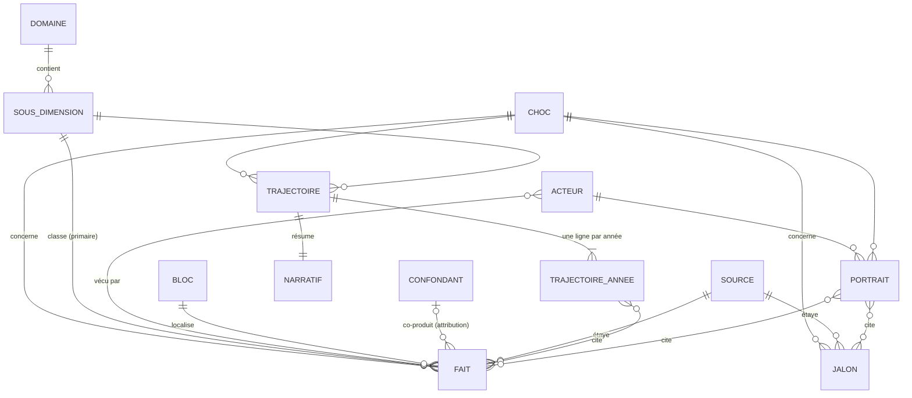

# Modèle de données

Schéma des enregistrements du dossier : faits, jalons, trajectoires, narratifs, portraits,
sources, confondants. Le support est du markdown (tableaux) pour rester lisible par tous ; la
structure est néanmoins normalisée pour qu'un fait n'existe qu'une fois et que toute vue le cite
par identifiant. Ce fichier est la référence pour écrire dans `par_dimension/`, `par_acteur/`
et `par_annee/`.

## Table of Contents

1. [Vue d'ensemble](#vue-d-ensemble) _(Lines 30-61)_
1. [Codes et vocabulaires](#codes-et-vocabulaires) _(Lines 64-83)_
1. [Enregistrements](#enregistrements) _(Lines 86-86)_
   1. [Fait](#fait) _(Lines 89-109)_
   1. [Jalon](#jalon) _(Lines 112-127)_
   1. [Trajectoire](#trajectoire) _(Lines 130-141)_
   1. [Narratif](#narratif) _(Lines 144-148)_
   1. [Portrait](#portrait) _(Lines 151-154)_
   1. [Source](#source) _(Lines 157-166)_
   1. [Confondant](#confondant) _(Lines 169-173)_
1. [Identifiants](#identifiants) _(Lines 176-191)_
1. [Où vit chaque enregistrement](#o-vit-chaque-enregistrement) _(Lines 194-210)_
1. [Règles d'intégrité](#r-gles-d-int-grit) _(Lines 213-224)_


---

## Vue d'ensemble
<!-- Lines 30-61 -->



Lecture : un **fait** est l'atome. Il appartient à un choc, à une sous-dimension primaire, à un
bloc, à une source ; il porte une attribution (choc, co-produit avec un confondant, exogène) et
zéro ou plusieurs acteurs. Un **jalon** est un événement daté, transversal aux dimensions. Une
**trajectoire** est la lecture année par année d'une sous-dimension pour un choc ; son
**narratif** la résume. Un **portrait** est la lecture d'un acteur pour un choc. Trajectoires et
portraits ne contiennent pas de faits : ils les citent.

---

## Codes et vocabulaires
<!-- Lines 64-83 -->

| Vocabulaire | Valeurs | Usage |
| --- | --- | --- |
| Choc | `INT` Internet 1995-2005 · `CLD` Cloud 2005-2015 · `IA` réservé à la session 2 | Préfixe des identifiants. |
| Domaine | `A` à `H` | Voir [01_dimensions.md](01_dimensions.md). `H` est l'énergie, hors ordre de retard. |
| Sous-dimension | `A1`…`A8`, `B1`…`B5`, `C1`…`C6`, `D1`…`D4`, `E1`…`E5`, `F1`…`F5`, `G1`…`G6`, `H1`…`H4` | Classement primaire d'un fait. |
| Acteur | `P1`…`P8`, `M1`…`M10`, `O1`…`O8`, `T1`…`T5` | Voir [02_acteurs.md](02_acteurs.md). Zéro ou plusieurs par fait. |
| Bloc | `US` · `EU` · `ASIE-E` · `CN` · `EMERG` · `MONDE` | Portée géographique du fait. `MONDE` si agrégat ou sans frontière. |
| Statut | `V` vérifié à la source · `K` connaissance à vérifier · `D` disputé | Voir standard de preuve. |
| Attribution | `choc` · `co:<ID confondant>` · `exo` | Voir [04_confondants.md](04_confondants.md). |
| Phase | `latent` · `émergence` · `accélération` · `crise` · `consolidation` · `banalisation` | Lecture partagée, pas un modèle. |
| Intensité | `0` rien de notable · `1` faible · `2` marqué · `3` rupture | Jugement dérivé, cité sur des faits. |
| Type de source | `stat` série statistique · `acad` académique · `off` officiel, loi, dépôt · `livre` ouvrage de référence · `presse` presse contemporaine de l'événement | Ordre de préférence décroissant. |

L'**intensité** est le seul champ de jugement du modèle. Elle permet une carte de chaleur
sous-dimension × année pour lire le rythme. Elle n'est jamais un fait ; chaque valeur non nulle
doit pouvoir pointer au moins un fait ou un jalon.

---

## Enregistrements
<!-- Lines 86-86 -->

### Fait
<!-- Lines 89-109 -->

Un énoncé daté, sourcé, classé. Un tableau par sous-dimension dans le fichier de domaine.

| Colonne | Contenu | Obligatoire |
| --- | --- | --- |
| `id` | `F.<CHOC>.<SD>.<nnn>` | oui |
| `année` | Année ou intervalle (`1999`, `1997-2001`) | oui |
| `bloc` | Code bloc | oui |
| `énoncé` | Une phrase, factuelle, sans adjectif d'appréciation | oui |
| `valeur` | Chiffre et unité si quantitatif, sinon vide | non |
| `acteurs` | Codes acteurs, séparés par des virgules | non |
| `attribution` | `choc`, `co:<ID>`, `exo` | oui |
| `source` | Clé locale `[S<n>]` renvoyant à la section Sources du fichier | oui |
| `statut` | `V`, `K`, `D` | oui |

Exemple de ligne, fictive dans sa valeur :

```
| F.INT.E1.003 | 2000 | US | La moitié des ménages dispose d'un accès à domicile. | 50 % des ménages | P3, P5 | choc | [S2] | K |
```

### Jalon
<!-- Lines 112-127 -->

Un événement daté qui marque une bascule, visible depuis plusieurs dimensions.

| Colonne | Contenu | Obligatoire |
| --- | --- | --- |
| `id` | `J.<CHOC>.<année>.<nn>` | oui |
| `date` | Au mois si possible (`1995-08`) | oui |
| `événement` | Une phrase | oui |
| `domaines` | Codes de sous-dimensions touchées, la primaire en premier | oui |
| `acteurs` | Codes acteurs | non |
| `bloc` | Code bloc | oui |
| `attribution` | `choc`, `co:<ID>`, `exo` ; les produits dérivés (téléphone intelligent, réseaux sociaux) suivent [04_confondants.md](04_confondants.md) | oui |
| `pourquoi` | En quoi c'est une bascule, une phrase | oui |
| `source` | Clé locale | oui |
| `statut` | `V`, `K`, `D` | oui |

### Trajectoire
<!-- Lines 130-141 -->

Une par sous-dimension et par choc. Un tableau à une ligne « avant t0 » et une ligne par année,
suivi du narratif.

| Colonne | Contenu |
| --- | --- |
| `année` | `avant t0`, puis `t0`…`t0+10` en années calendaires |
| `phase` | Vocabulaire des phases |
| `intensité` | 0 à 3 |
| `ce qui change` | Une ligne, au plus deux |
| `faits et jalons` | Identifiants cités |

### Narratif
<!-- Lines 144-148 -->

Trois à six phrases sous la trajectoire. Chaque phrase porte au moins un identifiant entre
crochets. Pas d'identifiant, pas de phrase. Aucune référence à l'autre choc ni au choc IA : la
comparaison vit dans le `README.md` du domaine, le transfert dans `synthese/`.

### Portrait
<!-- Lines 151-154 -->

Un par acteur retenu, les deux chocs dans le même fichier. Structure fixée dans
[02_acteurs.md](02_acteurs.md) § Ce qu'un portrait doit contenir. Cite, n'énonce pas.

### Source
<!-- Lines 157-166 -->

Section « Sources » en fin de chaque fichier de contenu. Clés locales `[S1]`, `[S2]`…

| Colonne | Contenu |
| --- | --- |
| `clé` | `[S<n>]` |
| `type` | `stat`, `acad`, `off`, `livre`, `presse` |
| `référence` | Auteur ou institution, titre, année, série ou identifiant, URL stable si disponible |
| `note` | Ce qu'on en a tiré, précaution éventuelle |

### Confondant
<!-- Lines 169-173 -->

Défini et numéroté dans [04_confondants.md](04_confondants.md), pas dans les fichiers de contenu.

---

## Identifiants
<!-- Lines 176-191 -->

| Objet | Format | Exemple | Règle |
| --- | --- | --- | --- |
| Fait | `F.<CHOC>.<SD>.<nnn>` | `F.CLD.A4.012` | Séquence par sous-dimension et par choc, trois chiffres. |
| Jalon | `J.<CHOC>.<année>.<nn>` | `J.INT.2000.03` | Séquence par année et par choc. |
| Trajectoire | `T.<CHOC>.<SD>` | `T.INT.F1` | Unique par cellule. |
| Portrait | `P.<CHOC>.<fichier>` | `P.CLD.agriculteurs` | Un par choc dans le fichier de l'acteur. |
| Confondant | `X.<CHOC>.<nn>` | `X.CLD.02` | Défini dans le registre. |
| Source | `[S<n>]` | `[S4]` | Locale au fichier. |

**Stabilité.** Un identifiant émis ne change jamais. Un fait retiré garde sa ligne avec la
mention `retiré` dans l'énoncé et un motif court. On n'insère jamais au milieu d'une séquence.
Les fichiers qui citent un identifiant n'ont pas à être modifiés quand le fait est corrigé.

---

## Où vit chaque enregistrement
<!-- Lines 194-210 -->

| Enregistrement | Emplacement unique | Cité depuis |
| --- | --- | --- |
| Fait | `par_dimension/<domaine>/<choc>.md` (ou `<choc>_<bloc>.md` pour un domaine scindé par bloc, D18), tableau de sa sous-dimension primaire | Trajectoires, narratifs, portraits, chronologies, synthèses |
| Jalon | `par_annee/<choc>.md`, tableau de son année | Fichiers de domaine (liste d'identifiants par sous-dimension), portraits |
| Trajectoire et narratif | `par_dimension/<domaine>/<choc>.md`, section de la sous-dimension | Synthèse du domaine |
| Portrait | `par_acteur/<acteur>.md` | Synthèses |
| Source | Section Sources du fichier qui contient le fait ou le jalon | Faits et jalons du même fichier |
| Confondant | `04_confondants.md` | Colonne attribution des faits |
| Comparaison des deux chocs | `par_dimension/<domaine>/README.md` | Session 2 |

Un jalon découvert en travaillant une dimension est **ajouté dans `par_annee/`** et seulement
référencé dans le fichier de domaine. C'est le seul cas où travailler une cellule modifie un
autre fichier.

---

## Règles d'intégrité
<!-- Lines 213-224 -->

Invariants à vérifier avant de clore une cellule. Une passe `grep` suffit pour la plupart.

1. Tout identifiant cité existe dans son fichier d'origine.
2. Tout fait `V` a une clé de source qui existe dans la section Sources du fichier.
3. Toute attribution `co:<ID>` renvoie à un confondant défini dans le registre.
4. Toute intensité non nulle cite au moins un fait ou un jalon.
5. Toute phrase de narratif porte au moins un identifiant.
6. Aucun fichier de `par_dimension/`, `par_acteur/`, `par_annee/` ne contient les mots
   « LLM », « agent » au sens IA, « IA générative », « ChatGPT ».
7. Les séquences d'identifiants sont sans trou non expliqué.
8. Un énoncé de fait n'apparaît qu'une fois dans le dossier.
