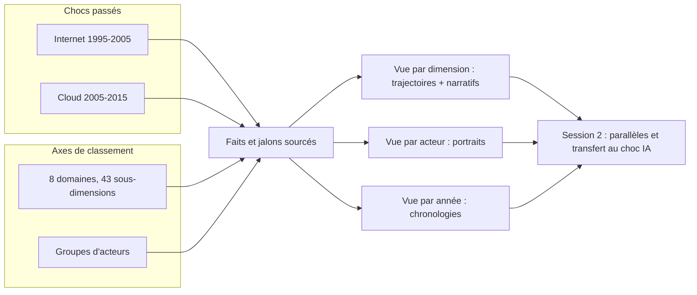

# ai_evolution — Deux chocs passés pour lire le choc IA

**But (niveau 0) :** construire un dossier historique, structuré et sourcé, sur ce qui a changé
pendant les dix années qui ont suivi deux chocs technologiques majeurs, la généralisation
d'Internet (1995-2005) et le passage au cloud (2005-2015), afin de disposer d'une base
factuelle pour lire, dans une seconde session, le choc en cours des LLM et des systèmes
agentiques (t0 = novembre 2022) sans spéculer.

Outil de pensée à vocation grand public. Rédigé en français, sources citées dans leur langue.

## Table of Contents

1. [Routage — lire ceci d'abord](#routage-lire-ceci-d-abord) _(Lines 26-43)_
1. [Les trois chocs](#les-trois-chocs) _(Lines 46-59)_
1. [Ce que le dossier n'est pas](#ce-que-le-dossier-n-est-pas) _(Lines 62-73)_
1. [Structure](#structure) _(Lines 76-132)_
1. [Statut et phases](#statut-et-phases) _(Lines 135-148)_
   1. [Résultats déjà acquis, à ne pas re-chercher](#r-sultats-d-j-acquis-ne-pas-re-chercher) _(Lines 151-169)_


---

## Routage — lire ceci d'abord
<!-- Lines 26-43 -->

| Votre besoin | Lire exactement ceci |
| --- | --- |
| Comprendre la thèse, la méthode, les fenêtres temporelles | [00_these_et_methode.md](00_these_et_methode.md) |
| Savoir quelles dimensions on suit, et pourquoi celles-là | [01_dimensions.md](01_dimensions.md) |
| Savoir quels groupes d'acteurs on suit | [02_acteurs.md](02_acteurs.md) |
| Écrire ou lire un fait, un jalon, une trajectoire, un portrait | [03_modele_de_donnees.md](03_modele_de_donnees.md) |
| Attribuer un changement au choc plutôt qu'à autre chose | [04_confondants.md](04_confondants.md) |
| Travailler comme agent IA sur ce dossier | [CLAUDE.md](CLAUDE.md) |
| Contenu : un domaine pour un choc | `par_dimension/<domaine>/<choc>.md` |
| Contenu : un axe transversal aux domaines (accaparement, D19) | `par_dimension/transversal/<axe>.md` |
| Contenu : un groupe d'acteurs à travers les deux chocs | `par_acteur/<acteur>.md` |
| Contenu : le rythme, année par année | `par_annee/<choc>.md` |
| Parallèles entre chocs et transfert au choc IA (session 2) | `synthese/` |
| Gabarits de fichiers de contenu | [gabarits/](gabarits/) |

---

## Les trois chocs
<!-- Lines 46-59 -->

| Choc | Fenêtre | Essence en une ligne | Rôle dans le dossier |
| --- | --- | --- | --- |
| **Internet** | 1995-2005 | L'interconnexion universelle : n'importe qui atteint n'importe quelle information, personne ou service. | Analogue **primaire** pour l'économie, la culture, la société, la politique. |
| **Cloud** | 2005-2015 | L'industrialisation de l'informatique : des usines produisent des services numériques consommés à la demande. | Analogue **primaire** pour l'industrie et l'infrastructure. Même niveau de rupture qu'Internet, à l'échelle de la société entière. |
| **LLM et agents** | 2022- | L'arrivée du non-structuré : des machines qui reçoivent, traitent et produisent du non-structuré, en format et en méthode. | **Cible.** Absente des fichiers historiques. Traitée uniquement dans `synthese/`, session 2. |

Chaque choc est traité comme un **traitement** au sens expérimental : on observe, dimension par
dimension et année par année, ce qui varie après son introduction, en tenant compte des autres
causes possibles (voir [04_confondants.md](04_confondants.md)). On ne cherche pas une réponse
binaire avant/après, mais la **forme de la variation dans le temps** : rythme, jalons, retards.

---

## Ce que le dossier n'est pas
<!-- Lines 62-73 -->

- **Pas une revue d'opinions.** Aucune recherche web générique, aucune moyenne des avis. Chaque
  fait est ancré dans une source admissible (séries statistiques, travaux académiques, rapports
  officiels, documents primaires, ouvrages de référence, presse contemporaine de l'événement).
- **Pas du journalisme.** Les narratifs font quelques phrases et pointent vers des faits identifiés.
- **Pas une prédiction.** Les fichiers historiques ne parlent pas d'IA. Le transfert au choc IA
  est une étape séparée, en session 2, dans `synthese/`.
- **Pas un cadre théorique strict.** On emprunte du vocabulaire à l'économie et à la science
  politique quand il aide à nommer, sans s'y enfermer.

---

## Structure
<!-- Lines 76-132 -->

Deux axes orthogonaux classent chaque fait : **la dimension** (quel aspect de la société a changé)
et **l'acteur** (qui l'a vécu). Trois vues en sont dérivées.



```
ai_evolution/
├── README.md                  ← vous êtes ici
├── CLAUDE.md                  ← règles pour les agents
├── 00_these_et_methode.md     ← niveau 0 : but, hypothèse, méthode, fenêtres
├── 01_dimensions.md           ← axe 1 : taxonomie des dimensions (8 domaines, A à H)
├── 02_acteurs.md              ← axe 2 : taxonomie des acteurs et portraits retenus
├── 03_modele_de_donnees.md    ← schéma des enregistrements, identifiants, statuts
├── 04_confondants.md          ← registre des autres causes, règles d'attribution
├── gabarits/                  ← modèles de fichiers de contenu
├── par_dimension/             ← vue 1 : <domaine>/<choc>.md
│   ├── A_industrie/           (internet.md = bâtisseurs A1-A4, internet_utilisatrices.md = A5-A8,
│   │                           cloud.md, README.md = comparaison)
│   ├── B_finance/
│   ├── C_economie/
│   ├── D_travail/
│   ├── E_vie_quotidienne/
│   ├── F_culture/
│   ├── G_politique/
│   ├── H_energie/             (facteur de production, hors ordre de retard)
│   └── transversal/           (axes qui traversent les domaines : accaparement.md, D19)
├── par_acteur/                ← vue 2 : un fichier par portrait, les deux chocs dedans
├── par_annee/                 ← vue 3 : internet_1995_2005.md, cloud_2005_2015.md
└── synthese/                  ← session 2 : parallèles, hypothèses testées, transfert IA
```

**Règle de normalisation :** un fait vit à un seul endroit, le fichier de sa sous-dimension
primaire. Les portraits et chronologies le **citent par identifiant**, sans le recopier.

---

## Statut et phases
<!-- Lines 135-148 -->

| Phase | Contenu | Statut |
| --- | --- | --- |
| 0. Structure | Thèse, méthode, taxonomies, modèle, confondants, gabarits | ✅ validée |
| 1. Squelette chronologique | Jalons majeurs par année, tous domaines dont H, pour chaque choc | ✅ livrée : `par_annee/internet_1995_2005.md` (93 jalons), `par_annee/cloud_2005_2015.md` (83 jalons) |
| 2. Collecte par cellule | Faits, jalons, trajectoires pour chaque (domaine × choc) | 🚧 Taxonomie refondue après relecture de la fenêtre Internet (décision D18, 43 sous-dimensions). **Internet** : refonte intégrée, domaine A scindé en bâtisseurs et utilisatrices ; 410 faits, 173 vérifiés à la source (42 %). **Cloud** : les huit nouvelles sous-dimensions (A6-A8, B4-B5, F5, G5-G6) restent à collecter. Dossier entier : 712 faits dont 6 retirés ; 285 `V` (40 % des faits actifs), 415 `K`, 8 `D`. Règles d'intégrité 1 à 7 satisfaites |
| 3. Narratifs | Quelques phrases par sous-dimension et par choc, pointant les faits | 🚧 premier jet : 70 narratifs, chaque phrase porte un identifiant. Relecture de fond à faire |
| 4. Portraits d'acteurs | Un fichier par groupe retenu, les deux chocs traversés | ⬜ |
| 5. Synthèse par domaine | Les deux chocs côte à côte ; rythme ; hypothèses H1-H4 testées | ⬜ |
| Session 2. Transfert | Parallèles avec le choc IA, extrapolation encadrée | ⬜ |

L'ordre est voulu : les jalons d'abord (phase 1) fixent le rythme avant que les faits ne
remplissent les dimensions (phase 2). Les narratifs ne viennent qu'une fois les faits posés.

### Résultats déjà acquis, à ne pas re-chercher
<!-- Lines 151-169 -->

Trois constats sortis de la collecte, tous adossés à des sources ouvertes et lues. Ils ne sont
pas des conclusions du dossier : la synthèse de phase 5 les tranchera. Ils sont notés ici pour
qu'aucune vague suivante ne les redécouvre ni ne les contredise sans preuve.

1. **Pas de rupture de productivité avant la crise de 2008.** La productivité du travail du
   secteur privé non agricole américain croît de 2,48 % par an sur 1995-2000, 2,59 % sur
   2000-2007, puis 1,52 % sur 2009-2015. La rupture est postérieure à 2009, pas au milieu des
   années 2000 comme on le suppose souvent. Voir `C_economie/cloud.md` § C1, faits vérifiés.
   Réserve (décision D17) : série américaine seule, mesurée en valeur ajoutée ; à relire
   sur un panel multi-pays avant d'en tirer une conclusion.
2. **Le choc à fort gain de productivité s'est déroulé en énergie bon marché.** L'accélération
   de 1996-1999 coïncide avec le point bas du prix du pétrole ; la décennie du cloud, elle,
   associe ralentissement de la productivité et découplage entre consommation des centres de
   données et service rendu. La forme forte de l'hypothèse H5 n'est pas soutenue en l'état.
3. **Construire des usines ne crée pas d'emplois d'exploitation proportionnels.** L'emploi
   américain du traitement de données et de l'hébergement recule de 288 600 en 2003 à 248 000
   en 2010, pendant la construction massive des centres de données. Voir `D_travail/cloud.md`
   § D1, série vérifiée.
