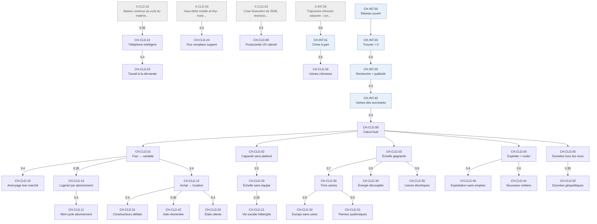

# Arbre des effets — Cloud 2005-2015

Statut : **première version, format abandonné** (voir [README.md § Journal](README.md#journal)) ; à refaire au format de [internet/](internet/README.md). Les renvois `CH.INT.*` pointent vers une version supprimée ; la vue calculée a été produite par un script retiré.
Méthode, sémantique des liens et lecture : [README.md](README.md). Les identifiants `CH.INT.*`
renvoient à [internet.md](internet.md).

## Table of Contents

1. [Racine, amont et leviers](#racine-amont-et-leviers)
1. [Changements](#changements)
1. [Liens](#liens)
1. [Vue calculée](#vue-calcul-e)

---

## Racine, amont et leviers
<!-- Lines 18-36 -->

**Racine (CH.CLD.00).** La capacité de calcul se loue à l'unité à quelques usines : produire et
exploiter un service numérique ne demande plus de posséder l'usine. Bascule en 2006, avec le
stockage loué au gigaoctet puis les machines louées à l'heure [F.CLD.A1.003, F.CLD.A1.004].

**Amont.** Contrairement à la racine d'Internet, celle du cloud a des parents **dans la fenêtre
précédente** : les usines construites par les survivants du Web pour leurs propres besoins
[CH.INT.45], et la bande passante bradée après le krach [CH.INT.41]. Les autres parents sont des
prérequis du registre : virtualisation [X.CLD.09], code ouvert [X.CLD.06], haut débit [X.CLD.04],
baisse du coût du matériel [X.CLD.10]. Les poids sont dans le tableau des liens.

**Cinq leviers**, valables pour quiconque produit un service numérique : le coût fixe devient
variable (01), la capacité suit la demande (02), la taille abaisse le coût unitaire (03),
exploiter devient écrire du logiciel (04), les données quittent les murs de leur propriétaire
(05). Les trois premiers sont des baisses de coût ; 04 change la nature d'un métier ; 05 déplace
le lieu du contrôle.

---

## Changements
<!-- Lines 39-75 -->

Mêmes colonnes que [internet.md](internet.md). CH.CLD.22 et CH.CLD.23 sont les confondants
X.CLD.01 et X.CLD.08 du registre, traités ici comme des changements ayant leurs propres parents.

| id | étiquette | changement | qui | échelle | ampleur | appui |
| --- | --- | --- | --- | --- | --- | --- |
| CH.CLD.00 | Calcul loué | La capacité de calcul se loue à l'unité à quelques usines ; produire un service ne demande plus de posséder l'usine. | toute organisation qui produit du logiciel | M | 3 | F.CLD.A1.003, F.CLD.A1.004, F.CLD.A4.003 |
| CH.CLD.01 | Fixe → variable | Lancer un service ne demande plus d'investissement initial : le coût fixe devient variable. | créateurs, équipes | S | 3 | F.CLD.B1.009, F.CLD.A4.005, F.CLD.C4.001 |
| CH.CLD.02 | Capacité sans plafond | La capacité suit la demande sans plafond ni reconstruction. | services en croissance | S | 3 | F.CLD.A4.001, F.CLD.A4.002, F.CLD.D3.002 |
| CH.CLD.03 | Échelle gagnante | La taille abaisse le coût unitaire : l'usine la plus grande gagne. | fournisseurs, marché de l'informatique | S | 3 | F.CLD.H1.006, F.CLD.A1.006, F.CLD.C5.002 |
| CH.CLD.04 | Exploiter = coder | Exploiter une infrastructure devient écrire du logiciel. | métiers de l'exploitation | S | 2 | F.CLD.A4.006, F.CLD.A4.007, F.CLD.A4.009, F.CLD.A2.005 |
| CH.CLD.05 | Données hors les murs | Les données et les traitements quittent les murs de leur propriétaire. | organisations, particuliers | M | 2 | F.CLD.F3.001, F.CLD.A5.006, F.CLD.E5.005 |
| CH.CLD.10 | Amorçage bon marché | Le coût d'amorçage s'effondre, les jeunes pousses logicielles se multiplient. | fondateurs, capital-risque | S | 2 | F.CLD.B1.008, F.CLD.B1.009 |
| CH.CLD.11 | Mini-cycle abonnement | Le logiciel par abonnement vit un cycle de valorisation, puis un recul en 2015. | investisseurs | S | 1 | F.CLD.B2.004, F.CLD.B2.006, F.CLD.B2.007 |
| CH.CLD.12 | Achat → location | Les organisations passent de l'achat de machines à la location de service et ferment leurs centres. | directions informatiques, administrations | S | 3 | F.CLD.C2.002, F.CLD.A4.004, F.CLD.A4.008, F.CLD.G3.004 |
| CH.CLD.13 | Logiciel par abonnement | Le logiciel se vend par abonnement plutôt que par licence. | éditeurs, clients | S | 2 | F.CLD.C4.002, F.CLD.C4.003, F.CLD.A5.002, F.CLD.A5.003 |
| CH.CLD.20 | Échelle sans équipe | Des services atteignent des centaines de millions d'usagers avec quelques dizaines de personnes. | fondateurs ; usagers | S | 3 | F.CLD.A4.001, F.CLD.A4.002, F.CLD.D3.002, F.CLD.E2.002 |
| CH.CLD.21 | Vie sociale hébergée | La vie sociale, la photo, la vidéo et la messagerie passent par des services hébergés gratuits. | grand public | M | 2 | F.CLD.F4.003, F.CLD.E2.004, F.CLD.E4.005, F.CLD.C4.004 |
| CH.CLD.22 | Téléphone intelligent | Le téléphone intelligent devient le terminal principal. | grand public | M | 3 | F.CLD.E1.009, F.CLD.E1.008 |
| CH.CLD.23 | Travail à la demande | Le travail à la demande par plateforme apparaît. | chauffeurs, livreurs, hôtes | G | 1 | F.CLD.C4.005, F.CLD.D3.004 |
| CH.CLD.24 | Flux remplace support | La vidéo et la musique en flux remplacent le support physique. | foyers, industries culturelles | S | 2 | F.CLD.E4.001, F.CLD.E4.004, F.CLD.E4.008 |
| CH.CLD.30 | Trois usines | Trois fournisseurs dominent la capacité louée ; l'échelle est la barrière à l'entrée. | marché mondial | M | 3 | F.CLD.C5.001, F.CLD.C5.002, F.CLD.A3.004, F.CLD.B3.009 |
| CH.CLD.31 | Constructeurs défaits | Les constructeurs historiques de serveurs reculent, se scindent ou se vendent. | constructeurs et éditeurs historiques | S | 2 | F.CLD.B3.004, F.CLD.B3.006, F.CLD.A3.003, F.CLD.C5.008 |
| CH.CLD.32 | Europe sans usine | L'Europe n'a pas d'usine à l'échelle mondiale et ses clouds souverains échouent. | Union européenne | N | 2 | F.CLD.B3.008, F.CLD.A3.006, F.CLD.G3.007, F.CLD.G3.008 |
| CH.CLD.33 | Usines chinoises | La Chine bâtit ses propres usines. | Chine | N | 2 | F.CLD.G4.002, F.CLD.A3.005, F.CLD.C3.006 |
| CH.CLD.34 | Énergie découplée | La consommation électrique des centres de données se découple du service rendu. | système électrique | M | 2 | F.CLD.H1.003, F.CLD.H1.004, F.CLD.H1.008, F.CLD.H1.009 |
| CH.CLD.35 | Usines électriques | Les usines deviennent des acteurs de l'électricité : sites près de l'hydraulique, contrats renouvelables. | exploitants, producteurs d'électricité | S | 1 | F.CLD.H2.001, F.CLD.H2.003, F.CLD.H2.004 |
| CH.CLD.40 | Exploitation sans emplois | L'emploi de l'exploitation recule pendant qu'on construit les usines. | techniciens d'exploitation | G | 2 | F.CLD.D1.003, F.CLD.D2.007 |
| CH.CLD.41 | Nouveaux métiers | De nouveaux métiers apparaissent : exploitation par le développement, fiabilité, architecture cloud. | informaticiens | G | 2 | F.CLD.D2.003, F.CLD.D2.004, F.CLD.D2.006, F.CLD.D1.005 |
| CH.CLD.42 | Inde réorientée | La sous-traitance indienne passe de la gestion de parcs à d'autres services. | Inde | N | 1 | F.CLD.A5.005, F.CLD.C3.002 |
| CH.CLD.50 | Données géopolitiques | L'accès des États aux données hébergées devient une question géopolitique. | nations | N | 3 | F.CLD.G4.003, F.CLD.G1.008, F.CLD.G4.006, F.CLD.G1.011 |
| CH.CLD.51 | Pannes systémiques | Une panne d'usine arrête des milliers de services à la fois. | services dépendants | S | 1 | F.CLD.C5.004, F.CLD.F3.006 |
| CH.CLD.52 | États clients | Les États achètent et normalisent le cloud. | administrations | N | 2 | F.CLD.G2.002, F.CLD.G3.002, F.CLD.G1.003, F.CLD.G3.005, F.CLD.G4.010 |
| CH.CLD.60 | Productivité US ralentit | La productivité américaine ralentit après 2009. | États-Unis | N | 2 | F.CLD.C1.004, F.CLD.C1.005 |

---

## Liens
<!-- Lines 78-156 -->

Mêmes types et même sémantique que [internet.md](internet.md).

| de | vers | type | poids | certitude | mécanisme |
| --- | --- | --- | --- | --- | --- |
| CH.INT.45 | CH.CLD.00 | cause | 0.4 | i | Les survivants du Web ont déjà l'usine et le savoir-faire ; louer l'excédent devient un métier. |
| X.CLD.09 | CH.CLD.00 | condition | 0.2 | i | La virtualisation découple le service de la machine physique. |
| X.CLD.06 | CH.CLD.00 | condition | 0.15 | i | Le code ouvert fournit système et hyperviseur sans licence par machine. |
| CH.INT.41 | CH.CLD.00 | condition | 0.1 | i | La bande passante bradée rend l'usine lointaine aussi proche que la salle machine. |
| X.CLD.04 | CH.CLD.00 | condition | 0.05 | i | Le haut débit côté client. |
| X.CLD.10 | CH.CLD.00 | cause | 0.05 | i | Le matériel moins cher abaisse le prix de revient de l'usine. |
| CH.CLD.00 | CH.CLD.01 | composante | 1 | f | On paie à l'heure et au gigaoctet. |
| CH.CLD.00 | CH.CLD.02 | composante | 1 | f | Une machine se démarre et s'arrête par programme. |
| CH.CLD.00 | CH.CLD.03 | composante | 1 | f | Un fournisseur mutualise des millions de clients. |
| CH.CLD.00 | CH.CLD.04 | composante | 1 | f | L'infrastructure se pilote par interface programmable. |
| CH.CLD.00 | CH.CLD.05 | composante | 1 | f | Les données résident chez le fournisseur. |
| CH.CLD.01 | CH.CLD.10 | cause | 0.4 | i | Une jeune pousse n'achète plus de serveur. |
| X.CLD.03 | CH.CLD.10 | cause | 0.35 | f | Taux proches de zéro : le capital cherche du rendement [F.CLD.B1.013]. |
| CH.CLD.22 | CH.CLD.10 | cause | 0.15 | i | Les magasins d'applications ouvrent un marché. |
| CH.CLD.10 | CH.CLD.11 | cause | 0.3 | i | Beaucoup d'entrants financés. |
| CH.CLD.13 | CH.CLD.11 | cause | 0.4 | i | Les revenus récurrents se valorisent en multiple du chiffre d'affaires. |
| X.CLD.03 | CH.CLD.11 | cause | 0.2 | i | Taux bas, multiples hauts. |
| CH.CLD.01 | CH.CLD.12 | cause | 0.4 | i | La dépense de capital devient une dépense de fonctionnement. |
| X.CLD.03 | CH.CLD.12 | cause | 0.3 | i | La crise gèle les budgets d'investissement. |
| CH.CLD.03 | CH.CLD.12 | cause | 0.2 | i | Le service loué coûte moins cher que la salle machine. |
| CH.CLD.01 | CH.CLD.13 | cause | 0.35 | i | Le client paie à l'usage, l'éditeur facture à l'usage. |
| CH.CLD.04 | CH.CLD.13 | cause | 0.2 | i | Une seule version, mise à jour en continu. |
| CH.CLD.05 | CH.CLD.13 | cause | 0.2 | i | Le logiciel tourne chez l'éditeur, pas chez le client. |
| CH.CLD.02 | CH.CLD.20 | cause | 0.5 | i | Plus besoin de prévoir la charge ni de construire à l'avance. |
| X.CLD.04 | CH.CLD.20 | condition | 0.2 | i | Les usagers ont le débit pour la vidéo et la photo. |
| CH.CLD.22 | CH.CLD.20 | cause | 0.15 | i | Un terminal toujours connecté multiplie les usagers. |
| CH.CLD.20 | CH.CLD.21 | cause | 0.35 | f | Le réseau social de référence dépasse 600 millions d'usagers fin 2010, surtout sur ordinateur [F.CLD.F4.003, F.CLD.E1.009]. |
| CH.CLD.22 | CH.CLD.21 | cause | 0.25 | i | La photo et le message partent du téléphone. |
| X.CLD.04 | CH.CLD.21 | condition | 0.15 | i | Débit mobile et fixe. |
| CH.INT.33 | CH.CLD.21 | cause | 0.1 | i | Le modèle gratuit financé par la publicité est hérité de la recherche. |
| X.CLD.10 | CH.CLD.22 | cause | 0.35 | i | Miniaturisation : processeur, écran tactile, batterie. |
| X.CLD.04 | CH.CLD.22 | condition | 0.3 | i | Réseau mobile de troisième puis quatrième génération. |
| CH.CLD.05 | CH.CLD.22 | cause | 0.15 | i | Synchronisation et applications adossées à des usines. |
| CH.INT.00 | CH.CLD.22 | condition | 0.1 | i | Le terminal donne accès au réseau universel. |
| CH.CLD.22 | CH.CLD.23 | cause | 0.4 | i | Localisation et connexion permanente de chaque travailleur. |
| X.CLD.03 | CH.CLD.23 | cause | 0.25 | i | Un marché du travail détendu fournit la main-d'œuvre. |
| CH.CLD.02 | CH.CLD.23 | cause | 0.15 | i | La plateforme monte en charge ville après ville. |
| X.CLD.04 | CH.CLD.24 | condition | 0.4 | i | Le débit domestique rend le flux vidéo possible. |
| CH.CLD.02 | CH.CLD.24 | cause | 0.3 | i | Les pics de consommation du soir absorbés par capacité louée. |
| CH.CLD.03 | CH.CLD.24 | cause | 0.1 | i | Le coût par gigaoctet servi baisse. |
| CH.CLD.03 | CH.CLD.30 | cause | 0.7 | i | Rendements croissants de l'usine. |
| CH.INT.45 | CH.CLD.30 | cause | 0.2 | i | Les gagnants sont ceux qui avaient déjà l'usine. |
| CH.CLD.30 | CH.CLD.03 | boucle | 0.3 | i | Plus de clients, plus d'échelle, prix plus bas, plus de clients. |
| CH.CLD.30 | CH.CLD.31 | cause | 0.3 | i | Les usines achètent du matériel sur mesure, pas du catalogue. |
| CH.CLD.12 | CH.CLD.31 | cause | 0.4 | i | Les clients d'entreprise n'achètent plus de serveurs. |
| X.CLD.03 | CH.CLD.31 | cause | 0.1 | i | La crise comprime l'investissement matériel. |
| CH.CLD.30 | CH.CLD.32 | cause | 0.6 | i | L'échelle est la barrière ; l'entrée tardive sur fonds publics ne la franchit pas. |
| CH.INT.36 | CH.CLD.32 | cause | 0.2 | i | L'Europe n'a pas eu de survivant du Web, donc pas d'usine à louer. |
| CH.INT.61 | CH.CLD.33 | cause | 0.5 | i | Un écosystème national séparé appelle ses propres usines. |
| CH.CLD.30 | CH.CLD.33 | cause | 0.2 | i | La même logique d'échelle, sur un marché fermé. |
| CH.CLD.03 | CH.CLD.34 | cause | 0.5 | i | La grande usine optimise son rendement énergétique [F.CLD.H1.006]. |
| X.CLD.09 | CH.CLD.34 | cause | 0.25 | f | La consolidation des serveurs ralentit la croissance de la consommation [F.CLD.H1.008]. |
| X.CLD.03 | CH.CLD.34 | cause | 0.1 | f | La récession freine aussi la construction [F.CLD.H1.008]. |
| CH.CLD.03 | CH.CLD.35 | cause | 0.6 | i | À cette échelle, l'électricité devient le premier coût et le premier critère de site. |
| X.CLD.11 | CH.CLD.35 | cause | 0.2 | i | Baisse du coût des renouvelables. |
| CH.CLD.04 | CH.CLD.40 | cause | 0.4 | i | Un technicien gère des milliers de machines par logiciel. |
| CH.CLD.03 | CH.CLD.40 | cause | 0.3 | i | La consolidation supprime les salles machines dispersées. |
| X.CLD.03 | CH.CLD.40 | cause | 0.2 | i | Récession. |
| CH.CLD.04 | CH.CLD.41 | cause | 0.6 | i | L'exploitation devient un travail de développeur. |
| CH.CLD.10 | CH.CLD.41 | cause | 0.2 | i | La demande des jeunes pousses. |
| CH.CLD.04 | CH.CLD.42 | cause | 0.35 | i | La gestion de parcs s'automatise. |
| CH.CLD.12 | CH.CLD.42 | cause | 0.45 | i | Les parcs à gérer disparaissent chez les clients. |
| CH.CLD.05 | CH.CLD.50 | cause | 0.35 | i | Les données d'un pays résident chez un fournisseur d'un autre pays. |
| CH.CLD.30 | CH.CLD.50 | cause | 0.25 | i | Ces fournisseurs sont trois, et américains. |
| X.CLD.07 | CH.CLD.50 | cause | 0.3 | i | Les révélations de 2013 rendent l'accès visible. |
| CH.CLD.30 | CH.CLD.51 | cause | 0.5 | i | Des milliers de services dans la même usine. |
| CH.CLD.05 | CH.CLD.51 | cause | 0.4 | i | Le client n'a plus de copie locale. |
| CH.CLD.12 | CH.CLD.52 | cause | 0.4 | i | L'État fait le même calcul que l'entreprise. |
| CH.CLD.01 | CH.CLD.52 | cause | 0.3 | i | Économies budgétaires affichées. |
| X.CLD.03 | CH.CLD.60 | cause | 0.5 | i | Crise, désendettement, investissement faible. |
| CH.CLD.12 | CH.CLD.60 | freine | 0.1 | i | La location de service apporte un gain réel mais faible et différé. |

---

## Vue calculée
<!-- Lines 159-276 -->

Générée par [calcul_parts.py](calcul_parts.py) à partir des deux tableaux ci-dessus. Ne pas
éditer à la main.

<!-- GENERE:debut -->

Arbre des parents principaux. Gris : confondant du registre. Bleu : changement de l'autre fichier. Les parents secondaires sont dans le tableau.

| id | étiquette | chaîne principale mène à | parent principal | autres parents | reste | part Internet | part cloud |
| --- | --- | --- | --- | --- | --- | --- | --- |
| CH.CLD.00 | Calcul loué | CH.INT.00 | CH.INT.45 (0.4) | X.CLD.09 (0.2), X.CLD.06 (0.15), CH.INT.41 (0.1), X.CLD.04 (0.05), X.CLD.10 (0.05) | 0.05 | 0.27 | 1.00 |
| CH.CLD.01 | Fixe → variable | CH.INT.00 | CH.CLD.00 | — | — | 0.27 | 1.00 |
| CH.CLD.02 | Capacité sans plafond | CH.INT.00 | CH.CLD.00 | — | — | 0.27 | 1.00 |
| CH.CLD.03 | Échelle gagnante | CH.INT.00 | CH.CLD.00 | — | — | 0.27 | 1.00 |
| CH.CLD.04 | Exploiter = coder | CH.INT.00 | CH.CLD.00 | — | — | 0.27 | 1.00 |
| CH.CLD.05 | Données hors les murs | CH.INT.00 | CH.CLD.00 | — | — | 0.27 | 1.00 |
| CH.CLD.10 | Amorçage bon marché | CH.INT.00 | CH.CLD.01 (0.4) | X.CLD.03 (0.35), CH.CLD.22 (0.15) | 0.10 | 0.13 | 0.42 |
| CH.CLD.11 | Mini-cycle abonnement | CH.INT.00 | CH.CLD.13 (0.4) | CH.CLD.10 (0.3), X.CLD.03 (0.2) | 0.10 | 0.12 | 0.43 |
| CH.CLD.12 | Achat → location | CH.INT.00 | CH.CLD.01 (0.4) | X.CLD.03 (0.3), CH.CLD.03 (0.2) | 0.10 | 0.16 | 0.60 |
| CH.CLD.13 | Logiciel par abonnement | CH.INT.00 | CH.CLD.01 (0.35) | CH.CLD.04 (0.2), CH.CLD.05 (0.2) | 0.25 | 0.20 | 0.75 |
| CH.CLD.20 | Échelle sans équipe | CH.INT.00 | CH.CLD.02 (0.5) | X.CLD.04 (0.2), CH.CLD.22 (0.15) | 0.15 | 0.15 | 0.52 |
| CH.CLD.21 | Vie sociale hébergée | CH.INT.00 | CH.CLD.20 (0.35) | CH.CLD.22 (0.25), X.CLD.04 (0.15), CH.INT.33 (0.1) | 0.15 | 0.17 | 0.22 |
| CH.CLD.22 | Téléphone intelligent | X.CLD.10 | X.CLD.10 (0.35) | X.CLD.04 (0.3), CH.CLD.05 (0.15), CH.INT.00 (0.1) | 0.10 | 0.14 | 0.15 |
| CH.CLD.23 | Travail à la demande | X.CLD.10 | CH.CLD.22 (0.4) | X.CLD.03 (0.25), CH.CLD.02 (0.15) | 0.20 | 0.10 | 0.21 |
| CH.CLD.24 | Flux remplace support | X.CLD.04 | X.CLD.04 (0.4) | CH.CLD.02 (0.3), CH.CLD.03 (0.1) | 0.20 | 0.11 | 0.40 |
| CH.CLD.30 | Trois usines | CH.INT.00 | CH.CLD.03 (0.7) | CH.INT.45 (0.2) | 0.10 | 0.31 | 0.70 |
| CH.CLD.31 | Constructeurs défaits | CH.INT.00 | CH.CLD.12 (0.4) | CH.CLD.30 (0.3), X.CLD.03 (0.1) | 0.20 | 0.16 | 0.45 |
| CH.CLD.32 | Europe sans usine | CH.INT.00 | CH.CLD.30 (0.6) | CH.INT.36 (0.2) | 0.20 | 0.29 | 0.42 |
| CH.CLD.33 | Usines chinoises | X.INT.09 | CH.INT.61 (0.5) | CH.CLD.30 (0.2) | 0.30 | 0.21 | 0.14 |
| CH.CLD.34 | Énergie découplée | CH.INT.00 | CH.CLD.03 (0.5) | X.CLD.09 (0.25), X.CLD.03 (0.1) | 0.15 | 0.13 | 0.50 |
| CH.CLD.35 | Usines électriques | CH.INT.00 | CH.CLD.03 (0.6) | X.CLD.11 (0.2) | 0.20 | 0.16 | 0.60 |
| CH.CLD.40 | Exploitation sans emplois | CH.INT.00 | CH.CLD.04 (0.4) | CH.CLD.03 (0.3), X.CLD.03 (0.2) | 0.10 | 0.19 | 0.70 |
| CH.CLD.41 | Nouveaux métiers | CH.INT.00 | CH.CLD.04 (0.6) | CH.CLD.10 (0.2) | 0.20 | 0.19 | 0.68 |
| CH.CLD.42 | Inde réorientée | CH.INT.00 | CH.CLD.12 (0.45) | CH.CLD.04 (0.35) | 0.20 | 0.17 | 0.62 |
| CH.CLD.50 | Données géopolitiques | CH.INT.00 | CH.CLD.05 (0.35) | X.CLD.07 (0.3), CH.CLD.30 (0.25) | 0.10 | 0.17 | 0.52 |
| CH.CLD.51 | Pannes systémiques | CH.INT.00 | CH.CLD.30 (0.5) | CH.CLD.05 (0.4) | 0.10 | 0.26 | 0.75 |
| CH.CLD.52 | États clients | CH.INT.00 | CH.CLD.12 (0.4) | CH.CLD.01 (0.3) | 0.30 | 0.14 | 0.54 |
| CH.CLD.60 | Productivité US ralentit | X.CLD.03 | X.CLD.03 (0.5) | — | 0.50 | 0.00 | 0.00 |

Hors calcul :

- `boucle` CH.CLD.30 → CH.CLD.03
- `freine` CH.CLD.12 → CH.CLD.60
<!-- GENERE:fin -->
