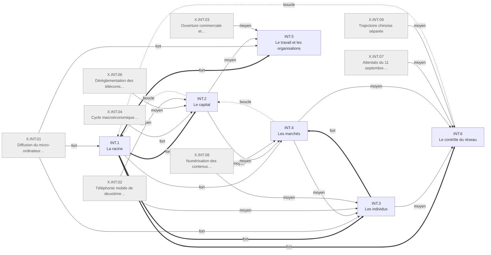
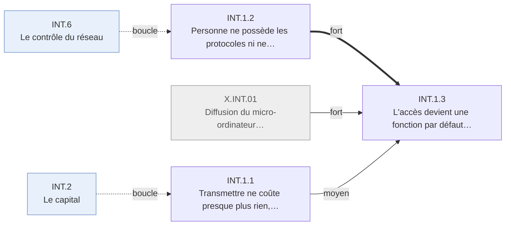

# Arbre des effets — Internet 1995-2005

Statut : ébauche, refaite selon la pratique du niveau de détail. Causes et poids : jugements de
l'agent ; changements : appuyés sur les faits cités. Méthode : [../README.md](../README.md).

## Table of Contents

1. [Comment lire](#comment-lire)
1. [INT.0 · Ce qui a changé](#int-0-ce-qui-a-chang)
1. [INT.1 · La racine](#int-1-la-racine)
1. [Branches](#branches)

---

## Comment lire
<!-- Lines 17-30 -->

- **L'arbre est un arbre de résolution.** Chaque boîte dit ce que ses enfants additionnent ; les
  enfants la partitionnent, par *qui vit le changement* ; les feuilles citent des faits du
  dossier, chaque fait sous une seule feuille.
- **Les causes sont des flèches entre boîtes**, comme les flux d'un diagramme SADT. Chaque boîte
  a une seule cause `principale`. Poids : `fort` (sans cette cause, plus de la moitié du
  changement disparaît), `moyen` (un quart à la moitié), `faible` (moins d'un quart). `boucle` :
  rétroaction, hors calcul. Une cause qui atteint une boîte profonde apparaît aussi sur ses
  ancêtres, à leur propre poids.
- **Certitude** du changement (pas de sa cause) : `V` au moins un fait vérifié à la source,
  `K` faits à vérifier seulement, `D` disputé. Toute cause est une inférence sauf mention.

---

## INT.0 · Ce qui a changé
<!-- Lines 33-98 -->

Qui : le monde · certitude : V

Causes : amont (pile de protocoles financée sur fonds publics avant 1995 ; réseaux privés d'échange de données entre entreprises antérieurs à 1995 ; tous deux absents du registre) ; X.INT.01 (fort) ; X.INT.02 (moyen) ; X.INT.03 (moyen) ; X.INT.04 (fort) ; X.INT.05 (faible) ; X.INT.06 (faible) ; X.INT.07 (moyen) ; X.INT.08 (moyen) ; X.INT.09 (moyen) ; X.INT.10 (faible)

De 1995 à 2005, transmettre ne coûte presque plus rien, à toute distance, sur un réseau que
personne ne possède (INT.1). Le capital le construit en pariant trop et trop tôt, puis le brade
(INT.2). Les individus s'y installent vite mais inégalement, d'abord pour s'écrire (INT.3). Les
rentes fondées sur la rareté de l'accès tombent, et la valeur se reforme autour de quelques
plateformes qui vendent l'attention ; l'essentiel du commerce électronique mesuré, entre
entreprises, passe pourtant par des réseaux antérieurs au Web (INT.4). Le travail de bureau s'y coordonne ; l'emploi
informatique suit le cycle du capital (INT.5). Les États et le droit se disputent un réseau sans
gardien (INT.6). Trois changements économiques majeurs de la fenêtre, l'accélération de la
productivité, la délocalisation des services et le commerce électronique entre entreprises, ont
leur cause principale hors du réseau.

<!-- GENERE:INT.0:debut -->

<!-- GENERE:INT.0:fin -->

---

## INT.1 · La racine
<!-- Lines 101-147 -->

Transmettre ne coûte presque plus rien, sur un réseau sans gardien. Qui : le monde · certitude : K

Causes : amont (fin de l'épine dorsale fédérale, décision publique, et gouvernance technique héritée du réseau de recherche) ; X.INT.01 (fort) ; INT.2 (boucle) ; INT.6 (boucle)

En 1995, l'acheminement passe à des opérateurs privés interconnectés, les protocoles restent
ouverts et sans propriétaire, et l'accès devient une fonction par défaut du micro-ordinateur.
Transmettre ne coûte presque plus rien, ni selon la distance ni, après le forfait illimité,
selon la durée ; publier ou lancer un service ne demande la permission de personne. Copier,
trouver, observer ne deviennent bon marché qu'ensuite, par d'autres mécanismes (INT.3.3, INT.4.3).
Contre-exemple : le Minitel offrait la transaction de masse, mais facturée à la durée et sous
gardien ; il décline dès que le Web arrive.

<!-- GENERE:INT.1:debut -->

<!-- GENERE:INT.1:fin -->

- **INT.1.1 · Transmettre ne coûte presque plus rien, ni selon la distance ni selon la durée** — toute paire d'interlocuteurs · K
  - Causes : amont (fin de l'épine dorsale fédérale) ; INT.2.2 (boucle)
  - Des milliers de fournisseurs d'accès se font concurrence ; le forfait illimité supprime la facturation à la durée.
  - Faits : J.INT.1995.01, F.INT.A3.001, F.INT.E5.002
- **INT.1.2 · Personne ne possède les protocoles ni ne filtre l'entrée** — auteurs, entrepreneurs · K
  - Causes : amont (gouvernance technique par consensus) ; INT.6.1 (boucle)
  - Transport, adressage et hypertexte restent des standards ouverts ; le serveur web dominant est un logiciel libre. Le Minitel, fermé, recule.
  - Faits : F.INT.A2.005, F.INT.G2.004, F.INT.G2.007, F.INT.A2.004, F.INT.E3.011, F.INT.G3.005
- **INT.1.3 · L'accès devient une fonction par défaut du micro-ordinateur** — ménages, bureaux · V
  - Causes : INT.1.2 (principale, fort) ; X.INT.01 (fort) ; INT.1.1 (moyen)
  - Le système grand public intègre l'accès puis le navigateur ; le navigateur commercial revendique 68 millions d'utilisateurs en 1997 ; l'accès des ménages croît deux fois plus vite que leur équipement : le réseau tire l'ordinateur.
  - Faits : J.INT.1995.04, F.INT.A2.003, F.INT.A2.001, F.INT.A1.007

---

## Branches
<!-- Lines 150-157 -->

| branche | ce qu'elle dit |
| --- | --- |
| [INT.2 · Le capital](int2_capital.md) | Le capital, en partie étranger, parie sur un réseau universel, surconstruit la fibre, s'effondre en 2000-2002 ; les États encaissent puis corrigent. |
| [INT.3 · Les individus](int3_individus.md) | Les ménages se connectent en quatre ans, inégalement ; ils s'écrivent d'abord, puis s'informent, publient, achètent, en complément du physique. |
| [INT.4 · Les marchés](int4_marches.md) | Les rentes d'accès tombent ; la valeur se reforme sur quelques plateformes qui vendent l'attention ; le commerce interentreprises passe par des réseaux antérieurs. |
| [INT.5 · Le travail et les organisations](int5_travail.md) | Les organisations se coordonnent par écrit en réseau ; l'emploi informatique suit le capital ; la productivité accélère surtout par l'ordinateur. |
| [INT.6 · Le contrôle du réseau](int6_controle.md) | Le droit protège d'abord l'entrée libre puis répond aux usages ; les États-Unis gardent la main ; la Chine se ferme ; la sécurité revient. |
