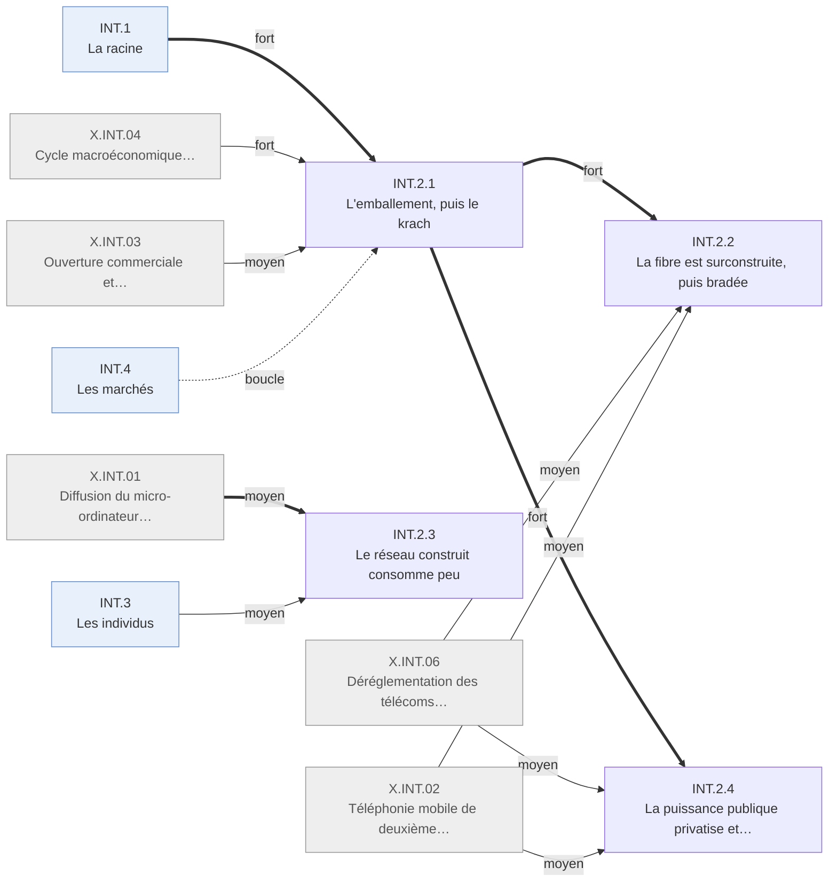

# Arbre des effets — Internet · INT.2 Le capital

Branche de l'[arbre Internet](README.md). Conventions : [README.md § Comment lire](README.md#comment-lire).

---

## INT.2 · Le capital
<!-- Lines 9-91 -->

Le capital construit le réseau, trop et trop tôt, puis le brade. Qui : investisseurs,
opérateurs · certitude : V

Causes : INT.1 (principale, fort) ; X.INT.04 (fort) ; X.INT.06 (moyen) ; X.INT.02 (moyen) ; X.INT.03 (faible) ; X.INT.01 (faible) ; INT.3 (faible) ; INT.4 (boucle)

Le capital parie sur la valeur future d'un réseau universel : le capital-risque est multiplié par
plus de dix, l'indice technologique par près de sept, et les opérateurs posent de la fibre sans
demande correspondante ; le capital étranger, surtout européen, finance une part du pari
américain. Les États privatisent et encaissent pendant la hausse, puis corrigent. Le retournement de 2000-2002 efface l'essentiel des valorisations ; une
vague de faillites télécoms brade la bande passante, ce qui prolonge la baisse du coût de
transmettre. Le réseau survit à ses financeurs. Son empreinte électrique reste de l'ordre du
pour cent.

<!-- GENERE:INT.2:debut -->

<!-- GENERE:INT.2:fin -->

- **INT.2.1 · L'emballement, puis le krach** — investisseurs, ménages actionnaires · V
  - Causes : INT.1 (principale, fort) ; X.INT.04 (fort) ; X.INT.03 (moyen) ; INT.4.4 (boucle)
  - Un cycle d'environ cinq ans : pic en mars 2000, correction sur deux ans et demi.
  - **INT.2.1.1 · Le financement afflue, puis se retire** — capital-risque, marché des introductions · V
    - Causes : INT.1 (principale, fort) ; X.INT.04 (fort)
    - Capital-risque d'environ 8 Md$ (1995) à 105 Md$ par an (1999-2000), puis 22 Md$ (2002) ; introductions technologiques de 205 (1995) à 370 (1999), puis 24 à 18 par an (2001-2003).
    - Faits : F.INT.B1.001, F.INT.B1.003, F.INT.B1.004, F.INT.B1.005, F.INT.B1.006, F.INT.B1.008, F.INT.B1.014
  - **INT.2.1.2 · Les valorisations se détachent des résultats, puis s'effondrent** — marchés · V
    - Causes : INT.2.1.1 (principale, fort) ; X.INT.04 (moyen) ; INT.4.4 (boucle)
    - 81 % d'introductions déficitaires en 2000 ; prix d'offre de 4,6 à 26,5 fois les ventes ; indice technologique ×6,8 jusqu'en mars 2000, puis −78 % jusqu'en octobre 2002 ; même forme en Allemagne, où un tiers des sociétés du marché de croissance disparaît ; « exubérance irrationnelle » dès 1996.
    - Faits : F.INT.B2.007, F.INT.B2.008, F.INT.B2.003, F.INT.B2.004, F.INT.B2.009, F.INT.B2.010, F.INT.B2.006, F.INT.B3.010, F.INT.B5.001
  - **INT.2.1.3 · La valeur passe aux valeurs technologiques, puis se concentre** — actionnaires · K
    - Causes : INT.2.1.2 (principale, fort)
    - Deux, puis quatre à six, puis deux valeurs technologiques parmi les dix premières capitalisations ; la plus grande fusion de la fenêtre finit en dépréciation ; les rendements vont à peu de sociétés et d'investisseurs précoces, les pertes à des ménages actionnaires devenus plus nombreux (36,7 % en 1992, 48,9 % en 1998).
    - Faits : F.INT.B3.001, F.INT.B3.002, F.INT.B3.003, F.INT.B3.004, F.INT.B3.005, F.INT.B3.008, F.INT.B3.009, F.INT.B1.012
  - **INT.2.1.4 · Le capital étranger, surtout européen, finance le pari américain** — investisseurs étrangers · V
    - Causes : INT.2.1.2 (principale, fort) ; X.INT.03 (moyen) ; X.INT.04 (moyen)
    - Déficit courant américain de 1,6 % à 4,4 % du PIB (1996-2000) ; plus de 700 Md$ d'achats nets étrangers d'actifs américains en 2000 ; investissement direct entrant de 70 à 215 Md$ (1997-1998), à plus de 70 % européen et fait de très grosses opérations ; la plus grande acquisition de la fenêtre est européenne et télécom.
    - Faits : F.INT.B4.001, F.INT.B4.002, F.INT.B4.003, F.INT.B4.004, F.INT.B4.005, F.INT.B4.006, F.INT.B4.007, F.INT.B4.008
- **INT.2.2 · La fibre est surconstruite, puis bradée** — opérateurs ; acheteurs de transit · K
  - Causes : INT.2.1 (principale, fort) ; X.INT.06 (moyen) ; X.INT.02 (moyen)
  - Un grand opérateur double presque sa fibre en un an, par la dette autant que par les actions (crédit syndiqué télécom de 256 Md$ en 2000) ; les opérateurs historiques se réorganisent autour de la vente de capacité ; la surcapacité apparaît au retournement ; vingt-trois opérateurs font faillite en 2001-2002, dont l'un avec 107 Md$ d'actifs déclarés ; le prix du transit baisse toute la fenêtre.
  - Faits : F.INT.A1.001, F.INT.A1.009, F.INT.B1.010, F.INT.A3.004, F.INT.A3.005, F.INT.A1.011, F.INT.B1.013, F.INT.A5.007, F.INT.B3.006
- **INT.2.3 · Le réseau construit consomme peu** — système électrique · V
  - Causes : X.INT.01 (principale, moyen) ; INT.3.1 (moyen)
  - Les centres de données doublent leur consommation (2000-2005) mais restent autour de 1 % de l'électricité mondiale ; l'affirmation de 1999 d'un réseau à 8 % de l'électricité américaine est ramenée à 2-3 % par la mesure ; la crise californienne n'est pas imputée à l'informatique.
  - Faits : F.INT.H1.004, F.INT.H1.006, F.INT.H1.001, F.INT.H1.003, F.INT.H2.003
- **INT.2.4 · La puissance publique privatise et encaisse, puis corrige le cycle** — États, régulateurs · V
  - Causes : INT.2.1 (principale, fort) ; X.INT.06 (moyen) ; X.INT.02 (moyen)
  - **INT.2.4.1 · Pendant la hausse, les États vendent et encaissent** — États européens · K
    - Causes : X.INT.06 (principale, fort) ; X.INT.02 (moyen) ; INT.2.1 (moyen)
    - Privatisation des opérateurs historiques allemand (1996) et français (1997-1998) ; plus de 100 Md$ de recettes des licences mobiles de troisième génération (2000-2001) ; décloisonnement bancaire américain (1999).
    - Faits : F.INT.B5.008, F.INT.B5.009, F.INT.B5.010, F.INT.B5.004
  - **INT.2.4.2 · Après le krach, les régulateurs corrigent** — régulateurs, sociétés cotées, banques d'affaires · V
    - Causes : INT.2.1 (principale, fort)
    - Diffusion équitable de l'information (2000) ; réforme de la gouvernance et des comptes après les scandales du cycle (2002) ; règlement de 1,4 Md$ avec dix banques d'affaires sur l'indépendance de leurs analystes (2003).
    - Faits : F.INT.B5.005, F.INT.B5.006, F.INT.B5.007
