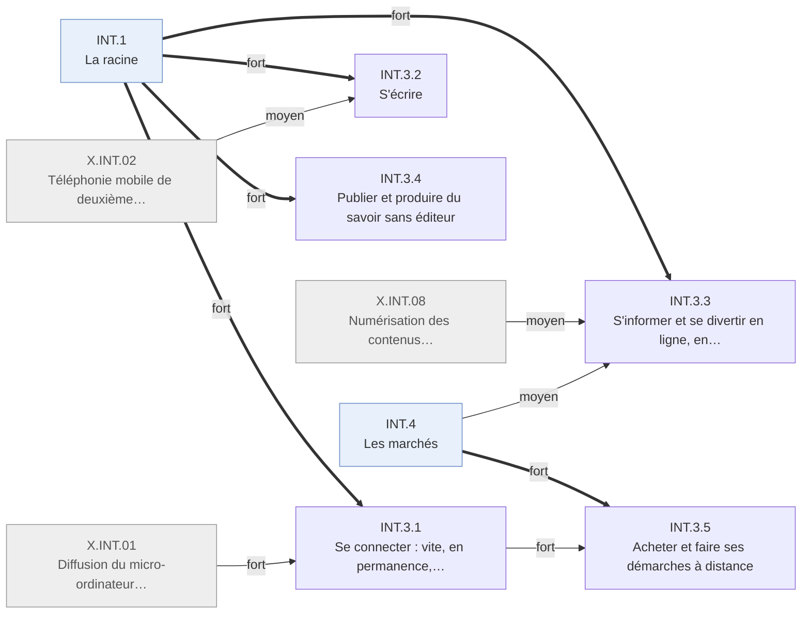

# Arbre des effets — Internet · INT.3 Les individus

Branche de l'[arbre Internet](README.md). Conventions : [README.md § Comment lire](README.md#comment-lire).

---

## INT.3 · Les individus
<!-- Lines 9-89 -->

Les individus se connectent vite mais inégalement, et s'écrivent, s'informent, publient et
achètent en ligne. Qui : ménages, internautes · certitude : V

Causes : INT.1 (principale, fort) ; X.INT.01 (fort) ; INT.2 (faible) ; INT.4 (moyen) ; X.INT.02 (moyen) ; X.INT.08 (moyen)

Les ménages américains connectés passent de 18,6 % (1997) à la majorité (2001) ; le haut débit
devient majoritaire en 2004 et fait du réseau un lieu permanent. L'accès suit le revenu, l'âge,
le pays. Le premier usage est l'écrit, puis viennent l'information et l'achat ; la publication
individuelle et le savoir bénévole deviennent mesurables en fin de fenêtre. Ces usages complètent
les médias et commerces physiques plus qu'ils ne les remplacent : la télévision reste la source
dominante.

<!-- GENERE:INT.3:debut -->

<!-- GENERE:INT.3:fin -->

- **INT.3.1 · Se connecter : vite, en permanence, inégalement** — ménages · V
  - Causes : INT.1.3 (principale, fort) ; X.INT.01 (fort) ; INT.1.1 (moyen) ; INT.2.2 (faible) ; X.INT.02 (faible)
  - **INT.3.1.1 · La majorité des ménages américains se connecte en quatre ans** — ménages américains · V
    - Causes : INT.1.3 (principale, fort) ; X.INT.01 (fort)
    - 18,6 % (1997), 50,4 % (2001) ; 68 % des adultes utilisent Internet en 2005.
    - Faits : F.INT.E1.002, F.INT.E1.003, F.INT.E1.004, F.INT.E1.005, F.INT.E5.008, F.INT.E4.010
  - **INT.3.1.2 · Le haut débit fait du réseau un lieu permanent** — foyers connectés · K
    - Causes : INT.1.1 (principale, moyen) ; INT.2.2 (faible)
    - 3 % des foyers connectés en haut débit en 2000, la majorité en 2004 ; la connexion ne se coupe plus entre deux sessions.
    - Faits : F.INT.E1.008, F.INT.E1.009, F.INT.E5.005, F.INT.H1.009, F.INT.E5.004
  - **INT.3.1.3 · L'accès suit le revenu, l'âge et le lieu** — ménages modestes, âgés, ruraux · V
    - Causes : X.INT.01 (principale, fort) ; INT.1.3 (moyen)
    - En 2003, 95 % des ménages aisés sont équipés d'un ordinateur, contre 35 % des plus de 65 ans ; l'écart rural persiste ; le terme de fracture numérique entre dans la politique publique.
    - Faits : F.INT.E1.006, F.INT.E1.007, F.INT.F4.006, F.INT.E1.012, F.INT.G3.004, F.INT.F3.002
  - **INT.3.1.4 · Le réseau se mondialise, très inégalement** — pays hors du monde anglophone · K
    - Causes : INT.1.1 (principale, fort) ; X.INT.01 (moyen) ; X.INT.02 (faible)
    - Environ 5 % de la population mondiale en ligne fin 2000, un tiers dans les pays développés ; plus d'un milliard d'internautes en 2005, très inégalement répartis ; la Corée du Sud dépasse 21 abonnés haut débit pour 100 habitants par politique publique ; l'Asie de l'Est se connecte d'abord par le mobile et les cybercafés ; la part de l'anglais dans les pages recule (série disputée).
    - Faits : F.INT.G6.001, F.INT.F4.010, F.INT.F4.009, F.INT.E1.010, F.INT.F4.004, F.INT.F4.003
- **INT.3.2 · S'écrire** — internautes · V
  - Causes : INT.1.1 (principale, fort) ; X.INT.02 (moyen)
  - Le courriel personnel est quasi universel chez les internautes dès 2000 ; la messagerie instantanée passe des adolescents à 42 % des internautes (2004) ; 3 % des internautes en couple ont rencontré leur partenaire en ligne. Le courrier postal croît pourtant jusqu'en 2001 (103,7 milliards de plis) avant de reculer : l'écrit en ligne s'ajoute avant de remplacer. En Asie de l'Est et en Europe, l'écrit à distance passe d'abord par le mobile.
  - Faits : F.INT.D3.014, F.INT.E2.002, F.INT.E2.003, F.INT.E2.004, F.INT.E2.007, F.INT.E2.008, F.INT.E2.009, F.INT.E2.011, F.INT.E2.005, F.INT.E2.006, F.INT.E2.010
- **INT.3.3 · S'informer et se divertir en ligne, en complément** — internautes · V
  - Causes : INT.1.1 (principale, fort) ; X.INT.08 (moyen) ; INT.4.3 (moyen)
  - 12 % des Américains s'informent en ligne un jour donné en 2000, 29 % régulièrement en 2004 ; la recherche devient quotidienne (84 % des internautes ont utilisé un moteur en 2004) ; l'échange de musique entre particuliers est la première copie de masse ; la vidéo amateur apparaît en 2005 ; la télévision reste dominante.
  - Faits : F.INT.E4.002, F.INT.E4.003, F.INT.E4.001, F.INT.E4.011, F.INT.E4.013, F.INT.E4.004, F.INT.E4.008, F.INT.E4.009, F.INT.E4.006, F.INT.F4.008, F.INT.E5.001
- **INT.3.4 · Publier et produire du savoir sans éditeur** — auteurs, contributeurs · V
  - Causes : INT.1.2 (principale, fort) ; INT.1.1 (fort)
  - **INT.3.4.1 · Chacun publie** — individus · V
    - Causes : INT.1.2 (principale, fort) ; INT.1.1 (moyen)
    - Les auteurs de carnets passent de 3 % à 7 % des internautes adultes (2002-2004), les lecteurs à 27 % ; la publication individuelle entre dans le débat public.
    - Faits : F.INT.F1.006, F.INT.F1.007, F.INT.F1.008
  - **INT.3.4.2 · Le savoir de référence se produit par des volontaires et s'ouvre** — savants, lecteurs · V
    - Causes : INT.1.2 (principale, fort) ; INT.1.1 (fort)
    - Prépublications de physique, encyclopédie ouverte à tous (2001), déclarations sur l'accès libre (2002-2003), licences de partage volontaire (2002) : l'auteur expert rémunéré cède une partie du terrain.
    - Faits : F.INT.F2.001, F.INT.F2.002, F.INT.F2.003, F.INT.F2.004, F.INT.F2.005, F.INT.F2.006, F.INT.F2.010, F.INT.F1.005, F.INT.F3.008
- **INT.3.5 · Acheter et faire ses démarches à distance** — consommateurs · V
  - Causes : INT.4.2 (principale, fort) ; INT.3.1.1 (fort)
  - 46 % des internautes ont déjà acheté en ligne en 2000 ; la banque en ligne passe de 17 % à 44 % des internautes (2000-2004) ; voyage, santé et comparaison de prix suivent.
  - Faits : F.INT.E3.002, F.INT.E3.003, F.INT.E3.004, F.INT.E3.006, F.INT.E3.005, F.INT.E3.009, F.INT.E3.010
