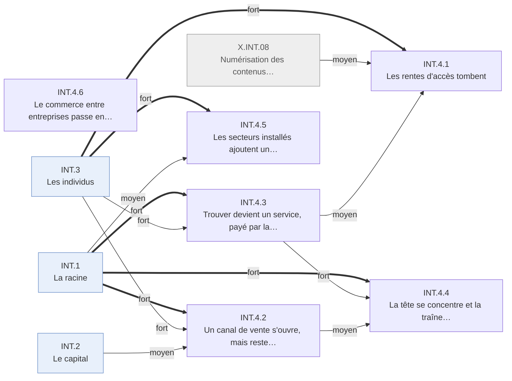

# Arbre des effets — Internet · INT.4 Les marchés

Branche de l'[arbre Internet](README.md). Conventions : [README.md § Comment lire](README.md#comment-lire).

---

## INT.4 · Les marchés
<!-- Lines 9-96 -->

Les rentes de rareté tombent, et la valeur se reforme autour de quelques plateformes qui
vendent l'attention. Qui : firmes, secteurs · certitude : V

Causes : INT.3 (principale, fort) ; INT.1 (fort) ; INT.2 (moyen) ; X.INT.08 (moyen)

Là où la valeur venait de la rareté de l'accès, elle tombe à mesure que les usagers migrent :
l'emploi des agences de voyages culmine en 1997 et perd plus d'un tiers en 2005, les petites
annonces quittent la presse, la musique perd le contrôle de la copie. Le commerce en ligne naît
en 1995 mais ne pèse que 2,3 % du détail américain en 2005. La valeur se reforme ailleurs :
trouver devient un service payé par la publicité sur mots-clés, et l'attention se concentre selon
une loi de puissance, en même temps qu'une traîne de titres rares trouve son public. Les
secteurs installés ajoutent un guichet en ligne sans se reconfigurer. Le gros du commerce
électronique, entre entreprises, passe par les réseaux privés d'avant 1995 ; les places de marché
ouvertes lancées en 2000 échouent.

<!-- GENERE:INT.4:debut -->

<!-- GENERE:INT.4:fin -->

- **INT.4.1 · Les rentes d'accès tombent** — intermédiaires, industries des supports · V
  - Causes : INT.3 (principale, fort) ; X.INT.08 (moyen) ; INT.4.3 (moyen)
  - **INT.4.1.1 · Les intermédiaires d'appariement perdent leur rôle** — agences de voyages, petites annonces · V
    - Causes : INT.3.5 (principale, fort) ; INT.4.3 (moyen)
    - Emploi des agences de voyages : 191 600 (1997), 125 100 (2005), recul commencé avant la récession ; billets d'avion réservés en ligne de 7 % à 30 % (1999-2002) ; comptes de courtage en ligne de 3,7 à 9,7 millions (1997-1999) ; les petites annonces des quotidiens partent vers des sites concurrents ; le mot « désintermédiation » entre dans le discours d'entreprise.
    - Faits : F.INT.D1.007, F.INT.A6.007, F.INT.A5.005, F.INT.A6.008, F.INT.A5.004, F.INT.A5.002, F.INT.F1.002, F.INT.F1.009
  - **INT.4.1.2 · La musique enregistrée perd le contrôle de la copie** — maisons de disques, disquaires · K
    - Causes : INT.3.3 (principale, fort) ; X.INT.08 (fort)
    - L'échange entre particuliers, puis les poursuites contre des particuliers, cristallisent le conflit ; en 2003, la vente au titre avec l'accord des maisons de disques ; l'emploi des disquaires et la production de supports reculent.
    - Faits : F.INT.F1.004, F.INT.A5.003, F.INT.C4.010, F.INT.D1.008, F.INT.H4.006
- **INT.4.2 · Un canal de vente s'ouvre, mais reste mince** — détaillants · V
  - Causes : INT.1.2 (principale, fort) ; INT.3.1.1 (fort) ; INT.2.1 (moyen)
  - Librairie en ligne et enchères entre particuliers en 1995 ; 0,64 % du détail fin 1999, 1,0 % en 2001 malgré le krach, 2,3 % en 2005 ; la logistique associée embauche ; la vente transfrontalière et l'abonnement restent marginaux.
  - Faits : J.INT.1995.02, F.INT.C4.003, F.INT.C4.004, F.INT.C4.005, F.INT.D1.010, F.INT.C3.004, F.INT.C4.009
- **INT.4.3 · Trouver devient un service, payé par la publicité** — moteurs de recherche, annonceurs, médias · K
  - Causes : INT.1.2 (principale, fort) ; INT.3.1.1 (fort)
  - Le Web passe de 320 à 800 millions de pages (1998-1999) et aucun moteur n'en couvre plus de 16 % : trouver devient rare. Première bannière en 1994 ; un moteur fondé en 1998 classe par liens entrants ; la publicité sur mots-clés devient son revenu dominant en 2003 et prend des revenus aux médias ; en 2005, la publicité en ligne américaine rivalise avec de grands médias ; 38 % seulement des usagers distinguent résultats payés et non payés.
  - Faits : F.INT.F2.011, F.INT.C4.001, F.INT.C4.006, F.INT.C4.007, F.INT.F1.010, F.INT.C4.008, F.INT.E4.012
- **INT.4.4 · La tête se concentre et la traîne s'épaissit, en même temps** — le marché mondial · V
  - Causes : INT.1.1 (principale, fort) ; INT.4.3 (fort) ; INT.4.2 (moyen)
  - Même mécanisme des deux côtés : atteindre n'importe quel titre coûte autant que le plus demandé.
  - **INT.4.4.1 · L'attention se concentre** — internautes · V
    - Causes : INT.1.1 (principale, fort) ; INT.4.3 (moyen)
    - Dès 1997, avant le classement par liens, le trafic suit une loi de puissance (0,1 % des sites font un tiers des visiteurs) ; les entités qui font la moitié du temps en ligne passent de onze à quatre (1999-2001, chiffre de cabinet).
    - Faits : F.INT.F5.001, F.INT.F5.002, F.INT.F5.004, F.INT.F5.005
  - **INT.4.4.2 · La valeur se concentre sur quelques firmes et quelques métropoles** — firmes de tête, territoires · K
    - Causes : INT.4.4.1 (principale, fort) ; INT.4.3 (fort)
    - Navigateur, recherche, portails et publicité se concentrent l'un après l'autre ; l'écart entre firmes de tête et reste du secteur s'élargit ; les gains vont à quelques métropoles ; en 2004, le moteur fondé en 1998 est valorisé au niveau des plus grandes.
    - Faits : F.INT.C5.006, F.INT.C5.001, F.INT.A2.002, F.INT.C5.004, F.INT.C5.007, F.INT.C6.005, F.INT.C6.003, F.INT.B3.007
  - **INT.4.4.3 · Une traîne épaisse de titres rares trouve son public** — créateurs de niche, consommateurs · V
    - Causes : INT.4.2 (principale, fort) ; INT.4.3 (moyen)
    - La variété des libraires en ligne crée un surplus mesurable ; en vidéo, les titres à faible vente se multiplient pendant que les meilleures ventes reculent ; tête et traîne coexistent.
    - Faits : F.INT.F5.006, F.INT.F5.007, F.INT.F5.008, F.INT.F5.010
- **INT.4.5 · Les secteurs installés ajoutent un guichet en ligne, sans se reconfigurer** — banques, universités, santé · V
  - Causes : INT.3.1.1 (principale, fort) ; INT.1.2 (moyen)
  - Banques américaines à site transactionnel de 21 % à 32 % (1999-2000), mais moins de 10 % de clients réguliers en ligne pour la plupart ; opérations courantes basculées en ligne ; cours à distance en complément ; en santé, pas de reconfiguration côté producteur.
  - Faits : F.INT.A8.001, F.INT.A8.002, F.INT.A5.008, F.INT.A5.009, F.INT.F2.007, F.INT.A5.010
- **INT.4.6 · Le commerce entre entreprises passe en électronique, surtout par des réseaux antérieurs** — industrie, commerce de gros · V
  - Causes : amont (réseaux privés d'échange de données entre entreprises, antérieurs à 1995, absents du registre) ; INT.1.2 (faible)
  - Commerce électronique manufacturier de 12,0 % à 26,7 % des expéditions, de gros de 5,3 % à 18,3 % des ventes (1999-2005) : plus de 90 % de tout le commerce électronique ; mais l'échange de données informatisé fait 88 % du commerce électronique de gros en 2000 et encore 83,5 % en 2005 ; dans l'industrie, Internet ne porte que 5 % de la valeur en 2000, contre 59 % pour l'échange de données ; en Europe aussi, la vente en ligne est d'abord interentreprises ; les places de marché ouvertes lancées en 2000 échouent.
  - Faits : F.INT.A6.001, F.INT.A6.002, F.INT.A6.003, F.INT.A6.004, F.INT.A6.005, F.INT.A6.006, F.INT.A6.009, F.INT.A6.010
