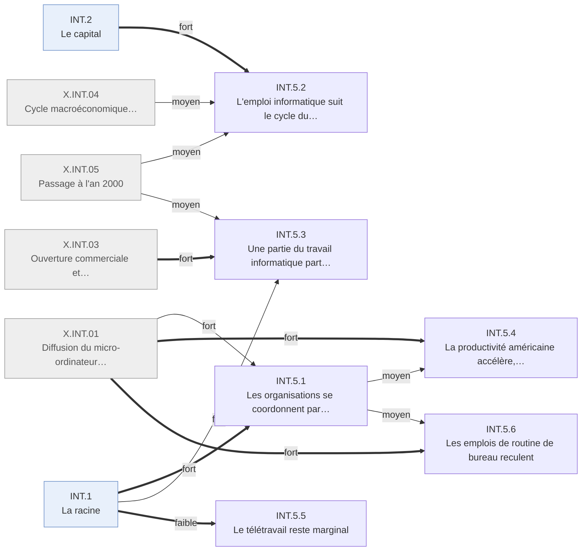

# Arbre des effets — Internet · INT.5 Le travail et les organisations

Branche de l'[arbre Internet](README.md). Conventions : [README.md § Comment lire](README.md#comment-lire).

---

## INT.5 · Le travail et les organisations
<!-- Lines 9-88 -->

Le travail de bureau se coordonne en réseau ; l'emploi informatique suit le cycle du capital ;
la productivité accélère, surtout par l'ordinateur. Qui : salariés, informaticiens, économie
américaine · certitude : V

Causes : INT.1 (principale, fort) ; X.INT.01 (fort) ; INT.2 (moyen) ; X.INT.03 (moyen) ; X.INT.04 (faible) ; X.INT.05 (faible) ; X.INT.02 (faible) ; X.INT.10 (faible)

Le courriel et l'intranet deviennent l'outil de coordination des organisations : 42 % des actifs
américains utilisent Internet ou le courriel au travail en 2003. L'emploi informatique suit le
capital : pénurie et plafonds de visas relevés jusqu'en 2000, puis environ 650 000 emplois de
moins dans le secteur de l'information de 2001 à 2005. Une partie du travail informatique part
en Inde. Le télétravail reste marginal. L'accélération de la productivité américaine vient
d'abord de la production et de l'accumulation d'ordinateurs ; le dossier n'y isole pas la part du
réseau. Deux des six branches pendent à l'ordinateur (X.INT.01), une à la mondialisation
(X.INT.03).

<!-- GENERE:INT.5:debut -->

<!-- GENERE:INT.5:fin -->

- **INT.5.1 · Les organisations se coordonnent par écrit, en réseau** — organisations, salariés de bureau · V
  - Causes : INT.1.2 (principale, fort) ; X.INT.01 (fort) ; INT.1.1 (fort) ; X.INT.02 (faible)
  - Courriel courant dès 1995 ; intranets sur les protocoles du Web à la place des réseaux propriétaires ; usage professionnel : 26 % (2000), 38 % (2001), 42 % (2003) des actifs, 66 % dans la finance ; 57 % des petites entreprises américaines en ligne en 2002 ; en Europe, 81 % des entreprises de dix salariés et plus ont accès à Internet en 2002, 30 % y achètent, 13 % y vendent ; la frontière du temps de travail se brouille. Les grandes entreprises gardent leurs propres centres de calcul et leur personnel informatique.
  - Faits : F.INT.D3.001, F.INT.D3.002, F.INT.A4.002, F.INT.A7.001, F.INT.A7.002, F.INT.A7.003, F.INT.D3.009, F.INT.D3.010, F.INT.D3.011, F.INT.D3.012, F.INT.D3.015, F.INT.D2.011, F.INT.D2.012, F.INT.E5.007, F.INT.D3.006, F.INT.D3.007, F.INT.A4.008
- **INT.5.2 · L'emploi informatique suit le cycle du capital** — informaticiens américains · V
  - Causes : INT.2.1 (principale, fort) ; X.INT.05 (moyen) ; X.INT.04 (moyen)
  - **INT.5.2.1 · Pénurie, puis relèvement des plafonds de visas** — informaticiens, employeurs · V
    - Causes : INT.2.1 (principale, fort) ; X.INT.05 (moyen)
    - Pénurie déclarée ; plafond des visas qualifiés de 65 000 à 115 000 (1998), puis 195 000 (2000) ; prime salariale croissante ; les diplômes d'informatique décollent.
    - Faits : F.INT.D2.003, F.INT.D2.004, F.INT.D2.005, F.INT.D1.002, F.INT.D4.001, F.INT.D2.001
  - **INT.5.2.2 · Retournement** — informaticiens · V
    - Causes : INT.2.1 (principale, fort) ; X.INT.05 (moyen) ; X.INT.04 (moyen)
    - Emploi du secteur de l'information au pic en mars 2001 (3,72 millions), puis environ −650 000 en quatre ans ; creux de la conception de systèmes en 2003 ; la prime se contracte, le rapport de force se retourne ; les diplômes continuent de croître.
    - Faits : F.INT.D1.003, F.INT.D1.004, F.INT.D1.006, F.INT.D1.005, F.INT.D4.002, F.INT.D4.009, F.INT.D2.002
- **INT.5.3 · Une partie du travail informatique part en Inde** — Inde ; informaticiens occidentaux · K
  - Causes : X.INT.03 (principale, fort) ; INT.1.1 (fort) ; X.INT.05 (moyen)
  - Parcs technologiques et liaisons de données installés par l'État indien dès 1991 ; bascule vers l'exportation à distance vers 1997, portée par le chantier de l'an 2000 : la part du travail fait chez le client passe de 66 % (1995) à 45 % (2001-2002), pendant que l'appel États-Unis–Inde coûte deux fois moins ; exportations de 6,3 Md$ en 2000-2001 (+57 %). Majeur pour l'Inde, « modeste » à l'échelle du commerce mondial selon l'OMC (2005).
  - Le réseau apporte la bascule du travail sur site vers le travail à distance ; l'industrie, elle, existait avant.
  - Faits : F.INT.C3.008, F.INT.C3.001, F.INT.A4.003, F.INT.C3.011, F.INT.C3.009, F.INT.C3.012, F.INT.C3.002, F.INT.C3.003, F.INT.C3.013, F.INT.C3.014, F.INT.C3.010, F.INT.D1.011, F.INT.D2.009, F.INT.D3.004
- **INT.5.4 · La productivité américaine accélère, surtout par l'ordinateur** — économie américaine · V
  - Causes : X.INT.01 (principale, fort) ; INT.5.1 (moyen) ; INT.5.3 (faible) ; X.INT.03 (faible) ; X.INT.10 (faible)
  - De 1,5 % par an (1991-1995) à 2,6 % (1996-1999) ; usage et production d'ordinateurs et de semi-conducteurs expliquent environ deux tiers de la hausse ; la délocalisation de services en expliquerait une part, et gonfle aussi la mesure ; une voix dissidente concentre l'accélération dans quelques secteurs ; l'Europe décroche. Sur données d'entreprises, les gains de l'informatique n'apparaissent qu'avec une réorganisation du travail et des compétences : c'est le canal par lequel le réseau pourrait peser, sa part reste ouverte.
  - Faits : F.INT.C1.001, F.INT.C1.002, F.INT.C1.003, F.INT.C1.004, F.INT.C1.005, F.INT.C1.012, F.INT.C1.013, F.INT.C1.014, F.INT.C1.008, F.INT.C1.009, F.INT.C2.002, F.INT.C2.003, F.INT.C2.004, F.INT.D4.010, F.INT.D4.011
- **INT.5.5 · Le télétravail reste marginal** — salariés · V
  - Causes : INT.1.1 (principale, faible)
  - Changement attendu qui n'advient pas : le chiffrage professionnel culmine à 28,8 millions en 2001 puis reflue d'un sixième ; la mesure officielle compte 15 % de l'emploi travaillant à domicile, sans rupture.
  - Faits : F.INT.H4.003, F.INT.H4.004, F.INT.H4.005, F.INT.D3.003
- **INT.5.6 · Les emplois de routine de bureau reculent** — standardistes, opérateurs de saisie · K
  - Causes : X.INT.01 (principale, fort) ; INT.5.1 (moyen)
  - Recul relatif de la saisie, du classement, du standard ; la littérature lit une polarisation par contenu de tâche.
  - Faits : F.INT.D1.009, F.INT.D4.004, F.INT.D4.003
