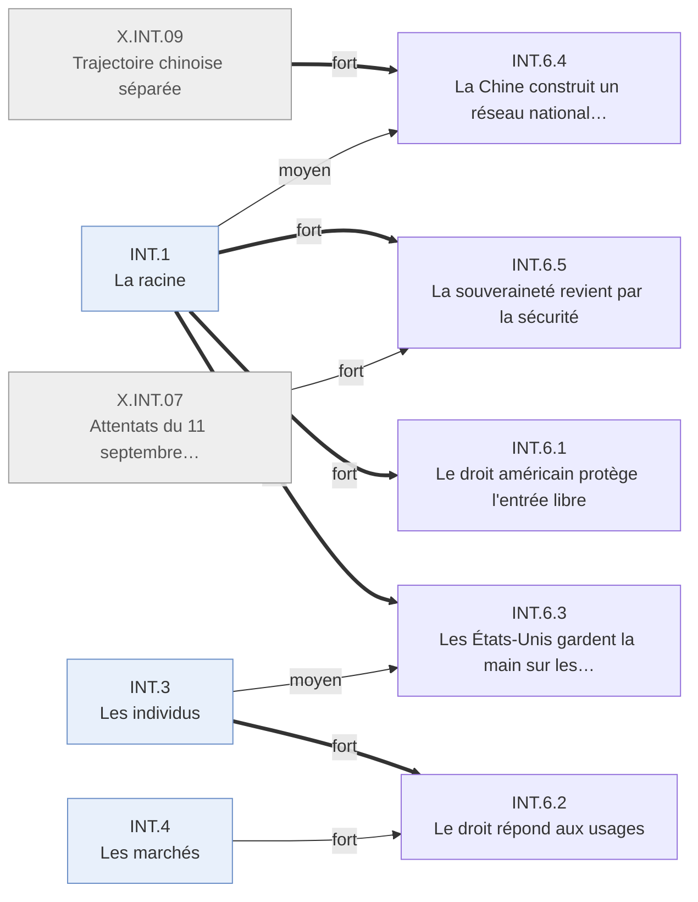

# Arbre des effets — Internet · INT.6 Le contrôle du réseau

Branche de l'[arbre Internet](README.md). Conventions : [README.md § Comment lire](README.md#comment-lire).

---

## INT.6 · Le contrôle du réseau
<!-- Lines 9-88 -->

Qui contrôle un réseau sans gardien devient une question de droit et de puissance. Qui : États,
législateurs, instances de gouvernance · certitude : V

Causes : INT.1 (principale, fort) ; INT.3 (moyen) ; INT.4 (moyen) ; X.INT.07 (moyen) ; X.INT.09 (moyen)

Le réseau naît sans gardien, et l'imaginaire de 1996 le déclare indépendant des États. En dix
ans, le droit américain fixe ses règles de base en faveur de l'entrée libre, puis répond aux
usages (copie, données, courrier non sollicité, position dominante) ; l'Europe choisit de
réguler l'usage des données plutôt que de construire des acteurs. Les États-Unis gardent la main
sur les ressources critiques contre les autres États ; la Chine construit une version fermée ;
la souveraineté revient par la sécurité, avant même le 11 septembre, et domine après.

<!-- GENERE:INT.6:debut -->

<!-- GENERE:INT.6:fin -->

- **INT.6.1 · Le droit américain protège l'entrée libre** — législateurs, plateformes · V
  - Causes : INT.1.2 (principale, fort)
  - Immunité des hébergeurs pour les contenus de tiers (1996) ; cadre du commerce électronique fondé sur l'autorégulation (1997) ; moratoire fiscal (1998) ; valeur juridique de la signature électronique (2000).
  - Faits : F.INT.G1.001, F.INT.G1.002, F.INT.G1.005, F.INT.G1.010
- **INT.6.2 · Le droit répond aux usages** — législateurs · V
  - Causes : INT.3 (principale, fort) ; INT.4 (fort) ; INT.1.1 (faible)
  - **INT.6.2.1 · La copie** — ayants droit · V
    - Causes : INT.3.3 (principale, fort)
    - Protection juridique des mesures techniques (1998), directive européenne sur le droit d'auteur numérique (2001).
    - Faits : F.INT.G1.003, F.INT.G1.008
  - **INT.6.2.2 · Les données et les sollicitations** — internautes, annonceurs · V
    - Causes : INT.4.3 (principale, moyen) ; INT.3.2 (moyen)
    - 84 % des internautes préoccupés par leurs données (2000) ; vie privée des mineurs (1998) ; courrier commercial non sollicité (2003).
    - Faits : F.INT.F3.005, F.INT.G1.004, F.INT.F3.009, F.INT.G1.012
  - **INT.6.2.3 · L'Europe régule l'usage des données** — Union européenne · K
    - Causes : INT.1.1 (principale, moyen)
    - Directive sur les données personnelles (1995, antérieure à l'usage de masse : cause principale ouverte), directive sur le commerce électronique (2000), accord de transfert avec les États-Unis (2000).
    - Faits : F.INT.G1.006, F.INT.G1.007, F.INT.G1.009, F.INT.C3.006
  - **INT.6.2.4 · L'antitrust vise l'intégration du navigateur** — éditeur dominant · K
    - Causes : INT.4.4.2 (principale, fort)
    - Action du ministère de la justice et de vingt États (1998) ; ordonnance de démantèlement (2000), non exécutée.
    - Faits : F.INT.C5.002, F.INT.C5.003, F.INT.A2.008
- **INT.6.3 · Les États-Unis gardent la main sur les ressources critiques ; les autres États contestent** — nations · V
  - Causes : INT.1.2 (principale, fort) ; INT.3.1.4 (moyen)
  - Dix des treize serveurs racine sont américains (1997) ; 98 % de la capacité interrégionale internationale passe par les États-Unis (2003, chiffre de cabinet) ; noms et adresses confiés en 1998 à une société californienne sous contrat du département du Commerce. Les câbles transatlantiques restent des consortiums multinationaux. Le G8 promet l'accès universel (2000) ; aux sommets mondiaux de 2003 et 2005, les autres États et les pays en développement demandent une gestion multilatérale sans l'obtenir.
  - Faits : F.INT.G5.001, F.INT.G5.002, F.INT.G5.003, F.INT.G5.004, F.INT.G2.001, F.INT.G2.002, F.INT.G2.003, F.INT.G4.001, F.INT.G6.002, F.INT.G6.003, F.INT.G2.005, F.INT.G2.006, F.INT.G4.005
- **INT.6.4 · La Chine construit un réseau national fermé** — Chine · K
  - Causes : X.INT.09 (principale, fort) ; INT.1.1 (moyen)
  - Filtrage et surveillance nationaux à partir de 1998 ; écosystème propre, protégé de la concurrence étrangère ; ses champions s'introduisent en bourse à l'étranger en 2004.
  - Faits : F.INT.G4.002, F.INT.F4.005, F.INT.C3.007, F.INT.A3.008, F.INT.G4.007
- **INT.6.5 · La souveraineté revient par la sécurité** — États, internautes · V
  - Causes : INT.1.1 (principale, fort) ; X.INT.07 (fort)
  - **INT.6.5.1 · Avant 2001, les États affirment leur contrôle sur les communications** — États · V
    - Causes : INT.1.1 (principale, fort)
    - Contre la déclaration d'indépendance du réseau (1996) : contrôle des exportations de biens à double usage (1995), assoupli pour le chiffrement (2000) ; doctrine russe de sécurité de l'information (2000) ; rapport européen sur l'interception des communications (2001).
    - Faits : F.INT.F3.001, F.INT.G4.009, F.INT.G4.012, F.INT.G4.010, F.INT.G4.011
  - **INT.6.5.2 · Après 2001, la sécurité domine** — États, internautes · K
    - Causes : X.INT.07 (principale, fort) ; INT.1.1 (moyen)
    - Pouvoirs d'accès élargis, première convention internationale sur la cybercriminalité ; le discours public passe de la liberté à la sécurité.
    - Faits : F.INT.G4.003, F.INT.G1.011, F.INT.F3.007
