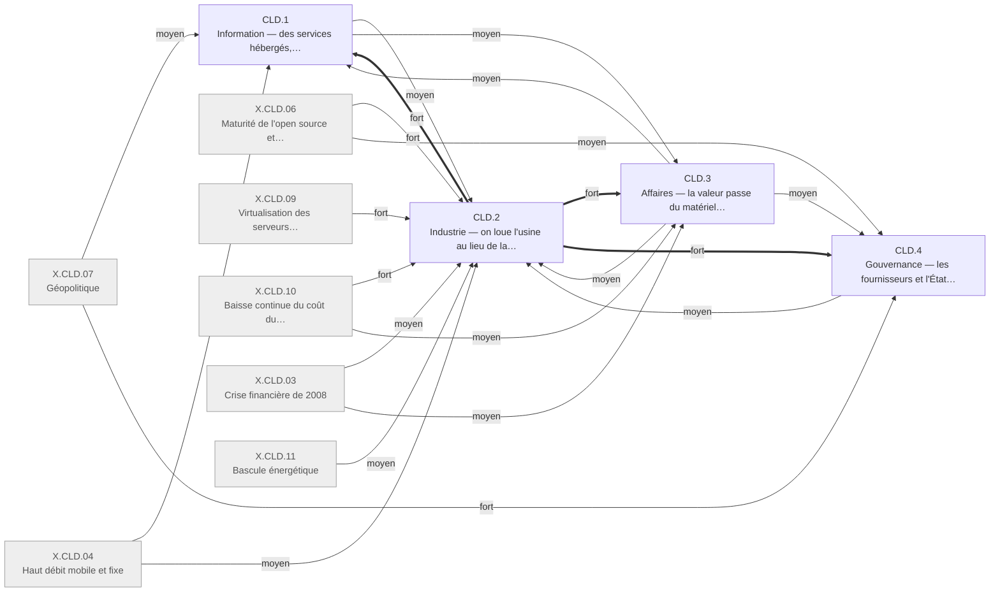

# Arbre des effets — cloud 2005-2015, en quatre ordres

Statut : deuxième génération, construite selon le cadre de l'auteur, révisée après la
confrontation des faits à des sources ouvertes et lues (décision D21). Changements : appuyés sur
les faits cités. Causes et poids : jugements de l'agent, relus une fois par un modèle distinct ;
les questions laissées à l'auteur sont dans « Ouvert ». Cadre et règles :
[../README.md](../README.md).

## Table of Contents

1. [Comment lire](#comment-lire) _(Lines 25-45)_
1. [CLD.0 · Ce qui a changé](#cld0--ce-qui-a-changé) _(Lines 48-112)_
1. [Branches](#branches) _(Lines 115-124)_
1. [Profil](#profil) _(Lines 127-213)_
1. [Élagués](#élagués) _(Lines 216-238)_
1. [Ouvert](#ouvert) _(Lines 241-315)_
1. [Pont avec Internet](#pont-avec-internet) _(Lines 318-349)_
1. [Journal](#journal) _(Lines 352-430)_

---

## Comment lire
<!-- Lines 25-45 -->

- **Le cadre est celui de l'auteur** ([../README.md](../README.md)) : racine commune aux deux
  chocs, quatre ordres au niveau 1 (Information, Industrie, Affaires, Gouvernance), partition
  par ce qui change, un événement découpé en un changement par ordre.
- **Arbre de résolution.** Chaque boîte dit ce que ses enfants additionnent ; chaque fait est
  cité sous une seule feuille ; les hauteurs varient (une feuille à un fait côtoie une feuille
  à treize).
- **Flèches causales** selon [../../README.md](../../README.md) : une cause `principale` par
  boîte ; `fort` (sans elle, plus de la moitié du changement disparaît), `moyen` (un quart à la
  moitié), `faible` (moins d'un quart) ; `boucle` pour une rétroaction ; `amont` pour une
  cause hors fenêtre ou hors registre, dont le choc précédent.
- **Certitude** du changement, pas de sa cause : celle de l'énoncé de la boîte, dérivée des
  faits qui portent son cœur : `V` ces faits sont vérifiés à la source première ; `A` au moins
  l'un d'eux est admis sur une source sérieuse lue, aucun n'est sans source ; `D` les sources
  se contredisent sur ce cœur ; `K` aucun fait sourcé ne le porte, la boîte est alors à sortir
  de l'arbre (décision D21).
- Vérification : `python3 verifier_arbre.py quatre_ordres/cloud --check`, depuis
  `arbre_des_effets/`.

---

## CLD.0 · Ce qui a changé
<!-- Lines 48-112 -->

Qui : le monde · certitude : A

Causes : amont (usines et savoir-faire des survivants du choc Internet ; logiciel hébergé par abonnement né en 2000 ; diffusion d'Internet héritée du choc précédent) ; X.CLD.03 (moyen) ; X.CLD.04 (fort) ; X.CLD.05 (faible) ; X.CLD.06 (moyen) ; X.CLD.07 (moyen) ; X.CLD.09 (fort) ; X.CLD.10 (fort) ; X.CLD.11 (faible)

De 2005 à 2015, produire et exploiter un service numérique cesse d'exiger qu'on possède
l'usine : la capacité se loue à l'unité à quelques usines géantes (trois fournisseurs en tiennent
75 à 90 % du marché européen en 2020, selon une étude de 2022, cinq ans après la fenêtre), qui
découplent leur électricité du service rendu, et le travail d'exploitation tend à devenir
écriture de code, chez certains (CLD.2). Mesuré en personnes atteintes, le changement le plus
large est informationnel : s'écrire, montrer photos et vidéos, accéder aux films, aux fichiers
et aux démarches passe par des services hébergés, gratuits pour l'usager là où les faits le
disent, joignables depuis le téléphone (CLD.1). Mesuré en argent, il est industriel : la valeur
quitte les vendeurs de salles machines pour des loueurs de capacité dont deux au moins couvrent
leurs dépenses d'équipement par leurs flux de trésorerie d'exploitation, hors du marché
boursier, et l'amorçage d'une entreprise de logiciel coûte moins (CLD.3). Les règles, d'abord
posées par les fournisseurs et par l'État client, se déplacent après 2013 vers l'accès des États
aux données hébergées, et l'Europe, sans usine, répond par le droit (CLD.4). Seize feuilles sur
86 ont leur cause principale dans un confondant du registre (crise de 2008, révélations de 2013,
haut débit mobile, maturité du logiciel libre, prix du matériel et de l'énergie) et onze dans
une tendance antérieure au choc (accès, libre accès, commerce en ligne, diplômes, part du
travail, productivité, loi de 2001, Chine).

<!-- GENERE:CLD.0:debut -->

<!-- GENERE:CLD.0:fin -->

---

## Branches
<!-- Lines 115-124 -->

| branche | ce qu'elle dit |
| --- | --- |
| [CLD.1 · Information](cld1_information.md) | Des services hébergés, gratuits pour l'usager là où les faits le disent, joignables depuis le téléphone : s'écrire, montrer, accéder à distance aux films, aux fichiers et aux démarches ; le public découvre aussi que tout cela tient dans quelques usines. |
| [CLD.2 · Industrie](cld2_industrie.md) | On loue l'usine au lieu de la posséder : la capacité se loue à l'unité à quelques usines géantes (trois fournisseurs, 75 à 90 % du marché européen en 2020, étude de 2022) qui découplent leur électricité du service rendu ; le travail d'exploitation tend à devenir code, chez certains ; productivité ralentie pour des causes surtout extérieures au choc. |
| [CLD.3 · Affaires](cld3_affaires.md) | La valeur passe des vendeurs de salles machines à des loueurs dont deux au moins couvrent leur équipement par leurs flux d'exploitation ; trois fournisseurs alignent leurs prix sur un marché concentré ; amorçage moins cher ; modèles à l'usage, à l'abonnement, gratuit pour l'usager financé par la publicité ; gains concentrés sur les firmes de tête, selon des tendances antérieures au choc. |
| [CLD.4 · Gouvernance](cld4_gouvernance.md) | Normes privées et État client d'abord ; après 2013, l'accès des États aux données hébergées ; l'Europe, sans usine, répond par le droit, la souveraineté se joue sur la géographie des usines. |

---

## Profil
<!-- Lines 127-213 -->

Test de couverture demandé par l'auteur. Chaînes principales lues dans la sortie du
vérificateur : une feuille aboutit au levier (CLD.2.1, loué à l'unité), à un confondant, ou à
une cause d'amont hors du levier. Le vérificateur arrête une chaîne soit à CLD.2.1, soit à sa
première boîte CLD.2.1.1 (stockage et calcul loués) : les deux comptent au levier, 34 feuilles
à CLD.2.1 et 25 à CLD.2.1.1.

| boîte | feuilles | faits cités (jalons) | au levier | à un confondant | à une cause d'amont |
| --- | --- | --- | --- | --- | --- |
| CLD.1 Information | 16 | 56 (7) | 8 | 6 : 1.1.2, 1.1.3, 1.2.2, 1.4.1 (X.CLD.04) ; 1.2.4 (X.CLD.06) ; 1.6.2 (X.CLD.07) | 2 : 1.1.1, 1.5.2 |
| CLD.2 Industrie | 29 | 102 (36) | 22 | 3 : 2.1.4 (X.CLD.10) ; 2.5.2 (X.CLD.03) ; 2.6.4 (X.CLD.11) | 4 : 2.4.3.2, 2.4.4, 2.5.1, 2.5.3 |
| CLD.3 Affaires | 24 | 73 (12) | 18 | 3 : 3.1.5 (X.CLD.03) ; 3.4.4 (X.CLD.04) ; 3.6.4 (X.CLD.07) | 3 : 3.4.5, 3.5.4, 3.6.2 |
| CLD.4 Gouvernance | 17 | 43 (20) | 11 | 4 : 4.3.2, 4.3.3, 4.4.2, 4.5.4 (X.CLD.07) | 2 : 4.3.1, 4.5.3 |
| **Total** | **86** | **274 sur 305 actifs (75 sur 83)** | **59** | **16** | **11** |

L'arbre compte 117 boîtes ; les feuilles sont à la profondeur 3 (80) ou 4 (6). Les 16 confondants
se répartissent ainsi : X.CLD.07 six feuilles, X.CLD.04 cinq, X.CLD.03 deux, X.CLD.06, X.CLD.10
et X.CLD.11 une chacune.

**Quelle mesure.** L'Information est l'ordre le plus large en personnes atteintes : 901 millions
d'usagers d'un réseau social (F.CLD.E2.002), deux tiers des adultes américains équipés d'un
téléphone intelligent (F.CLD.E1.009), 75 millions d'abonnés au flux vidéo (F.CLD.E4.004). En
argent et en capital, l'Industrie et les Affaires dominent : 678,5 Md$ d'investissement
informatique américain en 2015 (F.CLD.C2.003), 4,6 Md$ de dépenses d'équipement pour le seul
premier loueur (F.CLD.B1.001), 1,6 Md$ de chiffre d'affaires trimestriel de son activité cloud
(F.CLD.A3.001). La comparaison directe prévue par D9 (revenus des terminaux contre services
cloud) n'est pas dans le dossier : voir Ouvert.

**Événements découpés entre ordres**, chacun avec ses feuilles :

- Les révélations de 2013 : le public apprend (CLD.1.6.2), la loi américaine se réforme en
  partie (CLD.4.3.2), les fournisseurs chiffrent et font campagne (CLD.4.3.3), le droit européen
  invalide le transfert (CLD.4.4.2), l'échange de services hébergés devient incertain
  (CLD.3.6.4), la localisation des données devient une inquiétude des clients (CLD.4.5.4).
- L'Europe sans usine : retard sur des fournisseurs d'abord américains (CLD.3.6.1), puis
  constat français de la domination nord-américaine (CLD.4.5.1), deux clouds souverains loin de
  leurs objectifs (CLD.4.5.2), droit des données (CLD.4.4).
- La panne d'avril 2011 : production mutualisée (CLD.2.2.3), verrouillage et panne partagée des
  clients (CLD.3.3.3), usine rendue visible au public (CLD.1.6.1).
- La politique fédérale « nuage d'abord » : règle d'achat (CLD.4.2.2), fermetures de centres
  (CLD.2.3.2).
- Les services dérivés : une équipe de quelques personnes sur capacité louée (CLD.2.3.4),
  l'usage (CLD.1.2.1, CLD.1.2.3), la publicité ciblée qui finance un service gratuit pour
  l'usager, l'entrée en bourse (CLD.3.4.3), la règle d'identité imposée par une plateforme
  (CLD.4.1.3).
- « Expérimenter ne coûte plus une usine » : lancer sans serveur (CLD.2.3.4), capital
  d'amorçage et capital-risque (CLD.3.1.3).
- Les dépenses d'équipement des géants : capacité (CLD.2.2.1), dépenses couvertes par les flux
  d'exploitation de deux exploitants (CLD.3.1.1), trois fournisseurs qui alignent leurs prix et
  économies d'échelle (CLD.3.3.1).
- La publication d'avril 2015 : taille de la branche (CLD.2.2.2), rentabilité (CLD.3.3.2).
- L'argent mobile d'Afrique de l'Est : comptes émis et gérés par l'opérateur (CLD.3.4.6),
  payer sans agence (CLD.1.4.2).
- La plateforme d'hébergement de code : communauté qui publie (CLD.1.2.4), outil de production
  (CLD.2.1.3).
- Le logiciel libre d'infrastructure de 2010 : outil (CLD.2.1.3), gouvernance par fondation
  (CLD.4.1.2) ; la métrique d'efficacité : norme privée (CLD.4.1.1), efficacité (CLD.2.6.2).
- La Chine : filiale de nuage créée en 2009 (CLD.3.6.2), entrée d'un fournisseur américain par
  un opérateur local (CLD.4.5.3).

**Faits sans ordre.** Aucun. Trois faits portent sur la mesure plutôt que sur un changement ;
ils sont rangés avec le changement qu'ils qualifient : F.CLD.B2.010 (pas d'indice sectoriel
avant 2013, CLD.3.1.4), F.CLD.A3.008 (segment suivi à part, CLD.2.2.2), F.CLD.G2.007 (aucune
norme intergouvernementale, CLD.4.1.2).

**Faits entre deux ordres, et où ils sont.**

| faits | ordres possibles | placés | motif |
| --- | --- | --- | --- |
| E3.001-E3.005 (commerce en ligne) | Information, Affaires | CLD.3.4.5 | un canal de vente, comme dans l'arbre Internet |
| E3.007, E3.008, E5.004 (banque, santé, démarches) | Information, Affaires | CLD.1.4.1 | les faits mesurent l'usage, pas la valeur |
| C1.006, C1.007 (surplus non mesuré) | Industrie, Affaires | CLD.3.5.3 | la question est où va la valeur |
| D4.001, D4.008 (part du travail) | Industrie, Affaires | CLD.3.5.4 | partage de la valeur entre travail et capital |
| C2.005, C2.006 (prix de l'unité louée) | Industrie, Affaires | CLD.2.1.4 | coût de production d'une unité de calcul |
| A5.003, D3.003 (bureautique hébergée) | Information, Industrie | CLD.2.3.3 | les usagers sont des organisations |
| G3.003, G3.004, G3.010 (fermetures fédérales) | Industrie, Gouvernance | CLD.2.3.2 | la règle reste en CLD.4.2.2 ; les fermetures sont de la production |
| D1.007, D1.010 (Inde) | Industrie, Affaires | CLD.2.3.5 | organisation de la sous-traitance |
| F3.005, H2.006 (classement militant) | Information, Industrie | CLD.1.6.1 | ce que le public apprend de l'usine |
| F4.004 (nom réel imposé) | Information, Gouvernance | CLD.4.1.3 | une plateforme fixe une règle |
| D2.008 (cours en ligne ouverts) | Information, Industrie | CLD.1.5.1 | les faits mesurent l'inscription à des cours, pas la formation des informaticiens |
| D4.004 (centres implantés pour l'électricité) | Industrie, Affaires | CLD.2.6.3 | où vont les usines selon le prix de l'électricité, pas la concentration des emplois dans des métropoles |
| C6.002 (marges par segment d'un groupe) | Industrie, Affaires | CLD.3.3.2 | la rentabilité de l'usine louée, pas un écart entre firmes de tête et reste |
| C6.006 (part du travail par industrie) | Industrie, Affaires | CLD.3.5.4 | partage de la valeur entre travail et capital |
| C3.006 (filiale chinoise, entrée par un opérateur local) | Affaires, Gouvernance | CLD.4.5.3 | l'entrée d'un fournisseur américain tient à des exigences réglementaires ; la filiale de 2009 reste en CLD.3.6.2 par A3.005 et B3.007 |

---

## Élagués
<!-- Lines 216-238 -->

37 faits sur 311 et 8 jalons sur 83. Contrôle : `verifier_arbre.py quatre_ordres/cloud --check
--elagues` liste exactement ces 37 faits ; les jalons, que le vérificateur ne liste pas, ont été
comparés à la table des jalons. Plus aucune boîte ne repose sur un fait de statut `K` (décision
D21) : les faits `K` qui ne portent aucune boîte sont ici.

| raison | identifiants |
| --- | --- |
| ligne de base (avant t0, contexte seulement ; repris dans le Pont) : 16 faits, 4 jalons | F.CLD.A1.010, F.CLD.A2.001, F.CLD.A2.007, F.CLD.A5.001, F.CLD.B1.012, F.CLD.B3.011, F.CLD.C2.001, F.CLD.D1.001, F.CLD.D2.010, F.CLD.D3.009, F.CLD.E1.001, F.CLD.F1.001, F.CLD.F2.001, F.CLD.F3.001, F.CLD.F4.001, F.CLD.G1.001, J.CLD.2003.01, J.CLD.2003.02, J.CLD.2004.01, J.CLD.2004.02 |
| discours (tribune, débat, couverture, essai, nom du choc) : 8 faits, 1 jalon | F.CLD.B2.001, F.CLD.B2.002, F.CLD.B2.005, F.CLD.F1.003, F.CLD.F1.004, F.CLD.F1.005, F.CLD.F3.002, F.CLD.F3.003, J.CLD.2006.03 |
| retiré dans le dossier : 6 faits | F.CLD.A5.008, F.CLD.B2.008, F.CLD.C2.004 (doublon de F.CLD.A1.006), F.CLD.F1.007, F.CLD.F4.006, F.CLD.F4.007 |
| statut `K`, aucune source trouvée (décision D21) : 4 faits, 2 jalons | F.CLD.A3.006, F.CLD.B3.003, F.CLD.C3.002, F.CLD.C6.001, J.CLD.2007.05, J.CLD.2008.09 |
| doublon d'un fait `K` (même énoncé que F.CLD.C6.001) : 1 fait, 1 jalon | F.CLD.A1.007, J.CLD.2015.05 |
| chiffre de cabinet d'analystes seul, en attente de la décision de l'auteur : 2 faits | F.CLD.A3.009, F.CLD.C5.007 |

Les doublons entre cellules qui portent des angles distincts sont cités, un par ordre (par
exemple la filiale chinoise de 2009 : F.CLD.A3.005 et F.CLD.B3.007 en CLD.3.6.2, F.CLD.G4.002 en
CLD.4.5.3), ensemble sinon. Aucun élagage pour `point de série`, `hors fenêtre` ou `contexte
exogène` : le contexte exogène reste dans l'arbre en feuilles marquées (CLD.2.6.4, CLD.3.1.5,
CLD.2.5.2).

---

## Ouvert
<!-- Lines 241-315 -->

**Changements suggérés sans fait** (hors de l'arbre, cibles de collecte) :

- Flux classés par les plateformes, notifications poussées : aucun fait dans le dossier.
- Traîne longue du cloud : la sous-dimension F5 n'est pas collectée pour ce choc.
- Magasins d'applications comme porte d'entrée, câbles sous-marins des fournisseurs : listés
  comme lacunes dans `par_dimension/transversal/accaparement.md`.
- Industries utilisatrices (A5-A8, décision D18) : non collectées pour le cloud ; la branche
  CLD.2.3 ne voit que les directions informatiques, les administrations, les employés de
  bureau, les jeunes pousses et l'Inde.
- Opérateurs de réseau : aucun fait de télécoms dans la fenêtre cloud ; le déplacement de valeur
  depuis le propriétaire du réseau ne peut pas être testé.
- Comparaison terminaux contre services cloud (D9) : non collectée.
- Concentration des dépenses d'équipement (CLD.2.2.1) : « concentrée sur quelques exploitants »
  cherchée, non trouvée ; la seule comparaison lue donne 15 % des dépenses de centres de données
  en 2014 aux plus grands exploitants. Aucune part de marché pour 2005-2015 : la mesure de
  CLD.2.2 et CLD.3.3 est de 2020.
- Fournisseur européen à l'échelle mondiale (CLD.3.6.1) : « aucun » cherché, non trouvé ; la
  boîte garde le retard constaté en 2012.
- Code de conduite européen de 2008 sur l'énergie des centres de données (J.CLD.2008.09) :
  statut `K`, non ressourcé ; aucune boîte de CLD.4.1 ne le cite.
- Prix pour l'usager de la vidéo publiée, de la photo et du code (CLD.1.2) : aucun fait ne le
  dit ; « gratuit » ne vaut que pour le réseau social et l'appel vidéo.
- Flux de trésorerie du troisième exploitant (CLD.3.1.1) : non lu ; seuls deux sont établis.
- Demande allemande après 2013 (CLD.4.5.4) : l'inquiétude des clients est sourcée, une hausse de
  la demande ne l'est pas.
- Comptes de l'argent mobile et non-bancarisés (CLD.3.4.6) : la source note que les usagers
  détiennent plus souvent un compte bancaire que les autres ; rien ne dit que l'opérateur capte
  les non-bancarisés.
- Ligne de base : treize faits et trois jalons `K` (mémoire, sans source) décrivent l'avant-choc
  et nourrissent le Pont ; ni sourcés ni retirés.
- Chaîne des conditions de possibilité (D16) : le fichier
  `par_dimension/F_culture/cloud_condition_de_possibilite.md` n'existe pas ; l'arbre s'appuie
  sur les tailles d'équipe (CLD.2.3.4) comme seule trace de coût et d'échelle.

**Incohérences du dossier relevées en construisant** (à trancher dans la collecte) :

- Haute connectivité en 2011 : les deux lignes qui portent le 27,0 % n'en donnent pas la même
  base, « des individus connectés » (F.CLD.E5.001) contre « un adulte sur cinq », 57 % des
  utilisateurs (F.CLD.E1.010) ; le texte de CLD.1.1.3 le signale.
- Baisses de prix de 2014 : « 21 janvier, 25 et 26 mars » (J.CLD.2012.01) contre « 25, 26 et 31
  mars » (F.CLD.A3.004) ; CLD.2.1.4 ne donne pas le jour, CLD.3.3.1 reprend les trois dates de
  mars.

**Questions que l'auteur n'a pas tranchées** :

- Cause principale de CLD.3.5, CLD.3.5.1, CLD.3.4.6 et CLD.1.4.2 : le cloud (CLD.3.3, CLD.2.1)
  ou une tendance antérieure au choc ? L'écart entre firmes de tête et reste est mesuré dès
  2001 ; l'argent mobile repose sur une plateforme d'opérateur et des téléphones de base. Les
  lignes `Causes` de ces quatre boîtes restent telles quelles.
- Chiffres que seul un cabinet d'analystes mesure (part du marché chinois, F.CLD.A3.009 ; part
  d'une plateforme dans les ventes en ligne, F.CLD.C5.007) : tenus hors de l'arbre ; CLD.3.6.2
  et CLD.3.4.5 portent le titre que leurs faits sourcés permettent.

**L'intuition de l'auteur, item par item** (premier plan écrit pour Internet, supposé valoir
pour les deux chocs) :

| ordre | item | cloud | où |
| --- | --- | --- | --- |
| Information | accès et partage deviennent faciles | oui | CLD.1.2, CLD.1.3 |
| Information | substrat partagé, forte concentration | oui | CLD.1.2.1, CLD.3.4.3 |
| Information | traîne longue | non testé : aucun fait F5 cloud | — |
| Industrie | productivité | non : la productivité mesurée ralentit, le dossier ne l'impute pas au choc | CLD.2.5.1, CLD.3.5.3 |
| Industrie | organisation de la production : externalisation | en partie : deux grandes entreprises annoncent en 2015 réduire leurs centres, l'une en transférant ses charges chez un fournisseur ; la sous-traitance indienne s'oriente vers l'intégration de services loués, sans l'avoir achevé | CLD.2.3.1, CLD.2.3.5 |
| Industrie | glissement vers les services | oui : l'informatique elle-même devient un service | CLD.2.1, CLD.2.3.3, CLD.3.4.2 |
| Industrie | une industrie entière nouvelle | oui | CLD.2.2.1, CLD.2.2.2 |
| Affaires | finance | en partie : dépenses d'équipement couvertes par les flux d'exploitation de deux exploitants, hors du marché boursier ; amorçage moins cher ; mini-cycle de valorisation du logiciel par abonnement | CLD.3.1 |
| Affaires | accaparement | oui, avec une mesure datée de 2020 : trois fournisseurs alignent leurs prix et tiennent 75 à 90 % du marché européen (étude de 2022) ; l'échelle pèse sur l'entrée, aucun fait ne la dit fermée | CLD.3.3.1 |
| Affaires | valeur : propriétaire du réseau → usager → fournisseur de service | en partie : du propriétaire de machines au loueur (CLD.3.2, CLD.3.3.2) ; le surplus estimé des usagers reste inférieur au tiers du PIB manquant allégué (CLD.3.5.3) ; propriétaire du réseau non testé | CLD.3.2, CLD.3.5.3 |
| Gouvernance | impact culturel venu des États-Unis | en partie seulement : un réseau social américain impose une règle d'identité qui frappe les noms non occidentaux, puis l'abandonne en 2014 | CLD.4.1.3 |
| Gouvernance | régulation dans et entre les États | oui | CLD.4.3, CLD.4.4, CLD.4.5 |
| Gouvernance | écart de croissance entre pays adoptants et non adoptants | non : le ralentissement touche des dizaines de pays sans lien avec leur intensité informatique ; l'écart européen précède le choc | CLD.3.5.3, CLD.2.5.3 |

---

## Pont avec Internet
<!-- Lines 318-349 -->

Ce que le cloud hérite du choc 1995-2005, dans la mesure des faits (les faits d'avant t0 sont
élagués comme ligne de base et cités ici seulement ; ceux de statut `K`, de mémoire et sans source
ouverte, ne portent aucune boîte et sont marqués) :

- **Le logiciel hébergé existe avant le mot.** Un éditeur de relation client vend son logiciel
  comme service hébergé depuis février 2000 et le rend crédible en 2003 (F.CLD.A5.001,
  J.CLD.2003.02 `K`) ; l'abonnement prend l'échelle industrielle en 2009 (CLD.3.4.2).
- **Les survivants du Web ont déjà l'usine.** Un moteur de recherche coté en 2004 prévoit
  dans son prospectus des dépenses substantielles pour acheter ou louer des centres de données
  et leur équipement (J.CLD.2004.02) ; le directeur technique d'un
  grand détaillant décrit en mai 2006 le passage, en cinq ans, d'une architecture monolithique à
  une plateforme de services répartie (J.CLD.2005.01, CLD.2.1.1).
- **Le krach laisse des centres bradés.** Une foncière se constitue en 2004 avec des centres
  rachetés à des faillites (F.CLD.B1.004, CLD.3.1.2). L'arbre Internet documente aussi la
  fibre surconstruite, dont la surcapacité s'accompagne d'une baisse du prix de la capacité
  (INT.2.1.4, [../internet/int2_industrie.md](../internet/int2_industrie.md)) ; le dossier
  cloud n'a pas de fait sur la bande passante.
- **Les entreprises gardent leurs salles machines.** Avant t0, chaque organisation achète ses
  serveurs, les amortit, les exploite avec son personnel (F.CLD.A1.010, F.CLD.C2.001,
  F.CLD.B1.012, F.CLD.D3.009, F.CLD.D2.010, tous `K`) : c'est l'état que CLD.2.3 défait.
- **Les prérequis sont en place.** Virtualisation courante en 2003 (F.CLD.A2.001 `K`), pile
  serveur ouverte majoritaire en 2004 (F.CLD.A2.007 `K`), 54,7 % des ménages américains
  connectés en 2003 (F.CLD.E1.001), encyclopédie collaborative et communautés de développeurs
  déjà actives (F.CLD.F2.001 `K`, F.CLD.F4.001 `K`).
- **Les tendances continuent.** Emploi informatique sous son pic de 2000-2001 (F.CLD.D1.001 `K`),
  diplômes en chute après la correction (CLD.2.4.3.2), part du travail en baisse depuis 2001
  (CLD.3.5.4), regain de productivité borné à 1996-2004 (CLD.2.5.1), commerce en ligne à 2,3 %
  du détail en 2005 (amont de CLD.3.4.5).

---

## Journal
<!-- Lines 352-430 -->

**Coupe de niveau 2, par ordre.** Information par activité (se connecter, s'écrire, accéder,
régler le quotidien, savoir, découvrir l'usine). Industrie par mécanisme (levier, usines,
organisations clientes, travail, productivité, énergie). Affaires par destination de la valeur
(capital, vendeurs de matériel, oligopole, modèles, concentration, blocs). Gouvernance par qui
fixe la règle (acteurs privés, État client, renseignement, droit européen, souveraineté).
Écartés : une Information par support (texte, photo, vidéo), les faits se groupant par
activité ; une Industrie par bâtisseurs et utilisatrices, qui aurait séparé le levier, les
usines et l'énergie.

**Leviers.** « La capacité se loue à l'unité » est CLD.2.1, en Industrie, sans cause principale
(ses causes sont en amont et dans le registre) : 59 feuilles y remontent, 34 à CLD.2.1 et 25 à
sa première boîte CLD.2.1.1. « Expérimenter ne
coûte plus une usine » est découpé : production en CLD.2.3.4, capital en CLD.3.1.3 ; écarté :
Affaires seules, les faits portant sur des équipes et des serveurs.

**Produits dérivés.** Conformément à D9 et D16, ce sont des boîtes, pas des causes :
téléphone intelligent CLD.1.1.2, réseau social CLD.1.2.1, économie à la demande CLD.3.4.4.
X.CLD.01, X.CLD.02 et X.CLD.08 ne sont donc cités comme cause nulle part ; les autres boîtes
pointent vers ces boîtes.

**Cause principale du téléphone intelligent : X.CLD.04.** Les faits du terminal sont attribués
`co:X.CLD.04` par le dossier ; CLD.2.1 y figure à poids `fort`. Sensibilité : avec CLD.2.1
pour principale, cinq feuilles de plus (CLD.1.1.2, CLD.1.1.3, CLD.1.2.2, CLD.1.4.1,
CLD.3.4.4) remonteraient au levier, et l'Information n'aurait plus que deux feuilles sur seize au bout
d'un confondant (code partagé, surveillance).

**Jalons.** Cités avec le fait qu'ils doublent, dans l'ordre que leur portée désigne ; élagués
pour ligne de base, discours, doublon d'un fait `K` ou statut `K` sans source (J.CLD.2007.05,
J.CLD.2008.09, J.CLD.2015.05).

**Boucles.** Déclarées `boucle` : la guerre des prix et l'échelle sur le prix unitaire
(CLD.3.3.1 et CLD.2.2.1 vers CLD.2.1.4), le modèle gratuit sur le réseau social (CLD.3.4.3 vers
CLD.1.2.1), le droit européen sur la répartition par blocs (CLD.4.4 vers CLD.3.6), les services
en ligne communs sur les usines de leurs exploitants (CLD.1.2 vers CLD.2.2 et CLD.2.2.1). Une flèche
faible CLD.2.3 vers CLD.4.2 a été retirée : elle fermait un cycle avec la politique d'achat.

**Résultats acquis respectés, non redérivés.** Productivité américaine 2,59 %/an (2000-2007)
contre 1,52 %/an (2009-2015) : CLD.2.5.1, cause principale en amont. Énergie des centres
découplée du service rendu : CLD.2.6.1. Emploi du traitement de données et de l'hébergement en
recul de 2003 à 2010 : CLD.2.4.2.2.

**Causes du registre Internet.** X.INT.05, X.INT.07 et X.INT.09 apparaissent comme texte
d'`amont`, pas comme causes, conformément à la consigne (un choc précédent est un amont).

**Hypothèse de niveau 2 pour l'Information** (à comparer avec l'arbre Internet : pull, sessions
au bureau, texte et pages, liens puis recherche, monde de l'information ; cloud : push,
toujours connecté dans la poche, photos et vidéo, flux classés par les plateformes, monde
physique par les applications). Moitié cloud, testée sur les faits :

- toujours connecté, dans la poche : **soutenu** (CLD.1.1.2, CLD.1.1.3) ;
- photos et vidéo : **soutenu** (CLD.1.2.3, CLD.1.3.1) ;
- monde physique par les applications : **en partie** (itinéraire et démarches en CLD.1.4.1,
  mise en relation à la demande en CLD.3.4.4, marginale dans l'emploi, 0,5 % des travailleurs
  américains fin 2015, sans fait d'usage du public sur le transport ou l'hébergement à la
  demande) ;
- push et flux classés par les plateformes : **non testés**, aucun fait (voir Ouvert).

**Révision après confrontation aux sources.** Les faits de l'arbre ont été confrontés à des
sources ouvertes et lues, et les quatre branches ont été alignées sur ce que leurs faits portent :
plus aucune boîte ne repose sur un fait de statut `K` (décision D21), et les titres ont été
resserrés sur ce que leurs faits sourcés portent. Les affirmations qui avaient perdu leur fait ont été
ressourcées ou resserrées : « quelques usines géantes » et « trois fournisseurs » reviennent sur
une mesure de 2020 tirée d'une étude de 2022, datée comme telle ; les dépenses d'équipement sont
couvertes par les flux de trésorerie d'exploitation de deux exploitants, non par « leurs
bénéfices », et « sans krach » cède la place à un capital principal hors marché boursier et à un
mini-cycle de valorisation du logiciel par abonnement ; « gratuit » ne vaut que là où les faits
le disent ; l'exploitation « devient » code devient « tend à devenir, chez certains » ; les
développeurs augmentent de 65 % en dix ans et l'emploi de l'hébergement recule jusqu'en 2010
avant de repartir. Neuf causes principales ont changé : CLD.1.2.1 et CLD.1.5.3 (de CLD.2.1 à
CLD.2.2, un service tenu sur les usines de son exploitant), CLD.1.2.2 (de CLD.2.1 à CLD.1.1.2),
CLD.2.4.1.1 (de CLD.2.1.3 à CLD.2.1), CLD.2.5.4 (de CLD.2.2.2 à CLD.2.2), CLD.3.2 (de CLD.2.3 à
CLD.2.2), CLD.3.2.1 (de CLD.2.3.1 à CLD.2.2.1), CLD.3.3.3 (de CLD.3.3.1 à CLD.2.3) et CLD.4.4.3
(de CLD.4.5.1 à CLD.2.3) ; celles de CLD.3.5, CLD.3.5.1, CLD.3.4.6 et CLD.1.4.2 sont laissées en
l'état, en attente de l'auteur. Cinq faits ont changé de boîte : F.CLD.C3.006 de CLD.3.6.2 à
CLD.4.5.3, F.CLD.D2.008 de CLD.2.4.3.1 à CLD.1.5.1, F.CLD.C6.002 de CLD.3.5.1 à CLD.3.3.2,
F.CLD.D4.004 de CLD.3.5.1 à CLD.2.6.3 et F.CLD.C6.006 de CLD.3.5.1 à CLD.3.5.4. Aucune boîte
n'a été fusionnée. Le levier reste CLD.2.1 : 59 feuilles sur 86 y remontent au lieu de 60, une
feuille de l'Information (CLD.1.2.2) passant au haut débit mobile.
