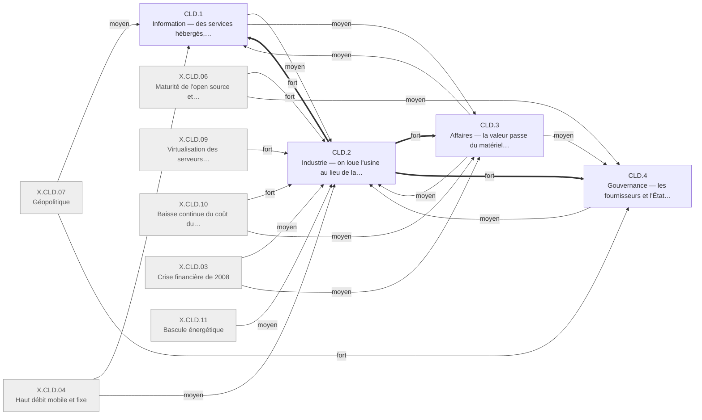

# Arbre des effets — cloud 2005-2015, en quatre ordres

Statut : première génération, construite selon le cadre de l'auteur. Changements : appuyés sur
les faits cités. Causes et poids : jugements de l'agent, à relire. Cadre et règles :
[../README.md](../README.md).

## Table of Contents

1. [Comment lire](#comment-lire) _(Lines 23-41)_
1. [CLD.0 · Ce qui a changé](#cld0--ce-qui-a-changé) _(Lines 44-104)_
1. [Branches](#branches) _(Lines 107-116)_
1. [Profil](#profil) _(Lines 119-190)_
1. [Élagués](#élagués) _(Lines 193-210)_
1. [Ouvert](#ouvert) _(Lines 213-258)_
1. [Pont avec Internet](#pont-avec-internet) _(Lines 261-288)_
1. [Journal](#journal) _(Lines 291-343)_

---

## Comment lire
<!-- Lines 23-41 -->

- **Le cadre est celui de l'auteur** ([../README.md](../README.md)) : racine commune aux deux
  chocs, quatre ordres au niveau 1 (Information, Industrie, Affaires, Gouvernance), partition
  par ce qui change, un événement découpé en un changement par ordre.
- **Arbre de résolution.** Chaque boîte dit ce que ses enfants additionnent ; chaque fait est
  cité sous une seule feuille ; les hauteurs varient (une feuille à un fait côtoie une feuille
  à treize).
- **Flèches causales** selon [../../README.md](../../README.md) : une cause `principale` par
  boîte ; `fort` (sans elle, plus de la moitié du changement disparaît), `moyen` (un quart à la
  moitié), `faible` (moins d'un quart) ; `boucle` pour une rétroaction ; `amont` pour une
  cause hors fenêtre ou hors registre, dont le choc précédent.
- **Certitude** du changement, pas de sa cause : celle de l'énoncé de la boîte, dérivée de ce
  qui le fonde (`V` vérifié à la source, `K` à vérifier, `D` disputé). Une boîte peut citer des
  faits `V` et rester `K` si son cœur ne repose que sur des faits `K`.
- Vérification : `python3 verifier_arbre.py quatre_ordres/cloud --check`, depuis
  `arbre_des_effets/`.

---

## CLD.0 · Ce qui a changé
<!-- Lines 44-104 -->

Qui : le monde · certitude : V

Causes : amont (usines et savoir-faire des survivants du choc Internet ; logiciel hébergé par abonnement né en 2000 ; diffusion d'Internet héritée du choc précédent) ; X.CLD.03 (moyen) ; X.CLD.04 (fort) ; X.CLD.05 (faible) ; X.CLD.06 (moyen) ; X.CLD.07 (moyen) ; X.CLD.09 (fort) ; X.CLD.10 (fort) ; X.CLD.11 (faible)

De 2005 à 2015, produire et exploiter un service numérique cesse d'exiger qu'on possède
l'usine : la capacité se loue à l'unité, quelques usines géantes la produisent en découplant
leur électricité du service rendu, et le travail d'exploitation devient écriture de code
(CLD.2). Mesuré en personnes atteintes, le changement le plus large est informationnel :
s'écrire, montrer photos et vidéos, accéder aux films, aux fichiers et aux démarches passe par
des services hébergés gratuits, dans la poche (CLD.1). Mesuré en argent, il est industriel : la
valeur quitte les vendeurs de salles machines pour trois loueurs américains financés sur leurs
bénéfices, sans krach, et lancer une entreprise de logiciel ne coûte plus une usine (CLD.3). Les
règles, d'abord posées par les fournisseurs et par l'État client, se déplacent après 2013 vers
l'accès des États aux données hébergées, et l'Europe, sans usine, répond par le droit (CLD.4).
Quinze feuilles sur 86 ont leur cause principale dans un confondant du registre (crise de 2008,
révélations de 2013, haut débit mobile, prix du matériel et de l'énergie) et onze dans une
tendance antérieure au choc (accès, commerce en ligne, part du travail, productivité, Chine).

<!-- GENERE:CLD.0:debut -->

<!-- GENERE:CLD.0:fin -->

---

## Branches
<!-- Lines 107-116 -->

| branche | ce qu'elle dit |
| --- | --- |
| [CLD.1 · Information](cld1_information.md) | Des services hébergés gratuits, dans la poche : s'écrire, montrer, accéder sans posséder, régler le quotidien depuis l'écran ; le public découvre l'usine et la surveillance. |
| [CLD.2 · Industrie](cld2_industrie.md) | La capacité se loue à l'unité à quelques usines géantes ; les organisations louent ; le travail passe de la machine au code ; électricité découplée ; productivité ralentie hors du choc. |
| [CLD.3 · Affaires](cld3_affaires.md) | La valeur passe des vendeurs de matériel à trois loueurs autofinancés ; nouveaux modèles (usage, abonnement, gratuit contre données) ; gains concentrés sur les firmes de tête et un bloc. |
| [CLD.4 · Gouvernance](cld4_gouvernance.md) | Normes privées et État client d'abord ; après 2013, la juridiction des données ; l'Europe répond par le droit, la souveraineté par la géographie des usines. |

---

## Profil
<!-- Lines 119-190 -->

Test de couverture demandé par l'auteur. Chaînes principales lues dans la sortie du
vérificateur : une feuille aboutit au levier (CLD.2.1, loué à l'unité), à un confondant, ou à
une cause d'amont hors du levier.

| boîte | feuilles | faits cités (jalons) | au levier | à un confondant | à une cause d'amont |
| --- | --- | --- | --- | --- | --- |
| CLD.1 Information | 16 | 52 (7) | 9 | 5 : 1.1.2, 1.1.3, 1.4.1 (X.CLD.04) ; 1.2.4 (X.CLD.06) ; 1.6.2 (X.CLD.07) | 2 : 1.1.1, 1.5.2 |
| CLD.2 Industrie | 29 | 105 (37) | 22 | 3 : 2.1.4 (X.CLD.10) ; 2.5.2 (X.CLD.03) ; 2.6.4 (X.CLD.11) | 4 : 2.4.3.2, 2.4.4, 2.5.1, 2.5.3 |
| CLD.3 Affaires | 24 | 76 (13) | 18 | 3 : 3.1.5 (X.CLD.03) ; 3.4.4 (X.CLD.04) ; 3.6.4 (X.CLD.07) | 3 : 3.4.5, 3.5.4, 3.6.2 |
| CLD.4 Gouvernance | 17 | 40 (21) | 11 | 4 : 4.3.2, 4.3.3, 4.4.2, 4.5.4 (X.CLD.07) | 2 : 4.3.1, 4.5.3 |
| **Total** | **86** | **273 sur 297 actifs (78 sur 83)** | **60** | **15** | **11** |

**Quelle mesure.** L'Information est l'ordre le plus large en personnes atteintes : 901 millions
d'usagers d'un réseau social (F.CLD.E2.002), deux tiers des adultes américains équipés d'un
téléphone intelligent (F.CLD.E1.009), 75 millions d'abonnés au flux vidéo (F.CLD.E4.004). En
argent et en capital, l'Industrie et les Affaires dominent : 678,5 Md$ d'investissement
informatique américain en 2015 (F.CLD.C2.003), 4,6 Md$ de dépenses d'équipement pour le seul
premier loueur (F.CLD.B1.001), 1,6 Md$ de chiffre d'affaires trimestriel de son activité cloud
(F.CLD.A3.001). La comparaison directe prévue par D9 (revenus des terminaux contre services
cloud) n'est pas dans le dossier : voir Ouvert.

**Événements découpés entre ordres**, chacun avec ses feuilles :

- Les révélations de 2013 : le public apprend (CLD.1.6.2), la loi américaine se réforme en
  partie (CLD.4.3.2), les fournisseurs chiffrent et font campagne (CLD.4.3.3), le droit européen
  invalide le transfert (CLD.4.4.2), l'échange transatlantique se grippe (CLD.3.6.4).
- L'Europe sans usine : valeur non captée (CLD.3.6.1), puis constat de dépendance (CLD.4.5.1),
  clouds souverains en échec (CLD.4.5.2), droit des données (CLD.4.4).
- La panne d'avril 2011 : production mutualisée (CLD.2.2.3), dépendance des clients (CLD.3.3.3),
  usine rendue visible au public (CLD.1.6.1).
- La politique fédérale « nuage d'abord » : règle d'achat (CLD.4.2.2), fermetures de centres
  (CLD.2.3.2).
- Les services dérivés : une petite équipe sur capacité louée (CLD.2.3.4), l'usage (CLD.1.2.1,
  CLD.1.2.3), le modèle gratuit et l'entrée en bourse (CLD.3.4.3), la règle d'identité imposée
  par une plateforme (CLD.4.1.3).
- « Expérimenter ne coûte plus une usine » : lancer sans serveur (CLD.2.3.4), capital
  d'amorçage et capital-risque (CLD.3.1.3).
- Les dépenses d'équipement des géants : capacité (CLD.2.2.1), capital autofinancé
  (CLD.3.1.1), concentration des firmes (CLD.3.3.1).
- La publication d'avril 2015 : taille de la branche (CLD.2.2.2), rentabilité (CLD.3.3.2).
- L'argent mobile d'Afrique de l'Est : relation bancaire captée par l'opérateur (CLD.3.4.6),
  payer sans agence (CLD.1.4.2).
- Les cours en ligne massifs : savoir (CLD.1.5.1), reconversion (CLD.2.4.3.1).
- La plateforme d'hébergement de code : communauté qui publie (CLD.1.2.4), outil de production
  (CLD.2.1.3).
- Le logiciel libre d'infrastructure de 2010 : outil (CLD.2.1.3), gouvernance par fondation
  (CLD.4.1.2) ; la métrique d'efficacité : norme privée (CLD.4.1.1), efficacité (CLD.2.6.2).
- La Chine : valeur gardée (CLD.3.6.2), marché séparé (CLD.4.5.3).

**Faits sans ordre.** Aucun. Trois faits portent sur la mesure plutôt que sur un changement ;
ils sont rangés avec le changement qu'ils qualifient : F.CLD.B2.010 (pas d'indice sectoriel
avant 2013, CLD.3.1.4), F.CLD.A3.008 (segment suivi à part, CLD.2.2.2), F.CLD.G2.007 (aucune
norme intergouvernementale, CLD.4.1.2).

**Faits entre deux ordres, et où ils sont.**

| faits | ordres possibles | placés | motif |
| --- | --- | --- | --- |
| E3.001-E3.005 (commerce en ligne) | Information, Affaires | CLD.3.4.5 | un canal de vente, comme dans l'arbre Internet |
| E3.007, E3.008, E5.004 (banque, santé, démarches) | Information, Affaires | CLD.1.4.1 | les faits mesurent l'usage, pas la valeur |
| C1.006, C1.007 (surplus non mesuré) | Industrie, Affaires | CLD.3.5.3 | la question est où va la valeur |
| D4.001, D4.008 (part du travail) | Industrie, Affaires | CLD.3.5.4 | partage de la valeur entre travail et capital |
| C2.004-C2.006 (prix de l'unité louée) | Industrie, Affaires | CLD.2.1.4 | coût de production d'une unité de calcul |
| A5.003, D3.003 (bureautique hébergée) | Information, Industrie | CLD.2.3.3 | les usagers sont des organisations |
| G3.003, G3.004, G3.010 (fermetures fédérales) | Industrie, Gouvernance | CLD.2.3.2 | la règle reste en CLD.4.2.2 ; les fermetures sont de la production |
| C3.002, D1.007, D1.010 (Inde) | Industrie, Affaires | CLD.2.3.5 | organisation de la sous-traitance |
| F3.005, H2.006 (classement militant) | Information, Industrie | CLD.1.6.1 | ce que le public apprend de l'usine |
| F4.004 (nom réel imposé) | Information, Gouvernance | CLD.4.1.3 | une plateforme fixe une règle |

---

## Élagués
<!-- Lines 193-210 -->

29 faits sur 302 et 5 jalons sur 83. Contrôle : `verifier_arbre.py quatre_ordres/cloud
--elagues` liste exactement ces 29 faits ; les jalons, que le vérificateur ne liste pas, ont été
comparés à la table des jalons.

| raison | identifiants |
| --- | --- |
| ligne de base (avant t0, contexte seulement ; repris dans le Pont) | F.CLD.A1.010, F.CLD.A2.001, F.CLD.A2.007, F.CLD.A5.001, F.CLD.B1.012, F.CLD.B3.011, F.CLD.C2.001, F.CLD.D1.001, F.CLD.D2.010, F.CLD.D3.009, F.CLD.E1.001, F.CLD.F1.001, F.CLD.F2.001, F.CLD.F3.001, F.CLD.F4.001, F.CLD.G1.001, J.CLD.2003.01, J.CLD.2003.02, J.CLD.2004.01, J.CLD.2004.02 |
| discours (tribune, débat, couverture, essai, nom du choc) | F.CLD.B2.001, F.CLD.B2.002, F.CLD.B2.005, F.CLD.F1.003, F.CLD.F1.004, F.CLD.F1.005, F.CLD.F3.002, F.CLD.F3.003, J.CLD.2006.03 |
| retiré dans le dossier | F.CLD.A5.008, F.CLD.B2.008, F.CLD.F1.007, F.CLD.F4.006, F.CLD.F4.007 |

Aucun élagage pour `doublon`, `point de série`, `hors fenêtre` ou `contexte exogène` : les
doublons entre cellules sont cités, un par ordre quand ils portent des angles distincts (par
exemple F.CLD.A1.007 en CLD.2.2.1 et F.CLD.C6.001 en CLD.3.3.1), ensemble sinon ; le contexte
exogène reste dans l'arbre en feuilles marquées (CLD.2.6.4, CLD.3.1.5, CLD.2.5.2).

---

## Ouvert
<!-- Lines 213-258 -->

**Changements suggérés sans fait** (hors de l'arbre, cibles de collecte) :

- Flux classés par les plateformes, notifications poussées : aucun fait dans le dossier.
- Traîne longue du cloud : la sous-dimension F5 n'est pas collectée pour ce choc.
- Magasins d'applications comme porte d'entrée, câbles sous-marins des fournisseurs : listés
  comme lacunes dans `par_dimension/transversal/accaparement.md`.
- Industries utilisatrices (A5-A8, décision D18) : non collectées pour le cloud ; la branche
  CLD.2.3 ne voit que les directions informatiques, les administrations et l'Inde.
- Opérateurs de réseau : aucun fait de télécoms dans la fenêtre cloud ; le déplacement de valeur
  depuis le propriétaire du réseau ne peut pas être testé.
- Comparaison terminaux contre services cloud (D9) : non collectée.
- Chaîne des conditions de possibilité (D16) : le fichier
  `par_dimension/F_culture/cloud_condition_de_possibilite.md` n'existe pas ; l'arbre s'appuie
  sur les tailles d'équipe (CLD.2.3.4) comme seule trace de coût et d'échelle.

**Incohérences du dossier relevées en construisant** (à trancher dans la collecte) :

- Application de photos de 2012 : « plusieurs centaines de millions d'usagers »
  (F.CLD.A4.002, F.CLD.D3.002) contre « plusieurs dizaines de millions » (F.CLD.F4.005).
- Filiale chinoise de calcul loué : 2009 (F.CLD.A3.005, F.CLD.G4.002) contre 2010
  (F.CLD.B3.007, J.CLD.2010.05).
- Stratégie fédérale « Cloud First » : décembre 2010 (J.CLD.2010.02) contre 8 février 2011
  (F.CLD.G3.002, `V`).

**L'intuition de l'auteur, item par item** (premier plan écrit pour Internet, supposé valoir
pour les deux chocs) :

| ordre | item | cloud | où |
| --- | --- | --- | --- |
| Information | accès et partage deviennent faciles | oui | CLD.1.2, CLD.1.3 |
| Information | substrat partagé, forte concentration | oui | CLD.1.2.1, CLD.3.4.3 |
| Information | traîne longue | non testé : aucun fait F5 cloud | — |
| Industrie | productivité | non : la productivité mesurée ralentit, le dossier ne l'impute pas au choc | CLD.2.5.1, CLD.3.5.3 |
| Industrie | organisation de la production : externalisation | oui | CLD.2.3.1, CLD.2.3.5 |
| Industrie | glissement vers les services | oui : l'informatique elle-même devient un service | CLD.2.1, CLD.2.3.3, CLD.3.4.2 |
| Industrie | une industrie entière nouvelle | oui | CLD.2.2.1, CLD.2.2.2 |
| Affaires | finance | en partie : autofinancement, amorçage, mini-cycle sans krach | CLD.3.1 |
| Affaires | accaparement | oui : oligopole à trois fermé par l'échelle | CLD.3.3.1 |
| Affaires | valeur : propriétaire du réseau → usager → fournisseur de service | en partie : du propriétaire de machines au loueur (CLD.3.2, CLD.3.3.2) ; le surplus des usagers existe mais reste au plus un tiers du PIB manquant allégué (CLD.3.5.3) ; propriétaire du réseau non testé | CLD.3.2, CLD.3.5.3 |
| Gouvernance | impact culturel venu des États-Unis | en partie seulement : un réseau social américain impose une règle d'identité qui frappe les noms non occidentaux | CLD.4.1.3 |
| Gouvernance | régulation dans et entre les États | oui | CLD.4.3, CLD.4.4, CLD.4.5 |
| Gouvernance | écart de croissance entre pays adoptants et non adoptants | non : le ralentissement touche des dizaines de pays sans lien avec leur intensité informatique ; l'écart européen précède le choc | CLD.3.5.3, CLD.2.5.3 |

---

## Pont avec Internet
<!-- Lines 261-288 -->

Ce que le cloud hérite du choc 1995-2005, dans la mesure des faits (les faits d'avant t0 sont
élagués comme ligne de base et cités ici seulement) :

- **Le logiciel hébergé existe avant le mot.** Un éditeur de relation client vend son logiciel
  comme service hébergé depuis février 2000 et le rend crédible en 2003 (F.CLD.A5.001,
  J.CLD.2003.02) ; l'abonnement prend l'échelle industrielle en 2009 (CLD.3.4.2).
- **Les survivants du Web ont déjà l'usine.** Un moteur de recherche coté en 2004 construit
  ses centres à partir de matériel banalisé (J.CLD.2004.02) ; un grand détaillant réorganise
  son informatique interne en services appelables en 2005 (J.CLD.2005.01, CLD.2.1.1).
- **Le krach laisse des centres bradés.** Une foncière se constitue en 2004 avec des centres
  rachetés à des faillites (F.CLD.B1.004, CLD.3.1.2). L'arbre Internet précédent documente
  aussi la fibre surconstruite puis bradée ([../../internet/int2_capital.md](../../internet/int2_capital.md)) ;
  le dossier cloud n'a pas de fait sur la bande passante.
- **Les entreprises gardent leurs salles machines.** Avant t0, chaque organisation achète ses
  serveurs, les amortit, les exploite avec son personnel (F.CLD.A1.010, F.CLD.C2.001,
  F.CLD.B1.012, F.CLD.D3.009, F.CLD.D2.010) : c'est l'état que CLD.2.3 défait.
- **Les prérequis sont en place.** Virtualisation courante en 2003 (F.CLD.A2.001), pile serveur
  ouverte majoritaire en 2004 (F.CLD.A2.007), 54,7 % des ménages américains connectés en 2003
  (F.CLD.E1.001), encyclopédie collaborative et communautés de développeurs déjà actives
  (F.CLD.F2.001, F.CLD.F4.001).
- **Les tendances continuent.** Emploi informatique sous son pic de 2000-2001 (F.CLD.D1.001),
  diplômes en chute après la correction (CLD.2.4.3.2), part du travail en baisse depuis 2001
  (CLD.3.5.4), regain de productivité borné à 1996-2004 (CLD.2.5.1), commerce en ligne à 2,3 %
  du détail en 2005 (amont de CLD.3.4.5).

---

## Journal
<!-- Lines 291-343 -->

**Coupe de niveau 2, par ordre.** Information par activité (se connecter, s'écrire, accéder,
régler le quotidien, savoir, découvrir l'usine). Industrie par mécanisme (levier, usines,
organisations clientes, travail, productivité, énergie). Affaires par destination de la valeur
(capital, vendeurs de matériel, oligopole, modèles, concentration, blocs). Gouvernance par qui
fixe la règle (acteurs privés, État client, renseignement, droit européen, souveraineté).
Écartés : une Information par support (texte, photo, vidéo), les faits se groupant par
activité ; une Industrie par bâtisseurs et utilisatrices, qui aurait séparé le levier, les
usines et l'énergie.

**Leviers.** « La capacité se loue à l'unité » est CLD.2.1, en Industrie, sans cause principale
(ses causes sont en amont et dans le registre) : 60 feuilles y remontent. « Expérimenter ne
coûte plus une usine » est découpé : production en CLD.2.3.4, capital en CLD.3.1.3 ; écarté :
Affaires seules, les faits portant sur des équipes et des serveurs.

**Produits dérivés.** Conformément à D9 et D16, ce sont des boîtes, pas des causes :
téléphone intelligent CLD.1.1.2, réseau social CLD.1.2.1, économie à la demande CLD.3.4.4.
X.CLD.01, X.CLD.02 et X.CLD.08 ne sont donc cités comme cause nulle part ; les autres boîtes
pointent vers ces boîtes.

**Cause principale du téléphone intelligent : X.CLD.04.** Les faits du terminal sont attribués
`co:X.CLD.04` par le dossier ; CLD.2.1 y figure à poids `fort`. Sensibilité : avec CLD.2.1
pour principale, quatre feuilles de plus (CLD.1.1.2, CLD.1.1.3, CLD.1.4.1, CLD.3.4.4)
remonteraient au levier, et l'Information n'aurait plus que deux feuilles sur seize au bout
d'un confondant (code partagé, surveillance).

**Jalons.** Cités avec le fait qu'ils doublent, dans l'ordre que leur portée désigne ; élagués
seulement pour ligne de base et discours.

**Boucles.** Déclarées `boucle` : la guerre des prix et l'échelle sur le prix unitaire
(CLD.3.3.1 et CLD.2.2.1 vers CLD.2.1.4), le modèle gratuit sur le réseau social (CLD.3.4.3 vers
CLD.1.2.1), le droit européen sur la répartition par blocs (CLD.4.4 vers CLD.3.6). Une flèche
faible CLD.2.3 vers CLD.4.2 a été retirée : elle fermait un cycle avec la politique d'achat.

**Résultats acquis respectés, non redérivés.** Productivité américaine 2,59 %/an (2000-2007)
contre 1,52 %/an (2009-2015) : CLD.2.5.1, cause principale en amont. Énergie des centres
découplée du service rendu : CLD.2.6.1. Emploi du traitement de données et de l'hébergement en
recul de 2003 à 2010 : CLD.2.4.2.2.

**Causes du registre Internet.** X.INT.05, X.INT.07 et X.INT.09 apparaissent comme texte
d'`amont`, pas comme causes, conformément à la consigne (un choc précédent est un amont).

**Hypothèse de niveau 2 pour l'Information** (à comparer avec l'arbre Internet : pull, sessions
au bureau, texte et pages, liens puis recherche, monde de l'information ; cloud : push,
toujours connecté dans la poche, photos et vidéo, flux classés par les plateformes, monde
physique par les applications). Moitié cloud, testée sur les faits :

- toujours connecté, dans la poche : **soutenu** (CLD.1.1.2, CLD.1.1.3) ;
- photos et vidéo : **soutenu** (CLD.1.2.3, CLD.1.3.1) ;
- monde physique par les applications : **en partie** (itinéraire et démarches en CLD.1.4.1,
  mise en relation à la demande en CLD.3.4.4, sans fait d'usage sur le transport ou le
  logement) ;
- push et flux classés par les plateformes : **non testés**, aucun fait (voir Ouvert).
