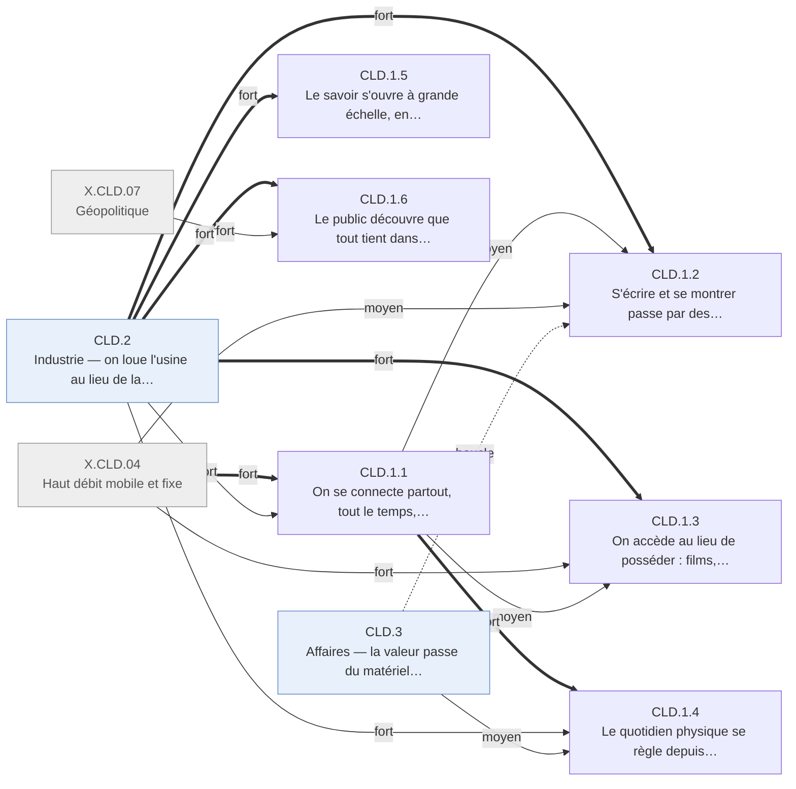

# Arbre des effets — cloud · CLD.1 Information

Branche de l'[arbre cloud](README.md). Conventions : [README.md § Comment lire](README.md#comment-lire).

## Table of Contents

1. [CLD.1 · Information — des services hébergés, gratuits, dans la poche](#cld1--information--des-services-hébergés-gratuits-dans-la-poche) _(Lines 14-147)_

---

## CLD.1 · Information — des services hébergés, gratuits, dans la poche
<!-- Lines 14-147 -->

Ce que les gens peuvent savoir et dire passe par des services hébergés gratuits, joignables
partout depuis le téléphone : s'écrire, montrer photos et vidéos, accéder aux films, aux
fichiers et aux démarches sans rien posséder ; le public découvre aussi que tout cela tient
dans quelques usines. Qui : le grand public, les développeurs, les apprenants · certitude : V

Causes : CLD.2 (principale, fort) ; X.CLD.04 (fort) ; CLD.3 (moyen) ; X.CLD.07 (moyen) ; X.CLD.06 (faible) ; X.CLD.05 (faible) ; amont (diffusion d'Internet et publication en ligne héritées du choc précédent)

L'accès prolonge la pente du choc précédent, mais le terminal change : deux adultes américains
sur trois ont un téléphone intelligent en 2015, et un connecté sur quatre se connecte de
plusieurs lieux et appareils dès 2011 (CLD.1.1). S'écrire et se montrer passe par des
plateformes gratuites hébergées : un réseau social à 901 millions d'usagers en 2012, la
messagerie et la visioconférence gratuites, la vidéo et la photo publiées sans hébergement
propre (CLD.1.2). Films, musique, documents et courriels quittent le support possédé pour un
compte distant (CLD.1.3). Banque, santé, logement, emploi, itinéraire se règlent depuis
l'écran, et en Afrique de l'Est l'argent circule sans agence (CLD.1.4). Le cours universitaire
cesse d'être borné par la salle ; la science ouverte, elle, suit une dynamique héritée
d'Internet (CLD.1.5). Enfin le public apprend que l'usine existe, par une panne, par son
électricité et, en 2013, par la surveillance (CLD.1.6). Mesure retenue : les personnes
atteintes ; en argent, cet ordre pèse moins que l'industrie (voir README § Profil).

<!-- GENERE:CLD.1:debut -->

<!-- GENERE:CLD.1:fin -->

- **CLD.1.1 · On se connecte partout, tout le temps, depuis la poche** — le grand public · V
  - Causes : X.CLD.04 (principale, fort) ; CLD.2.1 (fort) ; amont (diffusion d'Internet héritée du choc précédent)
  - L'équipement suit sa pente ; ce qui change est le terminal et la connexion permanente.
  - **CLD.1.1.1 · L'accès prolonge la pente du choc précédent, avec ses fractures** — ménages, adultes · V
    - Causes : amont (diffusion d'Internet héritée du choc précédent) ; X.CLD.04 (fort)
    - Ménages américains connectés : 68,7 % (2007), 71,7 % (2011) ; adultes usagers : 68 % (2005), 86 % (2015) ; haut débit à domicile : environ un tiers (2005), deux tiers (2015) ; en 2011, 96,1 % contre 49,8 % selon le revenu, 82 % contre 45,5 % selon l'âge ; monde : environ 16 % (2005), 43 % (2015).
    - Faits : F.CLD.E1.002, F.CLD.E1.003, F.CLD.E1.004, F.CLD.E1.005, F.CLD.E1.006, F.CLD.E1.007, F.CLD.E1.011
  - **CLD.1.1.2 · Le téléphone intelligent devient le terminal des services hébergés** — adultes · V
    - Causes : X.CLD.04 (principale, fort) ; CLD.2.1 (fort)
    - Téléphone tactile de juin 2007 dont les fonctions utiles dépendent de services distants ; cellulaire de tout type : 65 % (2004), 86 % (2011) ; téléphone intelligent : 35 % (2011), 51 % (2013), 67 % (2015) des adultes américains.
    - Faits : F.CLD.E1.008, F.CLD.E1.009, J.CLD.2007.01
  - **CLD.1.1.3 · On se connecte de plusieurs lieux et de plusieurs appareils** — jeunes adultes surtout · V
    - Causes : CLD.1.1.2 (principale, fort) ; CLD.2.1 (moyen)
    - En 2011, 27,0 % des individus en « haute connectivité » (domicile et dehors, plusieurs appareils) : 37,1 % des 18-34 ans, 5,6 % des 65 ans et plus ; 15,9 % ne se connectent nulle part.
    - Faits : F.CLD.E1.010, F.CLD.E5.001, F.CLD.E5.002
- **CLD.1.2 · S'écrire et se montrer passe par des plateformes hébergées gratuites** — le grand public, les développeurs · V
  - Causes : CLD.2.1 (principale, fort) ; CLD.2.3 (fort) ; CLD.1.1 (moyen) ; X.CLD.04 (moyen) ; X.CLD.06 (faible) ; CLD.3.4 (boucle)
  - Même mécanisme partout : une petite équipe sert une audience mondiale sur capacité louée ou propre, et le service est gratuit.
  - **CLD.1.2.1 · Un réseau social rassemble des centaines de millions d'usagers** — le grand public (monde) · V
    - Causes : CLD.2.1 (principale, fort) ; CLD.1.1.2 (moyen) ; CLD.3.4.3 (boucle)
    - 608 millions d'usagers actifs mensuels fin 2010 (+39 % sur un an), 901 millions à l'entrée en bourse de 2012, servis depuis des centres propres et des services loués.
    - Faits : F.CLD.E2.001, F.CLD.E2.002, F.CLD.F4.003, J.CLD.2010.03
  - **CLD.1.2.2 · La messagerie et la visioconférence deviennent gratuites** — possesseurs de téléphone intelligent · V
    - Causes : CLD.2.1 (principale, fort) ; CLD.1.1.2 (fort)
    - La visioconférence grand public passe de payante à gratuite, sur navigateur (2007-2015) ; en 2015, 36 % des possesseurs américains de téléphone intelligent utilisent une messagerie hébergée plutôt que le seul texto facturé à l'unité, 49 % des 18-29 ans.
    - Faits : F.CLD.E2.003, F.CLD.E2.004
  - **CLD.1.2.3 · Publier une vidéo ou une photo ne demande plus d'hébergement propre** — auteurs amateurs · K
    - Causes : CLD.2.3.4 (principale, fort) ; CLD.1.1.2 (moyen)
    - Après 2005, publier une vidéo cesse d'exiger un hébergement payé par l'auteur ; une application de photos réunit en 2012 des dizaines de millions d'usagers autour de l'image plutôt que du texte ; la photo personnelle passe de la carte mémoire au compte hébergé.
    - Faits : F.CLD.F1.002, F.CLD.F4.005, F.CLD.E4.005
  - **CLD.1.2.4 · Les développeurs publient et partagent leur code sur une plateforme commune** — développeurs · V
    - Causes : X.CLD.06 (principale, fort) ; CLD.2.1 (moyen)
    - Plateforme publique d'hébergement de code ouverte le 10 avril 2008 sur serveurs loués, devenue le lieu principal de la communauté mondiale du logiciel ouvert.
    - Faits : F.CLD.F4.002
- **CLD.1.3 · On accède au lieu de posséder : films, musique, fichiers vivent dans l'usine** — le grand public · V
  - Causes : CLD.2.1 (principale, fort) ; X.CLD.04 (fort) ; CLD.1.1 (moyen)
  - Le support possédé (disque, carte, disque dur) cède la place à un droit d'accès servi à distance.
  - **CLD.1.3.1 · Films et musique passent du support possédé au flux loué** — foyers · V
    - Causes : CLD.2.1 (principale, fort) ; X.CLD.04 (fort)
    - Loueur par correspondance : 4,179 millions d'abonnés, tous sur support physique (2005) ; flux inclus dans l'abonnement en 2007 ; 44,7 millions d'abonnés au flux aux États-Unis et 30,0 millions ailleurs (2015) ; musique en flux : 60 millions d'utilisateurs actifs dont 15 millions payants (janvier 2015).
    - Faits : F.CLD.E4.001, F.CLD.E4.002, F.CLD.E4.003, F.CLD.E4.004, F.CLD.E4.008, J.CLD.2007.08
  - **CLD.1.3.2 · Documents, photos et courriels quittent l'appareil pour un compte distant** — particuliers · K
    - Causes : CLD.2.1 (principale, fort) ; CLD.1.1.2 (moyen)
    - Stockage synchronisé : 100 millions d'usagers (novembre 2012), 200 millions (novembre 2013), des centaines de millions de comptes toutes offres confondues ; courriel archivé sans limite ; sauvegarde automatique continue à la place du tri périodique.
    - Faits : F.CLD.E3.009, F.CLD.A5.006, J.CLD.2012.04, J.CLD.2012.07, F.CLD.E2.005, F.CLD.E5.005
- **CLD.1.4 · Le quotidien physique se règle depuis l'écran** — possesseurs de téléphone, non-bancarisés · V
  - Causes : CLD.1.1 (principale, fort) ; CLD.2.1 (fort) ; CLD.3.4 (moyen)
  - Ce qui exigeait un déplacement ou un guichet passe par un service hébergé.
  - **CLD.1.4.1 · Banque, santé, logement, emploi, itinéraire passent par le téléphone** — possesseurs américains de téléphone intelligent · V
    - Causes : CLD.1.1.2 (principale, fort) ; CLD.2.1 (fort)
    - En 2015, dans l'année écoulée : 57 % pour la banque, 62 % pour une information de santé, 44 % pour chercher un logement, 43 % pour l'emploi, 40 % pour un service administratif ; la navigation hébergée, mise à jour en continu, remplace l'appareil autonome à cartes achetées.
    - Faits : F.CLD.E5.004, F.CLD.E3.007, F.CLD.E3.008, F.CLD.E4.006
  - **CLD.1.4.2 · Payer et envoyer de l'argent sans agence bancaire** — Afrique de l'Est · K
    - Causes : CLD.3.4.6 (principale, fort)
    - Plusieurs millions d'usagers dès 2008, par téléphone simple, sur une plateforme centrale d'opérateur.
    - Faits : F.CLD.E3.006
- **CLD.1.5 · Le savoir s'ouvre à grande échelle, en partie seulement par le cloud** — apprenants, chercheurs, lecteurs · V
  - Causes : CLD.2.1 (principale, fort) ; X.CLD.05 (faible) ; amont (publication scientifique en ligne et encyclopédie collaborative héritées du choc Internet)
  - **CLD.1.5.1 · Un cours universitaire n'est plus borné par la salle** — apprenants (monde) · V
    - Causes : CLD.2.1 (principale, fort)
    - Première plateforme de cours ouverts et massifs le 18 avril 2012, deux autres la même année (dont une dotée de 30 M$ par établissement) ; un million d'inscriptions en juin 2013 pour l'une d'elles.
    - Faits : F.CLD.F2.004, F.CLD.F2.005, F.CLD.F2.006, J.CLD.2012.08
  - **CLD.1.5.2 · La science et l'encyclopédie en ligne suivent une dynamique héritée d'Internet** — chercheurs, contributeurs bénévoles · V
    - Causes : amont (publication en ligne et encyclopédie collaborative héritées du choc Internet ; politiques de libre accès, hors registre) ; CLD.2.1 (faible)
    - Articles en libre accès : 20,4 % de ceux publiés en 2008, environ 45 % en 2015 ; les éditeurs actifs de l'encyclopédie anglophone déclinent dès 2007, les très actifs se stabilisent en 2015, sans lien établi avec le cloud.
    - Faits : F.CLD.F2.003, F.CLD.F2.007, F.CLD.F2.008
  - **CLD.1.5.3 · Traduire et traiter de grands jeux de données devient un service en ligne** — grand public, rédactions · K
    - Causes : CLD.2.1 (principale, fort) ; X.CLD.05 (moyen)
    - Traduction automatique gratuite, hébergée, généralisée sur la fenêtre à la place des logiciels installés ; journalisme de données reconnu en 2012, sur calcul loué et cartes hébergées.
    - Faits : F.CLD.E4.007, F.CLD.F1.006
- **CLD.1.6 · Le public découvre que tout tient dans quelques usines, accessibles aux États** — le grand public · V
  - Causes : CLD.2.2 (principale, fort) ; X.CLD.07 (fort)
  - **CLD.1.6.1 · Une panne et l'électricité rendent l'usine visible** — usagers, opinion publique · V
    - Causes : CLD.2.2 (principale, fort)
    - Du 21 au 24 avril 2011, la panne d'une région d'un fournisseur arrête ensemble de nombreux services : la confiance déléguée devient un risque partagé ; en 2010, une organisation environnementale classe les exploitants selon l'origine de leur électricité.
    - Faits : F.CLD.F3.006, F.CLD.E5.003, F.CLD.F3.005, F.CLD.H2.006, J.CLD.2010.08
  - **CLD.1.6.2 · Le public apprend que ses données hébergées sont accessibles au renseignement** — adultes américains · V
    - Causes : X.CLD.07 (principale, fort) ; CLD.2.2 (moyen)
    - Après juin 2013 : 91 % des adultes estiment avoir perdu le contrôle de leurs informations personnelles (janvier 2014) ; 34 % des informés prennent au moins une mesure de protection ; l'acceptation d'un programme de surveillance passe de 51 % (2006) à 56 % (2013), avec une inversion partisane.
    - Faits : F.CLD.F3.004, F.CLD.F3.007, F.CLD.F3.008, F.CLD.F3.009, F.CLD.F3.010
