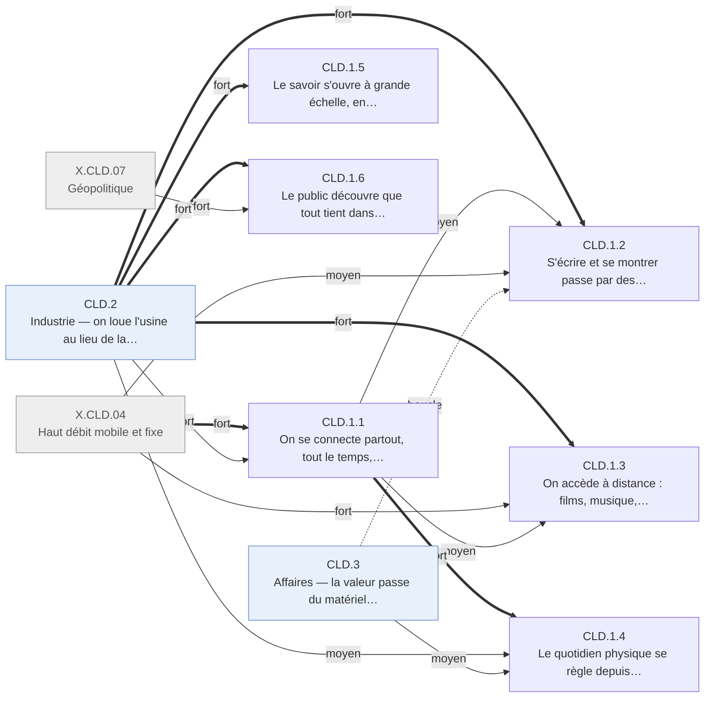

# Arbre des effets — cloud · CLD.1 Information

Branche de l'[arbre cloud](README.md). Conventions : [README.md § Comment lire](README.md#comment-lire).

## Table of Contents

1. [CLD.1 · Information — des services hébergés, gratuits, dans la poche](#cld1--information--des-services-hébergés-gratuits-dans-la-poche) _(Lines 14-153)_

---

## CLD.1 · Information — des services hébergés, gratuits, dans la poche
<!-- Lines 14-153 -->

Ce que les gens peuvent savoir et dire passe par des services hébergés gratuits pour l'usager
là où les faits le disent (réseau social, appel vidéo), joignables partout depuis le
téléphone : s'écrire, montrer photos et vidéos, accéder à distance aux films, aux fichiers et
aux démarches ; le public découvre aussi que tout cela tient dans quelques usines. Qui : le
grand public, les développeurs, les apprenants · certitude : A

Causes : CLD.2 (principale, fort) ; X.CLD.04 (fort) ; CLD.3 (moyen) ; X.CLD.07 (moyen) ; X.CLD.06 (faible) ; X.CLD.05 (faible) ; amont (diffusion d'Internet et publication en ligne héritées du choc précédent)

L'accès prolonge la pente du choc précédent, mais le terminal change : deux adultes américains
sur trois ont un téléphone intelligent en 2015, et 27,0 % se classent en « haute connectivité »
(plusieurs lieux et appareils) dès 2011 (CLD.1.1). S'écrire et se montrer passe par des
plateformes hébergées, gratuites pour l'usager : un réseau social à 901 millions d'usagers
actifs mensuels au 31 mars 2012, l'appel vidéo sans frais et la messagerie hébergée, la vidéo
et la photo publiées par leurs auteurs sur des services en ligne (CLD.1.2). Les films passent
du support physique au flux, la musique en flux compte 60 millions d'utilisateurs actifs en
janvier 2015, documents et courriels se stockent dans un compte distant (CLD.1.3). Banque,
santé, logement, emploi, itinéraire se règlent depuis le téléphone, et au Kenya l'argent
circule par téléphone mobile (CLD.1.4). Le cours universitaire cesse d'être borné par la
salle ; la science ouverte et l'encyclopédie en ligne suivent leur propre dynamique
(CLD.1.5). Enfin le public apprend que l'usine existe, par une panne, par des rapports sur
son électricité et, en 2013, par la surveillance (CLD.1.6) ; « quelques usines » s'appuie sur
une mesure postérieure à la fenêtre (trois exploitants, 75 à 90 % du marché européen, estimation
de 2020 dans une étude de 2022 : CLD.3.3.1). Mesure retenue : les personnes
atteintes ; en argent, cet ordre pèse moins que l'industrie (voir README § Profil).

<!-- GENERE:CLD.1:debut -->

<!-- GENERE:CLD.1:fin -->

- **CLD.1.1 · On se connecte partout, tout le temps, depuis la poche** — le grand public · V
  - Causes : X.CLD.04 (principale, fort) ; CLD.2.1 (fort) ; amont (diffusion d'Internet héritée du choc précédent)
  - L'équipement suit sa pente ; ce qui change est le terminal et la connexion permanente.
  - **CLD.1.1.1 · L'accès prolonge la pente du choc précédent, avec ses fractures** — ménages, adultes · V
    - Causes : amont (diffusion d'Internet héritée du choc précédent) ; X.CLD.04 (fort)
    - Ménages américains équipés d'un ordinateur : 61,8 % (2003), 75,6 % (2011) ; connectés : 68,7 % (2007), 71,7 % (2011) ; adultes usagers : 68 % (2005), 86 % (2015) ; haut débit à domicile : environ un tiers (2005), deux tiers (2015) ; écart d'usage à domicile entre ménages blancs non hispaniques et noirs : 22,5 points (2000), 19,3 points (2011) ; en 2011, 96,1 % contre 49,8 % selon le revenu, 82 % contre 45,5 % selon l'âge ; monde : environ 16 % (2005, ordre de grandeur), 43,4 % (2015, estimation de l'organisme international des télécommunications), avec en 2015 77,6 % en Europe, 36,9 % en Asie-Pacifique, 20,8 % en Afrique.
    - Faits : F.CLD.E1.002, F.CLD.E1.003, F.CLD.E1.004, F.CLD.E1.005, F.CLD.E1.006, F.CLD.E1.007, F.CLD.E1.011
  - **CLD.1.1.2 · Le téléphone intelligent devient le terminal des services hébergés** — adultes · V
    - Causes : X.CLD.04 (principale, fort) ; CLD.2.1 (fort)
    - Mise en vente, le 29 juin 2007, d'un téléphone à écran multitactile présenté comme « Internet in your pocket », avec messagerie, navigation web et cartes ; cellulaire de tout type : 65 % (2004), 86 % (2011) ; téléphone intelligent possédé : 35 % (2011), 51 % (2013), 67 % (2015) des adultes américains.
    - Faits : F.CLD.E1.008, F.CLD.E1.009, J.CLD.2007.01
  - **CLD.1.1.3 · On se connecte de plusieurs lieux et de plusieurs appareils** — jeunes adultes surtout · V
    - Causes : CLD.1.1.2 (principale, fort) ; CLD.2.1 (moyen)
    - En 2011, 27,0 % se classent en « haute connectivité » (domicile et dehors, plusieurs appareils) : 37,1 % des 18-34 ans, 5,6 % des 65 ans et plus ; 15,9 % ne se connectent nulle part ; les deux lignes qui portent le 27,0 % ne s'accordent pas sur sa base (individus connectés, ou adulte sur cinq, 57 % des utilisateurs).
    - Faits : F.CLD.E1.010, F.CLD.E5.001, F.CLD.E5.002
- **CLD.1.2 · S'écrire et se montrer passe par des plateformes hébergées, gratuites pour l'usager** — le grand public, les développeurs · A
  - Causes : CLD.2.1 (principale, fort) ; CLD.2.3 (fort) ; CLD.1.1 (moyen) ; CLD.2.2 (boucle) ; X.CLD.04 (moyen) ; X.CLD.06 (faible) ; CLD.3.4 (boucle)
  - Un service en ligne commun sert une large audience. L'usager ne paie pas là où les faits disent le prix : le réseau social est décrit comme gratuit et tire sa recette de la publicité (CLD.3.4.3), l'appel vidéo est sans frais (CLD.1.2.2) ; pour la vidéo publiée, la photo et le code, aucun fait ne dit le prix.
  - **CLD.1.2.1 · Un réseau social rassemble des centaines de millions d'usagers** — le grand public (monde) · A
    - Causes : CLD.2.2 (principale, fort) ; CLD.2.1 (moyen) ; CLD.1.1.2 (moyen) ; CLD.3.4.3 (boucle)
    - 500 millions d'usagers actifs annoncés en juillet 2010 ; 608 millions d'usagers actifs mensuels au 31 décembre 2010 ; 901 millions au 31 mars 2012, chiffre du prospectus d'introduction en bourse.
    - Faits : F.CLD.E2.001, F.CLD.E2.002, F.CLD.F4.003, J.CLD.2010.03
  - **CLD.1.2.2 · S'appeler en vidéo sans frais et s'écrire par des services hébergés plutôt que par le texto facturé à l'unité** — internautes, puis possesseurs de téléphone intelligent · A
    - Causes : CLD.1.1.2 (principale, fort) ; CLD.2.1 (moyen)
    - L'appel vidéo gratuit entre usagers apparaît en décembre 2005 dans un logiciel de téléphonie sur Internet (version bêta pour Windows, d'ordinateur à ordinateur, sans frais), puis en novembre 2008 dans une messagerie web, sans frais, avec un module de navigateur d'environ 2 Mo à installer ; en 2015, 36 % des possesseurs américains de téléphone intelligent utilisent une application de messagerie hébergée plutôt que le seul message texte facturé à l'unité, 49 % des 18-29 ans contre 24 % des 50 ans et plus.
    - Faits : F.CLD.E2.003, F.CLD.E2.004
  - **CLD.1.2.3 · Publier une vidéo ou une photo passe par un service en ligne** — auteurs amateurs · A
    - Causes : CLD.2.3.4 (principale, fort) ; CLD.1.1.2 (moyen)
    - Un service de partage de vidéos, dont la première vidéo est mise en ligne le 23 avril 2005, permet à ses utilisateurs de mettre eux-mêmes leurs vidéos en ligne : 65 000 nouvelles vidéos par jour en octobre 2006 ; une application de partage de photographies compte plusieurs dizaines de millions d'usagers (environ 33 M, ordre de grandeur) à l'annonce de son rachat, le 9 avril 2012 ; un service hébergé annoncé le 6 juin 2011 téléverse automatiquement les photos d'un appareil vers les autres appareils de l'usager ; en août 2012, 45 % des internautes adultes américains déclarent avoir partagé en ligne des photos qu'ils ont prises eux-mêmes.
    - Faits : F.CLD.F1.002, F.CLD.F4.005, F.CLD.E4.005
  - **CLD.1.2.4 · Les développeurs publient et partagent leur code sur une plateforme commune** — développeurs · V
    - Causes : X.CLD.06 (principale, fort) ; CLD.2.1 (moyen)
    - Plateforme publique d'hébergement de code ouverte le 10 avril 2008 sur serveurs loués, devenue le lieu principal de la communauté mondiale du logiciel ouvert.
    - Faits : F.CLD.F4.002
- **CLD.1.3 · On accède à distance : films, musique, fichiers vivent dans l'usine** — le grand public · A
  - Causes : CLD.2.1 (principale, fort) ; X.CLD.04 (fort) ; CLD.1.1 (moyen)
  - Le film envoyé sur support physique cède la place au flux, et les fichiers et courriels se stockent sur un compte distant.
  - **CLD.1.3.1 · Le flux remplace le support physique pour les films et gagne la musique** — foyers · A
    - Causes : CLD.2.1 (principale, fort) ; X.CLD.04 (fort)
    - Service de location de vidéo : 4,179 millions d'abonnés fin 2005, tous sur support physique envoyé par courrier ; le 16 janvier 2007, annonce d'un visionnage immédiat sur ordinateur, sans coût supplémentaire dans les abonnements existants, environ 1 000 titres, déployé par phases ; fin 2013, 33,420 millions d'abonnés au flux aux États-Unis et 10,930 millions à l'international, la majorité en flux ; fin 2015, 44,738 millions aux États-Unis et 30,024 millions à l'international ; musique en flux : 60 millions d'utilisateurs actifs et 15 millions d'abonnés payants annoncés le 12 janvier 2015, contre 50 millions et 12,5 millions deux mois plus tôt ; côté production, en mai 2010 un grand fournisseur de capacité louée annonce que ce service de vidéo l'a choisi pour exécuter des applications destinées aux clients et d'arrière-plan, dont le traitement et le stockage de sa bibliothèque de films, et en février 2016 le service indique avoir achevé en janvier 2016 sa migration vers ce fournisseur, entamée en août 2008, et fermé les derniers éléments de centre de données de son service de flux (annonce et achèvement : hors fenêtre pour 2016).
    - Faits : F.CLD.E4.001, F.CLD.E4.002, F.CLD.E4.003, F.CLD.E4.004, F.CLD.E4.008, J.CLD.2007.08, F.CLD.A4.011
  - **CLD.1.3.2 · Documents et courriels se stockent dans un compte distant** — particuliers · A
    - Causes : CLD.2.1 (principale, fort) ; CLD.1.1.2 (moyen)
    - Stockage synchronisé : 100 millions d'usagers (13 novembre 2012), 200 millions (13 novembre 2013), 300 millions (mai 2014), pour un service ouvert au public le 11 septembre 2008 ; deux autres offres de stockage grand public annoncent 240 millions d'usagers actifs (septembre 2014) et plus de 250 millions ; en mars 2007, un grand service de messagerie gratuit annonce un stockage illimité à partir de mai 2007 ; un service hébergé annoncé le 6 juin 2011 sauvegarde chaque jour les appareils de l'usager sur Wi-Fi, avec 5 Go gratuits ; dans un billet de mars 2016 (hors fenêtre), l'entreprise du service de stockage synchronisé indique avoir toujours eu une architecture hybride, métadonnées et serveurs web dans ses propres centres de données, contenu des fichiers chez Amazon, dont elle a été l'une des premières utilisatrices du service S3, et s'être fixé pour 2015 l'objectif de servir 90 % de ses données depuis sa propre infrastructure d'ici le 30 octobre.
    - Faits : F.CLD.E3.009, F.CLD.A5.006, J.CLD.2012.04, J.CLD.2012.07, F.CLD.E2.005, F.CLD.E5.005, F.CLD.E3.010
- **CLD.1.4 · Le quotidien physique se règle depuis l'écran** — possesseurs de téléphone · A
  - Causes : CLD.1.1 (principale, fort) ; CLD.2.1 (moyen) ; CLD.3.4 (moyen)
  - Ce qui exigeait un déplacement ou un guichet passe par un service hébergé.
  - **CLD.1.4.1 · Banque, santé, logement, emploi, itinéraire passent par le téléphone** — possesseurs américains de téléphone intelligent · A
    - Causes : CLD.1.1.2 (principale, fort) ; CLD.2.1 (moyen)
    - En 2015, dans l'année écoulée : 57 % pour la banque, 62 % pour une information de santé, 44 % pour chercher un logement, 43 % pour l'emploi, 40 % pour un service administratif ; en novembre 2009, une dépêche décrit les téléphones à GPS, dont une application gratuite de guidage pas à pas, comme un défi pour les fabricants d'appareils de navigation autonomes ; l'un d'eux tire de sa gamme 54 % de son chiffre d'affaires consolidé en 2010, 48 % en 2011, 43 % en 2012, et indique que l'extension de la navigation sur les téléphones et dans les automobiles neuves pourrait réduire encore ses ventes.
    - Faits : F.CLD.E5.004, F.CLD.E3.007, F.CLD.E3.008, F.CLD.E4.006
  - **CLD.1.4.2 · Payer et envoyer de l'argent par téléphone mobile, hors des agences bancaires** — Afrique de l'Est · A
    - Causes : CLD.3.4.6 (principale, fort)
    - Au Kenya, un service de transfert d'argent par téléphone mobile, exploité par le premier opérateur mobile du pays et alimenté par des dépôts d'espèces chez des agents, compte 2,075 millions d'usagers enregistrés en mars 2008, puis 6,175 millions en mars 2009 (la même plateforme est décrite sans réseau d'agences bancaires en CLD.3.4.6).
    - Faits : F.CLD.E3.006
- **CLD.1.5 · Le savoir s'ouvre à grande échelle, en partie seulement par le cloud** — apprenants, chercheurs, lecteurs · A
  - Causes : CLD.2.1 (principale, fort) ; CLD.2.2 (faible) ; X.CLD.05 (faible) ; amont (publication scientifique en ligne et encyclopédie collaborative héritées du choc Internet)
  - **CLD.1.5.1 · Un cours universitaire n'est plus borné par la salle** — apprenants (monde) · A
    - Causes : CLD.2.1 (principale, fort)
    - Le terme « MOOC » est forgé en 2008 pour un cours en ligne ouvert ; à l'automne 2011, une université lance trois cours en ligne ouverts, dont un réunit 160 000 inscrits ; en juin 2012, plus de 1,5 million de personnes se sont inscrites à des cours de trois plateformes ; ouverture au public, le 18 avril 2012, d'une plateforme de cours en ligne ouverts et massifs adossée à des services hébergés, première de trois plateformes majeures lancées la même année ; l'une des deux autres, annoncée le 2 mai 2012 par deux universités, est dotée de 30 M$ par université ; en juin 2013, l'une d'elles annonce un million d'étudiants, alors que ses inscriptions à des cours avaient dépassé le million dès mars 2013 ; une autre annonce le 10 juillet 2013 quatre millions d'étudiants.
    - Faits : F.CLD.F2.004, F.CLD.F2.005, F.CLD.F2.006, J.CLD.2012.08, F.CLD.D2.008
  - **CLD.1.5.2 · Le libre accès progresse et l'encyclopédie collaborative cesse de croître, sans lien établi avec le cloud** — chercheurs, contributeurs bénévoles · V
    - Causes : amont (publication en ligne et encyclopédie collaborative héritées du choc Internet ; politiques de libre accès, hors registre) ; CLD.2.1 (faible)
    - Articles en libre accès : 20,4 % de ceux publiés en 2008 (étude bibliométrique, mesure en 2009-2010), 44,7 % de ceux publiés en 2015 (autre étude, échantillon aléatoire de 100 000 articles) ; les éditeurs actifs de l'encyclopédie collaborative anglophone cessent de croître et déclinent de façon constante dès le début de 2007, les très actifs atteignent en août 2015 leur plus haut niveau depuis mars 2011 (3 458) ; trajectoire propre au modèle de contribution bénévole, sans lien direct établi avec le cloud.
    - Faits : F.CLD.F2.003, F.CLD.F2.007, F.CLD.F2.008
  - **CLD.1.5.3 · La traduction automatique devient un service en ligne gratuit d'usage et le journalisme de données s'installe dans les rédactions** — grand public, rédactions · A
    - Causes : CLD.2.2 (principale, moyen) ; X.CLD.05 (moyen) ; CLD.2.1 (faible)
    - Un service en ligne de traduction automatique statistique, décrit comme gratuit d'usage, est lancé le 28 avril 2006, d'abord pour l'arabe et l'anglais ; un manuel de journalisme de données, élaboré avec des contributeurs de rédactions et en accès libre, est présenté fin avril 2012 à un festival international de journalisme ; un historique du domaine date de 2009 le lancement du blog de données d'un quotidien et range 2009-2011 parmi les années de percée du journalisme de données ; en 2007, des chercheurs de l'entreprise exploitante, dont l'auteur du billet de lancement, décrivent un système de traduction statistique dont les modèles de langue sont entraînés avec MapReduce sur une infrastructure distribuée de l'entreprise (jusqu'à 1 500 machines, jusqu'à 2 000 milliards de mots) et consultés par le décodeur auprès de serveurs ; l'article ne dit pas que ce système est le service en ligne.
    - Faits : F.CLD.E4.007, F.CLD.F1.006, F.CLD.E4.009
- **CLD.1.6 · Le public découvre que tout tient dans quelques usines, accessibles aux États** — le grand public · A
  - Causes : CLD.2.2 (principale, fort) ; X.CLD.07 (fort)
  - Ce que le public voit : la panne d'une région (CLD.1.6.1) et l'accès des services de renseignement aux données stockées (CLD.1.6.2). « Quelques usines » reprend la mesure de concentration de CLD.3.3.1, postérieure à la fenêtre : estimation de 2020, dans une étude de 2022, de 75 à 90 % du marché européen pour trois exploitants.
  - **CLD.1.6.1 · Une panne et des rapports sur son électricité rendent l'usine visible au public** — usagers, opinion publique · A
    - Causes : CLD.2.2 (principale, fort)
    - Du 21 au 24 avril 2011, un changement de configuration réseau dans une zone de disponibilité de la région US East d'un grand fournisseur de capacité louée bloque environ 13 % des volumes de stockage de cette zone et rend indisponibles plusieurs services en ligne connus, 0,07 % des volumes ne pouvant être restaurés dans un état cohérent ; l'événement donne un contenu concret à l'idée que la confiance déléguée à un hébergeur est un risque partagé par ses clients ; en mars 2010, une organisation environnementale publie un rapport qui compare des centres de données de grands exploitants selon la part du charbon, du nucléaire et des énergies renouvelables dans le réseau électrique local, puis, le 21 avril 2011, un classement de dix grands services d'hébergement selon leur dépendance au charbon et leur recours aux énergies renouvelables (documents militants, cités comme discours).
    - Faits : F.CLD.F3.006, F.CLD.E5.003, F.CLD.F3.005, F.CLD.H2.006, J.CLD.2010.08
  - **CLD.1.6.2 · Le public apprend que ses données hébergées sont accessibles au renseignement** — adultes américains · A
    - Causes : X.CLD.07 (principale, fort) ; CLD.2.2 (moyen)
    - Le 6 juin 2013, deux quotidiens publient les premières révélations sur un programme de renseignement américain qui collecte des communications et des données stockées auprès de fournisseurs de services en ligne ; en 2013, 56 % des Américains jugent acceptable un programme de suivi des relevés téléphoniques par les services de renseignement, contre 51 % en 2006 pour un programme comparable (enquête de janvier 2006 : 51 % acceptable, 47 % inacceptable, 1 001 adultes), avec un clivage partisan inversé ; dans une enquête du 26 novembre 2014 au 3 janvier 2015, 34 % des Américains qui ont entendu parler des programmes de surveillance (30 % de l'ensemble des adultes) déclarent avoir pris au moins une mesure pour cacher leurs informations au gouvernement, seule une petite fraction recourant à des outils plus sophistiqués tels que le chiffrement ; 91 % des adultes interrogés estiment en janvier 2014 avoir perdu le contrôle sur la manière dont leurs informations personnelles sont collectées et utilisées.
    - Faits : F.CLD.F3.004, F.CLD.F3.007, F.CLD.F3.008, F.CLD.F3.009, F.CLD.F3.010
