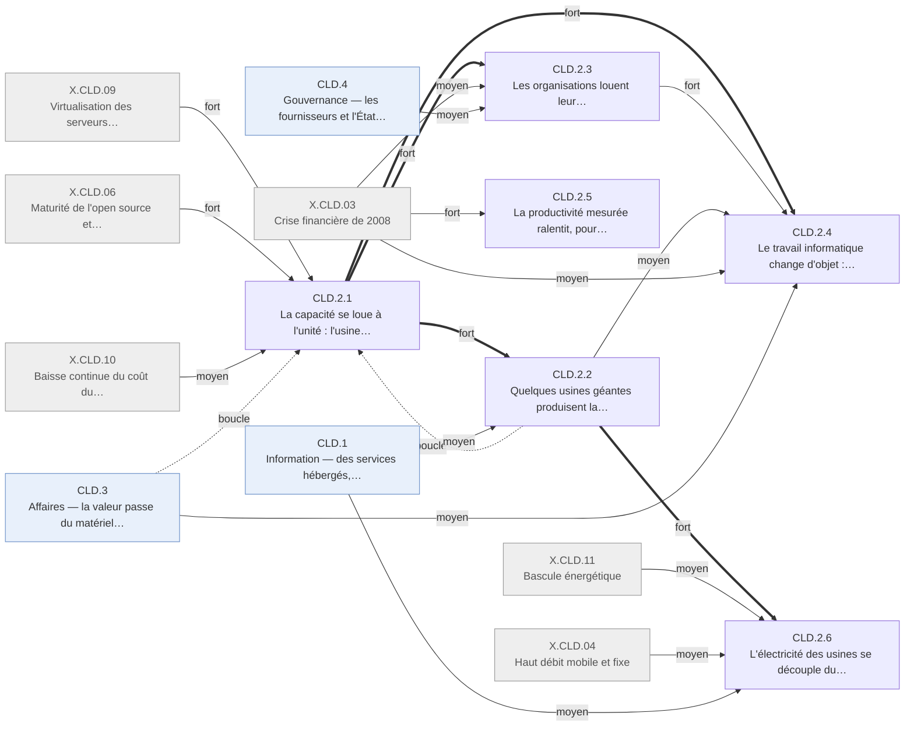

# Arbre des effets — cloud · CLD.2 Industrie

Branche de l'[arbre cloud](README.md). Conventions : [README.md § Comment lire](README.md#comment-lire).

## Table of Contents

1. [CLD.2 · Industrie — on loue l'usine au lieu de la posséder](#cld2--industrie--on-loue-lusine-au-lieu-de-la-posséder) _(Lines 14-215)_

---

## CLD.2 · Industrie — on loue l'usine au lieu de la posséder
<!-- Lines 14-215 -->

Produire un service numérique ne demande plus de posséder l'usine : la capacité se loue à
l'unité à quelques usines géantes, qui découplent leur électricité du service rendu, et le
travail d'exploitation devient écriture de code ; la productivité mesurée, elle, ralentit pour
des causes surtout extérieures au choc. Qui : toute organisation qui produit ou exploite du
logiciel, et ses informaticiens · certitude : V

Causes : amont (usines et savoir-faire des survivants du choc Internet ; logiciel hébergé par abonnement né en 2000 ; hors registre) ; X.CLD.09 (fort) ; X.CLD.10 (fort) ; X.CLD.06 (fort) ; X.CLD.03 (moyen) ; X.CLD.11 (moyen) ; X.CLD.04 (moyen) ; X.CLD.05 (faible) ; X.CLD.07 (faible) ; CLD.1 (moyen) ; CLD.3 (moyen) ; CLD.4 (moyen)

Le levier du choc est ici : depuis 2006, stockage et calcul se louent au gigaoctet et à
l'heure, puis la délégation monte jusqu'à la fonction facturée à l'appel, sur des outils
devenus ouverts et portables (CLD.2.1). Cette capacité est produite par quelques usines
géantes : l'informatique redevient une industrie lourde, assez grande pour être mesurée à part,
et sa panne devient collective (CLD.2.2). Les organisations clientes passent de l'achat à la
location ; une équipe de quelques personnes sert une audience mondiale ; la sous-traitance
indienne change de tâche (CLD.2.3). Le travail informatique change d'objet, de la machine au
code : les développeurs doublent presque pendant que l'emploi de l'hébergement recule
(CLD.2.4). La productivité américaine mesurée ralentit après 2009, pour des causes que le
dossier situe surtout hors du choc (CLD.2.5). L'électricité des usines se découple du service
rendu, par leur taille et leur efficacité, pendant que l'énergie change de prix pour d'autres
raisons (CLD.2.6).

<!-- GENERE:CLD.2:debut -->

<!-- GENERE:CLD.2:fin -->

- **CLD.2.1 · La capacité se loue à l'unité : l'usine n'a plus à être possédée** — toute organisation qui produit du logiciel · V
  - Causes : amont (usine interne d'un grand détaillant en ligne, réorganisée en services appelables en 2005) ; X.CLD.09 (fort) ; X.CLD.06 (fort) ; X.CLD.10 (moyen) ; X.CLD.05 (faible) ; CLD.2.2 (boucle) ; CLD.3.3 (boucle)
  - Le levier principal du choc, et l'essence posée par le dossier : produire et exploiter un service ne demande plus de posséder l'usine.
  - **CLD.2.1.1 · Stockage et calcul se louent au gigaoctet et à l'heure, sans contrat** — développeurs, organisations · V
    - Causes : amont (usine interne d'un grand détaillant en ligne, réorganisée en services appelables par interface en 2005) ; X.CLD.09 (fort) ; X.CLD.06 (moyen) ; X.CLD.10 (moyen)
    - Stockage d'objets ouvert le 14 mars 2006 à 0,15 $/Go/mois sans minimum ; machines virtuelles à l'heure en août 2006, démarrées et arrêtées par programme ; 2,9 milliards d'objets stockés fin 2006, 14 milliards fin 2007.
    - Faits : F.CLD.A1.003, F.CLD.A1.004, F.CLD.A1.005, J.CLD.2005.01, J.CLD.2006.01, J.CLD.2006.02, J.CLD.2007.04
  - **CLD.2.1.2 · La délégation monte d'étage : de la machine louée à la plateforme, puis à la fonction** — développeurs · V
    - Causes : CLD.2.1.1 (principale, fort)
    - Plateforme d'exécution où le développeur ne gère ni machine ni système (avril 2008) ; exécution de code facturée par tranche de 100 ms (novembre 2014) : l'unité facturée descend de la machine-heure à la fonction.
    - Faits : F.CLD.A4.003, F.CLD.A4.009, J.CLD.2008.02, J.CLD.2014.05
  - **CLD.2.1.3 · Les outils de l'usine deviennent ouverts et portables** — équipes d'exploitation, éditeurs · V
    - Causes : CLD.2.1.1 (principale, fort) ; X.CLD.06 (fort) ; X.CLD.05 (moyen)
    - Calcul distribué sur machines banalisées (article 2004, cadre libre 2006) ; bases non relationnelles distribuées devenues courantes (2009) ; logiciel libre pour bâtir sa propre usine (juillet 2010) ; conteneur standard (mars 2013) et orchestrateur publié en libre par un grand exploitant (juin 2014) ; le code lui-même s'héberge sur une plateforme louée (2008).
    - Faits : F.CLD.A2.002, F.CLD.A2.004, F.CLD.A2.005, F.CLD.A2.006, F.CLD.A2.008, J.CLD.2005.04, J.CLD.2006.05, J.CLD.2008.06, J.CLD.2009.03, J.CLD.2013.05, J.CLD.2014.03
  - **CLD.2.1.4 · Le prix de l'unité louée baisse plusieurs fois par an, d'abord par le coût du matériel** — clients de capacité louée · K
    - Causes : X.CLD.10 (principale, fort) ; CLD.2.2.1 (boucle) ; CLD.3.3.1 (boucle)
    - Indices de prix du matériel en baisse continue depuis avant 2005 ; stockage au gigaoctet et calcul à l'heure en baisse d'un ordre de grandeur sur la décennie (non chiffré précisément) ; baisses de tarif répétées sans changement de contrat en 2012-2015.
    - Faits : F.CLD.A1.006, F.CLD.C2.004, F.CLD.C2.005, F.CLD.C2.006, J.CLD.2012.01
- **CLD.2.2 · Quelques usines géantes produisent la capacité louée** — grands exploitants, marché mondial · V
  - Causes : CLD.2.1 (principale, fort) ; CLD.1.2 (moyen)
  - **CLD.2.2.1 · L'informatique redevient une industrie lourde, concentrée sur quelques exploitants** — grands exploitants · V
    - Causes : CLD.2.1.1 (principale, fort) ; CLD.1.2 (moyen)
    - Dépenses d'équipement du premier loueur : 224 M$ (2007), 979 M$ (2010), 3 785 M$ (2012), sans année de recul depuis 2009 ; en 2015, les quelques plus grands opérateurs dépensent plus en centres de données que tout le reste de l'industrie informatique (agrégat, K).
    - Faits : F.CLD.A1.001, F.CLD.A1.002, F.CLD.A1.007, J.CLD.2007.02, J.CLD.2015.05
  - **CLD.2.2.2 · Une branche nouvelle naît, assez grande pour être mesurée à part** — fournisseurs de capacité · V
    - Causes : CLD.2.1.1 (principale, fort)
    - Le marché est suivi comme segment distinct à partir de 2013 (chiffres de cabinets non repris) ; en avril 2015, l'activité cloud du premier loueur publie 1 566 M$ de chiffre d'affaires trimestriel, +49 % sur un an.
    - Faits : F.CLD.A3.001, F.CLD.A3.008, J.CLD.2013.06
  - **CLD.2.2.3 · La mutualisation de l'usine mutualise la panne** — services qui en dépendent · K
    - Causes : CLD.2.2.1 (principale, fort)
    - Avril 2011 : la panne d'une région d'un grand fournisseur arrête ensemble de nombreux services indépendants.
    - Faits : J.CLD.2011.02
- **CLD.2.3 · Les organisations louent leur informatique au lieu de la posséder** — organisations clientes · V
  - Causes : CLD.2.1 (principale, fort) ; X.CLD.03 (moyen) ; CLD.4.2 (moyen)
  - **CLD.2.3.1 · Les grandes organisations passent de l'achat à la location et ferment leurs centres** — directions informatiques · K
    - Causes : CLD.2.1.1 (principale, fort) ; X.CLD.03 (moyen)
    - À partir de 2008, les directions séparent dépense en capital et dépense de fonctionnement et louent plutôt qu'acheter, la crise servant d'argument ; en 2014, des grandes entreprises hors technologie annoncent fermer la majorité de leurs centres de données.
    - Faits : F.CLD.A4.004, F.CLD.C2.002, F.CLD.D3.005, J.CLD.2008.04, F.CLD.A4.008, J.CLD.2014.02
  - **CLD.2.3.2 · Les agences fédérales américaines ferment leurs centres, plus lentement qu'annoncé** — agences fédérales · V
    - Causes : CLD.4.2.2 (principale, fort)
    - Inventaires incomplets en juillet 2011 ; 420 centres fermés fin 2012 sur 1 253 visés d'ici 2015 ; économies encore non vérifiables en 2014.
    - Faits : F.CLD.G3.003, F.CLD.G3.004, F.CLD.G3.010
  - **CLD.2.3.3 · Le courriel et les documents de l'organisation quittent ses murs** — employés de bureau · V
    - Causes : CLD.2.1.1 (principale, fort)
    - Suite bureautique en ligne gratuite pour les organisations le 28 août 2006 ; courriel, documents partagés et visioconférence hébergés se diffusent comme condition technique du travail à distance, sans que le télétravail mesuré suive au même rythme.
    - Faits : F.CLD.A5.003, J.CLD.2006.04, F.CLD.D3.003
  - **CLD.2.3.4 · Une équipe de quelques personnes sert une audience mondiale** — fondateurs, jeunes pousses · K
    - Causes : CLD.2.1 (principale, fort)
    - Service de partage vidéo lancé en 2005 par trois fondateurs sans infrastructure de diffusion propre ; application de photos à plusieurs centaines de millions d'usagers pour environ treize employés en 2012 ; dès 2009, lancer une entreprise de logiciel sans acheter de serveur devient la norme.
    - Faits : F.CLD.A4.001, F.CLD.A4.002, F.CLD.A4.005, F.CLD.D3.001, F.CLD.D3.002, J.CLD.2005.05
  - **CLD.2.3.5 · La sous-traitance indienne passe de la gestion de parcs à l'intégration de services loués** — secteur indien des services informatiques · K
    - Causes : CLD.2.3.1 (principale, fort) ; X.CLD.03 (faible)
    - Réorientation vers 2012, changement de nature du travail exporté plus que de volume ; effectifs qualifiés de 1,96 million (2008) à 2,77 millions (2012, estimation), sans rupture pendant la crise ; 2,8 millions d'emplois directs et 8,9 millions indirects en 2012.
    - Faits : F.CLD.A5.005, F.CLD.C3.002, F.CLD.D3.008, J.CLD.2012.05, F.CLD.D1.007, F.CLD.D1.010
- **CLD.2.4 · Le travail informatique change d'objet : de la machine au code** — informaticiens · V
  - Causes : CLD.2.1 (principale, fort) ; CLD.2.3 (fort) ; CLD.2.2 (moyen) ; X.CLD.03 (moyen) ; X.CLD.06 (faible) ; CLD.3.4 (moyen) ; amont (creux de la formation informatique après la correction de 2000-2002)
  - **CLD.2.4.1 · Exploiter devient écrire du code** — administrateurs, directions informatiques · K
    - Causes : CLD.2.1 (principale, fort) ; CLD.2.3 (moyen)
    - **CLD.2.4.1.1 · Développement et exploitation fusionnent ; la mise en production passe du trimestre au jour** — équipes d'exploitation · K
      - Causes : CLD.2.1.3 (principale, fort)
      - L'administrateur système écrit du code de configuration (2010) ; « exploitation par le développement » (2009) et « fiabilité des sites » (2010) entrent dans le vocabulaire ; livraison continue : du trimestre à la journée (2011) ; astreinte organisée ; conteneurs adoptés par 1,8 % puis 8,3 % des sociétés d'un panel de 7 000 (2014-2015).
      - Faits : F.CLD.A4.006, F.CLD.D2.006, J.CLD.2010.06, F.CLD.D2.003, F.CLD.A4.007, F.CLD.D3.007, J.CLD.2011.06, F.CLD.D3.006, F.CLD.D2.009
    - **CLD.2.4.1.2 · La salle machine disparaît, la direction informatique pilote des contrats** — responsables d'infrastructure · K
      - Causes : CLD.2.3.1 (principale, fort)
      - Le responsable de salle machine cesse d'apparaître dans les descriptions de poste des entreprises qui migrent (2011-2015) ; en 2015, la direction informatique gère contrats, coûts variables et sécurité fournisseur plutôt qu'un parc.
      - Faits : F.CLD.D2.007, F.CLD.A4.010, J.CLD.2015.06
  - **CLD.2.4.2 · L'emploi du logiciel croît, celui de l'hébergement recule** — salariés de l'informatique (US) · V
    - Causes : CLD.2.1 (principale, fort) ; CLD.2.2 (fort) ; X.CLD.03 (moyen)
    - **CLD.2.4.2.1 · Les développeurs doublent presque, les services informatiques croissent malgré la crise** — développeurs, services informatiques · V
      - Causes : CLD.2.1 (principale, moyen) ; X.CLD.03 (moyen)
      - Développeurs à temps plein : 778 000 (2005), 1 287 000 (2015) ; services informatiques : 1 368 600 (2005), 2 043 400 (2015), un seul recul, −1,5 % en 2009, bien moindre que celui de l'emploi total ; chômage des professions informatiques sous la moyenne nationale pendant la crise.
      - Faits : F.CLD.D1.002, F.CLD.D1.005, F.CLD.D1.008, F.CLD.D1.004
    - **CLD.2.4.2.2 · L'emploi de l'hébergement recule pendant qu'on construit les usines** — traitement de données et hébergement · V
      - Causes : CLD.2.2.1 (principale, fort)
      - 288 600 emplois (2003), 248 000 (2010, creux), 300 100 (2015) ; un grand centre occupe des centaines à environ 2 000 ouvriers en chantier, puis quelques dizaines à quelques centaines de permanents.
      - Faits : F.CLD.D1.003, F.CLD.D1.006
  - **CLD.2.4.3 · Les compétences se déplacent vers les plateformes louées** — informaticiens, étudiants · V
    - Causes : CLD.2.1 (principale, fort) ; CLD.2.4.2 (moyen) ; X.CLD.06 (faible) ; amont (creux des diplômes après la correction de 2000-2002)
    - **CLD.2.4.3.1 · Certifications, cursus et cours en ligne forment aux usines louées** — informaticiens, reconversions · K
      - Causes : CLD.2.1 (principale, fort) ; X.CLD.06 (faible)
      - Premier cursus de calcul à très grande échelle en partenariat avec des opérateurs (2007) ; « architecte cloud » et certifications des fournisseurs à partir de 2010-2013 ; cours en ligne massifs orientés programmation et administration à partir de 2011-2012.
      - Faits : F.CLD.D2.002, F.CLD.F2.002, J.CLD.2007.03, F.CLD.D2.004, F.CLD.D2.005, F.CLD.D2.008
    - **CLD.2.4.3.2 · Les diplômes d'informatique chutent puis reviennent au niveau de 2004** — étudiants (US) · V
      - Causes : amont (correction du secteur informatique en 2000-2002, X.INT.05 du registre Internet) ; CLD.2.4.2.1 (moyen)
      - Licences : 59 488 (2003-04), 37 992 (2008-09), 59 581 (2014-15).
      - Faits : F.CLD.D2.001
  - **CLD.2.4.4 · La logistique du commerce en ligne embauche, à un rythme de travail intense** — entrepôts · K
    - Causes : CLD.3.4.5 (principale, fort)
    - Établissements et emploi du commerce de détail en ligne en hausse sur la fenêtre, part propre au cloud non séparable ; reportages et enquêtes sur des conditions et un rythme de travail intenses dans les entrepôts (2011-2015), sans indicateur chiffré admissible.
    - Faits : F.CLD.D1.009, F.CLD.D4.006
  - **CLD.2.4.5 · Les métiers du cloud se paient au-dessus de la moyenne, sans organisation collective** — salariés de l'informatique (US) · K
    - Causes : CLD.2.4.3 (principale, moyen) ; X.CLD.03 (moyen)
    - Développeurs mieux payés que les administrateurs sur toute la fenêtre ; en 2014, 130 081 $ pour une compétence de plateforme louée contre 89 450 $ en moyenne (enquête de cabinet, artefact) ; gel pendant la crise, reprise inégale après 2010 ; syndicalisation très inférieure à la moyenne du privé.
    - Faits : F.CLD.D4.002, F.CLD.D4.003, F.CLD.D4.007, F.CLD.D4.005
- **CLD.2.5 · La productivité mesurée ralentit, pour des causes surtout extérieures au choc** — économie américaine, puis européenne · V
  - Causes : amont (fin du regain de productivité de 1996-2004, porté par l'ordinateur et le choc Internet) ; X.CLD.03 (fort) ; X.CLD.07 (faible) ; CLD.2.1 (faible) ; CLD.2.2 (faible)
  - Résultat acquis du dossier, respecté ici : 2,59 %/an (2000-2007) contre 1,52 %/an (2009-2015) ; le choc ne l'explique pas.
  - **CLD.2.5.1 · Aux États-Unis, la productivité du travail passe de 2,59 %/an à 1,52 %/an** — économie américaine · V
    - Causes : amont (fin du regain de 1996-2004) ; X.CLD.03 (moyen) ; CLD.2.1 (faible)
    - Secteur privé non agricole : 2,48 %/an (1995-2000), 2,59 %/an (2000-2007), 1,52 %/an (2009-2015) ; productivité multifactorielle : 1,06 %/an (2000-2007), 0,4 %/an (2007-2015, arrondi officiel) ; une thèse de référence (2012) situe le regain de l'informatique entre 1996 et 2004 seulement.
    - Faits : F.CLD.C1.001, F.CLD.C1.004, F.CLD.C1.005, F.CLD.C1.008
  - **CLD.2.5.2 · Pendant la récession, la productivité du travail tient par la compression des effectifs** — économie américaine · V
    - Causes : X.CLD.03 (principale, fort)
    - 2,50 %/an en 2007-2009 pour le travail, −0,50 %/an pour la productivité multifactorielle.
    - Faits : F.CLD.C1.002, F.CLD.C1.003
  - **CLD.2.5.3 · L'Europe ne referme pas l'écart de productivité** — Union européenne · K
    - Causes : amont (écart transatlantique ouvert pendant la fenêtre Internet) ; X.CLD.03 (moyen) ; X.CLD.07 (faible)
    - Croissance par heure travaillée inférieure à celle des États-Unis sur 1995-2015 ; freinage supplémentaire par la crise de la zone euro (2010-2013).
    - Faits : F.CLD.C1.009, F.CLD.C1.010
  - **CLD.2.5.4 · Le secteur des technologies de l'information continue de contribuer à la croissance** — secteur des technologies de l'information (US) · K
    - Causes : CLD.2.2.2 (principale, moyen)
    - Contribution positive, mais moindre qu'à la fin des années 1990.
    - Faits : F.CLD.C1.011
- **CLD.2.6 · L'électricité des usines se découple du service rendu** — exploitants, système électrique · V
  - Causes : CLD.2.2 (principale, fort) ; X.CLD.11 (moyen) ; X.CLD.03 (faible) ; X.CLD.04 (moyen) ; CLD.1 (moyen) ; CLD.3.4 (faible) ; CLD.4.1 (faible)
  - Axiome de production du dossier (humain + énergie) : le choc change surtout l'efficacité, pas le volume d'électricité.
  - **CLD.2.6.1 · La consommation des centres de données plafonne pendant que le service explose** — système électrique (US, monde) · V
    - Causes : CLD.2.6.2 (principale, fort) ; CLD.2.2.1 (fort)
    - Doublement entre 2000 et 2005-2006 (61 TWh, 1,5 % de l'électricité américaine en 2006) ; +56 % monde et +36 % États-Unis sur 2005-2010, contre un nouveau doublement projeté en 2007 ; environ 70 TWh et 1,8 % en 2014, quasi stable depuis 2010, pendant que serveurs et trafic croissent bien plus vite.
    - Faits : F.CLD.H1.001, F.CLD.H1.002, F.CLD.H1.003, F.CLD.H1.004, F.CLD.H1.007, F.CLD.H1.008, F.CLD.H1.009, F.CLD.A1.008, J.CLD.2007.06, J.CLD.2010.04, J.CLD.2011.07
  - **CLD.2.6.2 · L'efficacité énergétique devient un argument de concurrence** — grands exploitants · V
    - Causes : CLD.2.2.1 (principale, fort) ; CLD.4.1.1 (moyen)
    - Efficacité publiée comme avantage industriel dès 2005 ; métrique commune adoptée en 2007-2008 ; flotte d'un grand exploitant à environ 1,20 (2008) puis 1,12 (2014), contre 1,8 à 2,0 pour les salles d'entreprise anciennes.
    - Faits : F.CLD.H1.005, F.CLD.H1.006, J.CLD.2005.03, J.CLD.2008.07
  - **CLD.2.6.3 · Les usines suivent l'électricité et deviennent ses acheteuses directes** — exploitants, producteurs d'électricité · K
    - Causes : CLD.2.2.1 (principale, fort) ; X.CLD.11 (moyen)
    - Sites près des barrages du nord-ouest américain (2006-2008), en Scandinavie et en Islande (2010-2011) ; premier contrat direct d'électricité éolienne (2010), puis contrats renouvelables chaque année plus nombreux ; raccordements dédiés de dizaines à centaines de mégawatts.
    - Faits : F.CLD.H2.001, F.CLD.H2.002, F.CLD.A1.009, F.CLD.H2.003, F.CLD.H2.004, F.CLD.H2.007, J.CLD.2010.07, J.CLD.2011.08
  - **CLD.2.6.4 · L'énergie change de prix pour des raisons extérieures au choc** — économies, système énergétique · V
    - Causes : X.CLD.11 (principale, fort) ; X.CLD.03 (moyen)
    - Pétrole : 41,51 $ (2004), 99,67 $ (2008), 48,66 $ le baril (2015) ; gaz : 8,69 $ (2005), 2,52 $/MBtu (2015) par le gaz de schiste ; électricité industrielle américaine plus basse qu'en Europe (6,91 ¢/kWh en 2015) ; coût du solaire −73 % de 2010 à 2017 ; intensité énergétique mondiale en baisse tendancielle.
    - Faits : F.CLD.H3.001, F.CLD.H3.002, F.CLD.H3.003, F.CLD.H3.004, F.CLD.H3.005, F.CLD.H3.006, F.CLD.H3.007, F.CLD.H3.008, F.CLD.H3.009, F.CLD.H2.005, J.CLD.2008.08, J.CLD.2013.07, J.CLD.2015.07
  - **CLD.2.6.5 · Le bilan énergétique net de la dématérialisation reste indéterminé** — usagers, commerce, système énergétique · D
    - Causes : CLD.1.3 (principale, fort) ; X.CLD.04 (moyen) ; CLD.3.4.5 (moyen)
    - Vidéo en flux contre supports physiques : résultats contrastés selon terminal et réseau (2014-2015) ; commerce en ligne contre magasin : bilan disputé ; télétravail, dématérialisation des documents et effet rebond évoqués sans mesure agrégée.
    - Faits : F.CLD.H4.001, F.CLD.H4.002, F.CLD.H4.003, F.CLD.H4.004, F.CLD.H4.005, J.CLD.2015.08
