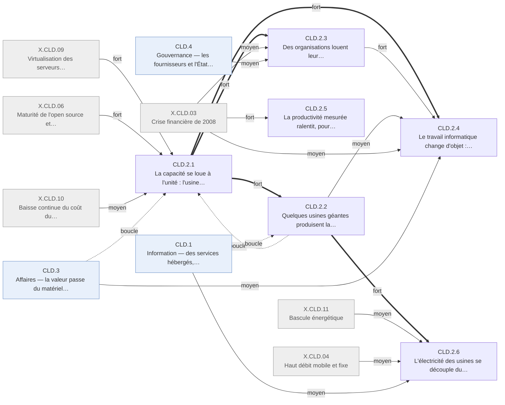

# Arbre des effets — cloud · CLD.2 Industrie

Branche de l'[arbre cloud](README.md). Conventions : [README.md § Comment lire](README.md#comment-lire).

## Table of Contents

1. [CLD.2 · Industrie — on loue l'usine au lieu de la posséder](#cld2--industrie--on-loue-lusine-au-lieu-de-la-posséder) _(Lines 14-221)_

---

## CLD.2 · Industrie — on loue l'usine au lieu de la posséder
<!-- Lines 14-221 -->

Produire un service numérique ne demande plus de posséder l'usine : la capacité se loue à
l'unité à quelques usines géantes, dont trois fournisseurs tiennent l'essentiel du marché
européen (estimations de 2020, tirées d'une étude de 2022), qui découplent leur électricité du
service rendu, et le travail d'exploitation tend à devenir écriture de code, chez certains ; la
productivité mesurée, elle, ralentit pour des causes surtout extérieures au choc. Qui : toute
organisation qui produit ou exploite du logiciel, et ses informaticiens · certitude : A

Causes : amont (usines et savoir-faire des survivants du choc Internet ; logiciel hébergé par abonnement né en 2000 ; hors registre) ; X.CLD.09 (fort) ; X.CLD.10 (fort) ; X.CLD.06 (fort) ; X.CLD.03 (moyen) ; X.CLD.11 (moyen) ; X.CLD.04 (moyen) ; X.CLD.05 (faible) ; X.CLD.07 (faible) ; CLD.1 (moyen) ; CLD.3 (moyen) ; CLD.4 (moyen)

Le levier du choc est ici : depuis 2006, stockage et calcul se louent au gigaoctet et à
l'heure, puis la délégation monte jusqu'à la fonction facturée à l'appel, sur des outils
devenus ouverts et portables (CLD.2.1). Cette capacité est produite par quelques usines
géantes : l'informatique redevient une industrie lourde, une branche nouvelle se mesure à part,
et la panne d'un fournisseur touche ensemble plusieurs services ; trois fournisseurs tiennent
75 à 90 % du marché européen en 2020 selon une étude de 2022, cinq ans après la fenêtre
(CLD.2.2). Des organisations clientes présentent la location comme un passage du capital au
fonctionnement ; une équipe de quelques personnes sert des dizaines de millions d'usagers ; la
sous-traitance indienne s'oriente vers l'intégration, sans l'avoir achevé (CLD.2.3). Le travail
informatique change d'objet, de la machine au code : les développeurs augmentent de 65 % en
dix ans pendant que l'emploi de l'hébergement recule jusqu'en 2010, puis repart (CLD.2.4). La
productivité américaine mesurée ralentit après 2009, pour des causes que le dossier situe
surtout hors du choc, pendant que l'économie numérique américaine croît plus vite que
l'ensemble (CLD.2.5). L'électricité des usines se découple du service rendu, pendant que leur
efficacité devient une mesure publiée, que des exploitants commencent à acheter de l'électricité
renouvelable en direct et que l'énergie change de prix pour d'autres raisons (CLD.2.6).

<!-- GENERE:CLD.2:debut -->

<!-- GENERE:CLD.2:fin -->

- **CLD.2.1 · La capacité se loue à l'unité : l'usine n'a plus à être possédée** — toute organisation qui produit du logiciel · V
  - Causes : amont (architecture de services d'un grand détaillant en ligne, bâtie dans les cinq années précédant 2006) ; X.CLD.09 (fort) ; X.CLD.06 (fort) ; X.CLD.10 (moyen) ; X.CLD.05 (faible) ; CLD.2.2 (boucle) ; CLD.3.3 (boucle)
  - Le levier principal du choc, et l'essence posée par le dossier : produire et exploiter un service ne demande plus de posséder l'usine.
  - **CLD.2.1.1 · Stockage et calcul se louent au gigaoctet et à l'heure, sans contrat** — développeurs, organisations · V
    - Causes : amont (architecture de services d'un grand détaillant en ligne, bâtie dans les cinq années précédant 2006) ; X.CLD.09 (fort) ; X.CLD.06 (moyen) ; X.CLD.10 (moyen)
    - Stockage d'objets ouvert sans contrat le 14 mars 2006 à 0,15 $/Go/mois, sans minimum ; machines virtuelles louées à l'heure, en version bêta les 24-25 août 2006, capacité facturée à l'usage ; 2,9 milliards d'objets stockés fin 2006, 14 milliards fin 2007 (chiffres publiés par le fournisseur) ; dans un entretien publié en mai 2006, le directeur technique du détaillant décrit le passage en cinq ans d'une architecture monolithique à deux niveaux à une plateforme de services entièrement répartie et décentralisée.
    - Faits : F.CLD.A1.003, F.CLD.A1.004, F.CLD.A1.005, J.CLD.2005.01, J.CLD.2006.01, J.CLD.2006.02, J.CLD.2007.04
  - **CLD.2.1.2 · La délégation monte d'étage : de la machine louée à la plateforme, puis à la fonction** — développeurs · V
    - Causes : CLD.2.1.1 (principale, fort)
    - Plateforme d'exécution où le développeur ne gère ni machine ni système, ouverte en préversion le 7 avril 2008 (accès limité aux 10 000 premiers développeurs inscrits) ; service d'exécution de code facturé par tranche de 100 ms, annoncé en préversion le 13 novembre 2014, sans machine ni serveur à déclarer : l'unité facturée descend de la machine-heure à la fonction.
    - Faits : F.CLD.A4.003, F.CLD.A4.009, J.CLD.2008.02, J.CLD.2014.05
  - **CLD.2.1.3 · Les outils de l'usine deviennent ouverts et portables** — équipes d'exploitation, éditeurs · A
    - Causes : CLD.2.1.1 (principale, fort) ; X.CLD.06 (fort) ; X.CLD.05 (moyen)
    - Calcul distribué sur machines banalisées (article de 2004, scission du projet libre de calcul distribué le 28 janvier 2006) ; bases non relationnelles distribuées décrites en 2007 puis en 2009, conçues pour traiter la panne comme la norme ; logiciel libre pour bâtir sa propre usine (annonce de juillet 2010) ; outil de conteneurs présenté en mars 2013 et publié en logiciel libre le 1er avril 2013 ; orchestrateur de conteneurs publié en logiciel libre par un grand exploitant (premier dépôt de code le 6 juin 2014) ; une plateforme de partage de code source ouvre en avril 2008, hébergée dès l'origine par un hébergeur tiers.
    - Faits : F.CLD.A2.002, F.CLD.A2.004, F.CLD.A2.005, F.CLD.A2.006, F.CLD.A2.008, J.CLD.2005.04, J.CLD.2006.05, J.CLD.2008.06, J.CLD.2009.03, J.CLD.2013.05, J.CLD.2014.03
  - **CLD.2.1.4 · Le prix de l'unité louée baisse plusieurs fois par an, pendant que le prix du matériel baisse** — clients de capacité louée · A
    - Causes : X.CLD.10 (principale, moyen) ; CLD.2.2.1 (boucle) ; CLD.3.3.1 (boucle)
    - Prix à la consommation des ordinateurs de 170,9 (2004) à 47,9 (2015) et prix à la production des composants électroniques et semi-conducteurs de 71,7 à 37,7 (indices de l'office statistique du travail américain, moyennes annuelles) ; prix de liste du stockage de 0,15 à 0,03 $/Go/mois de mars 2006 à avril 2014 (division par cinq) ; heure d'instance d'entrée de gamme de 0,10 $ (2006) à 0,013 $ (2014), les deux instances n'étant pas comparables ; baisses de tarif annoncées par plusieurs grands fournisseurs de 2012 à 2015 : 6 % pour une instance en mars 2012, trois baisses en 2014, 40 % de nombreux tarifs de calcul en mai 2015.
    - Faits : F.CLD.A1.006, F.CLD.C2.005, F.CLD.C2.006, J.CLD.2012.01
- **CLD.2.2 · Quelques usines géantes produisent la capacité louée : trois fournisseurs en tiennent l'essentiel du marché européen (estimations de 2020)** — grands exploitants, marché mondial et européen · A
  - Causes : CLD.2.1 (principale, fort) ; CLD.1.2 (boucle)
  - Dans une étude de marché de 2022, l'autorité néerlandaise des consommateurs et des marchés désigne trois grands opérateurs de services en nuage et, d'après ses estimations de 2020 fondées sur les chiffres d'affaires d'environ neuf opérateurs, leur attribue 35 à 40 % chacun du marché européen pour les deux premiers et 5 à 10 % pour le troisième, soit 75 à 90 % pour les trois par addition des fourchettes ; elle conclut à un haut degré de concentration. Ces estimations portent sur 2020, cinq ans après la fenêtre ; les lignes du dossier ne donnent pas de part de marché pour 2005-2015.
  - **CLD.2.2.1 · L'informatique redevient une industrie lourde : de grands exploitants dépensent des milliards en équipement** — grands exploitants · A
    - Causes : CLD.2.1.1 (principale, fort) ; CLD.1.2 (boucle)
    - Dépenses d'équipement (immobilisations corporelles) d'un grand détaillant en ligne exploitant sa propre usine : 224 M$ (2007), 373 M$ (2009), 979 M$ (2010), 1 811 M$ (2011), 3 785 M$ (2012), sans année de recul de 2009 à 2012 ; un moteur de recherche consacre environ 2,4 Md$ à ses immobilisations en 2007, contre 1,9 Md$ en 2006, principalement pour des centres de données et leur équipement.
    - Faits : F.CLD.A1.001, F.CLD.A1.002, J.CLD.2007.02
  - **CLD.2.2.2 · Une branche nouvelle naît et se mesure à part** — fournisseurs de capacité · A
    - Causes : CLD.2.1.1 (principale, fort)
    - En 2013 (publication de mars), un cabinet d'analystes suit le nuage public comme un marché distinct en six segments et publie une prévision de dépense mondiale (chiffres d'analystes non repris, artefact de mesure) ; en avril 2015, un grand détaillant en ligne publie pour la première fois séparément le chiffre d'affaires de son activité de services en nuage : 1 566 M$ au premier trimestre 2015 contre 1 050 M$ un an plus tôt (+49 %), et 265 M$ de résultat d'exploitation.
    - Faits : F.CLD.A3.001, F.CLD.A3.008, J.CLD.2013.06
  - **CLD.2.2.3 · La mutualisation de l'usine mutualise la panne** — services qui en dépendent · A
    - Causes : CLD.2.2.1 (principale, fort)
    - Du 21 au 24 avril 2011, une panne prolongée d'une zone de disponibilité de la région US East d'un grand fournisseur rend plusieurs services en ligne connus indisponibles ou dégradés.
    - Faits : J.CLD.2011.02
- **CLD.2.3 · Des organisations louent leur informatique au lieu de la posséder** — organisations clientes · A
  - Causes : CLD.2.1 (principale, fort) ; X.CLD.03 (moyen) ; CLD.4.2 (moyen)
  - **CLD.2.3.1 · De grandes entreprises annoncent réduire leurs centres en 2015, l'une en transférant ses charges chez un fournisseur ; dès 2009, la location est présentée comme un passage du capital au fonctionnement** — directions informatiques · A
    - Causes : CLD.2.1.1 (principale, fort) ; X.CLD.03 (moyen)
    - Fin 2008, un analyste décrit la crise du crédit comme une « capex crisis » ; en 2009, la presse spécialisée et un rapport universitaire présentent la location de capacité informatique comme le passage de la dépense en capital à la dépense de fonctionnement, la crise du crédit, qui prive de nombreuses entreprises de l'emprunt nécessaire aux gros investissements initiaux, étant avancée comme argument, et l'intérêt financier propre de ce passage est contesté ; un article de 2010 juge l'expression moins juste que « paiement à l'usage », sans chiffrer le budget déplacé ; en octobre 2015, lors de la conférence d'un fournisseur de nuage, deux grandes entreprises américaines annoncent réduire leurs centres de données : l'une de huit en 2014 à trois fin 2018, l'autre de 34 à quatre en trois ans, avec le transfert de ses 9 000 charges de travail chez ce fournisseur.
    - Faits : F.CLD.A4.004, F.CLD.C2.002, F.CLD.D3.005, J.CLD.2008.04, F.CLD.A4.008, J.CLD.2014.02
  - **CLD.2.3.2 · Les agences fédérales américaines ferment des centres par centaines, sans que leurs économies soient mesurées en 2013** — agences fédérales · V
    - Causes : CLD.4.2.2 (principale, fort)
    - En juillet 2011, la quasi-totalité des agences n'a pas complété son inventaire ni son plan de consolidation, malgré un objectif de 137 fermetures d'ici fin 2011 ; 420 centres fermés fin décembre 2012 sur 1 253 visés d'ici fin 2015 (40 % de 3 133) ; en avril 2013, l'administration budgétaire n'a pas mesuré les progrès vers l'objectif de 3 Md$ d'économies ; en septembre 2014, les agences prévoient environ 3,3 Md$ d'économies jusqu'en 2015, soit environ 300 M$ au-dessus de l'objectif initial, et 11 des 21 agences sous-déclarent environ 2,2 Md$.
    - Faits : F.CLD.G3.003, F.CLD.G3.004, F.CLD.G3.010
  - **CLD.2.3.3 · Le courriel et les documents de l'organisation quittent ses murs** — employés de bureau · A
    - Causes : CLD.2.1.1 (principale, fort)
    - Le 28 août 2006, un ensemble gratuit de services hébergés (messagerie, agenda, messagerie instantanée, création de pages) est proposé aux organisations pour leur domaine, comme substitut à des logiciels installés poste par poste, faisant sortir courriel et documents de leurs murs ; en juillet 2012, l'éditeur déclare, selon la presse, que cinq millions d'entreprises utilisent son service de courriel.
    - Faits : F.CLD.A5.003, J.CLD.2006.04, F.CLD.D3.003
  - **CLD.2.3.4 · Une équipe de quelques personnes sert des dizaines de millions d'usagers** — fondateurs, jeunes pousses · A
    - Causes : CLD.2.1 (principale, fort)
    - Service de partage vidéo fondé en février 2005 par trois personnes, qui n'en compte que trois à son premier financement fin 2005, dépasse 100 millions de vidéos vues par jour en octobre 2006, la livraison étant assurée par un prestataire externe de diffusion, et le service s'appuyant fin 2005 sur un hébergeur tiers à bande passante illimitée, ce qui n'est pas la location de capacité à l'unité ouverte en 2006 ; application de photos de 13 employés et de plus de 25 à environ 30 millions d'usagers (selon la source) à son rachat en avril 2012, dont l'exploitation reposait fin 2011 sur des services loués, avec trois ingénieurs ; de 2006 à 2010, les jeunes entreprises américaines pouvant louer leur capacité lèvent en moyenne 20 % de moins au premier tour de financement, et leurs premiers financements annuels passent d'environ 375 à plus de 700.
    - Faits : F.CLD.A4.001, F.CLD.A4.002, F.CLD.A4.005, F.CLD.D3.001, F.CLD.D3.002, J.CLD.2005.05
  - **CLD.2.3.5 · La sous-traitance indienne s'oriente vers l'intégration de services loués, sans que le changement soit achevé** — secteur indien des services informatiques · A
    - Causes : CLD.2.3.1 (principale, fort) ; X.CLD.03 (faible)
    - En 2012-2013, des analystes relèvent que de grands prestataires indiens adoptent des services liés au nuage, dont le courtage (intégration et gestion de plusieurs plateformes d'un client), mais restent loin de la transformation nécessaire, l'un d'eux notant que le potentiel du nuage ne s'est pas encore concrétisé ; les cinq premiers voient leur chiffre d'affaires croître de 13,3 % en 2012, contre 2 % pour le marché mondial des services informatiques ; effectifs qualifiés du secteur de 1,96 million (2008) à 2,77 millions (2012, estimation), sans rupture pendant la crise ni rupture attribuable à une automatisation ; 2,8 millions d'emplois directs et 8,9 millions indirects en 2012.
    - Faits : F.CLD.A5.005, F.CLD.D3.008, J.CLD.2012.05, F.CLD.D1.007, F.CLD.D1.010
- **CLD.2.4 · Le travail informatique change d'objet : de la machine au code** — informaticiens · A
  - Causes : CLD.2.1 (principale, fort) ; CLD.2.3 (fort) ; CLD.2.2 (moyen) ; X.CLD.03 (moyen) ; X.CLD.06 (faible) ; CLD.3.4 (moyen) ; amont (creux de la formation informatique après la correction de 2000-2002)
  - **CLD.2.4.1 · Exploiter devient écrire du code** — administrateurs, directions informatiques · A
    - Causes : CLD.2.1 (principale, fort) ; CLD.2.3 (moyen)
    - **CLD.2.4.1.1 · Développement et exploitation se rapprochent ; la mise en production se fait, chez certains, plusieurs fois par jour** — équipes d'exploitation · A
      - Causes : CLD.2.1 (principale, fort) ; CLD.2.1.3 (moyen)
      - Configuration des systèmes décrite en code et traitée comme du logiciel, avec des outils de 2005 et de 2009, sans mesure lue de l'effet sur le métier d'administrateur ; premier devopsdays à Gand en 2009 ; en juin 2012, un rapport d'un éditeur technique écrit que les administrateurs système à l'ancienne peuvent disparaître, l'exploitation devenant un arrangement « DevOps » où les spécialistes d'exploitation rejoignent l'équipe de développement ; chez un grand exploitant du web, l'ingénierie de fiabilité des sites est décrite par son fondateur, entré en 2003 pour diriger une équipe de production de sept ingénieurs ; environ dix mises en production par jour pour un site de partage de photos en juin 2009, un changement en production toutes les 11,6 secondes en moyenne pour un grand détaillant en ligne en mai 2011 ; astreinte organisée en rotations primaire et secondaire, décrite en 2015 comme historiquement assurée par des équipes d'exploitation dédiées ; outil de conteneurs publié en logiciel libre début 2013, le même conteneur s'exécutant en développement, test et production ; part des clientes d'un fournisseur de supervision ayant adopté cet outil de 1,8 % (septembre 2014) à 8,3 % (septembre 2015), sur un échantillon de 7 000 clientes tendant à être des adoptantes précoces.
      - Faits : F.CLD.A4.006, F.CLD.D2.006, J.CLD.2010.06, F.CLD.D2.003, F.CLD.A4.007, F.CLD.D3.007, J.CLD.2011.06, F.CLD.D3.006, F.CLD.D2.009
    - **CLD.2.4.1.2 · La salle machine doit reculer, la direction informatique s'attend à piloter des contrats** — responsables d'infrastructure · A
      - Causes : CLD.2.3.1 (principale, fort)
      - L'office statistique du travail américain projette pour 2006-2016 un recul de 24,7 % de l'emploi des opérateurs informatiques, qu'il attribue à l'usage croissant de logiciels qui automatisent l'exploitation, sans lien lu avec la migration vers des services loués ; une enquête d'août 2015 auprès de 230 directeurs informatiques de l'enseignement supérieur montre qu'ils anticipent, à cinq puis dix ans, un déplacement de leur gestion de l'infrastructure vers la gestion de fournisseurs, de services et de contrats externalisés.
      - Faits : F.CLD.D2.007, F.CLD.A4.010, J.CLD.2015.06
  - **CLD.2.4.2 · L'emploi du logiciel croît ; celui de l'hébergement recule jusqu'en 2010, puis repart** — salariés de l'informatique (US) · A
    - Causes : CLD.2.1 (principale, fort) ; CLD.2.2 (fort) ; X.CLD.03 (moyen)
    - **CLD.2.4.2.1 · Les développeurs augmentent de 65 % en dix ans, les services informatiques croissent malgré la crise** — développeurs, services informatiques · V
      - Causes : CLD.2.1 (principale, moyen) ; X.CLD.03 (moyen)
      - Développeurs à temps plein : 778 000 (2005), 1 287 000 (2015) ; services informatiques : 1 368 600 (2005), 2 043 400 (2015), un seul recul, −1,5 % en 2009, bien moindre que celui de l'emploi total ; chômage des professions informatiques sous la moyenne nationale pendant la crise.
      - Faits : F.CLD.D1.002, F.CLD.D1.005, F.CLD.D1.008, F.CLD.D1.004
    - **CLD.2.4.2.2 · L'emploi de l'hébergement recule de 2003 à 2010 malgré la construction des usines, puis repart ; une usine construite n'emploie que quelques dizaines de salariés** — traitement de données et hébergement · A
      - Causes : CLD.2.2.1 (principale, fort)
      - 288 600 emplois (2003), 265 300 (2005), 248 000 (2010, creux), 300 100 (2015) ; un grand centre de données occupe en général des milliers d'ouvriers du bâtiment pendant un à deux ans, puis quelques dizaines de salariés d'exploitation ; pour le site d'un grand réseau social, environ 650 emplois de construction sur cinq ans et plus de 200 emplois hors construction en 2013.
      - Faits : F.CLD.D1.003, F.CLD.D1.006
  - **CLD.2.4.3 · Les fournisseurs entrent dans la formation ; les diplômes d'informatique suivent leur propre cycle** — informaticiens, étudiants · A
    - Causes : CLD.2.1 (principale, fort) ; CLD.2.4.2 (moyen) ; X.CLD.06 (faible) ; amont (creux des diplômes après la correction de 2000-2002)
    - **CLD.2.4.3.1 · Fournisseurs et universités forment au calcul à grande échelle et aux plateformes louées** — informaticiens, étudiants · A
      - Causes : CLD.2.1 (principale, fort) ; X.CLD.06 (faible)
      - Le 8 octobre 2007, deux entreprises annoncent une initiative qui met à la disposition de six universités américaines une grappe de plusieurs centaines d'ordinateurs, des logiciels libres et un cursus de calcul parallèle, issue d'un cours pilote de l'université de Washington ; le 30 avril 2013, un grand fournisseur lance des certifications par rôle, dont le premier examen est « Solutions Architect – Associate Level », d'autres suivant en 2013, passées dans des centres de test de plus de 100 pays et de 750 sites, sans nombre de certifiés communiqué.
      - Faits : F.CLD.D2.002, F.CLD.F2.002, J.CLD.2007.03, F.CLD.D2.004, F.CLD.D2.005
    - **CLD.2.4.3.2 · Les diplômes d'informatique chutent puis reviennent au niveau de 2004** — étudiants (US) · V
      - Causes : amont (correction du secteur informatique en 2000-2002, X.INT.05 du registre Internet) ; CLD.2.4.2.1 (moyen)
      - Licences : 59 488 (2003-04), 37 992 (2008-09), 59 581 (2014-15).
      - Faits : F.CLD.D2.001
  - **CLD.2.4.4 · L'emploi du commerce en ligne croît ; une enquête d'un entrepôt décrit un rythme de travail intense** — entrepôts · A
    - Causes : CLD.3.4.5 (principale, fort)
    - Emploi du commerce électronique et de la vente par correspondance aux États-Unis de 283 600 (2005) à 377 000 (2015), avec un recul en 2006 (266 300) puis en 2009 (263 800), la série ne séparant pas la part due à l'infrastructure en nuage de celle due à la vente en ligne ; en septembre 2011, une enquête d'un quotidien local, fondée sur des entretiens avec une vingtaine de salariés actuels et anciens d'un entrepôt d'un grand détaillant en ligne, décrit des exigences de productivité jugées impossibles à tenir, une main-d'œuvre en grande partie intérimaire, une chaleur dangereuse et des ambulances stationnées devant l'entrepôt.
    - Faits : F.CLD.D1.009, F.CLD.D4.006
  - **CLD.2.4.5 · Les compétences du cloud se paient au-dessus de la moyenne, la syndicalisation de l'informatique restant faible** — salariés de l'informatique (US) · A
    - Causes : CLD.2.4.3 (principale, moyen)
    - Salaire annuel médian des développeurs de logiciels d'applications : 88 120 $ (mai 2011) puis 100 080 $ (mai 2016), contre 79 700 $ en mai 2016 pour les administrateurs de systèmes et de réseaux ; dans une enquête de fin 2014 d'un site d'emploi auprès de 23 470 professionnels (artefact d'un site d'emploi), 130 081 $ pour la compétence de plateforme contre 89 450 $ pour l'ensemble des répondants ; hausse sur douze mois des salaires du secteur privé, tous métiers confondus, de 3,3 % (décembre 2007) à 2,6 % (2008), 1,3 % (2009) puis 1,8 % (2010) ; en 2015, syndicalisation de 3,9 % dans les professions informatiques et mathématiques et de 1,7 % dans les services professionnels et techniques, contre 6,7 % dans le secteur privé et 11,1 % pour l'ensemble des salariés.
    - Faits : F.CLD.D4.002, F.CLD.D4.003, F.CLD.D4.007, F.CLD.D4.005
- **CLD.2.5 · La productivité mesurée ralentit, pour des causes surtout extérieures au choc, pendant que l'économie numérique croît plus vite** — économie américaine, puis européenne · V
  - Causes : amont (fin du regain de productivité de 1996-2004, porté par l'ordinateur et le choc Internet) ; X.CLD.03 (fort) ; X.CLD.07 (faible) ; CLD.2.1 (faible) ; CLD.2.2 (faible)
  - Résultat acquis du dossier, respecté ici : 2,59 %/an (2000-2007) contre 1,52 %/an (2009-2015) ; le choc ne l'explique pas.
  - **CLD.2.5.1 · Aux États-Unis, la productivité du travail passe de 2,59 %/an à 1,52 %/an** — économie américaine · V
    - Causes : amont (fin du regain de 1996-2004) ; X.CLD.03 (moyen) ; CLD.2.1 (faible)
    - Secteur privé non agricole : 2,48 %/an (1995-2000), 2,59 %/an (2000-2007), 1,52 %/an (2009-2015) ; productivité multifactorielle : 1,06 %/an (2000-2007), 0,4 %/an (2007-2015, arrondi officiel) ; une thèse de référence (2012) situe le regain de l'informatique entre 1996 et 2004 seulement.
    - Faits : F.CLD.C1.001, F.CLD.C1.004, F.CLD.C1.005, F.CLD.C1.008
  - **CLD.2.5.2 · Pendant la récession, la productivité du travail tient par la compression des effectifs** — économie américaine · V
    - Causes : X.CLD.03 (principale, fort)
    - 2,50 %/an en 2007-2009 pour le travail, −0,50 %/an pour la productivité multifactorielle.
    - Faits : F.CLD.C1.002, F.CLD.C1.003
  - **CLD.2.5.3 · L'Europe de l'Ouest ne referme pas l'écart de productivité** — Union européenne · A
    - Causes : amont (écart transatlantique ouvert pendant la fenêtre Internet) ; X.CLD.03 (moyen) ; X.CLD.07 (faible)
    - Pour les dix plus grandes économies d'Europe de l'Ouest, croissance de la productivité par heure travaillée inférieure à celle des États-Unis sur 1995-2005 (1,26 contre 2,17 %/an) puis sur 2005-2015 (0,63 contre 0,87 %/an), niveau relatif de 106 % (1995), 90 % (2005) et 86 % (2015) ; pour la zone euro, croissance plus faible qu'aux États-Unis entre le premier trimestre 2007 et le premier trimestre 2013, que la banque centrale européenne attribue en partie à une rétention de main-d'œuvre importante au début de la crise et à un manque de restructuration.
    - Faits : F.CLD.C1.009, F.CLD.C1.010
  - **CLD.2.5.4 · L'économie numérique américaine croît plus vite que l'ensemble de l'économie** — secteur des technologies de l'information (US) · V
    - Causes : CLD.2.2 (principale, moyen)
    - Valeur ajoutée réelle de l'économie numérique américaine (infrastructure numérique, commerce électronique, médias numériques) : +5,6 %/an en moyenne de 2006 à 2016, contre +1,5 %/an pour l'ensemble de l'économie, et au-dessus de la croissance de l'économie chaque année de la période (premières estimations publiées en 2018).
    - Faits : F.CLD.C1.011
- **CLD.2.6 · L'électricité des usines se découple du service rendu** — exploitants, système électrique · V
  - Causes : CLD.2.2 (principale, fort) ; X.CLD.11 (moyen) ; X.CLD.03 (faible) ; X.CLD.04 (moyen) ; CLD.1 (moyen) ; CLD.3.4 (faible) ; CLD.4.1 (faible)
  - Axiome de production du dossier (humain + énergie) : le choc change surtout l'efficacité, pas le volume d'électricité.
  - **CLD.2.6.1 · La consommation des centres de données ralentit puis plafonne pendant que le service explose** — système électrique (US, monde) · V
    - Causes : CLD.2.6.2 (principale, fort) ; CLD.2.2.1 (fort)
    - Doublement entre 2000 et 2005-2006 (61 TWh, 1,5 % de l'électricité américaine en 2006) ; +56 % monde et +36 % États-Unis sur 2005-2010, contre un nouveau doublement projeté en 2007 ; environ 70 TWh et 1,8 % en 2014, quasi stable depuis 2010, pendant que serveurs et trafic croissent bien plus vite.
    - Faits : F.CLD.H1.001, F.CLD.H1.002, F.CLD.H1.003, F.CLD.H1.004, F.CLD.H1.007, F.CLD.H1.008, F.CLD.H1.009, F.CLD.A1.008, J.CLD.2007.06, J.CLD.2010.04, J.CLD.2011.07
  - **CLD.2.6.2 · L'efficacité énergétique devient une mesure publiée par les grands exploitants** — grands exploitants · V
    - Causes : CLD.2.2.1 (principale, fort) ; CLD.4.1.1 (moyen)
    - En septembre 2005, un ingénieur d'un grand exploitant du web relève dans une revue d'ingénieurs des processeurs de moins en moins efficaces en énergie et avertit que cela pourrait menacer le coût abordable du calcul à grande échelle ; un consortium industriel publie en 2007 une métrique commune d'efficacité des centres de données (PUE) ; en 2008, un grand exploitant publie pour la première fois le PUE de la flotte de ses centres (1,21 puis 1,20), environ 1,12 en 2014, contre une moyenne sectorielle alors estimée entre 1,8 et 2,0 pour les installations d'entreprise plus anciennes.
    - Faits : F.CLD.H1.005, F.CLD.H1.006, J.CLD.2005.03, J.CLD.2008.07
  - **CLD.2.6.3 · Les usines suivent l'électricité, et de grands exploitants commencent à l'acheter en direct** — exploitants, producteurs d'électricité · A
    - Causes : CLD.2.2.1 (principale, fort) ; X.CLD.11 (moyen)
    - En 2006, des exploitants implantent des centres de données dans la région du fleuve Columbia (nord-ouest américain), attirés par l'électricité hydroélectrique abondante et bon marché, et contractent des capacités de 30 à 48 MW, dont deux auprès de distributeurs publics de comté (août 2006) ; le New York Times rapporte en 2006 que Google construit un centre à The Dalles (Oregon), où se rejoignent électricité bon marché et accès aux réseaux de données, et que Microsoft et Yahoo ont annoncé des centres à Wenatchee et à Quincy (État de Washington) ; des centres sont annoncés ou ouverts en Suède et en Finlande en 2011, puis en Islande en 2012, pour le refroidissement naturel du climat froid et le prix et la disponibilité de l'électricité locale, dont l'annonce du 27 octobre 2011 à Luleå (Suède) ; en juillet 2010, la filiale énergie d'un exploitant signe un contrat d'achat de 114 MW d'électricité éolienne sur 20 ans à prix fixé, son premier ; en 2014, des exploitants signent des contrats d'achat d'électricité renouvelable de 15 à 20 ans (175 MW éolien sur 20 ans pour un centre de Chicago ; 23 MW sur 15 ans), et un rapport de juillet 2015 d'un laboratoire national américain relève que de grandes entreprises du secteur numérique commencent ainsi à acheter de l'électricité renouvelable par des contrats de long terme, dont Amazon Web Services, Apple, Facebook et Google, sans série annuelle disponible.
    - Faits : F.CLD.H2.001, F.CLD.H2.002, F.CLD.A1.009, F.CLD.H2.003, F.CLD.H2.004, F.CLD.H2.007, F.CLD.D4.004, J.CLD.2010.07, J.CLD.2011.08
  - **CLD.2.6.4 · L'énergie change de prix pour des raisons extérieures au choc** — économies, système énergétique · A
    - Causes : X.CLD.11 (principale, fort) ; X.CLD.03 (moyen)
    - Pétrole : 41,51 $ (2004), 99,67 $ (2008), 48,66 $ le baril (2015), avec un plus haut mensuel de 133,88 $ en juin 2008 puis 41,12 $ en décembre 2008 ; gaz : 8,69 $ (2005), 2,52 $/MBtu (2015), la hausse de la production de gaz, notamment dans le bassin de schiste de Marcellus, contribuant à la baisse de 2012 (4,02 à 2,77 $/MBtu) ; électricité industrielle américaine de 7,10 ¢/kWh (2014) puis 6,91 (2015), inférieure hors taxes à celle de chaque pays de l'UE-15 renseigné en 2010, 2012, 2013 et 2014 et, en 2005, à celle de tous sauf la France, les prix européens étant en 2013 plus du double des américains pour les consommateurs industriels ; coût actualisé du solaire à grande échelle −73 % de 2010 à 2017 (mesuré au-delà de la fenêtre) ; intensité énergétique mondiale en baisse de 1,3 % par an en moyenne de 1970 à 2010, puis de 1,5 % en 2014 et de 1,8 % en 2015.
    - Faits : F.CLD.H3.001, F.CLD.H3.002, F.CLD.H3.003, F.CLD.H3.004, F.CLD.H3.005, F.CLD.H3.006, F.CLD.H3.007, F.CLD.H3.008, F.CLD.H3.009, F.CLD.H2.005, J.CLD.2008.08, J.CLD.2013.07, J.CLD.2015.07
  - **CLD.2.6.5 · Le bilan énergétique net de la dématérialisation reste indéterminé** — usagers, commerce, système énergétique · D
    - Causes : CLD.1.3 (principale, fort) ; X.CLD.04 (moyen) ; CLD.3.4.5 (moyen)
    - Vidéo en flux contre supports physiques : des études d'analyse de cycle de vie donnent des résultats contrastés selon le terminal, le réseau d'accès et le mode de visionnage ; une étude publiée le 28 mai 2014 (États-Unis, 2011) trouve que le flux peut être plus efficace que le DVD selon le mode de visionnage du DVD, l'avantage des terminaux plus efficaces disparaissant en grande partie une fois comptée l'énergie de transmission par le réseau, les centres de données comptant pour moins de 1 % de l'énergie du flux ; commerce en ligne contre magasin : bilan net disputé selon les études et les hypothèses de dernier kilomètre ; aux États-Unis, travail à domicile la plupart de la semaine de 3,6 % (2005) à 4,3 % (2010) des travailleurs et un peu de travail à domicile les jours travaillés de 19 % (2003) à 24 % (2015), sans mesure lue de l'énergie ; musique en 2014 : numérique et physique à 46 % chacun des revenus mondiaux, abonnements +39 % à 1,57 milliard de dollars ; une revue de la littérature de 2015 conclut que les technologies de l'information sont soumises à des effets rebond importants, peu étudiés, qui absorbent les gains visés s'ils sont élevés.
    - Faits : F.CLD.H4.001, F.CLD.H4.002, F.CLD.H4.003, F.CLD.H4.004, F.CLD.H4.005, J.CLD.2015.08
