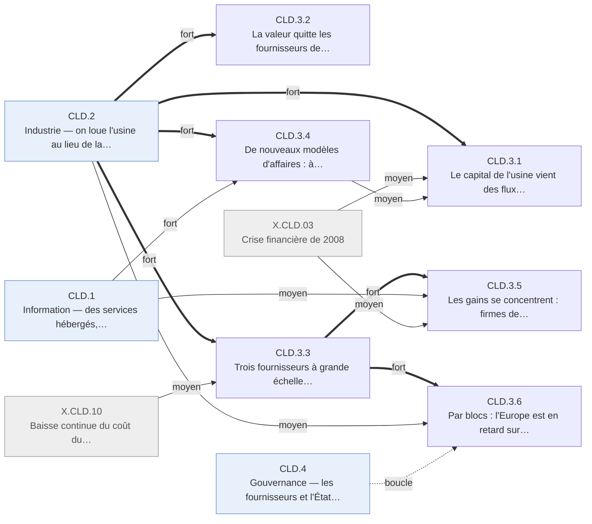

# Arbre des effets — cloud · CLD.3 Affaires

Branche de l'[arbre cloud](README.md). Conventions : [README.md § Comment lire](README.md#comment-lire).

## Table of Contents

1. [CLD.3 · Affaires — la valeur passe du matériel possédé aux loueurs et aux plateformes](#cld3--affaires--la-valeur-passe-du-matériel-possédé-aux-loueurs-et-aux-plateformes) _(Lines 14-191)_

---

## CLD.3 · Affaires — la valeur passe du matériel possédé aux loueurs et aux plateformes
<!-- Lines 14-191 -->

La valeur quitte les vendeurs de salles machines pour des loueurs de capacité dont deux au
moins couvrent leurs dépenses d'équipement par leurs flux de trésorerie d'exploitation, et dont
trois alignent leurs prix sur un marché très concentré (75 à 90 % du marché européen en 2020,
selon une étude de 2022) où l'échelle pèse sur l'entrée ; l'amorçage devient bon marché, et les
modèles à l'usage, à l'abonnement et gratuit pour l'usager, financé par la publicité ciblée, se
développent ; les gains se concentrent sur les firmes de tête, sur le capital et dans quelques
aires métropolitaines, selon des tendances que les mesures datent d'avant le choc (2001). Qui :
firmes, investisseurs, blocs géographiques · certitude : A

Causes : CLD.2 (principale, fort) ; CLD.1 (moyen) ; X.CLD.03 (moyen) ; X.CLD.10 (moyen) ; X.CLD.06 (faible) ; X.CLD.07 (faible) ; CLD.4 (faible) ; amont (revenus accumulés par les survivants du Web ; commerce en ligne, publicité et logiciel hébergé nés du choc Internet ; trajectoire chinoise séparée)

Le capital de l'usine vient des flux de trésorerie d'exploitation des exploitants (deux lus sur
trois) à taux quasi nuls, hors du marché boursier ; le marché finance les seconds rôles,
l'amorçage devenu bon marché et un mini-cycle de valorisation du logiciel par abonnement
(CLD.3.1). La valeur quitte les fournisseurs de salles machines : ventes de matériel en recul,
des constructeurs historiques qui facturent à l'usage dès 2005 mais un éditeur historique qui
annonce son offre louée environ deux ans après le nouvel entrant, un constructeur scindé en 2015
(CLD.3.2). Trois fournisseurs de capacité louée alignent leurs prix et, d'après une étude de
2022, tiennent 75 à 90 % du marché européen en 2020 (estimation postérieure de cinq ans à la
fenêtre) ; l'échelle des centres de données pèse sur l'entrée ; la première publication séparée,
en 2015, révèle une activité plus rentable que le commerce du même groupe ; le verrouillage chez
le fournisseur et la panne partagée exposent les clients (CLD.3.3). Les modèles d'affaires
changent : on paie l'informatique à la consommation, le logiciel à l'abonnement, le service est
gratuit pour l'usager et financé par la publicité ciblée ; la mise en relation à la demande
apparaît mais reste marginale dans l'emploi, le commerce en ligne passe de 2,8 % à 7,0 % du
détail américain, la part d'une grande plateforme y croissant, et un opérateur mobile émet des
comptes de paiement pour des millions d'usagers (CLD.3.4). Les mesures font remonter à 2001
l'écart de productivité entre firmes de tête et reste et la baisse de la part du travail ;
l'emploi numérique se concentre dans dix aires métropolitaines, la capitalisation boursière se
déplace en partie vers la technologie, et le surplus des usagers existe mais ne comble pas le
ralentissement mesuré (CLD.3.5). Par blocs, l'Europe est en retard sur des
fournisseurs d'abord américains, la Chine crée en 2009 la filiale de nuage d'un grand groupe,
les services hébergés s'échangent sans infrastructure locale dans chaque juridiction, et le droit
des données rend l'échange incertain après 2013 (CLD.3.6).

<!-- GENERE:CLD.3:debut -->

<!-- GENERE:CLD.3:fin -->

- **CLD.3.1 · Le capital de l'usine vient des flux d'exploitation, hors du marché boursier ; le marché finance les seconds rôles, l'amorçage et un mini-cycle de valorisation du logiciel par abonnement** — investisseurs, exploitants · A
  - Causes : CLD.2.2 (principale, fort) ; CLD.2.3 (fort) ; X.CLD.03 (moyen) ; CLD.3.4 (moyen) ; amont (revenus accumulés par les survivants du Web ; centres rachetés aux faillites de 2000-2002)
  - À la différence d'Internet, le capital principal ne passe pas par le marché boursier : deux exploitants couvrent leurs dépenses d'équipement par leurs flux de trésorerie d'exploitation (le troisième n'est pas lu sur ce point) et aucune levée d'actions dédiée au cloud n'est documentée ; le marché boursier finance les seconds rôles et un mini-cycle de valorisation du logiciel par abonnement (multiple d'environ 22 en février 2014, 11 en mars 2015 ; recul médian de 40 % en août 2015).
  - **CLD.3.1.1 · Les dépenses d'équipement de deux grands exploitants sont couvertes par leurs flux de trésorerie d'exploitation, à taux quasi nuls** — grands exploitants · V
    - Causes : CLD.2.2.1 (principale, fort) ; X.CLD.03 (moyen) ; amont (revenus des activités héritées du choc Internet)
    - Dépenses d'équipement : premier loueur de 224 M$ (2007) à 4 589 M$ (2015), en hausse chaque année de 2007 à 2012 puis en repli en 2013 et en 2015 ; éditeur historique de 2 305 M$ (2012) à 5 944 M$ (2015) ; moteur devenu conglomérat au-dessus de 10 Md$ en 2014. Les flux de trésorerie d'exploitation les couvrent chez deux exploitants : 5 475, 6 842 et 11 920 M$ contre 3 444, 4 893 et 4 589 M$ de dépenses (2013-2015) pour le premier loueur ; 18 659 M$ contre 7 358 M$ en 2013 pour le moteur de recherche ; l'éditeur historique n'est pas lu sur ce point. Taux directeur de 3,94 % (janvier 2008) à 0,07-0,24 % jusqu'à fin 2015 ; aucune levée d'actions dédiée au cloud documentée.
    - Faits : F.CLD.B1.001, F.CLD.B1.002, F.CLD.B1.003, F.CLD.B1.013, F.CLD.B1.014
  - **CLD.3.1.2 · Le marché finance les seconds rôles : foncières et hébergeurs** — foncières de centres de données, hébergeurs · A
    - Causes : CLD.2.2.1 (principale, moyen) ; amont (centres rachetés à prix décoté aux faillites de 2000-2002)
    - Foncière constituée en mars 2004 à partir de centres rachetés à des faillites, cotée en novembre 2004, valeur de marché d'environ 9,0 Md$ pour les actions détenues par des non-affiliés (30 juin 2015) ; hébergeur coté en août 2008 (147,6 M$ levés), un mois avant l'effondrement de septembre 2008, qui rachète en octobre 2008 deux jeunes entreprises (serveurs virtuels loués, sauvegarde en ligne) pour renforcer son offre face au service de calcul d'un grand détaillant en ligne.
    - Faits : F.CLD.B1.004, F.CLD.B1.006, F.CLD.B1.005, J.CLD.2008.10
  - **CLD.3.1.3 · L'amorçage coûte moins, le capital-risque logiciel quadruple** — fondateurs, capital-risque · V
    - Causes : CLD.2.3.4 (principale, fort) ; X.CLD.03 (faible)
    - Dès 2006, les services d'un grand détaillant en ligne permettent de louer du matériel par petits incréments au lieu d'un investissement initial en serveurs ; les jeunes pousses américaines des secteurs concernés lèvent en moyenne 20 % de moins au premier tour de capital-risque (échantillon 2002-2010) et les premiers financements annuels passent d'environ 375 à plus de 700 (2006-2010 contre 2002-2005) ; capital-risque logiciel américain : 5 595 M$ (2006), 5 283 M$ (2010), 11 308 M$ (2013), 23 498 M$ (2015) ; 11 à 20 introductions en bourse logicielles par an en 2012-2014.
    - Faits : F.CLD.B1.007, F.CLD.B1.008, F.CLD.B1.009, J.CLD.2009.01, F.CLD.B1.010, F.CLD.B1.011
  - **CLD.3.1.4 · Le logiciel par abonnement coté vit un mini-cycle de valorisation** — investisseurs · A
    - Causes : CLD.3.4.2 (principale, fort) ; X.CLD.03 (moyen)
    - Selon les décomptes d'un investisseur en capital-risque, le multiple de valeur d'entreprise rapportée au chiffre d'affaires des douze mois suivants des sociétés cotées de logiciel par abonnement à forte croissance culmine à environ 22 fois en février 2014 puis revient à 11 fois au 1er mars 2015, le multiple typique de l'ensemble étant d'environ 9,2 fois début 2014 et d'environ 6,0 fois en janvier 2015 ; médiane de 5,2 fois en août 2015, en baisse de 16 % sur le mois, une valeur ayant dépassé 20 fois fin 2013 ; au 21 août 2015, plus de 90 % des valeurs se négocient sous leur plus haut, avec un recul médian de 40 % (une valeur à environ −80 %, une autre à plus de −60 %) ; un fonds de capital-risque lance en 2013 un indice des sociétés cotées de cloud computing.
    - Faits : F.CLD.B2.004, F.CLD.B2.006, F.CLD.B2.007, F.CLD.B2.010
  - **CLD.3.1.5 · La crise de 2008 fait reculer en 2009 l'investissement américain en équipement informatique et logiciel, sans arrêter la croissance d'un éditeur de logiciel par abonnement** — entreprises, marchés · A
    - Causes : X.CLD.03 (principale, fort)
    - Faillite d'une grande banque d'investissement américaine le 15 septembre 2008, au cours d'une récession américaine de décembre 2007 à juin 2009, l'indice boursier large reculant de 57 % entre octobre 2007 et mars 2009 ; en 2009, l'investissement fixe privé américain en équipement de traitement de l'information et en logiciel recule de 530,1 à 501,7 Md$ en valeur nominale, alors que le chiffre d'affaires d'un éditeur de logiciel en abonnement progresse de 21 % sur son exercice clos en janvier 2010.
    - Faits : J.CLD.2008.01, F.CLD.C2.007, F.CLD.B2.011
- **CLD.3.2 · La valeur quitte les fournisseurs de salles machines** — constructeurs et éditeurs historiques · A
  - Causes : CLD.2.2 (principale, fort) ; CLD.2.3 (fort) ; CLD.2.1 (fort) ; X.CLD.10 (faible)
  - **CLD.3.2.1 · Les ventes de matériel aux entreprises reculent, l'investissement total continue de croître** — constructeurs historiques · A
    - Causes : CLD.2.2.1 (principale, fort) ; CLD.2.3.1 (moyen) ; X.CLD.10 (faible)
    - En 2013, le chiffre d'affaires mondial des serveurs recule de 4,4 à 4,5 % selon deux relevés (49,7 Md$ pour le premier), pour des livraisons en hausse (+2,1 % et +3,2 %, record d'environ 9 millions d'unités), celui d'un grand constructeur reculant de 28,9 % au quatrième trimestre, tandis que celui des constructeurs sous-traitants progresse de 57,3 % (2,8 Md$), croissance qu'un analyste rattache à l'expansion des centres de données ; le matériel d'un éditeur historique passe de 19 % à 14 % de son chiffre d'affaires (exercices 2011 à 2013) ; scission d'un constructeur historique annoncée le 6 octobre 2014, effective le 1er novembre 2015 ; investissement privé américain en équipement de traitement de l'information et en logiciel de 445,6 Md$ (2005) à 678,5 Md$ (2015), avec un creux à 501,7 Md$ en 2009 ; un grand exploitant attribue la hausse de ses dépenses d'investissement 2013 à son équipement de production, ses centres de données et des achats immobiliers.
    - Faits : F.CLD.A3.003, J.CLD.2011.04, F.CLD.B3.004, F.CLD.B3.005, F.CLD.B3.006, J.CLD.2015.09, F.CLD.C2.003, F.CLD.C2.008
  - **CLD.3.2.2 · Des constructeurs historiques facturent le calcul à l'usage dès 2005, avant le nouvel entrant ; l'éditeur historique des systèmes d'entreprise annonce son offre louée environ deux ans après lui** — éditeurs et constructeurs historiques · A
    - Causes : CLD.2.1.1 (principale, fort) ; amont (calcul facturé à l'usage proposé par des constructeurs historiques dès mars 2005)
    - En mars 2005, des constructeurs historiques facturent le calcul à l'usage : l'un à 1 $ par heure et par processeur sans engagement préalable, l'autre sur adhésion de 5 000 $ avec un prix fixé au départ d'après l'usage prévu ; l'éditeur historique des systèmes d'entreprise annonce le 27 octobre 2008 une offre de calcul et de stockage loués, ouverte en préversion aux seuls participants de sa conférence, environ 26 mois après la bêta (24 août 2006) du service de machines virtuelles loué à l'heure d'un détaillant en ligne.
    - Faits : J.CLD.2005.02, F.CLD.C4.008, F.CLD.A3.002, F.CLD.C5.008, J.CLD.2008.03
- **CLD.3.3 · Trois fournisseurs à grande échelle tiennent l'essentiel du marché européen (75 à 90 % en 2020, d'après une étude de 2022) : prix alignés, activité très rentable, clients exposés au verrouillage** — marché de la capacité louée · A
  - Causes : CLD.2.2 (principale, fort) ; X.CLD.10 (moyen) ; CLD.2.3 (moyen)
  - **CLD.3.3.1 · Trois fournisseurs alignent leurs prix ; l'échelle des centres de données avantage les très grands exploitants** — fournisseurs, entrants · A
    - Causes : CLD.2.2.1 (principale, fort) ; X.CLD.10 (faible)
    - Trois fournisseurs de capacité louée annoncent des baisses de prix les 25, 26 et 31 mars 2014 (Google 32 à 85 %, Amazon 36 à 65 %, Microsoft 27 à 65 %), Amazon alignant ses prix sur ceux de Google puis Microsoft sur ceux d'Amazon ; les auteurs d'une étude attribuent l'accélération des baisses à l'arrivée de Microsoft et de Google dans l'affichage public des prix ; une étude de 2010 attribue aux centres de données de très grande taille un coût inférieur d'un facteur 5 à 7 ; une étude de 2022 de l'autorité néerlandaise des consommateurs et des marchés, postérieure de sept ans à la fin de la fenêtre, classe les économies d'échelle parmi les causes de la difficulté d'entrée, désigne ces trois fournisseurs comme les grands opérateurs du nuage et, d'après ses estimations de 2020 (cinq ans après la fin de la fenêtre) fondées sur les chiffres d'affaires d'environ neuf opérateurs, attribue 35 à 40 % chacun du marché européen à Amazon Web Services et à Microsoft Azure et 5 à 10 % à Google Cloud Platform, soit 75 à 90 % pour les trois par addition des fourchettes ; elle conclut à un haut degré de concentration de ce marché.
    - Faits : F.CLD.A3.004, F.CLD.C5.001, J.CLD.2014.01, F.CLD.C5.002, F.CLD.C5.009
  - **CLD.3.3.2 · L'usine louée se révèle très rentable** — premier loueur, ses actionnaires · V
    - Causes : CLD.3.3.1 (principale, fort)
    - Première publication séparée, avril 2015 (rapport trimestriel signé le 23 avril) : 1 566 M$ de chiffre d'affaires trimestriel, 265 M$ de résultat d'exploitation, soit 16,9 % de marge, contre 3,9 % (517 M$ pour 13 406 M$) pour le segment Amérique du Nord du même groupe, dont le segment International est en perte de 76 M$ pour 7 745 M$ de chiffre d'affaires ; la valorisation boursière se redistribue après coup vers cette activité.
    - Faits : F.CLD.B2.009, F.CLD.B3.009, F.CLD.C4.007, J.CLD.2015.01, F.CLD.C6.002
  - **CLD.3.3.3 · Louer expose les clients au verrouillage chez le fournisseur et à la panne partagée** — organisations clientes · A
    - Causes : CLD.2.3 (principale, fort) ; CLD.3.3.1 (moyen)
    - En novembre 2009, l'agence européenne de sécurité des réseaux et de l'information classe le verrouillage chez le fournisseur parmi les risques du nuage (probabilité élevée, impact moyen), faute d'outils et de formats standard garantissant la portabilité ; un article de chercheurs le place en 2010 au deuxième rang de dix obstacles à la croissance du nuage ; du 21 au 24 avril 2011, la panne du stockage en bloc d'une zone d'un grand fournisseur rend indisponibles ou dégradés plusieurs services en ligne indépendants.
    - Faits : F.CLD.C5.003, F.CLD.C5.004
- **CLD.3.4 · De nouveaux modèles d'affaires : à l'usage, à l'abonnement, gratuit pour l'usager et financé par la publicité ciblée, à la demande** — firmes, usagers · A
  - Causes : CLD.2.1 (principale, fort) ; CLD.1 (fort) ; CLD.2.2 (moyen) ; amont (commerce en ligne, publicité et logiciel hébergé nés du choc Internet)
  - **CLD.3.4.1 · On paie l'informatique à la consommation** — clients de capacité · V
    - Causes : CLD.2.1.1 (principale, fort)
    - Un fournisseur de capacité louée facture le stockage au gigaoctet et par mois dès mars 2006 (0,15 $ par Go et par mois) et l'exécution de code à la requête et par tranche de 100 millisecondes dès novembre 2014 ; des chercheurs décrivent en 2010 le paiement à la consommation comme l'avantage économique de ces services pour l'acheteur.
    - Faits : F.CLD.C4.001
  - **CLD.3.4.2 · Le logiciel se vend à l'abonnement plutôt qu'en licence** — éditeurs, organisations clientes · V
    - Causes : CLD.2.1 (principale, moyen) ; amont (logiciel hébergé vendu par abonnement depuis février 2000 : 51 puis 96 M$ de chiffre d'affaires aux exercices clos en janvier 2003 et 2004)
    - Un éditeur de gestion de la relation client vendu par abonnement réalise 51 M$ de chiffre d'affaires (exercice clos en janvier 2003), 96 M$ (janvier 2004), 748,7 M$ (janvier 2008) puis 1 076,8 M$ (janvier 2009), qu'il présente comme le premier milliard de dollars annuel d'un éditeur de ce type ; chez un grand éditeur de logiciels, la part de l'abonnement dans le chiffre d'affaires passe de 28 % à 50 % puis 67 % (exercices 2013 à 2015), celle de la vente de produits de 61 % à 39 % puis 24 %.
    - Faits : F.CLD.A5.002, F.CLD.B2.003, F.CLD.C4.002, F.CLD.C4.003, J.CLD.2009.05
  - **CLD.3.4.3 · La publicité ciblée finance un service gratuit pour l'usager, de plus de 900 millions d'usagers mensuels** — plateformes, annonceurs · V
    - Causes : CLD.1.2 (principale, fort) ; amont (gratuit financé par la publicité, né du choc Internet)
    - Un réseau social fixe le 17 mai 2012 le prix de son introduction en bourse à 38 $ l'action, alors qu'il déclare 901 millions d'usagers actifs mensuels au 31 mars 2012, tire 85 % de son chiffre d'affaires 2011 de la publicité et sert ses produits depuis des centres de données possédés ou loués ; en 2013, son rapport annuel décrit le service comme « free and available throughout the world » et la publicité fait 89 % de son chiffre d'affaires (84 % en 2012), ciblée par âge, lieu et sexe ; fin 2012, environ deux tiers des internautes adultes américains disent l'utiliser, contre 16 % pour un service de micromessages et 15 % pour un service de partage d'images.
    - Faits : F.CLD.C4.004, F.CLD.C4.006, F.CLD.C5.006, J.CLD.2012.02
  - **CLD.3.4.4 · La mise en relation à la demande naît sur des plateformes mobiles, dont l'une s'appuie sur une capacité louée un an après son lancement, et reste marginale dans l'emploi (0,5 % des travailleurs américains fin 2015)** — plateformes, travailleurs indépendants · A
    - Causes : CLD.1.1.2 (principale, fort) ; CLD.2.1 (moyen)
    - Des plateformes d'hébergement et de transport mettent en relation des offreurs indépendants et des clients depuis une application mobile ; l'une d'elles, lancée en 2008, migre environ un an plus tard son calcul, son stockage et sa base de données vers un fournisseur de capacité louée (environ 200 instances de calcul selon l'étude de cas du fournisseur) ; fin 2015, les travailleurs qui offrent leurs services par des intermédiaires en ligne représentent 0,5 % des travailleurs américains.
    - Faits : F.CLD.C4.005, F.CLD.D3.004
  - **CLD.3.4.5 · Le commerce en ligne passe de 2,8 % à 7,0 % du détail américain, et la part d'une grande plateforme croît (environ 16 % en 2013, 19 % en 2015)** — détaillants, consommateurs · V
    - Causes : amont (commerce en ligne né du choc Internet, 2,3 % du détail américain en 2005) ; CLD.1.1.2 (moyen) ; CLD.2.2 (faible)
    - 2,8 % (T1 2006), 3,7 % (T4 2008), 4,6 % (T4 2010), 5,5 % (T4 2012), 7,0 % (T1 2015), sans trimestre de recul du taux ; les ventes nettes du segment Amérique du Nord d'un grand détaillant en ligne passent de 41 410 M$ (2013) à 50 834 M$ (2014) puis 63 708 M$ (2015), alors que le Census Bureau estime les ventes américaines du commerce de détail en ligne à 304,9 Md$ en 2014 (+15,4 %) puis 341,7 Md$ en 2015 (+14,6 %), d'où un rapport d'environ 16 % (2013), 17 % (2014) puis 19 % (2015), calculé en ordre de grandeur entre deux séries de périmètres différents ; les livraisons postales mondiales de petits paquets et colis augmentent d'environ 48 % entre 2011 et 2014, principalement du fait du commerce électronique transfrontalier selon un rapport de 2015.
    - Faits : F.CLD.E3.001, F.CLD.E3.002, F.CLD.E3.003, F.CLD.E3.004, F.CLD.E3.005, F.CLD.C3.003, F.CLD.C5.010
  - **CLD.3.4.6 · Un opérateur mobile émet et gère lui-même les comptes d'un paiement par téléphone adopté par des millions d'usagers, sans réseau d'agences bancaires** — opérateur, Afrique de l'Est · A
    - Causes : CLD.2.1 (principale, moyen)
    - Service de paiement par téléphone mobile simple, adossé à une plateforme centralisée d'opérateur et lancé en mars 2007 : environ 2 à 3 millions d'usagers courant 2008 (2,075 millions enregistrés en mars 2008), 6,175 millions en mars 2009, 9 millions en janvier 2010 (40 % des adultes kényans, dont 19 % seulement ont accès à un compte bancaire formel, enquête de début 2009), sans réseau d'agences bancaires ; l'opérateur émet et gère lui-même les comptes, dont la valeur est adossée à des dépôts dans deux banques réglementées ; au Kenya, il est exploité par le premier opérateur mobile du pays.
    - Faits : F.CLD.A5.004, J.CLD.2008.05
- **CLD.3.5 · Les gains se concentrent : firmes de tête, métropoles, capital** — firmes, territoires, salariés · A
  - Causes : CLD.3.3 (principale, fort) ; CLD.1 (moyen) ; X.CLD.03 (moyen) ; amont (baisse de la part du travail depuis 2001)
  - **CLD.3.5.1 · L'écart de productivité se creuse dès 2001 entre firmes de tête et reste, et l'emploi numérique se concentre dans dix aires métropolitaines** — firmes, territoires · A
    - Causes : CLD.3.3 (principale, fort)
    - De 2001 à 2013, dans 24 pays de l'OCDE, la productivité du travail des firmes à la frontière mondiale (les 5 % les plus productives de chaque secteur) croît de 2,8 % par an dans l'industrie et de 3,6 % dans les services marchands, contre 0,6 % et 0,4 % pour les autres firmes, l'écart de productivité multifactorielle croissant le plus dans les services intensifs en informatique ; 46 % des emplois américains des services numériques sont dans dix aires métropolitaines et 86 des 100 plus grandes aires voient leur part stagner ou reculer depuis 2010.
    - Faits : F.CLD.C6.003, F.CLD.C6.004
  - **CLD.3.5.2 · La capitalisation boursière se déplace en partie vers la technologie** — marchés d'actions · A
    - Causes : CLD.3.3 (principale, moyen) ; CLD.1.1.2 (moyen) ; X.CLD.03 (moyen)
    - En 2005, le classement mondial des capitalisations compte huit entreprises américaines parmi ses dix premières (un conglomérat industriel, une compagnie pétrolière, un éditeur de logiciel, deux banques, un distributeur, deux groupes pharmaceutiques et de santé), un seul éditeur de logiciel et aucun exploitant de capacité louée parmi les douze premières ; au 31 mars 2010, un éditeur de logiciel et un fabricant de matériel informatique figurent parmi les cinq premières (PetroChina 329, ExxonMobil 316, Microsoft 257, Apple 213 Md$) ; en 2015, l'indice boursier large américain termine en baisse de moins de 1 %, quatre à cinq grandes entreprises technologiques selon la source figurant parmi ses dix premiers contributeurs au rendement, dont trois exploitants de capacité louée selon l'une d'elles, et sans ces dix titres l'indice aurait fait 3,7 % de moins, contre 4,1 % en moyenne sur vingt ans.
    - Faits : F.CLD.B3.001, F.CLD.B3.002, F.CLD.B3.010, F.CLD.C6.005
  - **CLD.3.5.3 · Le surplus des usagers existe, mais ne comble pas le ralentissement mesuré** — usagers, comptables nationaux · V
    - Causes : CLD.1.2 (principale, fort) ; CLD.1.3 (fort)
    - Hypothèse d'époque : les produits numériques gratuits échapperaient au PIB ; quatre analyses (2016) la contestent : le ralentissement touche des dizaines de pays sans lien avec leur intensité informatique, et le surplus estimé reste inférieur au tiers du PIB manquant allégué.
    - Faits : F.CLD.C1.006, F.CLD.C1.007
  - **CLD.3.5.4 · La part du travail baisse, dans le prolongement d'une tendance antérieure, et davantage dans les industries de l'information** — salariés (US) · V
    - Causes : amont (tendance baissière depuis 2001, dans le cycle du choc Internet) ; X.CLD.03 (moyen)
    - 67,7 % (2000), 65,5 % (2003), 63,5 % (2005), 60,7 % (2013, creux), 61,5 % (2015), sans rupture attribuable au cloud ; de 1987 à 2015, dans les industries de l'information, la part du travail dans la production recule de 23 points pour l'édition de logiciels et de 16 points pour les opérateurs de télécommunications sans fil, l'information figurant parmi les secteurs aux baisses les plus fortes (statistiques industrielles du ministère américain du Travail).
    - Faits : F.CLD.D4.001, F.CLD.D4.008, F.CLD.C6.006
- **CLD.3.6 · Par blocs : l'Europe est en retard sur des fournisseurs d'abord américains, la Chine crée son propre nuage, et le droit des données rend l'échange de services incertain** — blocs géographiques · A
  - Causes : CLD.3.3 (principale, fort) ; CLD.2.1 (moyen) ; CLD.2.2 (moyen) ; X.CLD.07 (faible) ; CLD.4.4 (boucle) ; amont (trajectoire chinoise séparée depuis le choc Internet ; absence de survivant européen du Web)
  - **CLD.3.6.1 · L'Europe est en retard : la plupart des premiers fournisseurs sont américains** — Union européenne · V
    - Causes : CLD.3.3.1 (principale, fort) ; amont (absence de survivant européen du Web)
    - En septembre 2012, un document de travail de la Commission européenne relève que le marché européen du cloud a quelques années de retard sur le marché américain, que la plupart des premiers fournisseurs étaient des entreprises américaines, et que la France finance sur fonds publics deux projets d'infrastructure souveraine (75 M€ chacun).
    - Faits : F.CLD.B3.008
  - **CLD.3.6.2 · En Chine, un grand groupe de commerce en ligne crée en 2009 sa filiale de nuage** — Chine · A
    - Causes : amont (trajectoire chinoise séparée depuis le choc Internet, X.INT.09 du registre Internet) ; CLD.2.2 (moyen)
    - Un grand groupe chinois de commerce en ligne crée en septembre 2009 une filiale dédiée aux services de calcul en nuage. L'entrée d'un fournisseur américain en Chine par un opérateur local, en raison d'exigences réglementaires, relève de CLD.4.5.3.
    - Faits : F.CLD.A3.005, F.CLD.B3.007
  - **CLD.3.6.3 · Les services hébergés s'échangent sans infrastructure locale dans chaque juridiction** — fournisseurs exportateurs, clients étrangers · A
    - Causes : CLD.2.1 (principale, fort)
    - Un article de droit de 2015 décrit les services d'information fournis par Internet, dont l'informatique en nuage, comme un commerce international nouveau, que la distance et les restrictions d'immigration cantonnaient auparavant à l'intérieur des frontières nationales ; l'emplacement physique du stockage et du traitement des données y est largement invisible pour l'utilisateur, et le fournisseur n'a pas à bâtir d'infrastructure locale dans chaque juridiction où il sert des clients, ce que des obligations de localisation des données lui imposeraient.
    - Faits : F.CLD.C3.001
  - **CLD.3.6.4 · Après 2013, des États exigent la localisation des données et le transfert transatlantique est invalidé : l'échange de services hébergés devient incertain** — clients européens de fournisseurs américains · A
    - Causes : CLD.4.4.2 (principale, fort) ; X.CLD.07 (moyen)
    - Après les révélations de 2013 sur la surveillance menée par les États-Unis, le Brésil introduit dans son projet de loi sur l'internet un pouvoir d'exiger le stockage au Brésil des données concernant des Brésiliens ; un article de droit de 2015 recense des mesures de localisation des données dans dix-sept États et les présente comme une menace pour le commerce international de services d'information ; l'invalidation en octobre 2015 du cadre de transfert de données personnelles entre l'Union européenne et les États-Unis crée une incertitude juridique directe sur le commerce transfrontalier de services en nuage entre les deux blocs.
    - Faits : F.CLD.C3.004, F.CLD.C3.005
