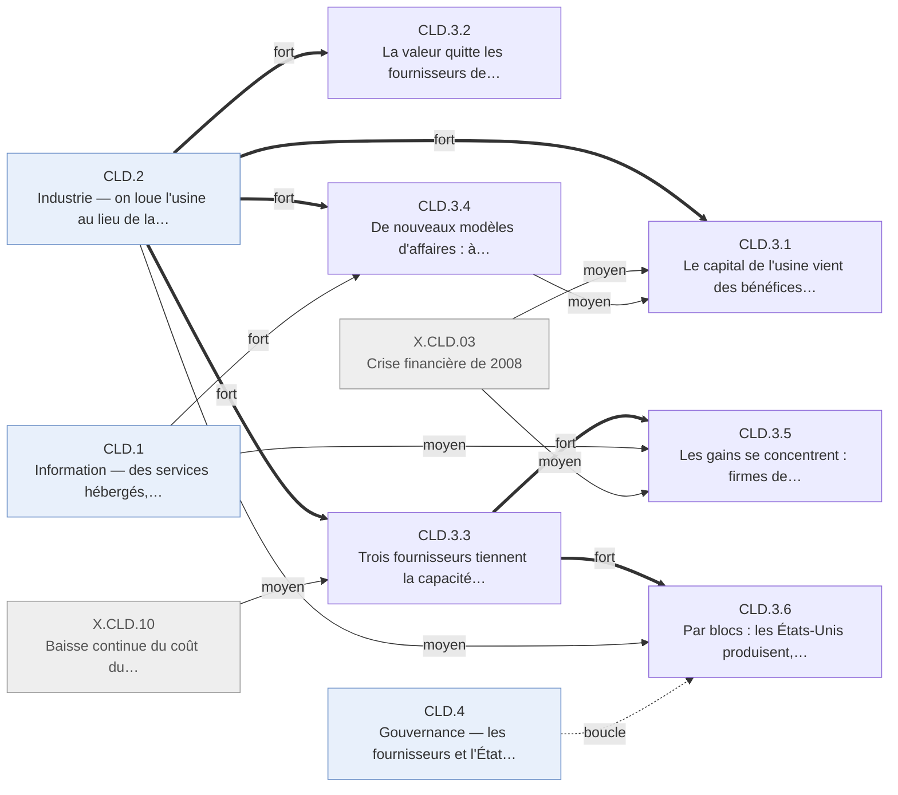

# Arbre des effets — cloud · CLD.3 Affaires

Branche de l'[arbre cloud](README.md). Conventions : [README.md § Comment lire](README.md#comment-lire).

## Table of Contents

1. [CLD.3 · Affaires — la valeur passe du matériel possédé aux loueurs et aux plateformes](#cld3--affaires--la-valeur-passe-du-matériel-possédé-aux-loueurs-et-aux-plateformes) _(Lines 14-177)_

---

## CLD.3 · Affaires — la valeur passe du matériel possédé aux loueurs et aux plateformes
<!-- Lines 14-177 -->

La valeur quitte les vendeurs de salles machines pour trois loueurs de capacité américains,
financés sur leurs bénéfices, qui tiennent un marché fermé par l'échelle ; l'amorçage devient
bon marché, et les modèles à l'usage, à l'abonnement et gratuit contre données s'imposent, sans
krach ; les gains se concentrent sur les firmes de tête et sur un bloc. Qui : firmes,
investisseurs, blocs géographiques · certitude : V

Causes : CLD.2 (principale, fort) ; CLD.1 (moyen) ; X.CLD.03 (moyen) ; X.CLD.10 (moyen) ; X.CLD.06 (faible) ; X.CLD.07 (faible) ; CLD.4 (faible) ; amont (revenus accumulés par les survivants du Web ; commerce en ligne, publicité et logiciel hébergé nés du choc Internet ; trajectoire chinoise séparée)

Le capital de l'usine vient des bénéfices des géants, à taux nuls ; le marché finance les
seconds rôles, l'amorçage devenu bon marché et un mini-cycle du logiciel par abonnement, sans
krach (CLD.3.1). La valeur quitte les fournisseurs de salles machines : ventes de matériel en
recul, titulaires entrés tard, un constructeur scindé en 2015 (CLD.3.2). Trois fournisseurs
tiennent la capacité louée, et la première publication séparée, en 2015, révèle une activité
très rentable qui rend ses clients dépendants (CLD.3.3). Les modèles d'affaires changent : on
paie l'informatique à la consommation, le logiciel à l'abonnement, le service gratuit par la
publicité et la donnée ; la mise en relation à la demande, le commerce en ligne et l'argent
mobile deviennent des marchés (CLD.3.4). Les gains se concentrent sur les firmes de tête,
quelques métropoles et le capital ; le surplus des usagers existe mais ne comble pas le
ralentissement mesuré (CLD.3.5). Par blocs, les États-Unis produisent, l'Europe achète, la
Chine garde son marché, et le droit des données commence à freiner l'échange (CLD.3.6).

<!-- GENERE:CLD.3:debut -->

<!-- GENERE:CLD.3:fin -->

- **CLD.3.1 · Le capital de l'usine vient des bénéfices ; le marché finance l'amorçage et un mini-cycle, sans krach** — investisseurs, exploitants · V
  - Causes : CLD.2.2 (principale, fort) ; CLD.2.3 (fort) ; X.CLD.03 (moyen) ; CLD.3.4 (moyen) ; amont (revenus accumulés par les survivants du Web ; centres rachetés aux faillites de 2000-2002)
  - À la différence d'Internet, le capital principal ne passe pas par les marchés : pas de forme en deux temps.
  - **CLD.3.1.1 · Les géants financent l'usine sur leurs bénéfices, à taux quasi nuls** — grands exploitants · V
    - Causes : CLD.2.2.1 (principale, fort) ; X.CLD.03 (moyen) ; amont (revenus des activités héritées du choc Internet)
    - Dépenses d'équipement : premier loueur de 224 M$ (2007) à 4 589 M$ (2015) ; éditeur historique de 2 305 M$ (2012) à 5 944 M$ (2015) ; moteur devenu conglomérat au-dessus de 10 Md$ en 2014 ; taux directeur de 3,94 % (janvier 2008) à 0,07-0,24 % jusqu'à fin 2015 ; aucune levée d'actions dédiée au cloud documentée.
    - Faits : F.CLD.B1.001, F.CLD.B1.002, F.CLD.B1.003, F.CLD.B1.013
  - **CLD.3.1.2 · Le marché finance les seconds rôles : foncières et hébergeurs** — foncières de centres de données, hébergeurs · V
    - Causes : CLD.2.2.1 (principale, moyen) ; amont (centres rachetés à prix décoté aux faillites de 2000-2002)
    - Foncière constituée en mars 2004 à partir de centres rachetés à des faillites, cotée en novembre 2004, environ 9,0 Md$ de capitalisation mi-2015 ; hébergeur coté en août 2008 (147,6 M$), un mois avant l'effondrement, qui se repositionne aussitôt sur le cloud.
    - Faits : F.CLD.B1.004, F.CLD.B1.006, F.CLD.B1.005, J.CLD.2008.10
  - **CLD.3.1.3 · L'amorçage coûte moins, le capital-risque logiciel quadruple** — fondateurs, capital-risque · V
    - Causes : CLD.2.3.4 (principale, fort) ; X.CLD.03 (faible)
    - Norme de 2009 : aucun serveur à acheter pour lancer une entreprise de logiciel ; capital-risque logiciel américain : 5 595 M$ (2006), 5 283 M$ (2010), 11 308 M$ (2013), 23 498 M$ (2015) ; 11 à 20 introductions en bourse logicielles par an en 2012-2014.
    - Faits : F.CLD.B1.007, F.CLD.B1.008, F.CLD.B1.009, J.CLD.2009.01, F.CLD.B1.010, F.CLD.B1.011
  - **CLD.3.1.4 · Le logiciel par abonnement coté vit un mini-cycle de valorisation, sans krach** — investisseurs · K
    - Causes : CLD.3.4.2 (principale, fort) ; X.CLD.03 (moyen)
    - Multiples de 3 à 5 fois le chiffre d'affaires (2004-2011), jusqu'à 20 fois pour certaines valeurs (fin 2013), médiane d'environ 5 fois en août 2015, plus de 90 % des valeurs sous leur plus haut ; aucun indice sectoriel avant 2013.
    - Faits : F.CLD.B2.004, F.CLD.B2.006, F.CLD.B2.007, F.CLD.B2.010
  - **CLD.3.1.5 · La crise de 2008 comprime l'informatique possédée sans casser la trajectoire du cloud** — entreprises, marchés · K
    - Causes : X.CLD.03 (principale, fort)
    - Effondrement de septembre 2008 et gel du crédit ; l'investissement en matériel possédé se contracte pendant que la dépense en services loués croît ; les valorisations du cloud reprennent leur progression après le creux de 2009.
    - Faits : J.CLD.2008.01, F.CLD.C2.007, F.CLD.B2.011
- **CLD.3.2 · La valeur quitte les fournisseurs de salles machines** — constructeurs et éditeurs historiques · V
  - Causes : CLD.2.3 (principale, fort) ; CLD.2.1 (fort) ; X.CLD.10 (faible)
  - **CLD.3.2.1 · Les ventes de matériel aux entreprises reculent, l'investissement total continue de croître** — constructeurs historiques · V
    - Causes : CLD.2.3.1 (principale, fort) ; X.CLD.10 (faible)
    - Ralentissement durable dès 2011 ; matériel d'un éditeur historique de 19 % à 14 % de son chiffre d'affaires (2011-2013) ; chiffre d'affaires des serveurs en recul malgré un record d'unités en 2013, le volume allant au matériel banalisé acheté par les exploitants ; scission d'un constructeur historique en novembre 2015 ; investissement américain en informatique et logiciel de 445,6 Md$ (2005) à 678,5 Md$ (2015).
    - Faits : F.CLD.A3.003, J.CLD.2011.04, F.CLD.B3.004, F.CLD.B3.005, F.CLD.B3.006, J.CLD.2015.09, F.CLD.C2.003, F.CLD.C2.008
  - **CLD.3.2.2 · Les titulaires arrivent tard, d'abord avec des contrats pluriannuels** — éditeurs et constructeurs historiques · V
    - Causes : CLD.2.1.1 (principale, fort)
    - Informatique « à la demande » des constructeurs en 2005, sous contrat pluriannuel ; l'éditeur historique des systèmes d'entreprise annonce son offre louée le 27 octobre 2008, deux ans après le nouvel entrant.
    - Faits : J.CLD.2005.02, F.CLD.C4.008, F.CLD.A3.002, F.CLD.C5.008, J.CLD.2008.03
- **CLD.3.3 · Trois fournisseurs tiennent la capacité louée : l'échelle ferme le marché** — marché mondial de la capacité · V
  - Causes : CLD.2.2 (principale, fort) ; X.CLD.10 (moyen)
  - **CLD.3.3.1 · Un oligopole à trois, fermé par l'échelle de l'investissement** — fournisseurs, entrants · K
    - Causes : CLD.2.2.1 (principale, fort) ; X.CLD.10 (moyen)
    - Barrière à l'entrée : l'échelle des centres de données ; en 2014, trois fournisseurs coordonnent dans le temps leurs baisses de prix ; en 2015, les plus grands opérateurs dépensent plus que tout le reste de l'industrie informatique.
    - Faits : F.CLD.A3.004, F.CLD.C5.001, J.CLD.2014.01, F.CLD.C5.002, F.CLD.C6.001
  - **CLD.3.3.2 · L'usine louée se révèle très rentable** — premier loueur, ses actionnaires · V
    - Causes : CLD.3.3.1 (principale, fort)
    - Première publication séparée, avril 2015 : 1 566 M$ de chiffre d'affaires trimestriel, 265 M$ de résultat, environ 17 % de marge contre bien moins pour le commerce du même groupe ; la valorisation boursière se redistribue après coup vers cette activité.
    - Faits : F.CLD.B2.009, F.CLD.B3.009, F.CLD.C4.007, J.CLD.2015.01
  - **CLD.3.3.3 · Les clients deviennent dépendants : verrouillage et risque partagé** — organisations clientes · K
    - Causes : CLD.3.3.1 (principale, fort)
    - Coût de sortie et interfaces propriétaires documentés à partir de 2010 ; la panne d'avril 2011 révèle publiquement le risque de concentration sur peu de fournisseurs.
    - Faits : F.CLD.C5.003, F.CLD.C5.004
- **CLD.3.4 · De nouveaux modèles d'affaires : à l'usage, à l'abonnement, gratuit contre données, à la demande** — firmes, usagers · V
  - Causes : CLD.2.1 (principale, fort) ; CLD.1 (fort) ; CLD.2.2 (moyen) ; amont (commerce en ligne, publicité et logiciel hébergé nés du choc Internet)
  - **CLD.3.4.1 · On paie l'informatique à la consommation** — clients de capacité · K
    - Causes : CLD.2.1.1 (principale, fort)
    - Calcul à l'heure, stockage au gigaoctet, exécution à l'appel : la facture suit la consommation réelle, pas un contrat de capacité (2006-2015).
    - Faits : F.CLD.C4.001
  - **CLD.3.4.2 · Le logiciel se vend à l'abonnement plutôt qu'en licence** — éditeurs, organisations clientes · V
    - Causes : CLD.2.1 (principale, moyen) ; amont (logiciel hébergé par abonnement démontré en 2000-2003)
    - Le principal éditeur par abonnement passe le milliard : 749 M$ puis 1 077 M$ (exercices clos en janvier 2008 et 2009) ; la part récurrente des grands éditeurs augmente au détriment de la licence perpétuelle.
    - Faits : F.CLD.A5.002, F.CLD.B2.003, F.CLD.C4.002, F.CLD.C4.003, J.CLD.2009.05
  - **CLD.3.4.3 · Le gratuit financé par la publicité et la donnée atteint l'échelle industrielle** — plateformes, annonceurs · K
    - Causes : CLD.1.2 (principale, fort) ; amont (gratuit financé par la publicité, né du choc Internet)
    - Réseau social coté en mai 2012 avec plus de 900 millions d'usagers actifs, valorisé pour une audience servie depuis des centres de données, signe de la concentration de l'audience ; profilage publicitaire à partir des données d'usage comme second modèle de revenu (2013-2015).
    - Faits : F.CLD.C4.004, F.CLD.C4.006, F.CLD.C5.006, J.CLD.2012.02
  - **CLD.3.4.4 · La mise en relation à la demande devient un modèle d'affaires** — plateformes, travailleurs indépendants · K
    - Causes : CLD.1.1.2 (principale, fort) ; CLD.2.1 (moyen)
    - Hébergement, transport, livraison par plateforme à partir de 2008, sur des services loués pour la mise en relation et le paiement ; la contribution propre du cloud se limite à l'infrastructure.
    - Faits : F.CLD.C4.005, F.CLD.D3.004
  - **CLD.3.4.5 · Le commerce en ligne passe de 2,8 % à 7,0 % du détail américain et se concentre** — détaillants, consommateurs · V
    - Causes : amont (commerce en ligne né du choc Internet, 2,3 % du détail américain en 2005) ; CLD.1.1.2 (moyen) ; CLD.2.2 (moyen)
    - 2,8 % (T1 2006), 3,7 % (T4 2008), 4,6 % (T4 2010), 5,5 % (T4 2012), 7,0 % (T1 2015), sans trimestre de recul ; concentration sur quelques grandes plateformes ; commerce transfrontalier de biens en hausse, sans série agrégée.
    - Faits : F.CLD.E3.001, F.CLD.E3.002, F.CLD.E3.003, F.CLD.E3.004, F.CLD.E3.005, F.CLD.C5.007, F.CLD.C3.003
  - **CLD.3.4.6 · Un opérateur mobile capte la relation bancaire des non-bancarisés** — opérateur, Afrique de l'Est · V
    - Causes : CLD.2.1 (principale, moyen)
    - Paiement par téléphone simple sur une plateforme centrale d'opérateur, lancé en mars 2007 : 2 à 3 millions d'usagers en 2008, 9 millions en janvier 2010, sans réseau d'agences.
    - Faits : F.CLD.A5.004, J.CLD.2008.05
- **CLD.3.5 · Les gains se concentrent : firmes de tête, métropoles, capital** — firmes, territoires, salariés · K
  - Causes : CLD.3.3 (principale, fort) ; CLD.1 (moyen) ; X.CLD.03 (moyen) ; amont (baisse de la part du travail depuis 2001)
  - **CLD.3.5.1 · L'écart se creuse entre firmes de tête et reste, et entre métropoles** — firmes, territoires · K
    - Causes : CLD.3.3 (principale, fort)
    - Écart croissant de rentabilité et de productivité entre firmes « frontières » et autres, surtout dans les secteurs intensifs en informatique ; gains et emplois du cloud concentrés dans quelques métropoles et régions à électricité bon marché ; part du capital en hausse dans la valeur ajoutée du secteur.
    - Faits : F.CLD.C6.002, F.CLD.C6.003, F.CLD.C6.004, F.CLD.C6.006, F.CLD.D4.004
  - **CLD.3.5.2 · La capitalisation boursière bascule vers la technologie** — marchés d'actions · K
    - Causes : CLD.3.3 (principale, moyen) ; CLD.1.1.2 (moyen) ; X.CLD.03 (moyen)
    - En 2005, énergie, banque et industrie dominent les dix premières capitalisations américaines ; en 2010, un fabricant de terminaux entre parmi les toutes premières mondiales ; fin de fenêtre, deux exploitants d'usines figurent parmi les trois moteurs de hausse depuis 2009 ; rendements 2012-2015 concentrés sur quelques très grandes firmes technologiques.
    - Faits : F.CLD.B3.001, F.CLD.B3.002, F.CLD.B3.003, F.CLD.B3.010, F.CLD.C6.005
  - **CLD.3.5.3 · Le surplus des usagers existe, mais ne comble pas le ralentissement mesuré** — usagers, comptables nationaux · V
    - Causes : CLD.1.2 (principale, fort) ; CLD.1.3 (fort)
    - Hypothèse d'époque : les produits numériques gratuits échapperaient au PIB ; quatre analyses (2016) la contestent : le ralentissement touche des dizaines de pays sans lien avec leur intensité informatique, et le surplus estimé couvre au mieux un tiers du PIB manquant allégué.
    - Faits : F.CLD.C1.006, F.CLD.C1.007
  - **CLD.3.5.4 · La part du travail baisse, dans le prolongement d'une tendance antérieure** — salariés (US) · V
    - Causes : amont (tendance baissière depuis 2001, dans le cycle du choc Internet) ; X.CLD.03 (moyen)
    - 67,7 % (2000), 65,5 % (2003), 63,5 % (2005), 60,7 % (2013, creux), 61,5 % (2015), sans rupture attribuable au cloud.
    - Faits : F.CLD.D4.001, F.CLD.D4.008
- **CLD.3.6 · Par blocs : les États-Unis produisent, l'Europe achète, la Chine garde son marché** — blocs géographiques · K
  - Causes : CLD.3.3 (principale, fort) ; CLD.2.1 (moyen) ; CLD.2.2 (moyen) ; CLD.4.4 (boucle) ; amont (trajectoire chinoise séparée depuis le choc Internet ; absence de survivant européen du Web)
  - **CLD.3.6.1 · L'Europe ne capte aucune part de la production** — Union européenne · K
    - Causes : CLD.3.3.1 (principale, fort) ; amont (absence de survivant européen du Web)
    - Aucun fournisseur européen de capacité à l'échelle mondiale en 2009, ni en 2012 malgré un projet public.
    - Faits : F.CLD.A3.006, F.CLD.B3.008
  - **CLD.3.6.2 · La Chine garde la valeur dans un marché domestique séparé** — Chine · K
    - Causes : amont (trajectoire chinoise séparée depuis le choc Internet, X.INT.09 du registre Internet) ; CLD.2.2 (moyen)
    - Usines nationales engagées dès 2007 ; filiale dédiée au calcul loué en 2009 ou 2010 selon les sources ; marché séparé qui limite l'échange de services avec l'Occident.
    - Faits : F.CLD.A3.005, F.CLD.B3.007, F.CLD.C3.006, J.CLD.2007.05
  - **CLD.3.6.3 · Les services hébergés s'échangent sans présence locale** — fournisseurs exportateurs, clients étrangers · K
    - Causes : CLD.2.1 (principale, fort)
    - Logiciel par abonnement, plateformes et contenus s'exportent sans implantation, contrairement à l'essentiel du commerce de services antérieur.
    - Faits : F.CLD.C3.001
  - **CLD.3.6.4 · Le droit des données commence à freiner l'échange transatlantique** — clients européens de fournisseurs américains · V
    - Causes : CLD.4.4.2 (principale, fort)
    - Localisation des données comme frein naissant après 2013 ; l'invalidation du cadre de transfert en octobre 2015 crée une incertitude juridique directe.
    - Faits : F.CLD.C3.004, F.CLD.C3.005
