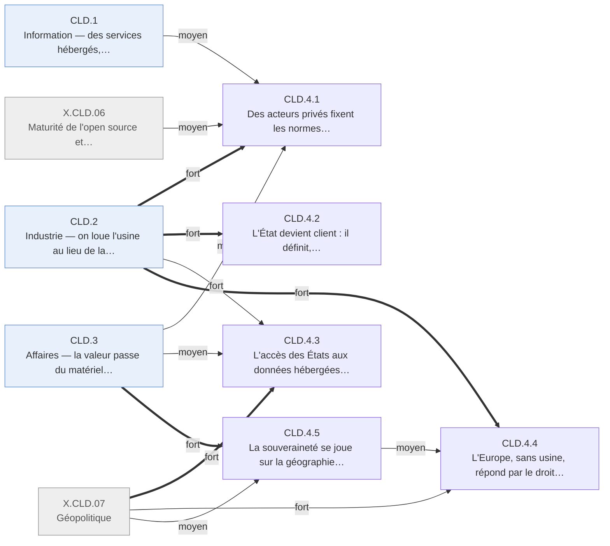

# Arbre des effets — cloud · CLD.4 Gouvernance

Branche de l'[arbre cloud](README.md). Conventions : [README.md § Comment lire](README.md#comment-lire).

## Table of Contents

1. [CLD.4 · Gouvernance — les fournisseurs et l'État client d'abord, la juridiction des données ensuite](#cld4--gouvernance--les-fournisseurs-et-létat-client-dabord-la-juridiction-des-données-ensuite) _(Lines 14-146)_

---

## CLD.4 · Gouvernance — les fournisseurs et l'État client d'abord, la juridiction des données ensuite
<!-- Lines 14-146 -->

Les règles du nuage sont d'abord fixées par ses fournisseurs et par l'État client, qui le
définit, l'achète et l'homologue ; après 2013, l'accès des États aux données hébergées devient
la question centrale, et l'Europe, sans usine, répond par le droit pendant que la souveraineté
se joue sur la géographie des usines. Qui : États, fournisseurs, autorités de protection des
données · certitude : V

Causes : CLD.2 (principale, fort) ; X.CLD.07 (fort) ; CLD.3 (moyen) ; CLD.1 (faible) ; X.CLD.06 (moyen) ; amont (loi antiterroriste américaine de 2001 et directive européenne de 1995 sur les données ; trajectoire chinoise séparée depuis le choc Internet)

Les premières normes du nuage sont privées : une métrique d'efficacité posée par un
consortium, des fondations qui gouvernent la pile logicielle, un réseau social qui impose puis
abandonne le nom réel ; aucun traité (CLD.4.1). L'État américain agit en client : il fixe le
vocabulaire opposable, achète sur catalogue avec priorité au nuage, homologue une fois pour
toutes ses agences, jusqu'aux données classifiées ; la Corée du Sud fait une loi de
développement (CLD.4.2). L'accès des États aux données hébergées, élargi par la loi américaine
en 2008, devient public en 2013 : réforme partielle, chiffrement et campagne des fournisseurs
(CLD.4.3). L'Europe, cliente d'une industrie qu'elle ne possède pas, répond par le droit des
données, jusqu'à l'invalidation du cadre de transfert en 2015, et par la certification de
l'usage (CLD.4.4). La souveraineté se joue sur la géographie des usines : clouds souverains
français en échec, marché chinois séparé, obligations de localisation et régions locales des
fournisseurs américains (CLD.4.5). Aucune de ces règles ne contrôle l'entrée par la
concurrence : l'antitrust est absent des faits de la fenêtre (CLD.4.1, CLD.4.2), et c'est
l'échelle qui ferme le marché, en Affaires.

<!-- GENERE:CLD.4:debut -->

<!-- GENERE:CLD.4:fin -->

- **CLD.4.1 · Des acteurs privés fixent les normes techniques et sociales, sans traité** — consortiums, fondations, plateformes · V
  - Causes : CLD.2.2 (principale, fort) ; CLD.3.3 (moyen) ; CLD.1.2 (moyen) ; X.CLD.06 (moyen)
  - **CLD.4.1.1 · Un consortium d'exploitants fixe la métrique d'efficacité énergétique** — exploitants de centres de données · K
    - Causes : CLD.2.2.1 (principale, fort)
    - Consortium d'exploitants et de constructeurs fondé en février 2007, hors de toute autorité publique.
    - Faits : F.CLD.G2.001, J.CLD.2007.07
  - **CLD.4.1.2 · Des fondations ouvertes gouvernent la pile logicielle, en l'absence de norme intergouvernementale** — éditeurs, exploitants · K
    - Causes : CLD.3.3 (principale, fort) ; X.CLD.06 (fort)
    - Fondation créée en juillet 2010 pour empêcher que la pile de l'usine soit contrôlée par deux ou trois fournisseurs ; orchestrateur d'un grand exploitant confié à une fondation (2015) ; aucune instance intergouvernementale ne fixe de norme contraignante sur la fenêtre.
    - Faits : F.CLD.G2.003, J.CLD.2010.01, F.CLD.G2.004, F.CLD.G2.007
  - **CLD.4.1.3 · Une plateforme fixe la règle de l'identité en ligne, puis recule** — usagers des réseaux sociaux · V
    - Causes : CLD.1.2 (principale, fort)
    - Nom réel imposé en 2011 par un réseau social, suspensions touchant noms non occidentaux et mononymes ; obligation abandonnée le 15 juillet 2014 après un conflit public.
    - Faits : F.CLD.F4.004
- **CLD.4.2 · L'État devient client : il définit, achète, homologue** — administrations · V
  - Causes : CLD.2.1 (principale, fort)
  - **CLD.4.2.1 · L'État fixe le vocabulaire opposable du nuage** — acheteurs, auditeurs · V
    - Causes : CLD.2.1 (principale, fort)
    - Définition normative du 28 septembre 2011 : cinq caractéristiques, trois modèles de service, quatre modèles de déploiement ; sans elle, ni marché public ni audit.
    - Faits : F.CLD.G2.002, F.CLD.A2.003, J.CLD.2011.01
  - **CLD.4.2.2 · L'achat public passe au catalogue et au « nuage d'abord »** — administrations (US, Royaume-Uni) · V
    - Causes : CLD.2.1 (principale, fort)
    - Portail d'achat fédéral (septembre 2009) ; stratégie « Cloud First » du 8 février 2011 ; place de marché britannique de plus de 1 700 services de plus de 250 fournisseurs (février 2012), à contrats courts.
    - Faits : F.CLD.G3.001, J.CLD.2009.02, F.CLD.G3.002, J.CLD.2010.02, F.CLD.G3.005, J.CLD.2012.06
  - **CLD.4.2.3 · Une homologation unique, jusqu'aux données classifiées, ouvre le marché public** — fournisseurs homologués, agences · V
    - Causes : CLD.4.2.2 (principale, fort)
    - Programme fédéral unique d'homologation du 8 décembre 2011, jugé par un comité de trois agences ; en 2013, un fournisseur homologué pour des données classifiées remporte un contrat de renseignement, contesté par un intégrateur historique.
    - Faits : F.CLD.G1.003, F.CLD.G2.006, J.CLD.2011.03, F.CLD.G3.009, F.CLD.G4.004, J.CLD.2013.02
  - **CLD.4.2.4 · La Corée du Sud fait une loi pour développer le nuage** — Corée du Sud · V
    - Causes : CLD.2.1 (principale, moyen)
    - Loi n° 13234 promulguée le 27 mars 2015 : soutien public au secteur et protection des usagers, pas de repli souverain.
    - Faits : F.CLD.G4.010, J.CLD.2015.10
- **CLD.4.3 · L'accès des États aux données hébergées devient une question publique** — États, fournisseurs · V
  - Causes : X.CLD.07 (principale, fort) ; CLD.2.2 (fort) ; CLD.3.3 (moyen) ; amont (loi antiterroriste américaine de 2001)
  - **CLD.4.3.1 · La loi américaine étend la surveillance aux données de ses fournisseurs, où qu'elles soient** — étrangers clients de fournisseurs américains · V
    - Causes : amont (loi antiterroriste de 2001 et élargissements après le 11 septembre, X.INT.07 du registre Internet) ; CLD.2.2 (faible)
    - Loi du 10 juillet 2008 : ciblage sans mandat individualisé des personnes situées hors du territoire américain.
    - Faits : F.CLD.G1.002
  - **CLD.4.3.2 · Les révélations de 2013 forcent une réforme partielle** — Congrès, renseignement · V
    - Causes : X.CLD.07 (principale, fort) ; CLD.4.3.3 (moyen)
    - Révélations à partir de juin 2013 ; loi du 2 juin 2015 qui met fin à la collecte en masse des métadonnées téléphoniques ; les propositions de protéger les courriels hébergés de plus de six mois n'aboutissent pas.
    - Faits : F.CLD.G4.003, J.CLD.2013.01, F.CLD.G1.007, J.CLD.2015.03, F.CLD.G1.010
  - **CLD.4.3.3 · Les fournisseurs se défendent : chiffrement et campagne pour la loi** — grands fournisseurs · V
    - Causes : X.CLD.07 (principale, fort) ; CLD.3.3 (moyen)
    - Chiffrement systématique des liaisons entre centres annoncé en 2013-2014 ; campagne publique pour la loi de 2015, afin de rassurer la clientèle étrangère.
    - Faits : F.CLD.G4.005, J.CLD.2013.03, F.CLD.G4.008
- **CLD.4.4 · L'Europe, sans usine, répond par le droit des données** — Union européenne · K
  - Causes : CLD.2.3 (principale, fort) ; X.CLD.07 (fort) ; CLD.4.5 (moyen) ; CLD.2.2 (faible)
  - **CLD.4.4.1 · L'Europe prépare un droit des données adapté au nuage** — autorités européennes · K
    - Causes : CLD.2.3 (principale, moyen) ; CLD.4.5.1 (moyen)
    - Travaux de stratégie en 2011 ; proposition de refonte en janvier 2012 (traitements hors de l'Union, notification des violations) ; avis des autorités de protection sur le nuage en juillet 2012 : transparence, localisation, audit et certification.
    - Faits : F.CLD.G1.004, F.CLD.G1.005, F.CLD.G2.005, F.CLD.C5.005, J.CLD.2011.05
  - **CLD.4.4.2 · Après 2013, le droit durcit puis invalide le transfert vers les États-Unis** — organisations européennes clientes · K
    - Causes : X.CLD.07 (principale, fort) ; CLD.4.4.1 (moyen)
    - Doctrine durcie en 2013 ; le 6 octobre 2015, la Cour de justice invalide la décision « sphère de sécurité » (affaire C-362/14).
    - Faits : F.CLD.G1.006, J.CLD.2013.04, F.CLD.G1.008, F.CLD.G4.007, J.CLD.2015.02
  - **CLD.4.4.3 · Les États européens encadrent l'usage à défaut de produire** — administrations, secteurs réglementés · K
    - Causes : CLD.4.5.1 (principale, moyen) ; CLD.2.3 (moyen) ; CLD.2.2 (faible)
    - Code de conduite volontaire sur l'efficacité des centres de données (2008) ; référentiels nationaux de certification des services en nuage en 2015, sans cadre européen unifié.
    - Faits : F.CLD.A5.007, F.CLD.G1.009, F.CLD.G3.011, J.CLD.2015.04, J.CLD.2008.09
- **CLD.4.5 · La souveraineté se joue sur la géographie des usines** — États, fournisseurs · K
  - Causes : CLD.3.6 (principale, fort) ; X.CLD.07 (moyen) ; amont (trajectoire chinoise séparée depuis le choc Internet)
  - **CLD.4.5.1 · L'Europe se découvre cliente d'une industrie qu'elle ne possède pas** — Union européenne · K
    - Causes : CLD.3.6.1 (principale, fort)
    - Constat de 2009 des groupes européens du numérique et des pouvoirs publics.
    - Faits : F.CLD.G4.001, J.CLD.2009.04
  - **CLD.4.5.2 · Les clouds souverains financés sur fonds publics échouent** — France · K
    - Causes : CLD.4.5.1 (principale, fort)
    - Projet national annoncé en 2009 ; en 2012, deux coentreprises de 75 M€ chacune faute d'accord entre industriels ; l'une reprise par son actionnaire télécoms en mars 2015.
    - Faits : F.CLD.G3.006, F.CLD.G3.007, F.CLD.G3.008, F.CLD.G4.009, F.CLD.A3.007, J.CLD.2012.03
  - **CLD.4.5.3 · La Chine sépare son marché** — Chine · K
    - Causes : amont (trajectoire chinoise séparée depuis le choc Internet) ; CLD.3.6.2 (moyen)
    - Filiale dédiée au calcul en nuage d'un opérateur chinois de commerce en ligne, créée le 10 septembre 2009 pour le marché intérieur.
    - Faits : F.CLD.G4.002, J.CLD.2010.05
  - **CLD.4.5.4 · Les données se localisent : obligations nationales et régions locales des fournisseurs** — États, fournisseurs américains · K
    - Causes : X.CLD.07 (principale, moyen) ; CLD.3.6 (moyen)
    - Obligations sectorielles de localisation dans plusieurs pays (2009-2015) ; régions ouvertes en Allemagne et ailleurs en Europe en 2014 : la souveraineté traitée par la géographie physique plutôt que par l'actionnariat.
    - Faits : F.CLD.G1.011, F.CLD.G4.006, J.CLD.2014.04
