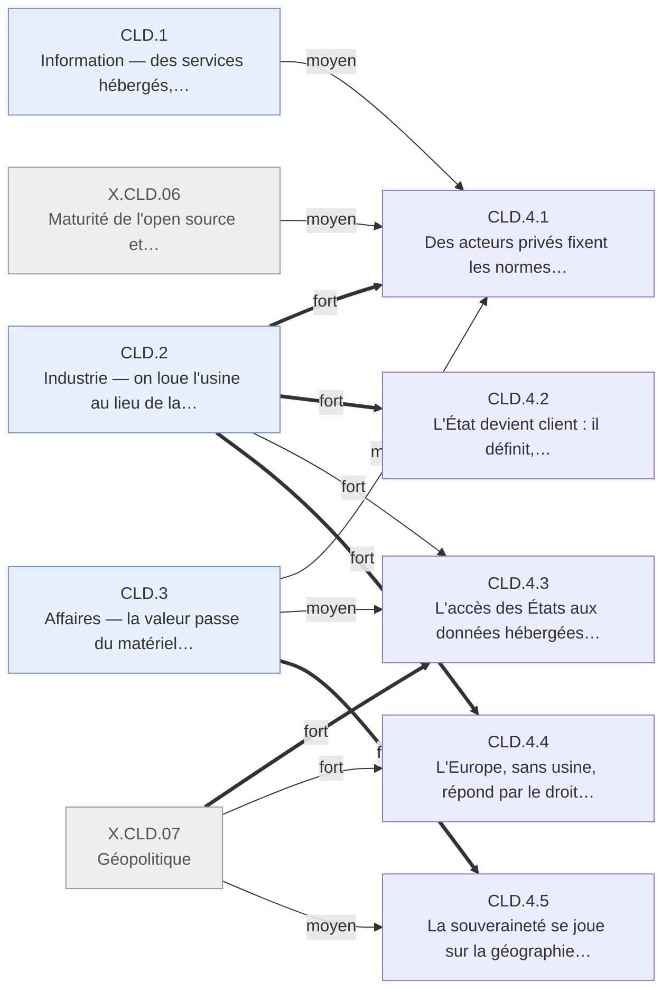

# Arbre des effets — cloud · CLD.4 Gouvernance

Branche de l'[arbre cloud](README.md). Conventions : [README.md § Comment lire](README.md#comment-lire).

## Table of Contents

1. [CLD.4 · Gouvernance — les fournisseurs et l'État client d'abord, la juridiction des données ensuite](#cld4--gouvernance--les-fournisseurs-et-létat-client-dabord-la-juridiction-des-données-ensuite) _(Lines 14-149)_

---

## CLD.4 · Gouvernance — les fournisseurs et l'État client d'abord, la juridiction des données ensuite
<!-- Lines 14-149 -->

Les règles du nuage sont d'abord fixées par ses fournisseurs et par l'État client, qui le
définit, l'achète et l'homologue ; après 2013, l'accès des États aux données hébergées devient
la question centrale, et l'Europe, sans usine, répond par le droit pendant que la souveraineté
se joue sur la géographie des usines. Qui : États, fournisseurs, autorités de protection des
données · certitude : A

Causes : CLD.2 (principale, fort) ; X.CLD.07 (fort) ; CLD.3 (moyen) ; CLD.1 (faible) ; X.CLD.06 (moyen) ; amont (loi antiterroriste américaine de 2001 et directive européenne de 1995 sur les données ; trajectoire chinoise séparée depuis le choc Internet)

Les premières normes du nuage sont privées : une métrique d'efficacité posée par un consortium,
des fondations qui gouvernent la pile logicielle, un réseau social qui impose puis abandonne le
nom réel ; la recommandation intergouvernementale reste non obligatoire (CLD.4.1). L'État
américain agit en client : il fixe le vocabulaire opposable, achète sur catalogue avec priorité
au nuage, homologue une fois pour toutes ses agences, en cohérence avec le « nuage d'abord », et un
service de renseignement retient un nuage commercial pour des données classifiées ; la Corée du
Sud fait une loi de développement (CLD.4.2). L'accès des États aux données hébergées, élargi par la loi américaine en 2008,
devient public en 2013 : réforme partielle, chiffrement et campagne des fournisseurs (CLD.4.3).
L'Europe, cliente d'un marché que dominent les Nord-Américains, répond par le droit des données,
jusqu'à l'invalidation du cadre de transfert en 2015, et par des référentiels de sécurité de
l'usage (CLD.4.4). La souveraineté se joue sur la géographie des usines : la France fait de la domination
nord-américaine une question de souveraineté, ses deux clouds souverains restent loin de leurs
objectifs et l'État sort de l'un en 2015, le marché chinois ne s'ouvre à un fournisseur américain
que par un opérateur local, les obligations de localisation et l'inquiétude des clients après
2013, l'Allemagne au centre, mènent à une région allemande d'un fournisseur américain
(CLD.4.5). Aucune de ces règles ne contrôle l'entrée par la concurrence : l'antitrust
est absent des faits de la fenêtre (CLD.4.1, CLD.4.2), et l'échelle pèse sur l'entrée, en
Affaires.

<!-- GENERE:CLD.4:debut -->

<!-- GENERE:CLD.4:fin -->

- **CLD.4.1 · Des acteurs privés fixent les normes techniques et sociales** — consortiums, fondations, plateformes · A
  - Causes : CLD.2.2 (principale, fort) ; CLD.3.3 (moyen) ; CLD.1.2 (moyen) ; X.CLD.06 (moyen)
  - **CLD.4.1.1 · Un consortium industriel publie une métrique partagée d'efficacité énergétique** — exploitants de centres de données · A
    - Causes : CLD.2.2.1 (principale, fort)
    - Consortium industriel ouvert à but non lucratif, réunissant des utilisateurs finaux, des fournisseurs de technologie et d'autres acteurs des centres de données, qui publie en 2007 une métrique partagée d'efficacité énergétique (livre blanc n° 6, 2007), rapportant l'énergie totale de l'installation à celle des équipements informatiques.
    - Faits : F.CLD.G2.001, J.CLD.2007.07
  - **CLD.4.1.2 · Des fondations ouvertes gouvernent la pile logicielle ; la recommandation intergouvernementale reste non obligatoire** — éditeurs, exploitants · A
    - Causes : CLD.3.3 (principale, fort) ; X.CLD.06 (fort)
    - Projet ouvert de logiciel d'infrastructure en nuage annoncé en juillet 2010 à partir de code d'un exploitant de centres de données et de code développé pour une agence spatiale américaine, confié en septembre 2012 à une fondation indépendante dont le conseil de 24 membres compte des représentants de plusieurs entreprises ; en juillet 2015, une fondation rattachée à une fondation du logiciel libre reçoit d'un grand exploitant, comme technologie de départ, un système d'orchestration de conteneurs publié en logiciel libre en juin 2014 ; l'union internationale des télécommunications publie en 2014 la recommandation Y.3500 sur le vocabulaire du nuage, non obligatoire tant qu'elle n'est pas adoptée dans les lois nationales.
    - Faits : F.CLD.G2.003, J.CLD.2010.01, F.CLD.G2.004, F.CLD.G2.007
  - **CLD.4.1.3 · Une plateforme fixe la règle de l'identité en ligne, puis recule** — usagers des réseaux sociaux · V
    - Causes : CLD.1.2 (principale, fort)
    - Nom réel imposé en 2011 par un réseau social, suspensions touchant noms non occidentaux et mononymes ; obligation abandonnée le 15 juillet 2014 après un conflit public.
    - Faits : F.CLD.F4.004
- **CLD.4.2 · L'État devient client : il définit, achète, homologue** — administrations · A
  - Causes : CLD.2.1 (principale, fort)
  - **CLD.4.2.1 · L'État fixe le vocabulaire opposable du nuage** — acheteurs, auditeurs · V
    - Causes : CLD.2.1 (principale, fort)
    - Définition normative publiée le 28 septembre 2011 par l'institut américain de normalisation : cinq caractéristiques, trois modèles de service, quatre modèles de déploiement ; elle fixe le vocabulaire opposable pour tout marché ou audit.
    - Faits : F.CLD.G2.002, F.CLD.A2.003, J.CLD.2011.01
  - **CLD.4.2.2 · L'achat public passe au catalogue et au « nuage d'abord »** — administrations (US, Royaume-Uni) · V
    - Causes : CLD.2.1 (principale, fort)
    - Portail d'achat fédéral lancé le 15 septembre 2009 ; stratégie « Cloud First » du 8 février 2011 ; boutique en ligne du cadre d'achat britannique ouverte le 19 février 2012 pour le secteur public, avec des offres de près de 300 fournisseurs pour environ 1 700 services.
    - Faits : F.CLD.G3.001, J.CLD.2009.02, F.CLD.G3.002, J.CLD.2010.02, F.CLD.G3.005, J.CLD.2012.06
  - **CLD.4.2.3 · L'État homologue une fois pour toutes ses agences, et un service de renseignement retient un nuage commercial pour des données classifiées** — fournisseurs homologués, agences · A
    - Causes : CLD.4.2.2 (principale, fort)
    - Programme fédéral unique d'homologation de sécurité créé par un mémorandum du 8 décembre 2011, en cohérence avec la politique fédérale « Cloud First » : une homologation vaut pour l'ensemble du gouvernement fédéral, et un comité conjoint de trois agences juge la conformité des fournisseurs ; en janvier 2013, une agence de renseignement attribue à un fournisseur américain de services en nuage un contrat pouvant atteindre 600 M$ sur dix ans, pour un nuage appelé à traiter des informations classifiées et à être homologué selon les normes de la communauté du renseignement ; un concurrent saisit l'organe d'audit du Congrès, qui lui donne en partie raison, puis la juridiction fédérale des réclamations tranche en faveur du fournisseur en octobre 2013.
    - Faits : F.CLD.G1.003, F.CLD.G2.006, J.CLD.2011.03, F.CLD.G3.009, F.CLD.G4.004, J.CLD.2013.02
  - **CLD.4.2.4 · La Corée du Sud fait une loi pour développer le nuage** — Corée du Sud · V
    - Causes : CLD.2.1 (principale, moyen)
    - Loi n° 13234 promulguée le 27 mars 2015 : soutien public au secteur et protection des usagers, pas de repli souverain.
    - Faits : F.CLD.G4.010, J.CLD.2015.10
- **CLD.4.3 · L'accès des États aux données hébergées devient une question publique** — États, fournisseurs · A
  - Causes : X.CLD.07 (principale, fort) ; CLD.2.2 (fort) ; CLD.3.3 (moyen) ; amont (loi antiterroriste américaine de 2001)
  - **CLD.4.3.1 · La loi américaine étend la surveillance aux données de ses fournisseurs, où qu'elles soient** — étrangers clients de fournisseurs américains · V
    - Causes : amont (loi antiterroriste de 2001 et élargissements après le 11 septembre, X.INT.07 du registre Internet) ; CLD.2.2 (faible)
    - Loi du 10 juillet 2008 : ciblage sans mandat individualisé des personnes situées hors du territoire américain.
    - Faits : F.CLD.G1.002
  - **CLD.4.3.2 · Les révélations de 2013 forcent une réforme partielle** — Congrès, renseignement · A
    - Causes : X.CLD.07 (principale, fort) ; CLD.4.3.3 (moyen)
    - Révélations de presse à partir du 6 juin 2013 sur un programme de surveillance qui recueille des données auprès de grands fournisseurs américains de services en ligne ; déclaration du 17 juillet 2013 de la commission de contrôle du renseignement du Parlement britannique, selon laquelle le service britannique a produit des rapports à partir de renseignement sollicité auprès des États-Unis ; loi du 2 juin 2015 qui met fin à la collecte en masse de métadonnées téléphoniques, dont la conservation passe aux opérateurs ; deux projets de loi du Sénat (mars 2013, février 2015) exigeant un mandat pour le contenu des courriels détenus par des fournisseurs et supprimant la règle des 180 jours ne sont pas adoptés pendant la fenêtre.
    - Faits : F.CLD.G4.003, J.CLD.2013.01, F.CLD.G1.007, J.CLD.2015.03, F.CLD.G1.010
  - **CLD.4.3.3 · Les fournisseurs se défendent : chiffrement et campagne pour la loi** — grands fournisseurs · A
    - Causes : X.CLD.07 (principale, fort) ; CLD.3.3 (moyen)
    - Deux grands fournisseurs américains de services en ligne annoncent en 2013 chiffrer les échanges entre leurs centres de données : l'un accélère en juin 2013 un programme existant, l'autre annonce le 4 décembre 2013 un chiffrement du contenu des clients, prévu en totalité d'ici fin 2014 ; l'industrie américaine du cloud fait campagne publiquement pour la loi limitant la collecte en masse de métadonnées, afin de rassurer sa clientèle étrangère inquiète depuis 2013.
    - Faits : F.CLD.G4.005, J.CLD.2013.03, F.CLD.G4.008
- **CLD.4.4 · L'Europe, sans usine, répond par le droit des données** — Union européenne · A
  - Causes : CLD.2.3 (principale, fort) ; X.CLD.07 (fort) ; CLD.4.5 (faible) ; CLD.2.2 (faible)
  - **CLD.4.4.1 · L'Europe prépare un droit des données adapté au nuage** — autorités européennes · A
    - Causes : CLD.2.3 (principale, moyen) ; CLD.4.5.1 (faible)
    - Consultation publique de la Commission sur l'informatique en nuage, ouverte en mai 2011 et close le 31 août 2011, qui doit nourrir une stratégie européenne présentée le 27 septembre 2012 ; proposition de refonte du cadre de protection des données le 25 janvier 2012 (application des règles de l'Union aux traitements opérés à l'étranger par des entreprises actives sur son marché, notification des violations graves, si possible sous 24 heures) ; avis des autorités de protection du 1er juillet 2012 sur le nuage : le client doit connaître les sous-traitants et les lieux de traitement, le contrat doit les lister et prévoir la notification des violations, la seule auto-certification « sphère de sécurité » peut ne pas suffire, et la certification par un tiers reconnu peut être un moyen crédible de démontrer la conformité.
    - Faits : F.CLD.G1.004, F.CLD.G1.005, F.CLD.G2.005, F.CLD.C5.005, J.CLD.2011.05
  - **CLD.4.4.2 · Après 2013, le droit durcit puis invalide le transfert vers les États-Unis** — organisations européennes clientes · A
    - Causes : X.CLD.07 (principale, fort) ; CLD.4.4.1 (moyen)
    - Après les révélations sur la surveillance de masse, les autorités allemandes de protection des données annoncent le 24 juillet 2013 qu'elles n'accorderont plus de nouvelle autorisation de transfert vers des pays tiers et examineront la suspension des transferts fondés sur la sphère de sécurité, et le groupe des autorités européennes écrit à la Commission le 13 août 2013 qu'il doute que la surveillance à grande échelle relève de l'exception de sécurité nationale ; le 6 octobre 2015, la Cour de justice invalide la décision de la Commission qui reconnaissait le cadre américain « sphère de sécurité » comme offrant un niveau de protection adéquat (affaire C-362/14).
    - Faits : F.CLD.G1.006, J.CLD.2013.04, F.CLD.G1.008, F.CLD.G4.007, J.CLD.2015.02
  - **CLD.4.4.3 · Des États européens fixent des référentiels de sécurité pour l'usage du nuage par leurs administrations** — administrations · A
    - Causes : CLD.2.3 (principale, moyen) ; CLD.4.5.1 (faible) ; CLD.2.2 (faible)
    - Des organismes publics de plusieurs pays européens publient des référentiels de sécurité des services en nuage à l'usage de leurs administrations. Dans la fenêtre : recueil de guides britannique du 23 avril 2014, projet de guide espagnol d'avril 2014, dispositif français Secure Cloud créé en février 2015 (expérimentation depuis mars 2015). Après la fenêtre, en 2016 : catalogue de l'office fédéral allemand de la sécurité de l'information, et première partie du référentiel français le 12 décembre 2016.
    - Faits : F.CLD.A5.007, F.CLD.G1.009, F.CLD.G3.011, J.CLD.2015.04
- **CLD.4.5 · La souveraineté se joue sur la géographie des usines** — États, fournisseurs · A
  - Causes : CLD.3.6 (principale, fort) ; X.CLD.07 (moyen) ; amont (trajectoire chinoise séparée depuis le choc Internet)
  - **CLD.4.5.1 · La France constate que le nuage est dominé par les Nord-Américains et en fait une question de souveraineté** — France · V
    - Causes : CLD.3.6.1 (principale, fort)
    - Le 18 janvier 2010, le Premier ministre français déclare que les Nord-Américains dominent le marché de l'informatique en nuage, qu'il présente comme un enjeu pour la compétitivité, le développement durable et la souveraineté, et appelle à développer une alternative française et européenne.
    - Faits : F.CLD.G4.001, J.CLD.2009.04
  - **CLD.4.5.2 · Les deux clouds souverains financés sur fonds publics restent loin de leurs objectifs, et l'État sort de l'un en 2015** — France · A
    - Causes : CLD.4.5.1 (principale, fort)
    - Projet de cloud public national présenté par le Premier ministre en septembre 2011 (285 M€, dont 135 M€ de la Caisse des dépôts, financé en partie par le grand emprunt), destiné à offrir une alternative aux fournisseurs nord-américains qui dominent le marché ; scindé en deux sociétés lancées en septembre 2012 après un désaccord entre industriels, avec chacune 225 M€ d'investissement total, dont 75 M€ de la Caisse des dépôts ; le 20 mars 2015, l'État annonce que l'actionnaire télécoms de l'une, qui en détenait 44,4 %, a racheté les participations de l'État (33,3 %) et d'un groupe industriel (22,2 %), et confirme son soutien à l'autre. Début 2015, la presse spécialisée relève que les deux sociétés restent loin de leurs objectifs : la première, qui visait environ 500 M€ de recettes en 2017, a tout juste dépassé 1 M€ de chiffre d'affaires sur son dernier exercice, et l'objectif de 400 M€ de chiffre d'affaires à l'horizon 2017 de la seconde est encore loin d'être atteint.
    - Faits : F.CLD.G3.006, F.CLD.G3.007, F.CLD.G3.008, F.CLD.G3.012, F.CLD.G4.009, F.CLD.A3.007, J.CLD.2012.03
  - **CLD.4.5.3 · Le marché chinois du nuage ne s'ouvre à un fournisseur américain que par un opérateur local, en raison d'exigences réglementaires** — Chine · A
    - Causes : amont (trajectoire chinoise séparée depuis le choc Internet) ; CLD.3.6.2 (moyen)
    - Un groupe chinois de commerce en ligne crée en 2009 une filiale dédiée aux services de calcul en nuage, qui se présente comme le premier fournisseur de cloud en Chine ; un éditeur américain ne propose son service de nuage aux clients chinois que par l'intermédiaire d'un opérateur local, en raison d'exigences réglementaires locales (disponibilité générale en mars 2014).
    - Faits : F.CLD.G4.002, J.CLD.2010.05, F.CLD.C3.006
  - **CLD.4.5.4 · Les données se localisent : obligations nationales et région locale d'un fournisseur** — États, fournisseurs américains · A
    - Causes : X.CLD.07 (principale, moyen) ; CLD.3.6 (moyen)
    - Obligations sectorielles de localisation : en 2011 la banque centrale chinoise interdit aux banques de stocker ou de traiter hors de Chine les informations financières personnelles collectées en Chine, en 2012 l'Australie interdit, sauf exceptions, le transfert hors du pays des dossiers de santé électroniques de son système national, en 2013 le Nigeria impose d'héberger localement les données publiques ; en juillet 2014, la presse spécialisée rapporte que, depuis les révélations de 2013 sur la collecte de données par le renseignement américain, la localisation des centres de données est devenue une préoccupation aiguë de nombreux clients, l'Allemagne étant au centre de l'affaire, et que la filiale de services informatiques d'un opérateur allemand ouvre un grand centre de données commercialisé auprès des clients qui veulent que leurs données restent dans le pays ; le 23 octobre 2014, un grand fournisseur américain de services en nuage ouvre à Francfort une région de centres de données, sa deuxième région européenne, que la presse spécialisée relie à la demande de localisation des données en Allemagne.
    - Faits : F.CLD.G1.011, F.CLD.G4.006, F.CLD.G4.011, J.CLD.2014.04
