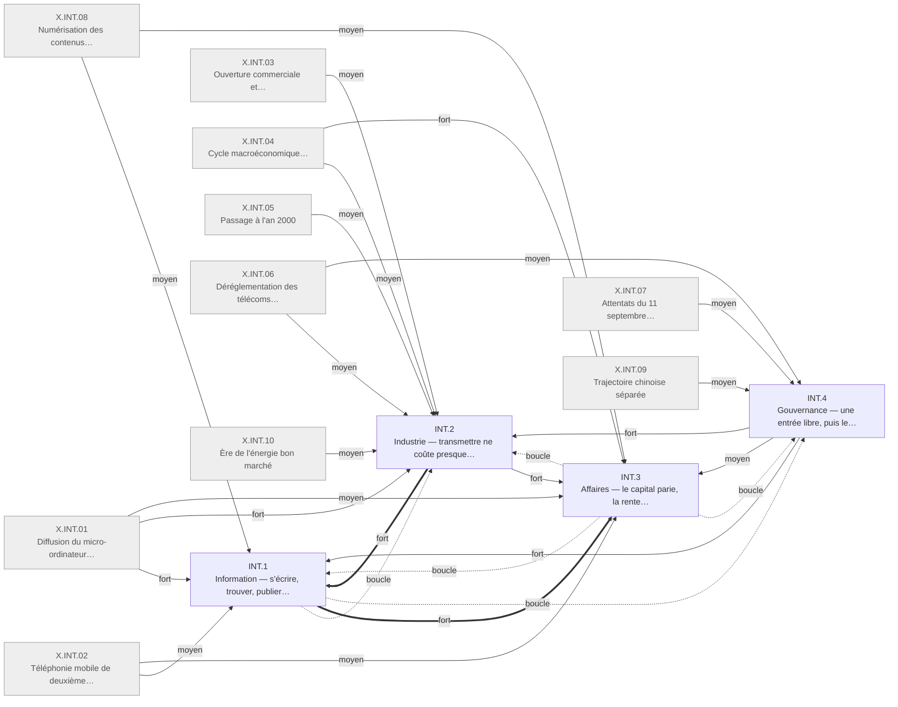

# Arbre des effets en quatre ordres — Internet 1995-2005

Statut : première génération. Changements appuyés sur les faits cités ; causes et poids :
jugements de l'agent, à relire par un modèle distinct. Cadre : [../README.md](../README.md).

## Table of Contents

1. [Comment lire](#comment-lire) _(Lines 21-37)_
1. [INT.0 · Ce qui a changé](#int0--ce-qui-a-changé) _(Lines 40-113)_
1. [Branches](#branches) _(Lines 116-125)_
1. [Profil](#profil) _(Lines 128-186)_
1. [Élagués](#élagués) _(Lines 189-207)_
1. [Ouvert](#ouvert) _(Lines 210-241)_
1. [Journal](#journal) _(Lines 244-306)_

---

## Comment lire
<!-- Lines 21-37 -->

- **Cadre** : racine de l'auteur, quatre ordres et leurs questions, règles 1 à 9 :
  [../README.md](../README.md). Syntaxe, poids et vérificateur : [../../README.md](../../README.md).
- **Une boîte énonce ce que ses enfants additionnent**, avec sa propre certitude : `V` au moins
  un appui vérifié à la source, `K` appuis à vérifier, `D` disputé. La certitude porte sur le
  changement ; toute cause est une inférence de l'agent.
- **Causes** : une seule `principale` par boîte ; poids `fort` (sans cette cause, plus de la
  moitié du changement disparaît), `moyen`, `faible` ; `boucle` marque une flèche de retour ;
  `amont` une cause antérieure à la fenêtre ou absente du registre.
- **Les deux leviers** du choc sont des boîtes comme les autres : INT.2.1 (transmettre ne coûte
  presque plus rien) en Industrie, INT.4.1 (personne ne filtre l'entrée) en Gouvernance.
- **Entre ordres, au niveau 1**, les flèches vont des leviers vers les usages puis vers la valeur
  (INT.4 → INT.2 → INT.1 → INT.3) ; les flèches de retour y sont marquées `boucle`. Plus bas, une
  flèche de retour n'est marquée `boucle` que si elle ferme un cycle.

---

## INT.0 · Ce qui a changé
<!-- Lines 40-113 -->

De 1995 à 2005, transmettre ne coûte presque plus rien sur un réseau où personne ne filtre l'entrée : les connectés s'écrivent, trouvent et publient presque sans coût, le capital parie puis s'effondre, la valeur quitte les rentes d'accès pour quelques plateformes payées par la publicité, et le droit rattrape les usages sous tutelle américaine ; les grands agrégats économiques de la fenêtre ont leur cause principale ailleurs. Qui : le monde, d'abord les connectés des pays riches · certitude : V

Causes : amont (arrêt de l'épine dorsale publique américaine en 1995 ; Web placé dans le domaine public et gouvernance technique par consensus hérités du réseau de recherche ; réseaux privés d'échange de données entre entreprises antérieurs à 1995 ; tendances culturelles antérieures) ; X.INT.01 (fort) ; X.INT.02 (moyen) ; X.INT.03 (moyen) ; X.INT.04 (fort) ; X.INT.05 (moyen) ; X.INT.06 (moyen) ; X.INT.07 (moyen) ; X.INT.08 (moyen) ; X.INT.09 (moyen) ; X.INT.10 (faible) ; X.CLD.02 (faible)

Deux leviers font le choc : transmettre ne coûte presque plus rien, ni selon la distance ni selon
la durée (INT.2.1), et personne ne possède les protocoles ni ne filtre l'entrée (INT.4.1) ; 73
feuilles sur 100 y remontent par leurs causes principales. En Information, qui est connecté peut
s'écrire, trouver, publier et copier presque sans coût, mais l'accès reste inégal et l'attention
se concentre dès 1997 (INT.1). En Industrie, l'infrastructure devient une industrie privée, les
organisations se coordonnent par écrit en réseau sans se reconfigurer, et l'emploi informatique
suit le capital (INT.2). En Affaires, le capital parie puis s'effondre, les rentes fondées sur
l'accès tombent là où les usagers migrent, et la valeur se reforme sur quelques plateformes
payées par la publicité (INT.3). En Gouvernance, le droit protège d'abord l'intermédiaire puis
rattrape les usages avec deux à six ans de retard ; les États-Unis gardent la tutelle des
ressources critiques, la Chine cloisonne, la sécurité revient après 2001 (INT.4). Vingt feuilles
ont leur cause principale dans un confondant, dont treize en Industrie : l'accélération de la
productivité revient surtout à l'ordinateur, la délocalisation des services à la mondialisation
et au passage à l'an 2000, et le plus gros changement mesuré en dollars, le commerce entre
entreprises, passe surtout par des réseaux antérieurs au Web (INT.3.6). Le choc est net en
Information, en Affaires et en Gouvernance ; en Industrie, il l'est pour l'infrastructure et le
travail de bureau, pas pour les agrégats.

<!-- GENERE:INT.0:debut -->

<!-- GENERE:INT.0:fin -->

---

## Branches
<!-- Lines 116-125 -->

| fichier | ce que dit la branche |
| --- | --- |
| [INT.1 · Information](int1_information.md) | Les connectés s'écrivent, trouvent, publient et copient presque sans coût ; l'accès s'étend vite mais inégalement ; tête concentrée et traîne épaisse. |
| [INT.2 · Industrie](int2_industrie.md) | Transmettre ne coûte presque plus rien ; les bureaux se coordonnent par écrit en réseau ; l'emploi informatique suit le capital ; productivité et délocalisation ont leur cause principale hors du réseau. |
| [INT.3 · Affaires](int3_affaires.md) | Le capital parie puis s'effondre ; les rentes d'accès tombent ; la valeur se reconcentre sur des plateformes payées par la publicité ; le commerce interentreprises passe par des réseaux antérieurs. |
| [INT.4 · Gouvernance](int4_gouvernance.md) | Entrée libre ; le droit protège l'intermédiaire puis rattrape les usages ; tutelle américaine contestée ; cloisonnement chinois ; retour de la sécurité. |

---

## Profil
<!-- Lines 128-186 -->

Lu sur la sortie du vérificateur (chaînes de causes principales). « Levier » : la chaîne aboutit
à INT.2.1 ou INT.4.1 ; « hors registre » : à une boîte dont la cause est `amont`.

| boîte | boîtes | feuilles | faits cités (F + J) | levier | confondant | hors registre |
| --- | --- | --- | --- | --- | --- | --- |
| INT.1 Information | 28 | 21 | 69 + 0 | 17 | 3 (X.INT.02 ×2, X.CLD.02) | 1 |
| INT.2 Industrie | 48 | 36 | 134 + 5 | 23 | 13 (X.INT.01 ×4, X.INT.03 ×3, X.INT.05 ×2, X.INT.10 ×2, X.INT.06, X.INT.08) | 0 |
| INT.3 Affaires | 29 | 21 | 87 + 7 | 19 | 1 (X.INT.04) | 1 |
| INT.4 Gouvernance | 28 | 22 | 58 + 10 | 14 | 3 (X.INT.06, X.INT.07, X.INT.09) | 5 |
| **total** | 134 avec INT.0 | 100 | 348 / 410 faits, 22 / 93 jalons | 73 | 20 | 7 |

**Mesure.** En personnes touchées, Information domine (un milliard d'internautes) ; en dollars,
Affaires (capital-risque de 105 milliards par an, commerce interentreprises à plus de 90 % du
commerce électronique) ; en productivité, le changement d'Industrie est réel mais surtout causé
par l'ordinateur. L'importance d'un ordre dépend donc de la mesure : aucune n'est retenue seule.

**Événements découpés entre ordres** (règle 2) :

- Partage de musique : copier gratuitement INT.1.5.1 → maisons de disques INT.3.2.3 → procès
  INT.4.2.4 → disquaires INT.2.4.3.3 → supports physiques INT.2.6.5.
- Réservation de voyages en ligne : commissions INT.3.2.1 → emploi des agences INT.2.4.3.2.
- Commerce de détail en ligne : canal INT.3.5.1 → logistique INT.2.4.3.4 → traîne de la vidéo
  INT.1.6.2 → surplus des usagers INT.3.5.2 ; moratoire fiscal INT.4.2.2 en amont.
- Moteur de recherche de 1998 : trouver INT.1.3.1, INT.1.3.2 → mots-clés INT.3.3.2 →
  concentration INT.3.4.2.
- Haut débit : déploiement INT.2.1.5 → connexion permanente INT.1.1.5 → appareils sous tension
  INT.2.6.2 ; plan coréen INT.4.4.3.
- Cycle du capital : pari INT.3.1 → fibre INT.2.1.4.1 → transit bon marché INT.2.1.4.2 ; emploi
  informatique INT.2.4.1 → pénurie INT.2.4.2 → visas INT.4.3.5 ; règles financières INT.4.3.3 →
  travail de contrôle INT.2.4.5.
- Fracture d'accès : écart INT.1.1.2, INT.1.1.3 → politique INT.4.4.1, G8 INT.4.4.2, sommets
  INT.4.5.3.
- Navigateur intégré : brique INT.2.2.1 → guerre des navigateurs INT.3.4.1 → procès INT.4.3.2.
- Courriel gratuit de 1996 : s'écrire INT.1.2.1 ; gratuit contre attention INT.3.3.1 ; logiciel
  distant INT.2.2.3.
- Minitel : usagers INT.1.1.6 ; services publics INT.2.3.4.2.
- Délocalisation vers l'Inde : travail INT.2.4.4 → gain et biais de productivité INT.2.5.3.

**Faits sans ordre** : aucun.

**Faits à égalité entre deux ordres**, et où ils sont :

| faits | ordres en balance | placés en | motif |
| --- | --- | --- | --- |
| F.INT.E3.003, E3.004, E3.006 (banque en ligne des ménages) | Information, Affaires, Industrie | INT.2.3.4.1 | le client fait une part du travail de l'agence |
| F.INT.G3.001, G3.005 (portail fédéral, services publics) | Gouvernance, Industrie | INT.2.3.4.2 | l'État ajoute un guichet, il ne fixe pas de règle |
| F.INT.F5.005 (entités faisant la moitié du temps en ligne) | Information, Affaires | INT.1.6.1 | mesure d'attention, pas de valeur |
| F.INT.F5.006, C1.007 (surplus de variété, surplus hors PIB) | Information, Industrie, Affaires | INT.3.5.2 | où va la valeur : aux usagers |
| F.INT.F1.005, F2.004, F2.005 (licences de partage, accès libre) | Information, Gouvernance | INT.4.2.6 | des acteurs privés fixent une règle |
| F.INT.F3.005 (inquiétude sur les données) | Information, Gouvernance | INT.4.2.5 | demande de règle |
| F.INT.D2.004, D2.005 (visas qualifiés) | Industrie, Gouvernance | INT.4.3.5 | règle d'entrée sur le marché du travail |
| F.INT.B5.008, B5.009 (privatisations) | Affaires, Gouvernance | INT.4.3.1 | l'État cède le contrôle de l'infrastructure |
| F.INT.B1.009 (enchères de licences mobiles) | Affaires, Gouvernance | INT.3.1.3 | origine de la dette des opérateurs |
| F.INT.F5.003 (topologie physique en loi de puissance) | Industrie, Information | INT.1.6.1 | même forme que l'usage, cité comme mécanisme |
| F.INT.D3.014 (courrier de première classe) | Industrie, Information | INT.2.3.1 | contrepoint : addition avant substitution |

---

## Élagués
<!-- Lines 189-207 -->

62 faits et 71 jalons ne sont cités par aucune feuille. `doublon` : même énoncé qu'un appui cité
(entre crochets).

| raison | identifiants |
| --- | --- |
| doublon (faits) | A1.006 [E1.002], A1.007 [E1.001], A2.008 [C5.002], A3.002 [J.1995.03], A3.003 [A1.001], A3.004 [B3.006], A3.008 [G4.007], A4.002 [D3.002], A5.001 [C4.002], A5.006 [E3.011], A6.007 [A5.005], A6.008 [A5.004], B3.007 [C6.004], B5.010 [B1.009], C2.005 [H3.002], C2.008 [G1.005], C6.001 [J.1999.03], C6.006 [E1.011], E1.009 [A1.010], E2.001 [D3.001], E3.001 [C4.002], E3.008 [C4.003-005], E4.007 [F1.007], F1.001 [G1.001], F2.007 [A5.009], F3.008 [F1.005], F4.010 [E1.011], G1.011 [G4.004], G3.003 [F1.008], G4.006 [E1.011] |
| doublon (jalons) | 1994.01 [G2.007, C4.001], 1995.02 [C4.002], 1995.05 [D3.001], 1995.06 [G1.006], 1996.02 [G1.001], 1996.06 [G3.004], 1996.08 [G4.009], 1997.02 [G1.002], 1997.03 [C3.001], 1997.04 [D3.002], 1997.05 [E2.005], 1998.01 [C5.002], 1998.02 [G2.001-002], 1998.03 [E4.001], 1998.04 [G1.003], 1998.05 [G1.004-005], 1998.07 [H3.002], 1998.08 [B5.002], 1999.01 [E4.004], 1999.05 [E3.011], 2000.01 [B3.004], 2000.02 [B2.003], 2000.03 [G1.007], 2000.04 [C5.003], 2000.05 [B1.009], 2000.06 [G1.009], 2000.07 [H1.003], 2000.08 [C4.003], 2000.09 [G3.001], 2000.10 [B4.007], 2000.11 [G6.002], 2000.12 [G4.010], 2001.01 [F2.002], 2001.04 [G4.003, F3.007], 2001.06 [G1.008], 2001.07 [H2.001], 2001.08 [E1.004], 2001.09 [G4.011], 2002.01 [B3.006], 2002.02 [B5.006], 2002.03 [A1.008], 2002.04 [E4.006], 2002.05 [F1.005], 2002.08 [B2.004], 2002.11 [F2.004], 2003.01 [C4.010], 2003.03 [G2.005], 2003.04 [C4.007], 2003.05 [G1.012], 2004.01 [C6.004], 2004.02 [A4.007], 2004.03 [F1.008], 2004.04 [E5.005], 2004.05 [E2.010], 2004.06 [G4.007], 2005.01 [E4.008], 2005.03 [G2.006], 2005.04 [C4.008], 2005.05 [E1.011], 2005.06 [C3.003], 2005.07 [H3.005] |
| ligne de base | C1.001, C2.001, C3.008, D1.001, F3.010, G5.001 ; jalons 1993.01, 1993.02, 1994.02 |
| discours | B5.001, C3.013, F1.009, F2.010, F3.001, F3.003, F3.004, F3.006, F4.001, F4.011, F5.009, H1.001, H1.002, H4.001, H4.002, H4.007 ; jalons 1996.07, 1996.09, 1999.06, 1999.07, 2002.07, 2004.07 |
| contexte exogène | C3.005 (décrit le confondant X.INT.03, chiffré par C3.009-010), D1.012, D4.005, D4.006, E5.003, F4.012, F4.013, H3.009 ; jalon 2003.07 |
| hors fenêtre | F4.015 (2022) |
| retiré dans le dossier | E3.007 |

Préfixes omis : `F.INT.` pour les faits, `J.INT.` pour les jalons. H4.001-002 et H4.007 sont des
évaluations sans conclusion ni mesure ; rangés en `discours` faute de meilleure raison (voir Ouvert).

---

## Ouvert
<!-- Lines 210-241 -->

**Changements suggérés, sans fait qui les appuie** (hors de l'arbre) :

1. Une influence culturelle américaine passant par le réseau. Seuls faits : cinéma et télévision,
   canaux antérieurs (F.INT.F4.012, F4.013, élagués) ; la part de l'anglais dans les pages recule,
   mesure disputée (INT.1.6.3).
2. Un écart de croissance entre pays adoptants et non adoptants. Le dossier documente l'écart
   d'adoption (INT.1.1.3) et l'écart de productivité États-Unis-Europe (INT.2.5.4), attribué à
   l'organisation et à la libéralisation ; aucun fait de PIB par intensité d'adoption.
3. Un glissement vers les services causé par le choc : la part des services marchands croît
   depuis 1980 (F.INT.C1.010) ; rien n'isole la fenêtre.
4. Le bilan énergétique net du commerce en ligne et du télétravail (H5, côté substitution) :
   évaluations sans signe (H4.001-002, H4.007, élagués).
5. La part de l'usage du réseau dans la productivité : aucun fait ne la sépare de l'ordinateur
   (F.INT.C1.007, décision D17).
6. Un transfert de valeur dans le temps, du propriétaire du réseau à l'usager puis au fournisseur
   de service : une seule mesure du surplus des usagers (2000, INT.3.5.2).
7. Le prix du transit : baisse certaine, aucune série (F.INT.A1.011, K).

**Registre** : causes hors registre qui portent des feuilles. Proposition, comme l'arbre
précédent : X.INT.11 réseaux privés d'échange de données entre entreprises (INT.3.6) ; X.INT.12
pile de protocoles et gouvernance technique d'origine publique (INT.4.1, INT.2.1). À discuter :
déréglementation financière (INT.4.3.4), fin du régime de guerre froide (INT.4.6.3), crise
asiatique (F.INT.B4.008, attribué `co:X.INT.09` dans le dossier, qui désigne la Chine).

**À corriger dans le dossier** : F.INT.A3.003 dit que la fibre « double quasiment » alors que ses
valeurs donnent +12,5 % ; F.INT.B5.004 attribué `choc`, son jalon J.INT.1999.02 `exo` ;
F.INT.F4.012 attribué `choc` pour une domination antérieure au réseau, période 1998 pour une
valeur de 2000.

---

## Journal
<!-- Lines 244-306 -->

**Coupe par branche.** Information par activité (accéder, s'écrire, s'informer, publier, copier,
substrat) : les mêmes personnes vivent tout, la coupe par qui ne partitionnait pas. Industrie par
mécanisme, dans l'ordre du cadre (infrastructure, outils, organisations, travail, productivité,
énergie). Affaires par destination de la valeur (capital, rentes, publicité, concentration, détail
et surplus, interentreprises). Gouvernance par qui fixe la règle (protocoles, législateur, État
face aux marchés, accès, tutelle américaine, souveraineté).

**Leviers.** INT.2.1 et INT.4.1 portent `amont` et pas de cause principale ; les boucles INT.3.1
→ INT.2.1 (le capital construit la fibre) et INT.1 → INT.4 (les usages appellent le droit) sont
les flèches de retour. Au niveau 1, INT.4 n'a pas de cause principale : le levier est en amont,
et la plupart de ses feuilles répondent aux usages ou au cycle.

**Écartés.** Achats en ligne des ménages en Information (c'est où va la valeur : INT.3.5.1).
Administration en ligne en Gouvernance (aucune règle fixée : INT.2.3.4.2). Domination du cinéma
américain en feuille (aucune variation dans la fenêtre : élaguée). Vidéo amateur rattachée au
haut débit (règle 7 : produit dérivé du choc cloud, X.CLD.02 principal). Une boîte de niveau 2
pour « session puis permanence » (une seule feuille de faits : INT.1.1.5). Un jalon cité à côté
du fait qu'il répète : le fait est cité, le jalon élagué, sauf s'il ajoute un événement.

**Repris de l'arbre précédent, après relecture des faits** : addition avant substitution ;
concentration de l'attention avant le classement par liens ; commerce interentreprises par les
réseaux antérieurs. **Changé** : le cycle du capital est en Affaires, le travail en Industrie,
les leviers sont des boîtes d'ordre et non une branche « racine ».

**Intuition de l'auteur, testée**

| ordre | élément | verdict | appui ou ce qui a été vérifié |
| --- | --- | --- | --- |
| Information | facilité d'accéder et de partager | appuyé | INT.1.2, INT.1.3, INT.1.4 |
| Information | substrat partagé, concentration et longue traîne | appuyé, nuancé | INT.1.6.1 (loi de puissance dès 1997, avant la recherche), INT.1.6.2 (traîne en variété, pas en volume) |
| Industrie | productivité | en partie | INT.2.5 : accélération réelle, cause principale l'ordinateur (INT.2.5.1, INT.2.5.2) |
| Industrie | organisation de la production : externalisation, services | en partie | coordination écrite sans reconfiguration (INT.2.3) appuyée ; externalisation et délocalisation (INT.2.4.4) causées surtout par X.INT.03 et X.INT.05 ; glissement vers les services non appuyé (Ouvert 3) |
| Industrie | une industrie entière nouvelle | appuyé | accès INT.2.1.1, INT.2.1.3 ; briques INT.2.2 ; emploi INT.2.4.1, qui suit le capital |
| Affaires | finance | appuyé | INT.3.1, dont la dette des opérateurs INT.3.1.3 |
| Affaires | ruée sur un territoire | appuyé, transversal | porte d'entrée INT.3.4, fibre INT.2.1.4, détail INT.3.5.1, noms INT.4.5.1 ; la ruée échoue là où le terrain est occupé (INT.3.6.2) |
| Affaires | valeur du propriétaire du réseau à l'usager puis au fournisseur de service | en partie | bâtisseurs en faillite (INT.3.1.3), plateformes gagnantes (INT.3.4.2), surplus des usagers mesuré une fois (INT.3.5.2) ; la séquence n'est pas établie (Ouvert 6) |
| Gouvernance | impact culturel des États-Unis | non appuyé | seuls faits : cinéma et télévision antérieurs (élagués) ; la domination américaine appuyée est d'infrastructure (INT.4.5) |
| Gouvernance | régulation dans et entre les États | appuyé | INT.4.2, INT.4.3, INT.4.5, INT.4.6 |
| Gouvernance | écart de croissance entre adoptants et non adoptants | en partie | écart d'adoption (INT.1.1.3) et de productivité (INT.2.5.4, cause principale X.INT.06) ; pas de fait de croissance (Ouvert 2) |

Tensions connues : domination culturelle antérieure au réseau (F.INT.F4.012) confirmée ;
productivité surtout par l'ordinateur (INT.2.5) confirmée ; commerce interentreprises surtout par
l'échange de données antérieur (INT.3.6.1) confirmé ; délocalisation attribuée à la
mondialisation (INT.2.4.4) confirmée, le réseau la rendant praticable (poids moyen).

**Comparaison de niveau 2 (moitié Internet de l'hypothèse)**

- *Tiré, pas poussé* : appuyé. On va chercher : recherche quotidienne (INT.1.3.2), actualité en
  ligne (INT.1.3.3).
- *Sessions au bureau* : appuyé jusqu'en 2004. Ordinateur domestique (INT.1.1.1), usage au
  travail selon le métier de bureau (INT.2.3.2) ; la connexion ne devient permanente qu'en fin
  de fenêtre (INT.1.1.5).
- *Texte et pages* : appuyé. Courriel, messagerie, carnets, encyclopédie (INT.1.2, INT.1.4.1,
  INT.1.4.2) ; exceptions : musique (INT.1.5.1), jeux (INT.1.5.2), vidéo en 2005 (INT.1.4.3).
- *Liens puis recherche* : appuyé. Loi de puissance des liens en 1997 (INT.1.6.1), classement par
  liens en 1998 (INT.1.3.1), mots-clés en 2003 (INT.3.3.2). Mais le classement par une plateforme
  commence déjà ici : 38 % seulement distinguent le payé (INT.1.3.2). Le contraste avec le cloud
  tient donc sur « requête contre flux », pas sur « non classé contre classé ».
- *Monde de l'information* : appuyé. Le détail en ligne pèse 2,3 % (INT.3.5.1) ; le voyage est
  l'exception (INT.3.2.1).
- Contre-exemple : au Japon, l'accès passe par le téléphone dès 1999-2001 (INT.1.1.4), par un
  co-choc (X.INT.02) : la « poche » existe déjà en Asie de l'Est, hors du choc étudié.
