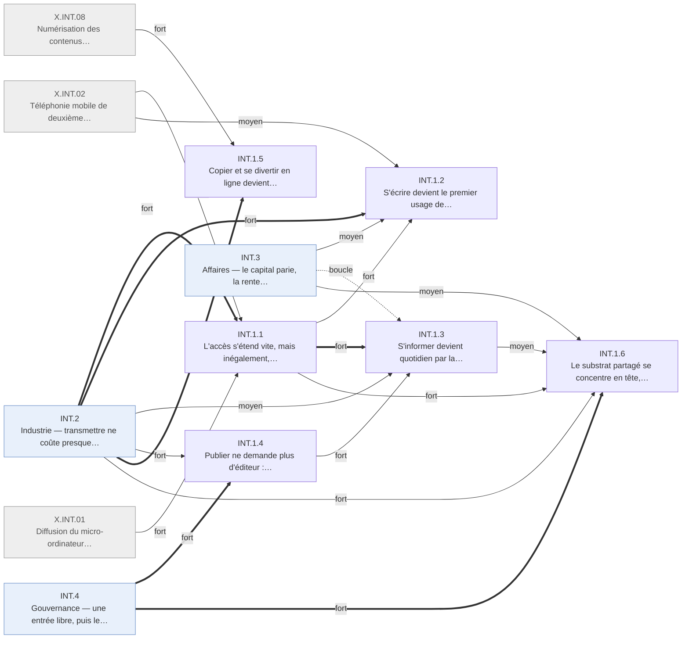

# Arbre des effets en quatre ordres — Internet · INT.1 Information

Branche de l'[arbre Internet en quatre ordres](README.md). Conventions :
[README.md § Comment lire](README.md#comment-lire).

## Table of Contents

1. [INT.1 · Information — s'écrire, trouver, publier presque sans coût](#int1--information--sécrire-trouver-publier-presque-sans-coût) _(Lines 15-173)_

---

## INT.1 · Information — s'écrire, trouver, publier presque sans coût
<!-- Lines 15-173 -->

Qui est connecté peut s'écrire, trouver, publier et copier presque sans coût ; l'accès s'étend vite mais inégalement, et l'attention se concentre pendant qu'une traîne s'épaissit. Qui : les personnes connectées, un sixième du monde en 2005 · certitude : V

Causes : INT.2 (principale, fort) ; INT.4 (fort) ; INT.3 (moyen, boucle) ; X.INT.01 (fort) ; X.INT.02 (moyen) ; X.INT.08 (moyen) ; X.CLD.02 (faible)

Les ménages américains passent de 18,6 % à plus de la moitié connectés entre 1997 et 2001, le
réseau tirant l'ordinateur ; l'écart suit le revenu, l'âge et le pays, et la connexion ne devient
permanente qu'en 2004 (INT.1.1). Le premier usage de masse est d'écrire : courriel, puis
messagerie instantanée ; le texto, par un autre réseau, prend les échanges brefs (INT.1.2).
Trouver devient une pratique quotidienne par la recherche, qui s'ajoute à la télévision et à la
presse sans les remplacer (INT.1.3). Publier ne demande plus d'éditeur : carnets, encyclopédie
ouverte, puis vidéo en toute fin de fenêtre (INT.1.4). Copier la musique devient gratuit en
1999, et le réseau devient un lieu de loisir collectif en Asie de l'Est (INT.1.5). Le substrat
partagé suit une loi de puissance dès 1997, sa traîne s'allonge en variété sans gagner en volume,
et l'anglais y recule selon une mesure disputée (INT.1.6). L'ensemble reste une affaire de
session devant un ordinateur, de texte et de pages, tirée par l'usager qui va chercher.

<!-- GENERE:INT.1:debut -->

<!-- GENERE:INT.1:fin -->

- **INT.1.1 · L'accès s'étend vite, mais inégalement, et reste une session jusqu'en 2004** — ménages, pays · V
  - Causes : INT.2.1 (principale, fort) ; X.INT.01 (fort) ; INT.2.2 (moyen) ; X.INT.02 (moyen) ; INT.4.1 (faible)
  - Mesure : part des personnes et des ménages connectés. Le réseau tire l'ordinateur ; l'écart d'accès est l'état final le plus solide de la fenêtre.
  - **INT.1.1.1 · Les ménages américains se connectent en six ans, plus vite qu'ils ne s'équipent** — ménages US · V
    - Causes : INT.2.1 (principale, fort) ; X.INT.01 (fort) ; INT.2.2 (moyen)
    - Ménages connectés : 18,6 % (1997, +397 % depuis 1994, contre +52 % pour l'équipement), 41,5 % (2000), 50,4 % (2001), 54,7 % (2003) ; adultes en ligne de 52 % (2000) à 68 % (2005).
    - Faits : F.INT.E1.001, F.INT.E1.002, F.INT.E1.003, F.INT.E1.004, F.INT.E1.005, F.INT.E5.008, F.INT.E4.010
  - **INT.1.1.2 · L'écart d'accès suit le revenu, l'âge, le diplôme et le lieu, et se resserre lentement** — ménages modestes, âgés, ruraux · V
    - Causes : INT.1.1.1 (principale, fort) ; X.INT.01 (moyen)
    - En 2003, 92,2 % des ménages aisés sont connectés contre 30,7 % des ménages modestes ; 34,7 % des plus de 65 ans équipés ; l'écart rural persiste.
    - Faits : F.INT.E1.006, F.INT.E1.007, F.INT.E1.012, F.INT.F4.006
  - **INT.1.1.3 · Le monde passe le milliard d'internautes, concentrés dans les pays riches** — pays · V
    - Causes : INT.2.1 (principale, fort) ; X.INT.01 (moyen)
    - Fin 2000, 5 % du monde en ligne, un tiers des pays développés contre moins de 2 % des pays en développement ; 16 % du monde en 2005 ; la population en ligne se mondialise plus vite que le contenu anglophone.
    - Faits : F.INT.G6.001, F.INT.E1.011, F.INT.F4.009
  - **INT.1.1.4 · Au Japon, l'accès en ligne passe d'abord par le téléphone** — Asie de l'Est · K
    - Causes : X.INT.02 (principale, fort) ; INT.2.1 (moyen)
    - Service de données mobile lancé en 1997 : 30 millions d'abonnés fin 2001 ; courriel mobile de masse, avant le micro-ordinateur domestique.
    - Faits : F.INT.E2.005, F.INT.E2.006, F.INT.F4.004
  - **INT.1.1.5 · La connexion devient permanente en fin de fenêtre, la Corée d'abord** — foyers connectés · K
    - Causes : INT.2.1.5 (principale, fort)
    - Temps en ligne de l'ère commutée : 4 à 5 h par semaine (chiffre de cabinet). La Corée atteint 21,3 abonnés haut débit pour 100 habitants en 2002 ; en 2004-2005, le haut débit majoritaire fait du réseau un état et non un lieu où l'on va.
    - Faits : F.INT.E5.001, F.INT.E1.010, F.INT.E5.005, F.INT.E5.004
  - **INT.1.1.6 · En France, le réseau fermé et facturé à la durée recule devant le Web** — usagers du Minitel · K
    - Causes : INT.4.1 (principale, fort) ; INT.2.1 (moyen)
    - Contre-exemple : la transaction en ligne de masse existait, sous gardien et au compteur ; elle décline dès 1999.
    - Faits : F.INT.E3.011
- **INT.1.2 · S'écrire devient le premier usage de masse, par courriel puis messagerie instantanée** — internautes · V
  - Causes : INT.2.1 (principale, fort) ; INT.1.1 (fort) ; INT.3.3 (moyen) ; X.INT.02 (moyen)
  - Écrire à quelqu'un ne coûte plus rien, à toute distance ; le texte asynchrone précède tout autre usage.
  - **INT.1.2.1 · Le courriel personnel devient l'activité en ligne la plus pratiquée** — internautes · K
    - Causes : INT.2.1 (principale, fort) ; INT.1.1.1 (fort) ; INT.3.3.1 (moyen)
    - Courriel gratuit consultable depuis tout navigateur en 1996 ; 91 % des internautes l'ont utilisé en 2000 ; 45 puis 54 millions d'Américains par jour (2000-2002).
    - Faits : F.INT.E2.002, F.INT.E2.003, F.INT.E2.004
  - **INT.1.2.2 · Messagerie instantanée et forums relient proches et inconnus, sous pseudonyme au besoin** — adolescents, puis adultes · V
    - Causes : INT.2.1 (principale, fort) ; INT.1.1.1 (moyen)
    - 74-75 % des adolescents en ligne (2000-2005), 42 % des internautes adultes (2004) ; 3 % des couples connectés se sont rencontrés en ligne (2005) ; pseudonymes sans norme stabilisée.
    - Faits : F.INT.E2.007, F.INT.E2.008, F.INT.E2.009, F.INT.E2.011, F.INT.F4.007
  - **INT.1.2.3 · Le texto, par un autre réseau, prend les échanges brefs en Europe et en Asie** — usagers du mobile · K
    - Causes : X.INT.02 (principale, fort)
    - Joignabilité permanente et écrit court de masse, hors du réseau étudié.
    - Faits : F.INT.E2.010, F.INT.E5.006
- **INT.1.3 · S'informer devient quotidien par la recherche, en complément des anciens médias** — internautes · V
  - Causes : INT.1.1 (principale, fort) ; INT.1.4 (fort) ; INT.2.1 (moyen) ; INT.3.3 (moyen, boucle)
  - Tirer l'information à soi, par liens puis par requête, devient gratuit ; le mécanisme qui classe reste opaque à l'usager.
  - **INT.1.3.1 · Le Web grandit plus vite que sa couverture, puis un moteur classe par liens (1998)** — internautes · K
    - Causes : INT.1.4 (principale, fort) ; INT.2.1 (moyen)
    - 320 puis 800 millions de pages (1998-1999), aucun moteur au-delà de 16 % : trouver devient le goulot ; le classement par liens entrants y répond.
    - Faits : F.INT.F2.011, F.INT.E4.001
  - **INT.1.3.2 · La recherche devient quotidienne, et la plupart ne distinguent pas le payé du non payé** — internautes US · V
    - Causes : INT.1.3.1 (principale, fort) ; INT.1.1.1 (fort) ; INT.3.3.2 (moyen)
    - Plus de 80 % ont déjà utilisé un moteur en 2002 ; 56 % un jour donné et 3,9 milliards de requêtes par mois en 2004 ; 87 % trouvent ce qu'ils cherchent, 38 % distinguent les résultats payants (2005).
    - Faits : F.INT.E4.013, F.INT.E4.011, F.INT.E4.012
  - **INT.1.3.3 · Actualité, santé et prix se consultent en ligne, sans détrôner télévision et presse** — Américains · V
    - Causes : INT.1.1.1 (principale, fort) ; INT.1.3.1 (moyen)
    - Actualité en ligne régulière : 23 % (2000), 29 % (2004) ; télévision et presse restent les sources dominantes ; recherche de santé et comparaison de prix deviennent courantes.
    - Faits : F.INT.E4.002, F.INT.E4.003, F.INT.E4.009, F.INT.E3.009, F.INT.E3.010
  - **INT.1.3.4 · La lecture littéraire recule et la confiance dans les médias reste basse, sans lien établi avec le réseau** — adultes US · V
    - Causes : amont (recul de la lecture engagé depuis 1982 et confiance dans les médias basse depuis les années 1970, antérieurs au réseau et hors registre)
    - Lecture littéraire : 56,9 % puis 46,7 % des adultes (1982-2002), l'enquête n'impute pas le recul ; confiance dans les médias stable à 51-55 % (1997-2003).
    - Faits : F.INT.F1.011, F.INT.F1.003
- **INT.1.4 · Publier ne demande plus d'éditeur : textes, savoir de référence, puis vidéo** — auteurs amateurs, chercheurs · V
  - Causes : INT.4.1 (principale, fort) ; INT.4.2.1 (fort) ; INT.2.1 (fort) ; INT.2.2 (moyen) ; X.CLD.02 (faible)
  - Personne ne filtre l'entrée et l'hébergeur n'est pas responsable : la publication amateur de masse suit.
  - **INT.1.4.1 · Les carnets en ligne atteignent une échelle mesurable et pèsent dans une campagne** — internautes US · V
    - Causes : INT.4.1 (principale, fort) ; INT.4.2.1 (fort) ; INT.2.2.2 (moyen)
    - Auteurs de carnets : 3 % (2002) puis 7 % des internautes adultes (2004) ; lecteurs : 17 % puis 27 % en 2004 ; relais et analyse de mémos contestés pendant la campagne de 2004.
    - Faits : F.INT.F1.006, F.INT.F1.007, F.INT.F1.008
  - **INT.1.4.2 · Le savoir de référence se produit et se diffuse hors des éditeurs** — chercheurs, contributeurs · K
    - Causes : INT.4.1 (principale, fort) ; INT.2.1 (fort)
    - Prépublications : plus de 30 000 soumissions en 2000 ; encyclopédie ouverte lancée en 2001, 500 000 articles anglais en 2005, erreurs comparables à la référence commerciale (3,9 contre 2,9 par article, étude contestée) ; numérisation de cinq grandes bibliothèques (2004) ; calcul et grandes bases entrent dans la pratique scientifique.
    - Faits : F.INT.F2.001, F.INT.F2.002, F.INT.F2.003, F.INT.F2.006, F.INT.F2.008, F.INT.F2.009
  - **INT.1.4.3 · La vidéo amateur devient publiable en toute fin de fenêtre** — auteurs amateurs · K
    - Causes : X.CLD.02 (principale, fort) ; INT.2.1.5 (moyen)
    - Service de partage de vidéo créé en 2005 : produit dérivé rangé dans le choc suivant (règle 7 du cadre), rendu possible ici par le haut débit.
    - Faits : F.INT.E4.008
- **INT.1.5 · Copier et se divertir en ligne devient gratuit : musique, jeux** — jeunes, mélomanes · K
  - Causes : INT.2.1 (principale, fort) ; X.INT.08 (fort) ; INT.3.2 (faible, boucle)
  - Seul format non textuel de masse de la fenêtre, la musique, déjà numérisée hors réseau.
  - **INT.1.5.1 · Copier la musique devient gratuit et de masse (1999), puis s'achète au titre (2003)** — mélomanes · K
    - Causes : INT.2.1 (principale, fort) ; X.INT.08 (fort) ; INT.3.2.3 (faible, boucle)
    - Échange de fichiers entre particuliers en 1999 ; en 2003, l'écoute légale se déplace vers le titre plutôt que l'album.
    - Faits : F.INT.E4.004, F.INT.E4.005
  - **INT.1.5.2 · Le réseau devient un lieu de loisir collectif, en Asie de l'Est d'abord** — jeunes urbains · K
    - Causes : INT.2.1 (principale, fort)
    - Jeux massivement multijoueurs et cybercafés en 2002-2004, avant leur équivalent occidental.
    - Faits : F.INT.E4.006, F.INT.F4.008
- **INT.1.6 · Le substrat partagé se concentre en tête, s'allonge en traîne et devient moins anglophone** — tous · V
  - Causes : INT.4.1 (principale, fort) ; INT.2.1 (fort) ; INT.1.1 (fort) ; INT.3.5 (moyen) ; INT.1.3 (moyen)
  - Tête et traîne ont la même racine : entrer ne coûte rien, et atteindre un titre rare coûte autant qu'atteindre le plus demandé.
  - **INT.1.6.1 · L'attention suit une loi de puissance dès 1997, avant la recherche par liens** — internautes · V
    - Causes : INT.4.1 (principale, fort) ; INT.2.1 (fort) ; INT.1.3.1 (faible)
    - 0,1 % des sites font 32,4 % des visiteurs (1997) ; même forme pour la topologie physique ; croissance exponentielle du nombre de sites et attachement préférentiel comme mécanisme ; entités faisant la moitié du temps en ligne : de onze à quatre (1999-2001, chiffre de cabinet).
    - Faits : F.INT.F5.001, F.INT.F5.002, F.INT.F5.003, F.INT.F5.004, F.INT.F5.005
  - **INT.1.6.2 · La traîne s'allonge en variété pendant que la tête se resserre** — consommateurs de vidéo · V
    - Causes : INT.3.5.1 (principale, fort) ; INT.1.3.2 (moyen)
    - Vidéo domestique 2000-2005 : titres à 1-10 ventes par semaine ×1,5, titres à zéro vente ×2, ventes des meilleures ventes en recul et part de tête plus concentrée ; tête et traîne coexistent.
    - Faits : F.INT.F5.007, F.INT.F5.008, F.INT.F5.010
  - **INT.1.6.3 · L'anglais recule dans les pages à mesure que des non-anglophones se connectent** — le contenu mondial · D
    - Causes : INT.1.1.3 (principale, fort)
    - Environ 80 % (milieu des années 1990), 75 % (1998), 45 % (2005) selon une seule chaîne d'études, dont l'auteur conteste lui-même la méthode en 2022.
    - Faits : F.INT.F4.002, F.INT.F4.003, F.INT.F4.014
