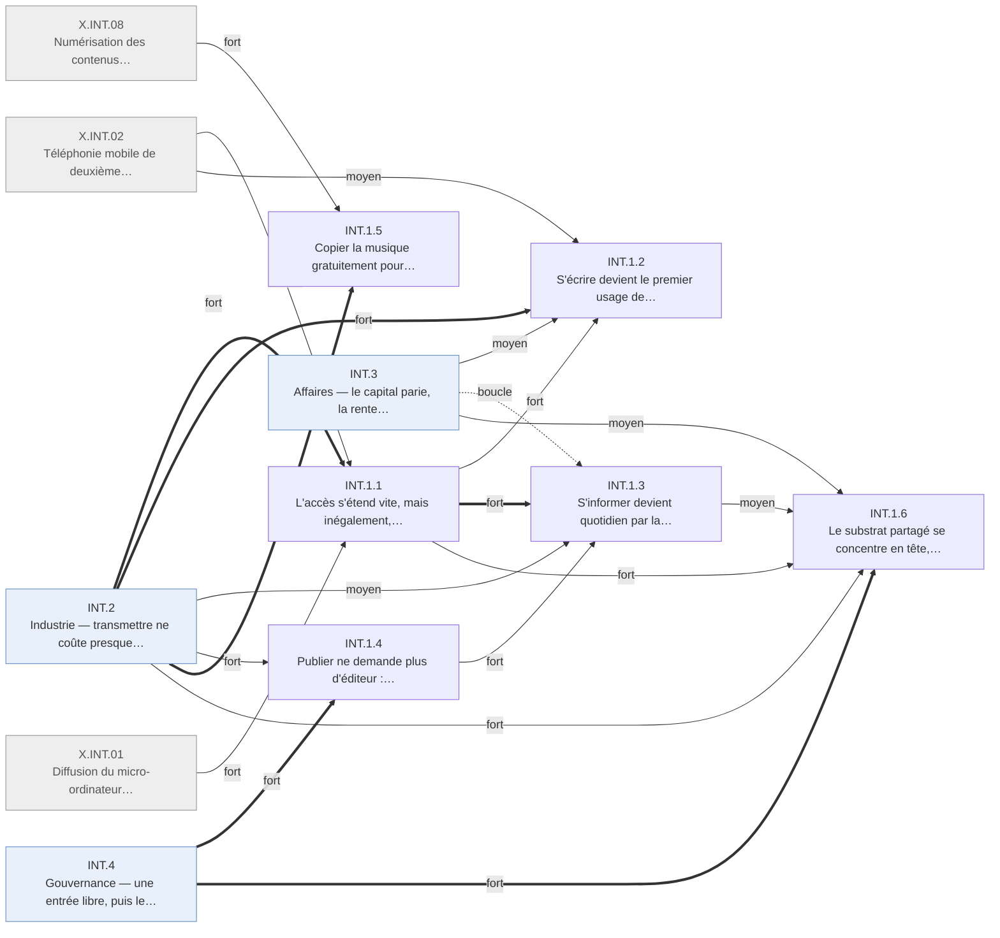

# Arbre des effets en quatre ordres — Internet · INT.1 Information

Branche de l'[arbre Internet en quatre ordres](README.md). Conventions :
[README.md § Comment lire](README.md#comment-lire).

## Table of Contents

1. [INT.1 · Information — s'écrire, trouver, publier presque sans coût](#int1--information--sécrire-trouver-publier-presque-sans-coût) _(Lines 15-176)_

---

## INT.1 · Information — s'écrire, trouver, publier presque sans coût
<!-- Lines 15-176 -->

Qui est connecté peut s'écrire, trouver, publier et copier presque sans coût ; l'accès s'étend vite mais inégalement, et l'attention se concentre pendant qu'une traîne s'allonge en variété. Qui : les personnes connectées, environ 16 % du monde en 2005 · certitude : A

Causes : INT.2 (principale, fort) ; INT.4 (fort) ; INT.3 (moyen, boucle) ; X.INT.01 (fort) ; X.INT.02 (moyen) ; X.INT.08 (moyen) ; X.CLD.02 (faible)

Les ménages américains passent de 18,6 % à plus de la moitié connectés entre 1997 et 2001, la
connexion progressant plus vite que l'équipement ; l'écart suit le revenu, l'âge et le diplôme,
le lieu ne divisant plus que le haut débit, et le haut débit, que l'enquête Pew décrit comme
toujours connecté, ne devient majoritaire chez les internautes américains à domicile qu'en 2005,
la Corée d'abord (INT.1.1). Le premier usage de masse est d'écrire : courriel, puis messagerie
instantanée ; le texto, par un autre réseau, devient un usage de masse dans le monde (INT.1.2).
Trouver devient une pratique quotidienne par la recherche, qui s'ajoute à la télévision sans la
détrôner, pendant que la lecture de la presse imprimée recule (INT.1.3). Publier ne demande plus
d'éditeur : carnets, encyclopédie ouverte, puis vidéo en toute fin de fenêtre (INT.1.4). Copier la
musique se fait gratuitement pour l'usager dès 1999, sans paiement aux ayants droit, et le réseau
devient un lieu de loisir collectif en Corée du Sud et en Chine (INT.1.5). Le substrat partagé
suit une loi de puissance dès 1997, sa traîne s'allonge en variété sans gagner en volume, et
l'anglais y recule selon une mesure disputée (INT.1.6). L'ensemble reste une affaire d'ordinateur,
de texte et de pages, tirée par l'usager qui va chercher.

<!-- GENERE:INT.1:debut -->

<!-- GENERE:INT.1:fin -->

- **INT.1.1 · L'accès s'étend vite, mais inégalement, et aux États-Unis reste surtout à bas débit jusqu'en 2004** — ménages, pays · V
  - Causes : INT.2.1 (principale, fort) ; X.INT.01 (fort) ; INT.2.2 (moyen) ; X.INT.02 (moyen) ; INT.4.1 (faible)
  - Mesure : part des personnes et des ménages connectés. La connexion progresse plus vite que l'équipement en ordinateur entre 1994 et 1997 ; l'écart d'accès est l'état final le plus solide de la fenêtre. Aux États-Unis, le haut débit ne devient majoritaire chez les internautes à domicile qu'en 2005 (53 %, mai 2005 ; 50 % en décembre 2004), la Corée du Sud étant en tête dès 2002.
  - **INT.1.1.1 · Les ménages américains se connectent en six ans, plus vite qu'ils ne s'équipent** — ménages US · V
    - Causes : INT.2.1 (principale, fort) ; X.INT.01 (fort) ; INT.2.2 (moyen)
    - Ménages connectés : 18,6 % (1997, +397,1 % depuis 1994, contre +51,9 % pour l'équipement), 41,5 % (août 2000), 50,4 % (2001), 54,7 % (2003) ; adultes en ligne de 52 % (2000) à 68 % (2005).
    - Faits : F.INT.E1.001, F.INT.E1.002, F.INT.E1.003, F.INT.E1.004, F.INT.E1.005, F.INT.E5.008, F.INT.E4.010
  - **INT.1.1.2 · L'écart d'accès suit le revenu, l'âge et le diplôme, et se resserre lentement ; entre rural et urbain, il ne reste que le haut débit** — ménages modestes, âgés, ruraux · V
    - Causes : INT.1.1.1 (principale, fort) ; X.INT.01 (moyen)
    - En 2003, 92,2 % des ménages à revenu d'au moins 100 000 $ sont connectés contre 30,7 % de ceux à moins de 25 000 $ ; 34,7 % des ménages de 65 ans et plus et 27,9 % de ceux sans diplôme du secondaire sont équipés d'un ordinateur ; l'écart d'accès en ligne entre ménages ruraux et urbains passe de 5 points (1997) à moins d'un point (2003), mais l'écart de haut débit demeure (24,7 % contre 40,4 % des ménages connectés).
    - Faits : F.INT.E1.006, F.INT.E1.007, F.INT.E1.012, F.INT.F4.006
  - **INT.1.1.3 · Le monde atteint de l'ordre d'un milliard d'internautes, concentrés dans les pays riches** — pays · V
    - Causes : INT.2.1 (principale, fort) ; X.INT.01 (moyen)
    - Fin 2000, environ 315 millions d'internautes, soit 5 % du monde, avec un tiers de la population des pays développés en ligne contre moins de 2 % dans les pays en développement ; 15,6 % du monde en 2005, de l'ordre d'un milliard d'internautes (calcul) ; en 2004, environ un habitant sur deux du G8 contre 3 % en Afrique ; la part des anglophones parmi les internautes tombe d'environ 80 % (1996) à 27 % (2005), plus vite que la part de l'anglais dans les pages (75 % en 1998, 45 % en 2005, mesure disputée, biaisée en faveur de l'anglais selon le document : INT.1.6.3), calcul sur deux séries.
    - Faits : F.INT.G6.001, F.INT.E1.011, F.INT.F4.009
  - **INT.1.1.4 · Au Japon, l'accès en ligne passe en masse par le téléphone mobile** — Asie de l'Est · V
    - Causes : X.INT.02 (principale, fort) ; INT.2.1 (moyen)
    - Service japonais de données mobiles lancé le 22 février 1999, dont le courriel est un usage populaire : 10 millions d'abonnés le 6 août 2000, 20 millions le 4 mars 2001, 30 millions le 25 décembre 2001 ; en 2001, 72,3 % des abonnés mobiles japonais (59,1 % en Corée du Sud) utilisent l'Internet mobile, contre 5,6 à 16,5 % dans les autres économies comparées ; mi-2002, plus de 50 millions d'abonnés à un service d'Internet mobile, soit 73,5 % des abonnés mobiles.
    - Faits : F.INT.E2.005, F.INT.E2.006, F.INT.F4.004
  - **INT.1.1.5 · La connexion permanente du haut débit devient majoritaire chez les internautes à domicile en fin de fenêtre, la Corée d'abord** — foyers connectés · V
    - Causes : INT.2.1.5 (principale, fort)
    - Selon une enquête Pew de 2002, la connexion haut débit à domicile, décrite par les auteurs comme « always on », s'accompagne d'un usage plus fréquent et plus long : 82 % des internautes à haut débit sont en ligne un jour donné, contre 58 % des internautes à bas débit (États-Unis, 2002). Temps hebdomadaire moyen en ligne d'un usager américain : 4,2 heures en 2000, une heure de moins qu'en 1999 (chiffre de cabinet). La Corée atteint 21,3 abonnés haut débit pour 100 habitants fin 2002, au premier rang mondial ; aux États-Unis, le haut débit passe de 35 % (novembre 2003) à 53 % (mai 2005) des internautes à domicile, majoritaire en 2005 ; en décembre 2005, 43 % des internautes à haut débit disent passer plus de deux heures en ligne un jour donné, contre 33 % à bas débit (enquête déclarative).
    - Faits : F.INT.E5.001, F.INT.E1.010, F.INT.E5.005, F.INT.E5.004, F.INT.E5.009
  - **INT.1.1.6 · En France, le service en ligne antérieur au Web, facturé à la minute et dont chaque serveur est approuvé par l'État, recule devant l'informatique domestique et l'accès commuté à Internet** — usagers du Minitel · A
    - Causes : INT.2.1 (principale, fort) ; X.INT.01 (moyen) ; INT.4.1 (moyen)
    - Contre-exemple : un service en ligne de masse existait avant le Web ; son usage est facturé à la minute de connexion, les terminaux étant loués aux usagers, au départ gratuitement, le kiosque regroupe les consommations de la période en un seul poste de la facture téléphonique et chaque serveur doit être approuvé par l'État (1980-2002) ; son trafic culmine en 1993 à 90 millions d'heures puis baisse jusqu'à 65 millions en 2000 (−11,4 % sur 1999), pendant que les accès par micro-ordinateur progressent (3,2 millions sur 8,3 millions d'accès mi-2001) ; une revue d'ingénierie rapporte ce recul à la diffusion de l'informatique domestique et de l'accès commuté à Internet.
    - Faits : F.INT.E3.011, F.INT.E3.012
- **INT.1.2 · S'écrire devient le premier usage de masse, par courriel puis messagerie instantanée** — internautes · A
  - Causes : INT.2.1 (principale, fort) ; INT.1.1 (fort) ; INT.3.3 (moyen) ; X.INT.02 (moyen)
  - Écrire à quelqu'un ne coûte plus rien, à toute distance ; un rapport de 2003 qualifie le courriel d'usage de loin le plus populaire d'Internet.
  - **INT.1.2.1 · Le courriel personnel devient l'activité en ligne la plus pratiquée** — internautes · A
    - Causes : INT.2.1 (principale, fort) ; INT.1.1.1 (fort) ; INT.3.3.1 (moyen)
    - Courriel gratuit, soutenu par des bandeaux publicitaires selon l'éditeur, lancé le 4 juillet 1996 et consultable depuis tout micro-ordinateur connecté à Internet ; 91 % des internautes américains l'ont déjà utilisé en mars 2000, contre 72 % en 1995 ; 45 millions d'Américains en ligne l'utilisent un jour donné en mars 2000, 54 millions en décembre 2002 ; un rapport de 2003 le qualifie d'usage de loin le plus populaire d'Internet.
    - Faits : F.INT.E2.002, F.INT.E2.003, F.INT.E2.004
  - **INT.1.2.2 · Messagerie instantanée et forums relient proches et inconnus, sous pseudonyme au besoin** — adolescents, puis adultes · A
    - Causes : INT.2.1 (principale, fort) ; INT.1.1.1 (moyen)
    - 74 % (2000) puis 75 % (2005) des adolescents en ligne utilisent la messagerie instantanée ; 42 % des internautes adultes américains, plus de 53 millions (2004) ; début 2001, 84 % des internautes américains ont contacté un groupe en ligne ou s'en sont informé auprès de lui ; 3 % des internautes mariés ou en couple stable, environ 3 millions de personnes, disent avoir rencontré leur partenaire en ligne (2005) ; un texte de recherche de 1996 (version préliminaire) décrit identités multiples et pseudonymes dans les forums, jeux textuels et salons, l'anonymat y étant très controversé ; rien n'est établi pour 1999-2005.
    - Faits : F.INT.E2.007, F.INT.E2.008, F.INT.E2.009, F.INT.E2.011, F.INT.F4.007
  - **INT.1.2.3 · Le texto, par un autre réseau, devient un usage de masse dans le monde** — usagers du mobile · A
    - Causes : X.INT.02 (principale, fort)
    - 24 milliards de messages courts envoyés dans le monde en mai 2002 contre 15 milliards un an plus tôt (estimation de l'association des opérateurs GSM relayée par l'Union internationale des télécommunications), demande particulièrement forte chez les jeunes ; abonnés mobiles de 11 millions (1990) à 945 millions (fin 2001), dont 37 % en Europe et 35 % en Asie ; ce développement est à attribuer au co-choc de la téléphonie mobile plutôt qu'au choc étudié.
    - Faits : F.INT.E2.010, F.INT.E5.006
- **INT.1.3 · S'informer devient quotidien par la recherche, en complément de la télévision** — internautes · V
  - Causes : INT.1.1 (principale, fort) ; INT.1.4 (fort) ; INT.2.1 (moyen) ; INT.3.3 (moyen, boucle)
  - Tirer l'information à soi, par liens puis par requête, devient une pratique de masse à faible coût ; le mécanisme qui classe est mal compris de la plupart des usagers.
  - **INT.1.3.1 · Le Web grandit plus vite que sa couverture, puis un moteur classe par liens (1998)** — internautes · V
    - Causes : INT.1.4 (principale, fort) ; INT.2.1 (moyen)
    - Au moins 320 millions de pages en décembre 1997, environ 800 millions en février 1999 ; le meilleur moteur en couvre environ un tiers fin 1997, aucun des onze moteurs étudiés plus d'environ 16 % en février 1999 ; un moteur constitué en septembre 1998 classe les pages en partie selon l'importance des sites qui les lient.
    - Faits : F.INT.F2.011, F.INT.E4.001
  - **INT.1.3.2 · La recherche devient quotidienne, et la plupart ne distinguent pas le payé du non payé** — internautes US · V
    - Causes : INT.1.3.1 (principale, fort) ; INT.1.1.1 (fort) ; INT.3.3.2 (moyen)
    - 85 % des internautes américains ont déjà utilisé un moteur de recherche en janvier 2002 et 29 % en utilisent un un jour donné (environ 33 millions d'adultes) ; mi-2004, 84 % l'ont déjà fait, 56 % des internautes en ligne un jour donné utilisent un moteur ce jour-là, et 3,9 milliards de requêtes sont faites en juin 2004 sur les 25 moteurs les plus utilisés ; début 2005, 87 % des utilisateurs déclarent trouver l'information cherchée la plupart du temps, 38 % savent distinguer les résultats payants des résultats organiques.
    - Faits : F.INT.E4.013, F.INT.E4.011, F.INT.E4.012
  - **INT.1.3.3 · Actualité, santé et produits se consultent en ligne, sans détrôner la télévision** — Américains · V
    - Causes : INT.1.1.1 (principale, fort) ; INT.1.3.1 (moyen)
    - Actualité en ligne : 12 % des Américains un jour donné (2000) ; régulière pour 23 % (2000), 25 % (2002), 29 % (2004) ; en 2004, 59 % suivent régulièrement les informations télévisées locales, et la lecture d'un journal la veille passe de 58 % (1994) à 47 % (2000), 41 % (2002), 42 % (2004) ; 80 % des internautes adultes, environ 93 millions, ont recherché en ligne au moins un sujet de santé parmi seize proposés (2003) ; 83 % des internautes ont déjà recherché un produit en ligne (fin 2002), contre 73 % à la mi-2000.
    - Faits : F.INT.E4.002, F.INT.E4.003, F.INT.E4.009, F.INT.E3.009, F.INT.E3.010
  - **INT.1.3.4 · La lecture littéraire recule et la confiance dans les médias reste basse, sans lien établi avec le réseau** — adultes US · V
    - Causes : amont (recul de la lecture mesuré depuis 1982, confiance dans les médias plus élevée dans les années 1970 : l'un et l'autre antérieurs à la fenêtre et hors registre)
    - Lecture littéraire : 56,9 % puis 46,7 % des adultes (1982-2002), l'enquête n'impute pas le recul ; confiance élevée ou moyenne dans les médias dans une fourchette de 51 à 55 % (1997-2003).
    - Faits : F.INT.F1.011, F.INT.F1.003
- **INT.1.4 · Publier ne demande plus d'éditeur : textes, savoir de référence, puis vidéo** — auteurs amateurs, chercheurs · A
  - Causes : INT.4.1 (principale, fort) ; INT.4.2.1 (fort) ; INT.2.1 (fort) ; INT.2.2 (moyen) ; X.CLD.02 (faible)
  - Personne ne filtre l'entrée et l'hébergeur n'est pas responsable : la publication amateur de masse suit.
  - **INT.1.4.1 · Les carnets en ligne atteignent une échelle mesurable et pèsent dans une campagne** — internautes US · V
    - Causes : INT.4.1 (principale, fort) ; INT.4.2.1 (fort) ; INT.2.2.2 (moyen)
    - Auteurs de carnets : 3 % (2002) puis 7 % des internautes adultes américains (fin 2004) ; lecteurs : 17 % (février 2004) puis 27 % (fin 2004) ; relais et analyse de mémos contestés pendant la campagne de 2004.
    - Faits : F.INT.F1.006, F.INT.F1.007, F.INT.F1.008
  - **INT.1.4.2 · Le savoir de référence se produit et se diffuse hors des éditeurs** — chercheurs, contributeurs · A
    - Causes : INT.4.1 (principale, fort) ; INT.2.1 (fort)
    - Serveur de prépublications : 13 014 nouvelles soumissions en 1995, 27 704 en 1999, 30 601 en 2000 ; encyclopédie ouverte à la modification par quiconque créée le 15 janvier 2001, après un projet à relecture par les pairs qui comptait moins de 24 articles ; 100 000 articles anglais franchis entre le 12 et le 22 janvier 2003, 500 000 entre le 13 et le 18 mars 2005 ; étude par des pairs (décembre 2005) sur 42 articles scientifiques : 162 erreurs, omissions critiques ou énoncés trompeurs pour l'encyclopédie ouverte contre 123 pour la référence commerciale (environ 3,9 contre 2,9 par article, rapports calculés), méthode contestée par l'éditeur commercial ; accord de numérisation de cinq grandes bibliothèques de recherche annoncé le 14 décembre 2004 ; en 2003, 20 téraoctets de données génomiques et environ 10 téraoctets pour la plus grande base astronomique.
    - Faits : F.INT.F2.001, F.INT.F2.002, F.INT.F2.003, F.INT.F2.006, F.INT.F2.008, F.INT.F2.009
  - **INT.1.4.3 · La vidéo amateur devient publiable en toute fin de fenêtre** — auteurs amateurs · V
    - Causes : X.CLD.02 (principale, fort) ; INT.2.1.5 (moyen)
    - Service de partage de vidéo fondé en février 2005, où chacun peut téléverser et partager des vidéos ; plus de 100 millions de vidéos vues par jour et 65 000 téléversées par jour en octobre 2006 ; produit dérivé rangé dans le choc suivant (règle 7 du cadre).
    - Faits : F.INT.E4.008
- **INT.1.5 · Copier la musique gratuitement pour l'usager et jouer en réseau deviennent des pratiques de masse** — jeunes, mélomanes · A
  - Causes : INT.2.1 (principale, fort) ; X.INT.08 (fort) ; INT.3.2 (faible, boucle)
  - Échange de musique de poste à poste à l'échelle de millions d'internautes dès 1999, gratuit pour l'usager et sans paiement aux détenteurs de droits (la gratuité n'est établie que pour la musique) ; salles de jeux en réseau à l'heure en Corée du Sud dès 1998 (INT.1.5.1, INT.1.5.2).
  - **INT.1.5.1 · Copier la musique devient de masse et gratuit pour l'usager (1999), puis s'achète au titre (2003)** — mélomanes · A
    - Causes : INT.2.1 (principale, fort) ; X.INT.08 (fort) ; INT.3.2.3 (faible, boucle)
    - Ouverture le 1er juin 1999 d'un service d'échange de fichiers musicaux de poste à poste, utilisé à l'échelle de millions d'internautes, qui échangent les fichiers sans payer ni aux autres utilisateurs, ni à l'exploitant, ni aux détenteurs de droits, c'est-à-dire gratuitement pour l'usager ; le 28 avril 2003, une boutique de musique en ligne ouvre aux États-Unis : 99 cents le titre, sans abonnement, plus de 200 000 titres issus notamment de cinq maisons de disques.
    - Faits : F.INT.E4.004, F.INT.E4.005
  - **INT.1.5.2 · Le réseau devient un lieu de loisir collectif, en Corée du Sud et en Chine** — jeunes urbains · A
    - Causes : INT.2.1 (principale, fort)
    - En Corée du Sud, les salles de jeux en réseau à l'heure passent d'environ 100 début 1998 à plus de 2 500 fin 1998, plus de 15 000 en 1999 et environ 21 400 en 2000 ; en 2002, cybercafés et jeux en ligne y sont un lieu de loisir de jeunes (environ 25 000 salles), comme en Chine (environ 46 000 cybercafés autorisés et 150 000 non autorisés estimés).
    - Faits : F.INT.E4.006, F.INT.F4.008
- **INT.1.6 · Le substrat partagé se concentre en tête, s'allonge en traîne ; la part de l'anglais y recule selon une mesure disputée** — tous · V
  - Causes : INT.4.1 (principale, fort) ; INT.2.1 (fort) ; INT.1.1 (fort) ; INT.3.5 (moyen) ; INT.1.3 (moyen)
  - Tête et traîne ont la même racine : entrer ne coûte rien, et atteindre un titre rare coûte autant qu'atteindre le plus demandé.
  - **INT.1.6.1 · L'attention suit une loi de puissance dès 1997, avant la recherche par liens** — internautes · V
    - Causes : INT.4.1 (principale, fort) ; INT.2.1 (fort) ; INT.1.3.1 (faible)
    - Visiteurs uniques, pages et liens par site suivent une loi de puissance (exposant d'environ 2,07 pour les visiteurs, 1997) ; 0,1 % des sites captent 32,4 % du volume d'utilisateurs d'un grand service en ligne (décembre 1997), 1 % en captent 55,6 % ; trois instantanés de la topologie inter-domaines (graphes de systèmes autonomes, 1997-1998) suivent aussi des lois de puissance malgré une croissance de 45 %, les auteurs jugeant toute généralisation prématurée ; un modèle de croissance continue et de rattachement préférentiel reproduit ces distributions (exposant 2,1 ± 0,1 pour les liens entrants du Web) ; de 11 à 4 entreprises font 50 % des minutes des internautes américains de mars 1999 à mars 2001 (chiffre rapporté d'un cabinet, rapport d'origine non trouvé).
    - Faits : F.INT.F5.001, F.INT.F5.002, F.INT.F5.003, F.INT.F5.004, F.INT.F5.005
  - **INT.1.6.2 · La traîne s'allonge en variété pendant que la tête se resserre** — consommateurs de vidéo · V
    - Causes : INT.3.5.1 (principale, fort) ; INT.1.3.2 (moyen)
    - Marché américain de la vidéo domestique, 2000-2005 : titres à 1-10 ventes par semaine ×1,5, titres à zéro vente ×2, ventes des meilleures ventes en recul chaque année et part de marché concentrée sur moins de titres en tête ; les auteurs concluent que tête et traîne coexistent.
    - Faits : F.INT.F5.007, F.INT.F5.008, F.INT.F5.010
  - **INT.1.6.3 · L'anglais recule dans les pages à mesure que des non-anglophones se connectent** — le contenu mondial · D
    - Causes : INT.1.1.3 (principale, fort)
    - Première mesure très approximative, en 1996, d'environ 80 % de pages en anglais, que ses auteurs disent sans valeur scientifique ; leur série donne 75 % en septembre 1998 puis 45 % en 2005, avec un biais des moteurs de recherche en faveur de l'anglais ; c'est une seule chaîne de mesures par comptage via moteurs de recherche (1996-2008), dont l'auteur juge la méthode possiblement biaisée en 2022, face à une méthode concurrente qui donne un résultat opposé.
    - Faits : F.INT.F4.002, F.INT.F4.003, F.INT.F4.014
