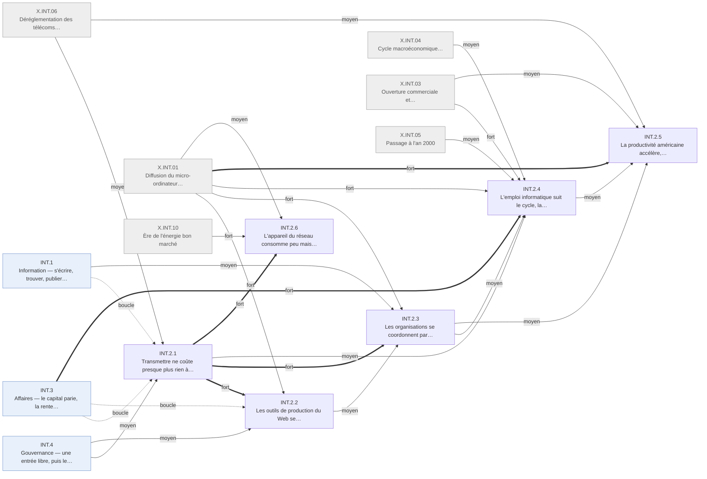

# Arbre des effets en quatre ordres — Internet · INT.2 Industrie

Branche de l'[arbre Internet en quatre ordres](README.md). Conventions :
[README.md § Comment lire](README.md#comment-lire).

## Table of Contents

1. [INT.2 · Industrie — transmettre ne coûte presque plus rien à l'usager](#int2--industrie--transmettre-ne-coûte-presque-plus-rien-à-lusager) _(Lines 16-263)_

---

## INT.2 · Industrie — transmettre ne coûte presque plus rien à l'usager
<!-- Lines 16-263 -->

Transmettre ne coûte presque plus rien à l'usager et les organisations se coordonnent par écrit en réseau ; l'emploi informatique suit le cycle du capital, et l'accélération de la productivité revient surtout à l'ordinateur. Qui : opérateurs, organisations, salariés · certitude : A

Causes : amont (arrêt de l'épine dorsale publique américaine en 1995 ; pile de protocoles financée sur fonds publics avant 1995) ; INT.4 (fort) ; INT.3 (fort, boucle) ; INT.1 (moyen, boucle) ; X.INT.01 (fort) ; X.INT.03 (moyen) ; X.INT.04 (moyen) ; X.INT.05 (moyen) ; X.INT.06 (moyen) ; X.INT.10 (moyen) ; X.INT.02 (faible) ; X.INT.08 (faible)

L'acheminement devient en 1995 une industrie privée ; des milliers de fournisseurs d'accès s'y
installent, un grand fournisseur passe au forfait illimité fin 1996 quand le téléphone interurbain
reste facturé à la minute, la fibre se construit et sa surcapacité apparaît alors que le prix de la
capacité longue distance chute, puis que celui du transit continue de baisser (INT.2.1). Les
briques de production du Web se standardisent : navigateur livré avec le système, serveur libre,
premiers services distants (INT.2.2). Courriel et intranet s'installent dans les grandes
entreprises, deux actifs américains sur cinq utilisent le réseau au travail en 2001-2003, et
banques, universités et administrations ajoutent un guichet en ligne (INT.2.3). L'emploi
informatique gonfle jusqu'en 2001 puis recule avec le capital ; les tâches de routine reculent
avec l'informatisation ; le travail informatique devient échangeable à distance, vers l'Inde
surtout, par un glissement graduel des années 1990 auquel le passage à l'an 2000 apporte une
demande (INT.2.4). La productivité américaine accélère de 1,5 à 2,6 %/an, par le capital
informatique et la production d'ordinateurs, aucun fait ne mesurant la part de l'usage du réseau,
et l'Europe décroche par l'organisation et la libéralisation (INT.2.5). L'appareil du réseau
consomme peu mais ses centres de données doublent, dans une énergie bon marché jusqu'en 1999 puis
chère ; aucun fait cité ne relie ce mouvement au choc, et des mesures lues montrent exagéré le rôle
prêté aux centres de données dans la crise électrique californienne (INT.2.6).

<!-- GENERE:INT.2:debut -->

<!-- GENERE:INT.2:fin -->

- **INT.2.1 · Transmettre ne coûte presque plus rien à l'usager** — usagers de l'accès, acheteurs de capacité · A
  - Causes : amont (arrêt de l'épine dorsale publique américaine en 1995) ; INT.4 (moyen) ; INT.3.1 (fort, boucle) ; INT.1.1 (moyen, boucle) ; X.INT.06 (moyen) ; X.INT.01 (faible)
  - Premier levier du choc. Il tient à trois constats : l'accès commuté est facturé au forfait mensuel sans redevance à l'usage, alors que le téléphone interurbain l'est à la minute (INT.2.1.2) ; le prix de la capacité longue distance chute entre 2000 et 2002 (INT.2.1.4.2) ; le prix du transit baisse ensuite chaque année (données de 1994 à 2012, hors de la fenêtre). La série du transit de gros sur 1995-2005 n'est pas établie.
  - **INT.2.1.1 · L'acheminement devient une industrie privée ouverte, et des milliers de fournisseurs d'accès se font concurrence** — opérateurs, fournisseurs d'accès · A
    - Causes : amont (arrêt de l'épine dorsale publique américaine NSFNET) ; INT.4.3.1 (moyen) ; INT.4.1 (moyen)
    - Arrêt de l'épine dorsale publique américaine le 30 avril 1995 : l'acheminement passe à plusieurs dorsales exploitées par des fournisseurs privés, reliées entre elles aux points d'échange ; 3 816 fournisseurs d'accès américains sont inscrits sur un annuaire, environ 2 000 nouveaux entrants arrivent en 1997 et 1998, et environ 6 700 sont estimés en 1999 ; une consolidation est alors anticipée, son ampleur n'étant pas chiffrée.
    - Faits : J.INT.1995.01, F.INT.A3.001
  - **INT.2.1.2 · Le forfait mensuel illimité supprime la facturation à la durée, alors que le téléphone interurbain reste facturé à la minute** — abonnés · A
    - Causes : INT.2.1.1 (principale, fort)
    - Un grand fournisseur d'accès passe au forfait illimité (19,95 dollars par mois), annoncé le 29 octobre et en vigueur le 1er décembre 1996 ; la contrainte de facturation à la durée disparaît et le temps passé en ligne s'allonge ensuite ; la presse de décembre décrit des lignes téléphoniques mobilisées par des appels plus longs (+20 % en moyenne). En 1997, l'accès commuté est en général facturé aux États-Unis par un forfait mensuel sans redevance à l'usage (abonnement téléphonique local, abonnement au fournisseur d'accès, redevance à l'usage nulle), alors que le téléphone interurbain est facturé à la minute ; les opérateurs de dorsale facturent entre eux et aux fournisseurs d'accès des tarifs non sensibles à la durée. Le document établit un prix qui ne varie pas avec l'usage, non un prix indépendant de la distance parcourue par les données.
    - Faits : F.INT.E5.002, J.INT.1996.03, F.INT.A1.014
  - **INT.2.1.3 · Un grand fournisseur d'accès double ses abonnés en un an puis en deux ans, et la capacité d'accès se construit en avance sur l'usage** — fournisseurs d'accès · V
    - Causes : INT.1.1.1 (principale, fort) ; INT.2.1.2 (moyen)
    - Un seul grand fournisseur d'accès, dont les chiffres ne mesurent pas l'industrie, abonnés à la marque principale : environ 3 millions (mi-1995), 6,2 millions (30 juin 1996, doublement en un an), 12,5 (30 juin 1998, doublement en deux ans), 23,2 (30 juin 2000), avec plus de 4,6 millions d'abonnés hors des États-Unis en 2000 ; un opérateur raccorde 48 961 bâtiments et exploite 1 655 132 modems d'accès en 1999, signe d'une capacité construite bien au-delà de l'usage immédiat.
    - Faits : F.INT.A1.003, F.INT.A1.004, F.INT.A1.005, F.INT.A1.002
  - **INT.2.1.4 · La fibre se surconstruit, puis sa surcapacité s'accompagne d'une baisse du prix de la capacité** — opérateurs de réseau · A
    - Causes : INT.3.1 (principale, fort) ; X.INT.06 (moyen)
    - Le capital construit, la surcapacité devient visible après le retournement boursier et s'accompagne, sur un marché favorable aux acheteurs, d'une chute du prix de la capacité longue distance (une liaison Los Angeles-New York, 1,8 million de dollars par an en 2000, 194 000 en 2002) : la forme en deux temps passe par l'infrastructure. Aucune ligne ne dit que la surcapacité cause à elle seule la baisse.
    - **INT.2.1.4.1 · Opérateurs historiques et nouveaux entrants construisent de la fibre en 1998-1999, dans des groupes de télécoms très endettés** — opérateurs · V
      - Causes : INT.3.1 (principale, fort) ; X.INT.06 (moyen)
      - Un opérateur longue distance américain passe de 797 550 à 896 998 miles de fibre (1998-1999, hors filiale brésilienne), dans un mouvement de construction commun aux opérateurs et aux nouveaux entrants ; des opérateurs historiques figurent parmi les groupes de télécoms très endettés, la dette cumulée des groupes cités, opérateurs historiques comme entrants, équipementiers et groupes de médias, étant de l'ordre de 2 000 milliards de dollars (revue spécialisée, janvier 2003).
      - Faits : F.INT.A1.001, F.INT.A5.007
    - **INT.2.1.4.2 · La fibre non éclairée s'accompagne d'une chute du prix de la capacité longue distance, et le prix du transit continue de baisser ensuite** — acheteurs de capacité · A
      - Causes : INT.2.1.4.1 (principale, fort) ; INT.3.1 (moyen)
      - La surcapacité de fibre devient visible après le retournement boursier (2000-2002) : seule une fraction de la fibre posée est éclairée, ordre de grandeur non chiffré ; elle tient d'abord à une demande de capacité qui croît moins vite que l'offre construite, et la presse ne la signale largement qu'au début de 2001. Elle s'accompagne d'un marché favorable aux acheteurs : une liaison en fibre à haut débit entre Los Angeles et New York, facturée 1,8 million de dollars par an en 2000, se vend 590 000 dollars en 2001 et 194 000 en 2002 (Réserve fédérale de Richmond, d'après TeleGeography) ; le prix de la capacité de transmission longue distance américaine est nettement plus bas en 2001 qu'en 1999. Hors fenêtre, le prix du transit IP baisse chaque année jusqu'en 2012, où il s'achète environ 2 dollars par mégabit et par mois dans les grands marchés, avec des prix jusqu'à 0,50 dollar ; un document de discussion de l'UIT chiffre à 16 000 milliards de dollars le trafic de 2010 facturé aux tarifs de gros de 1994, et note que la baisse, que certains craignaient temporaire après l'éclatement de la bulle de 1999-2000, s'est révélée durable ; la série annuelle du transit sur 1995-2005 n'est pas établie. Fin 2002, la plus grande partie des opérateurs locaux concurrents américains est en faillite ou proche de l'être.
      - Faits : F.INT.A1.009, F.INT.A1.011, F.INT.A1.012, F.INT.A1.013, J.INT.2001.05
  - **INT.2.1.5 · Le haut débit se déploie, la Corée du Sud en tête dès 2002, et devient majoritaire chez les internautes américains à domicile en 2005** — foyers, opérateurs · V
    - Causes : INT.1.1.1 (principale, moyen) ; INT.4.4.3 (moyen) ; INT.2.1.4 (faible)
    - Part de la population américaine disposant d'un haut débit à domicile : 3 % (juin 2000), 33 % (mars 2005), devant le bas débit (28 %) ; parmi les internautes à domicile, 42 % en mai 2004, 50 % en décembre 2004, 53 % en mai 2005 ; la Corée du Sud atteint 21,3 abonnés pour 100 habitants en 2002, contre 6,5 aux États-Unis et 11,5 au Canada, après un plan lancé en 1999 et des prêts à taux très bas aux opérateurs ; la situation européenne en 2004 n'est pas établie.
    - Faits : F.INT.A1.010, F.INT.E1.008, F.INT.A1.008
- **INT.2.2 · Les outils de production du Web se standardisent en briques intégrées ou libres** — éditeurs, développeurs · A
  - Causes : INT.2.1 (principale, fort) ; X.INT.01 (fort) ; INT.4.1 (moyen) ; INT.3.3 (moyen, boucle)
  - Le navigateur livré avec le système, un serveur libre devenu le plus utilisé et des services hébergés apportent des briques standard pour publier ou lancer un service ; le logiciel commence à quitter le poste par le courriel gratuit hébergé et les prestataires de logiciels hébergés.
  - **INT.2.2.1 · Le navigateur devient une brique du système d'exploitation** — ménages, bureaux · V
    - Causes : INT.2.1 (principale, fort) ; X.INT.01 (fort)
    - Un système grand public est lancé le 24 août 1995, son navigateur étant livré avec la première version licenciée aux fabricants en juillet 1995 ; à partir d'août 1996, le code du navigateur est lié à celui du système ; la part d'usage du navigateur commercial pionnier passe de plus de 80 % (janvier 1996) à 55 % (novembre 1997), celle du navigateur de l'éditeur du système d'environ 5 % à 36 %, le tribunal attribuant une part de ce renversement à la distribution avec le système sans supplément de prix ; le navigateur pionnier revendiquait plus de 68 millions d'utilisateurs installés en 1997.
    - Faits : J.INT.1995.04, F.INT.A2.003, F.INT.A2.001
  - **INT.2.2.2 · Publier un site repose sur des briques standard, dont un serveur libre devenu le plus utilisé** — développeurs, petits sites · A
    - Causes : INT.4.1 (principale, fort) ; INT.2.1 (fort)
    - Un serveur web libre devient en avril 1996 le plus utilisé d'après une enquête (29 % contre 26 % pour le serveur dont il dérive) et fait fonctionner 69,01 % des sites actifs en janvier 2004, contre 23,45 % pour le serveur d'un éditeur commercial ; plusieurs éditeurs commercialisent des systèmes de gestion de contenu dès 1996-1997, et en 2001 les deux premiers éditeurs de serveurs d'applications réalisent 34 % et 31 % des revenus de licences, sur un marché de 1,18 milliard de dollars ; à l'été 1998, 460 des 2 089 fournisseurs d'accès américains étudiés (22 %) proposent l'hébergement de sites web ; le site d'un grand détaillant en ligne, ouvert en juillet 1995, est écrit par deux programmeurs à partir de bases de données et d'un serveur HTTP du commerce et libres.
    - Faits : F.INT.A2.004, F.INT.A2.006, F.INT.A4.005, F.INT.A4.001
  - **INT.2.2.3 · Le logiciel commence à passer du poste au service distant** — usagers du courriel · A
    - Causes : INT.2.1 (principale, fort) ; INT.3.3.1 (moyen)
    - Un service de courriel gratuit hébergé, accessible depuis un navigateur et financé par des bandeaux publicitaires, est lancé le 4 juillet 1996 et compte plus de 9 millions de membres fin 1997 ; en 1999-2001, des prestataires de logiciels hébergés pour les entreprises entrent en nombre sur le marché, puis beaucoup cessent leur activité ; le 1er avril 2004, un moteur de recherche annonce en version de test un courriel web gratuit de 1 gigaoctet, soit plus de 100 fois l'offre usuelle.
    - Faits : F.INT.A2.007, F.INT.A4.007
- **INT.2.3 · Les organisations se coordonnent par écrit en réseau** — entreprises, administrations · A
  - Causes : INT.2.1 (principale, fort) ; X.INT.01 (fort) ; INT.2.2 (moyen) ; INT.1.1 (moyen) ; X.INT.02 (faible) ; X.INT.04 (faible)
  - Mesure : part des actifs et des entreprises qui utilisent le réseau. Addition avant substitution : le courrier papier croît jusqu'en 2001.
  - **INT.2.3.1 · Le courriel puis l'intranet s'installent dans les grandes entreprises** — cadres, employés de bureau · A
    - Causes : INT.2.1 (principale, fort) ; X.INT.01 (fort) ; X.INT.04 (faible)
    - Enquête de 1995 auprès de 404 directeurs informatiques de grandes entreprises américaines : 89 % ont le courrier électronique, environ 60 % des salariés y ont accès, 44 % ont une liaison à Internet ; 51 % des grandes entreprises (500 salariés et plus) utilisent un intranet, contre 32,6 % des moyennes et 6,1 % des petites, mais 4 % seulement des salariés dans le monde y ont accès en 1998 (cabinet d'analystes, 1998-2000) ; au Japon, selon l'enquête du ministère des Postes et Télécommunications de novembre 1998 auprès d'entreprises de 100 salariés et plus, 36,3 % de celles de 300 salariés et plus ont installé un intranet (14,9 points de plus que lors de l'enquête précédente) et 58,3 % de celles de 2 000 salariés et plus, le taux croissant avec la taille ; le courrier de première classe américain passe de 96,3 à 103,7 milliards de plis (1995-2001) puis recule à 98,6 en 2005, avec la récession et la baisse du nombre de chèques, ce qui n'établit pas de substitution immédiate.
    - Faits : F.INT.D3.001, F.INT.D3.002, F.INT.D3.014, F.INT.D3.016
  - **INT.2.3.2 · Deux actifs sur cinq utilisent le réseau au travail, selon un gradient de métier, de diplôme et de secteur** — actifs US · V
    - Causes : INT.2.3.1 (principale, fort) ; X.INT.01 (fort)
    - 26,1 % des actifs de 25 ans et plus (août 2000), 38,4 % (septembre 2001), 41,7 % (octobre 2003) ; cadres et professions intellectuelles 65,8 % contre 8,4 % pour les opérateurs, façonniers et manutentionnaires (2001) ; 73,4 % des diplômés de troisième cycle contre 7,6 % des personnes sans diplôme du secondaire (2001) ; finance, assurance et immobilier 66,2 % (2001), construction et agriculture parmi les taux les plus bas (environ 12 à 21 % selon l'année).
    - Faits : F.INT.D3.009, F.INT.D3.010, F.INT.D3.011, F.INT.D3.012, F.INT.D3.013, F.INT.D2.011, F.INT.D2.012
  - **INT.2.3.3 · Les entreprises se connectent et achètent en ligne plus qu'elles ne vendent** — entreprises européennes, petites entreprises US · V
    - Causes : INT.2.1 (principale, fort) ; X.INT.01 (fort)
    - Union européenne, entreprises de dix salariés ou plus : 81 % ont accès à Internet (2002) ; parmi les utilisatrices, 30 % achètent en ligne et 13 % vendent (2001), pour l'immense majorité de celles qui vendent à moins de 10 % du chiffre d'affaires ; banque et services financiers, premier usage comme client (65 %, 2001) ; petites entreprises américaines (2002) : 57 % utilisent Internet ; 83 % utilisent le courriel (base non précisée), 61 % achètent des biens ou services en ligne et 35 % vendent par un site.
    - Faits : F.INT.A7.001, F.INT.A7.002, F.INT.A7.003, F.INT.D3.015
  - **INT.2.3.4 · Les secteurs installés ajoutent un guichet en ligne** — banques, universités, santé, administrations · A
    - Causes : INT.2.1 (principale, fort) ; INT.1.1.1 (moyen)
    - Les banques offrent le service avant que les clients ne l'utilisent ; universités, santé et administrations ajoutent le réseau à des degrés inégaux.
    - **INT.2.3.4.1 · Les banques ouvrent un site transactionnel avant que les clients ne suivent** — banques, clients · V
      - Causes : INT.2.1 (principale, fort) ; INT.1.1.1 (moyen)
      - Banques nationales américaines à site transactionnel : 21 % (septembre 1999), 32 % (juillet 2000), mais moins de 10 % de clients réguliers en ligne pour la majorité d'entre elles ; au troisième trimestre 1999, 464 banques nationales proposent des opérations en ligne, dont 88,8 % (412) la consultation de compte et le virement ; internautes américains ayant déjà fait de la banque en ligne : 17 % (mars 2000), 32 % (septembre 2002), 44 %, soit 53 millions de personnes (fin 2004).
      - Faits : F.INT.A8.001, F.INT.A8.002, F.INT.A5.008, F.INT.E3.003, F.INT.E3.004, F.INT.E3.006
    - **INT.2.3.4.2 · Universités, santé et administrations ajoutent le réseau, la santé à peine** — établissements, agences · A
      - Causes : INT.2.1 (principale, fort)
      - Environ un tiers des établissements d'enseignement postsecondaire américains proposent des cours à distance en 1997-1998 (de 33 % à 44 % pour l'enseignement supérieur), 56 % en 2000-2001 ; en 2000, 52 millions d'adultes américains (55 % des internautes) cherchent de l'information de santé en ligne, dont 9 % ont communiqué avec un médecin, et un rapport de 2001 constate que les technologies de l'information touchent à peine les soins aux patients ; le gouvernement fédéral américain ouvre un portail unique le 22 septembre 2000 ; en France, un programme d'action gouvernemental met en place l'administration en ligne en 1998, le Minitel, réseau antérieur au Web, ayant servi à l'État pour des démarches administratives.
      - Faits : F.INT.A5.009, F.INT.A5.010, F.INT.G3.001, F.INT.G3.005
  - **INT.2.3.5 · Le travail sort un peu du bureau** — salariés de bureau · V
    - Causes : INT.2.3.1 (principale, fort) ; X.INT.02 (moyen)
    - **INT.2.3.5.1 · Le télétravail progresse jusqu'en 2001, puis ne progresse plus, et reste minoritaire** — salariés US · V
      - Causes : INT.2.3.1 (principale, fort)
      - Au sens large de la définition professionnelle (au moins un jour par mois hors du lieu de travail habituel) : 19,6 millions (1999), 23,6 (2000), 28,8 (2001), 24,1 (2004, 18,3 % des actifs occupés) ; au sens officiel hebdomadaire (au moins une fois par semaine), environ 15 % de l'emploi : 14,9 % en mai 2001, 15,1 % en mai 2004 (20,7 millions).
      - Faits : F.INT.D3.003, F.INT.H4.003, F.INT.H4.004, F.INT.H4.005
    - **INT.2.3.5.2 · La joignabilité déborde les heures de bureau** — cadres, commerciaux · V
      - Causes : INT.2.3.1 (principale, fort) ; X.INT.02 (moyen)
      - En 2002, parmi les salariés américains qui utilisent le courriel au travail (plus de 57 millions), 26 % consultent leur courriel professionnel après le travail, 31 % le week-end, 15 % en vacances, 25 % s'en servent pour parler de leur vie personnelle et environ un tiers estiment qu'il les rend trop accessibles ; la part des salariés à temps plein à horaires flexibles ne monte pas (27,6 % en 1997, 28,6 % en 2001, 27,5 % en 2004) ; une étude de couples actifs (1998-2001, publiée en 2005) associe l'usage continu du téléphone portable et du bipeur à une détresse psychologique plus élevée et à une moindre satisfaction familiale.
      - Faits : F.INT.D3.006, F.INT.E5.007, F.INT.D3.007
- **INT.2.4 · L'emploi informatique suit le cycle, la routine recule, le travail de bureau devient échangeable à distance** — salariés · A
  - Causes : INT.3.1 (principale, fort) ; X.INT.01 (fort) ; X.INT.03 (fort) ; X.INT.05 (moyen) ; X.INT.04 (moyen) ; INT.2.3 (moyen) ; INT.2.1 (moyen) ; INT.3.2 (moyen) ; INT.3.5 (faible) ; INT.4.3 (faible, boucle) ; X.INT.08 (faible)
  - Mesure : emplois. Le plus gros mouvement mesuré, dans le secteur de l'information, suit le capital.
  - **INT.2.4.1 · L'emploi informatique et de l'information gonfle jusqu'en 2001, puis perd 650 000 postes** — salariés du secteur · V
    - Causes : INT.3.1 (principale, fort) ; X.INT.05 (moyen) ; X.INT.04 (moyen)
    - Secteur de l'information : 2,79 millions (janvier 1995), 3,72 (mars 2001), 3,07 (janvier 2005) ; conception de systèmes informatiques : 726 000 à 1,46 million (1995-2001), creux de 1,29 million en 2003, 1,37 en 2005 ; télécoms (téléphonie et télégraphe) 831 000 à 1,08 million (1993-2000), puis −25,3 % entre mars 2001 et 2005, avec 77 faillites d'entreprises de télécommunications en 2001 contre 20 en 2000 ; l'investissement réel des entreprises en technologies de l'information recule de 10,7 % en 2001, à l'entrée en récession de mars 2001.
    - Faits : F.INT.D1.002, F.INT.D1.003, F.INT.D1.004, F.INT.D1.005, F.INT.D1.006, F.INT.D1.013, J.INT.2001.03
  - **INT.2.4.2 · Le marché du travail informatique suit le cycle : pénurie alléguée au pic, puis salaires en recul et chômage en hausse, les diplômes en retard** — informaticiens · A
    - Causes : INT.2.4.1 (principale, fort) ; X.INT.04 (moyen)
    - Diplômes de premier cycle en informatique et sciences de l'information : 24 506 (1995-96), 37 788 (1999-2000), pic de 59 488 en 2003-04 (deux à trois ans après le pic de l'emploi), 47 702 en 2005-06 ; un rapport du Sénat (2000) cite des déclarations d'employeurs alléguant une pénurie (plus de 346 000 postes non pourvus selon une enquête) et le plafond de 65 000 visas H-1B est atteint en 1997 puis en mai 1998 ; salaire des industries productrices de technologies de l'information : 1,65 fois celui de l'ensemble des salariés en 1992, 2,11 fois en 2000, puis 67 440 $ en 2002 (−1,3 % contre +1 % pour le privé), salaire de départ des diplômés d'informatique −4,1 % en 2003 ; chômage des métiers informatiques 3,7 % (2001) puis 5,2 % (2002), après une période 1993-2000 sous la moyenne nationale ; plus de 300 certifications créées depuis 1989, environ 2,4 millions obtenues début 2000, une annonce d'emploi sur huit les mentionne ; la classification professionnelle américaine de 1998 comprend la profession 15-1081 (analystes de réseaux et de communications de données) ; options d'achat d'actions en 1999 : 2,7 % des établissements en attribuent à des non-propriétaires, dont 31,3 % relèvent de la « nouvelle économie » contre 1,9 % de l'ensemble ; la prime salariale de 10 à 15 % des utilisateurs d'ordinateur est estimée sur des données de 1984-1989, avant la fenêtre.
    - Faits : F.INT.D2.001, F.INT.D2.002, F.INT.D2.003, F.INT.D2.006, F.INT.D2.007, F.INT.D2.008, F.INT.D4.001, F.INT.D4.002, F.INT.D4.007, F.INT.D4.009
  - **INT.2.4.3 · L'emploi se déplace entre métiers selon la tâche que prennent la machine ou le canal** — employés, vendeurs · A
    - Causes : X.INT.01 (principale, fort) ; INT.2.3 (moyen) ; INT.3.2 (moyen) ; INT.3.5 (faible) ; X.INT.08 (faible)
    - **INT.2.4.3.1 · Les tâches de routine de bureau reculent avec l'informatisation** — standardistes, opérateurs de saisie · V
      - Causes : X.INT.01 (principale, fort) ; INT.2.3.1 (moyen)
      - Entre 1970 et 1998, l'intensité en tâches routinières cognitives de l'emploi américain recule de 8,7 centiles et celle en tâches routinières manuelles de 4,3 centiles, l'informatisation étant associée à ce recul au sein des industries, des professions et des niveaux d'études ; dans les années 1990, jusqu'en 2002, la croissance de l'emploi des cellules les plus intensives en tâches routinières décline et ralentit ; de 1996 à 2002, l'emploi des opérateurs de saisie de données passe de 436 000 à 392 000 et celui des opérateurs téléphoniques d'environ 81 000 à 50 000, celui des standardistes restant stable (237 000 puis 236 000), les classifications de 1996 et de 2002 différant.
      - Faits : F.INT.D1.009, F.INT.D4.003, F.INT.D4.004
    - **INT.2.4.3.2 · L'emploi des agences de voyages perd plus d'un tiers depuis 1997** — agents de voyages · V
      - Causes : INT.3.2.1 (principale, fort)
      - 191 600 (1997, pic), 190 700 (1999), 185 200 (2000), 125 100 (2005) ; recul continu à partir de 2000, commencé avant la récession de 2001.
      - Faits : F.INT.D1.007
    - **INT.2.4.3.3 · L'emploi des disquaires recule après 2000** — disquaires · A
      - Causes : INT.3.2.3 (principale, fort) ; X.INT.08 (moyen)
      - 66 623 postes (1997), maximum de 75 988 (2000), 57 092 (2005), soit environ 14 % sous le niveau de 1997 ; la source n'énonce aucune cause.
      - Faits : F.INT.D1.008
    - **INT.2.4.3.4 · L'emploi de l'entreposage et de la vente par correspondance et en ligne progresse ; le commerce en ligne en représente environ un cinquième en 2002** — entrepôts, livraison · V
      - Causes : INT.3.5.1 (principale, fort)
      - Le code NAICS 4541 (vente par correspondance et commerce de détail en ligne, qui n'est pas une série du commerce en ligne seul) passe de 215 600 (1995) à 283 900 (2000), 232 500 (2002) puis 283 600 (2005) ; l'entreposage et le stockage (NAICS 493) de 454 100 (1995) à 614 500 (2005), avec un palier en 2001-2002 (524 800 puis 524 400). Le recensement économique de 2002 sépare pour la première fois le commerce de détail en ligne (NAICS 454111 : 51 049 salariés dans 5 498 établissements) de la vente par correspondance (454113 : 215 304 salariés) : il en fait environ un cinquième des 266 353 salariés de l'ensemble (454110), et la nomenclature de 1997 ne connaît que le code combiné ; 2002 est le seul point de mesure du commerce en ligne distinct trouvé sur la fenêtre, aucune série n'établit donc la croissance du commerce en ligne seul.
      - Faits : F.INT.D1.010, F.INT.D1.014
  - **INT.2.4.4 · Le travail informatique devient échangeable à distance, vers l'Inde surtout** — prestataires indiens, directions informatiques · A
    - Causes : X.INT.03 (principale, fort) ; X.INT.05 (fort) ; INT.2.1 (moyen)
    - Le réseau rend la délocalisation praticable ; il ne la cause pas.
    - **INT.2.4.4.1 · Le passage à l'an 2000 alimente la sous-traitance indienne, dans un glissement graduel vers le travail à distance** — prestataires indiens · A
      - Causes : X.INT.05 (principale, fort) ; X.INT.03 (fort) ; INT.2.1 (moyen)
      - Le passage à l'an 2000 pousse les entreprises utilisatrices à remplacer leurs anciens logiciels, d'où une forte demande de codage et de programmation routiniers que des prestataires indiens à main-d'œuvre moins chère exploitent pour obtenir des contrats auprès de grands clients américains ; la part des exportations indiennes de logiciels réalisée sur site chez le client recule de 90 % (1990) à 58 % (1998) ; les solutions pour l'an 2000 représentent 560 millions de dollars, soit 20 % des exportations de logiciels en 1998-1999.
      - Faits : F.INT.C3.001, F.INT.A4.003
    - **INT.2.4.4.2 · Les exportations indiennes de services changent d'échelle, de plus en plus hors site** — Inde · A
      - Causes : X.INT.03 (principale, fort) ; INT.2.1 (moyen)
      - Exportations de services informatiques : 6,3 milliards de dollars en 2000-01 (+57 %), 17,2 en 2004-05 (+34,4 %), le secteur représentant 4,1 % du PIB indien ; dépenses totales du secteur, marché intérieur compris, d'environ 5 milliards en 1997-98 à près de 20 en 2003-04 ; part du personnel affecté sur site chez le client : environ 90 % (1988), 67 % (2000), 42 % (2005) ; emploi direct de 284 000 (1999-2000) à environ 1,29 million (2005-06, projection) ; places en cursus informatiques de 98 000 (1992) à 122 000 (1996), diplômés potentiels de 135 000 (1997) à 250 000 (2002) ; appel États-Unis-Inde deux fois moins cher (1996-2001) ; commerce international de services professionnels et d'affaires +40 % environ (1996-2002) ; l'Organisation mondiale du commerce juge l'ampleur macroéconomique de la délocalisation de services « modeste » en 2005.
      - Faits : F.INT.C3.002, F.INT.C3.003, F.INT.C3.009, F.INT.C3.010, F.INT.C3.011, F.INT.C3.012, F.INT.C3.014, F.INT.D1.011, F.INT.D2.009
    - **INT.2.4.4.3 · Les entreprises délocalisent une part du développement mais gardent en interne l'essentiel de leur dépense informatique** — grandes entreprises · A
      - Causes : X.INT.03 (principale, moyen) ; INT.2.1 (faible)
      - La délocalisation à l'étranger des services logiciels (programmation, conception) commence dans les années 1990, après que les communications par Internet ont permis de les échanger, et la préparation de l'an 2000 l'accélère ; les travailleurs indépendants sont 10,3 millions en février 2005 (7,4 % des actifs occupés) contre 6,4 % en février 2001, toutes professions ; l'externalisation informatique pèse en moyenne 24 % du budget informatique des grandes entreprises européennes sous contrat (1993) et 19,4 % des dépenses informatiques totales des entreprises interrogées par un magazine (2004).
      - Faits : F.INT.D3.004, F.INT.D3.005, F.INT.A4.008
  - **INT.2.4.5 · La réforme comptable de 2002 alourdit le travail de contrôle interne** — services administratifs et comptables · V
    - Causes : INT.4.3.3 (principale, fort)
    - Une loi américaine du 30 juillet 2002 exige que le rapport annuel des sociétés cotées contienne une évaluation par la direction du contrôle interne de l'information financière, attestée par l'auditeur (article 404), et que les dirigeants certifient les rapports financiers (article 302) ; selon le président de l'autorité boursière en 2007, de nombreuses entreprises ont accru la documentation de leurs contrôles après la norme d'audit de 2004 et le coût de l'exercice a dépassé toutes les attentes.
    - Faits : F.INT.D3.008
- **INT.2.5 · La productivité américaine accélère, surtout par l'ordinateur et sa production ; l'Europe décroche** — économies US et UE · A
  - Causes : X.INT.01 (principale, fort) ; INT.2.3 (moyen) ; INT.2.4 (moyen) ; X.INT.03 (moyen) ; X.INT.06 (moyen) ; INT.2.1 (faible) ; X.INT.04 (faible) ; X.INT.05 (faible)
  - Mesure : productivité du travail en valeur ajoutée déflatée (décision D17 : un fait, pas une conclusion). Aucun fait ne mesure la part propre de l'usage du réseau.
  - **INT.2.5.1 · La productivité américaine passe de 1,5 à 2,6 %/an et monte encore en 2000-2005** — économie US · A
    - Causes : X.INT.01 (principale, fort) ; INT.2.3 (moyen) ; X.INT.04 (faible)
    - Productivité du travail du secteur non agricole : environ 2,6 %/an (1996-1999) contre environ 1,5 %/an (1991-1995) ; dans le secteur des entreprises, de 1,49 %/an (1973-1995) à 2,70 %/an (1995-2000), le « paradoxe de la productivité de l'informatique » cessant de décrire les données ; elle atteint 3,09 %/an en 2000-2005 alors que la croissance des heures travaillées passe de 2,07 à −0,16 %/an et celle de l'investissement réel en équipement informatique de 22,2 à 1,7 %/an, ce qui nourrit le débat sur la « reprise sans emploi ».
    - Faits : F.INT.C1.002, F.INT.C1.006, F.INT.C1.008
  - **INT.2.5.2 · L'accélération vient du capital informatique et de la production d'ordinateurs** — producteurs et utilisateurs d'informatique · V
    - Causes : X.INT.01 (principale, fort) ; INT.2.1 (moyen)
    - Entre les deux moitiés de la décennie (1996-1999), le capital informatique explique plus des deux cinquièmes de l'accélération de la productivité du travail et la productivité multifactorielle plus des trois cinquièmes ; la production de matériel informatique et de semi-conducteurs y contribue aussi, usage et production valant environ les deux tiers de la hausse de 1 point ; stock réel de matériel informatique en hausse de plus de 17 %/an, investissement réel en matériel multiplié par plus de quatre depuis 1995 ; prix des équipements ajustés de la qualité : −8,6 %/an (1995-2000) contre −3,5 %/an (1973-1995), −4,8 %/an (2000-2005) ; thèse dissidente : accélération confinée à la fabrication de biens durables, surtout la production informatique.
    - Faits : F.INT.C1.003, F.INT.C1.004, F.INT.C1.005, F.INT.C1.014, F.INT.C2.002, F.INT.C2.003, F.INT.C2.004
  - **INT.2.5.3 · La délocalisation de services ajoute un gain de productivité manufacturière et un biais de mesure** — industrie manufacturière US · A
    - Causes : X.INT.03 (principale, fort) ; INT.2.4.4 (moyen)
    - La délocalisation de services explique environ 10 % de la croissance de la productivité du travail dans l'industrie manufacturière américaine entre 1992 et 2000, contre environ 5 % pour celle de biens intermédiaires, l'estimation résistant à l'ajout de contrôles ; la substitution vers des fournisseurs étrangers moins chers, non captée par les indices de prix à l'importation, fait surestimer de 0,1 à 0,2 point par an la croissance de la productivité multifactorielle manufacturière et de 0,2 à 0,5 point celle de la valeur ajoutée réelle (1997-2007).
    - Faits : F.INT.C1.012, F.INT.C1.013
  - **INT.2.5.4 · L'Europe décroche, par l'organisation et la libéralisation plus que par l'équipement** — économies européennes · A
    - Causes : X.INT.06 (principale, fort) ; INT.2.3 (moyen)
    - Productivité du travail par heure : États-Unis 1,3 %/an (1980-1995) puis 2,2 (1995-2006), UE-15 2,3 puis 1,4 ; services marchands américains 1,4 puis 3,3 %/an (1980-2004), l'écart avec l'Europe étant attribué surtout à des gains d'efficacité inégaux et à une libéralisation plus précoce des télécommunications et de la poste aux États-Unis, plus qu'au rythme d'investissement en capital informatique ou humain ; dans un panel d'établissements britanniques (1995-2003), les multinationales américaines sont plus productives que les multinationales non américaines, principalement par leurs technologies de l'information, ce que les auteurs rattachent à une organisation qui les emploie mieux ; la complémentarité entre technologies de l'information, réorganisation du travail et nouveaux produits est établie sur des données d'entreprises américaines (1988-1998), et la mise en œuvre d'une pratique compte plus que son adoption pour la productivité des établissements (1987-1993).
    - Faits : F.INT.C1.009, F.INT.C1.010, F.INT.C1.011, F.INT.D4.010, F.INT.D4.011
  - **INT.2.5.5 · L'investissement informatique recule en 2001 avec la récession ; le passage à l'an 2000 n'y joue qu'un rôle mineur** — directions informatiques · A
    - Causes : X.INT.04 (principale, fort) ; X.INT.05 (faible)
    - Les dépenses de correction du passage à l'an 2000 sont estimées à environ 100 milliards de dollars aux États-Unis sur 1995-2001, avec un pic en 1998 ; l'investissement réel des entreprises en technologies de l'information croît de 18,9 % en 2000, recule de 10,7 % en 2001, croît de 4,3 % en 2002 et de 20,3 % en 2003, après une croissance moyenne de 24 %/an sur 1995-2000 ; selon l'étude lue, le passage à l'an 2000 n'a joué qu'un rôle mineur, au mieux, dans ces variations.
    - Faits : F.INT.A4.004, F.INT.A4.006, F.INT.C2.007
- **INT.2.6 · L'appareil du réseau consomme peu mais croît, dans une énergie bon marché puis chère** — secteur électrique, exploitants · V
  - Causes : INT.2.1 (principale, fort) ; X.INT.10 (fort) ; X.INT.01 (moyen) ; X.INT.08 (faible) ; INT.1 (faible)
  - Test de H5 : l'énergie bouge pendant la fenêtre ; aucun fait cité ne relie ce mouvement au choc.
  - **INT.2.6.1 · L'électricité du réseau reste faible, mais celle des centres de données double en cinq ans** — exploitants, réseau électrique · V
    - Causes : INT.2.1 (principale, fort) ; X.INT.01 (moyen)
    - Fin 1999, la consommation directe des équipements de bureau et de réseau est mesurée à environ 2 % de l'électricité américaine, environ 3 % avec les télécommunications et la fabrication électronique, l'affirmation de 1999 étant 4 à 8 fois supérieure à cette mesure ; centres de données mondiaux de 70,8 à 152,5 milliards de kWh par an (2000-2005), environ 1 % de l'électricité mondiale en 2005, refroidissement et distribution compris ; centres de données et serveurs américains en 2006 : environ 61 milliards de kWh, 1,5 % de l'électricité américaine, plus du double de 2000 ; l'histoire des centres de données de la Virginie du Nord commence avec le point d'échange MAE-East, créé en 1992.
    - Faits : F.INT.H1.003, F.INT.H1.004, F.INT.H1.005, F.INT.H1.006, F.INT.H1.007, F.INT.H2.006
  - **INT.2.6.2 · Une part des ordinateurs de bureau reste allumée la nuit et les équipements consomment en veille** — ménages, bureaux · V
    - Causes : X.INT.01 (principale, moyen) ; INT.1.1.5 (moyen)
    - Fin 1999, selon les mesures et enquêtes du Lawrence Berkeley National Laboratory, 35 % des ordinateurs de bureau des entreprises et de l'industrie sont allumés la nuit et le week-end (65 % sont éteints) et 73 % des imprimantes laser sont allumées la nuit, plus souvent que le laboratoire ne l'avait prévu en 1995 ; l'arrêt complet de nuit des équipements qui n'ont pas à fonctionner la nuit économiserait 7 TWh par an ; sur environ 74 TWh par an consommés par les équipements de bureau et de réseau américains, 86 % (64 TWh) le sont en mode actif et 4 % (3 TWh) en mode éteint. En 2000, dans dix logements du nord de la Californie, la consommation totale en veille va de 14 à 169 watts (moyenne 67 W), soit 5 à 26 % de l'électricité annuelle du logement, les téléviseurs, décodeurs et imprimantes ayant les plus fortes pertes. Un programme de label pour ordinateurs et écrans est lancé en juin 1992, avec huit fabricants partenaires et un seuil de 30 watts ou moins en mode de basse consommation, exigences révisées en 1995, 1998 et 1999 pour les écrans, en 1999 et 2000 pour les ordinateurs. La part des internautes américains à domicile disposant d'un haut débit passe de 24 % (2002) à 42 % (mai 2004), 50 % (décembre 2004) et 53 % (mai 2005) ; aucune mesure lue ne dit que les modems et routeurs des ménages restent sous tension.
    - Faits : F.INT.H1.010, F.INT.H1.011, F.INT.H1.012, F.INT.H1.008, F.INT.H1.009
  - **INT.2.6.3 · L'énergie reste bon marché jusqu'en 1999 puis renchérit jusqu'en 2005** — toute l'économie · V
    - Causes : X.INT.10 (principale, fort)
    - Brut américain, en dollars nominaux par baril : 14,42 (1998, point bas), 19,34 (1999), 30,38 (2000), 25,98 (2001), 26,18 (2002), 56,64 (2005) ; gaz livré au secteur électrique, par million de Btu : 2,55 $ (1999), 4,27 (2000), 8,24 (2005), soit plus de trois fois le niveau de 1999 ; en 1998, l'indice des prix à la consommation progresse de 1,5 % contre près de 2 % en 1997, alors que le prix du pétrole baisse de près de 40 % entre décembre 1997 et décembre 1998 ; intensité énergétique −22 % (1995-2005), tendance engagée dans les années 1970.
    - Faits : F.INT.H3.001, F.INT.H3.002, F.INT.H3.003, F.INT.H3.004, F.INT.H3.005, F.INT.H3.006, F.INT.H3.007, F.INT.H3.008, F.INT.C2.006
  - **INT.2.6.4 · La crise électrique californienne est attribuée au marché et à l'offre, et des mesures montrent exagéré le rôle prêté aux centres de données** — Californie · A
    - Causes : X.INT.10 (principale, fort)
    - Coupures tournantes localisées en juin 2000 (97 000 clients le 14 juin), puis touchant plusieurs centaines de milliers de clients les 17 et 18 janvier 2001 et 1,5 million les 19 et 20 mars 2001, le gouverneur déclarant l'état d'urgence le 17 janvier 2001 ; une synthèse d'une institution monétaire internationale (septembre 2001) attribue la crise au décalage entre offre et demande, aux défauts de conception du marché de gros et à la contrainte réglementaire sur les prix de détail, sans citer l'informatique ni Internet, et note que la demande, faible au début des années 1990, s'est accélérée à la fin de la décennie avec l'essor de la Silicon Valley ; en juillet 2001, une responsable de la commission de l'énergie de Californie écarte l'informatique et les fermes de serveurs comme cause, contre les affirmations de janvier de l'organisme de recherche de l'industrie électrique et de services locaux, qui citaient la hausse de la demande des centres de données ; un fournisseur d'électricité et ses grands clients, dont un fabricant de microprocesseurs, forment un groupe de réduction de charge d'au moins 10 % (août 2001). Des mesures publiées par le Lawrence Berkeley National Laboratory sur un centre de données de la baie de San Francisco (2001-2003) établissent que les estimations courantes de puissance des centres de données sont très exagérées : 12,5 MW avec la densité de 1 100 W/m² couramment citée, environ 14 fois les 0,9 MW mesurés, et 7,5 MW avec la densité de conception (646 W/m²), plus de 8 fois ; les auteurs écrivent que ces chiffres entretiennent « the urban legend that "the Internet" is a huge consumer of electricity ». En juillet 2002, le même laboratoire écrit que l'un des plus grands malentendus sur la crise de 2001 est le rôle prêté à l'énergie consommée par les ordinateurs, et que les centres de données d'hébergement consomment en 2000 moins de 500 MW, soit 0,12 % de l'électricité américaine. Aucune source lue n'énonce en toutes lettres que les centres de données n'ont pas causé la crise.
    - Faits : F.INT.H2.001, F.INT.H2.002, F.INT.H2.003, F.INT.H2.004, F.INT.H2.005, F.INT.H2.007, F.INT.H2.008
  - **INT.2.6.5 · Les livraisons de musique sur supports physiques reculent, les ventes numériques apparaissent** — industries culturelles · V
    - Causes : INT.1.5.1 (principale, fort) ; X.INT.08 (moyen)
    - Aux États-Unis, les livraisons de musique enregistrée sur supports physiques reculent de 1 079,2 millions d'unités en 2000 à 748,7 millions en 2005 (CD : 942,5 puis 705,4) ; les ventes numériques, décomptées à partir de 2004, atteignent 143,9 millions d'unités en 2004 et 383,1 millions en 2005.
    - Faits : F.INT.H4.006
