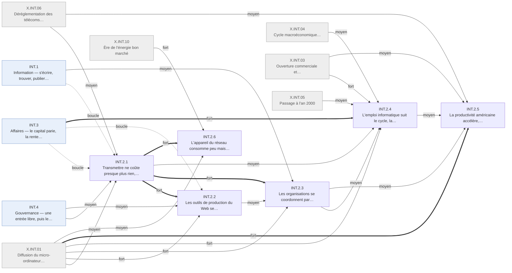

# Arbre des effets en quatre ordres — Internet · INT.2 Industrie

Branche de l'[arbre Internet en quatre ordres](README.md). Conventions :
[README.md § Comment lire](README.md#comment-lire).

## Table of Contents

1. [INT.2 · Industrie — transmettre ne coûte presque plus rien](#int2--industrie--transmettre-ne-coûte-presque-plus-rien) _(Lines 15-255)_

---

## INT.2 · Industrie — transmettre ne coûte presque plus rien
<!-- Lines 15-255 -->

Transmettre ne coûte presque plus rien et les organisations se coordonnent par écrit en réseau, sans se reconfigurer ; l'emploi informatique suit le cycle du capital, et l'accélération de la productivité revient surtout à l'ordinateur. Qui : opérateurs, organisations, salariés · certitude : V

Causes : amont (arrêt de l'épine dorsale publique américaine en 1995 ; pile de protocoles financée sur fonds publics avant 1995) ; INT.4 (fort) ; INT.3 (fort, boucle) ; INT.1 (moyen, boucle) ; X.INT.01 (fort) ; X.INT.03 (moyen) ; X.INT.04 (moyen) ; X.INT.05 (moyen) ; X.INT.06 (moyen) ; X.INT.10 (moyen) ; X.INT.02 (faible) ; X.INT.08 (faible)

L'acheminement devient en 1995 une industrie privée et ouverte ; la concurrence des fournisseurs
d'accès apporte le forfait illimité, le capital surconstruit la fibre et la surcapacité fait
baisser le prix du transit (INT.2.1). Les briques de production du Web se standardisent :
navigateur intégré au système, serveur libre, premiers services distants (INT.2.2). Courriel et
intranet deviennent l'outil des bureaux, deux actifs américains sur cinq utilisent le réseau au
travail en 2001-2003, et banques, universités et administrations ajoutent un guichet sans se
réorganiser (INT.2.3). L'emploi informatique gonfle jusqu'en 2001 puis recule avec le capital ;
les tâches de routine reculent, surtout par l'ordinateur ; le travail informatique devient
échangeable à distance vers l'Inde, surtout par la mondialisation et le passage à l'an 2000
(INT.2.4). La productivité américaine accélère de 1,5 à 2,6 %/an, par le capital informatique
et la production d'ordinateurs plus que par l'usage du réseau, et l'Europe décroche par
l'organisation et la libéralisation (INT.2.5). L'appareil du réseau consomme peu mais ses
centres de données doublent, dans une énergie bon marché jusqu'en 2002 puis chère, sans lien
avec le choc (INT.2.6).

<!-- GENERE:INT.2:debut -->

<!-- GENERE:INT.2:fin -->

- **INT.2.1 · Transmettre ne coûte presque plus rien, ni selon la distance ni selon la durée** — l'infrastructure, toute paire d'interlocuteurs · V
  - Causes : amont (arrêt de l'épine dorsale publique américaine en 1995) ; INT.4 (moyen) ; INT.3.1 (fort, boucle) ; INT.1.1 (moyen, boucle) ; X.INT.01 (moyen) ; X.INT.06 (moyen)
  - Premier levier du choc. Le prix exact du transit n'est pas chiffré à la source ; la baisse est certaine, son ampleur ouverte.
  - **INT.2.1.1 · L'acheminement devient une industrie privée ouverte, et des milliers de fournisseurs d'accès se font concurrence** — opérateurs, fournisseurs d'accès · K
    - Causes : amont (arrêt de l'épine dorsale publique américaine NSFNET) ; INT.4.3.1 (moyen) ; INT.4.1 (moyen)
    - Avril 1995 : opérateurs privés interconnectés ; plusieurs milliers de fournisseurs indépendants au pic, avant consolidation.
    - Faits : J.INT.1995.01, F.INT.A3.001
  - **INT.2.1.2 · Le forfait illimité supprime la facturation à la durée** — abonnés · K
    - Causes : INT.2.1.1 (principale, fort)
    - Un grand fournisseur passe au forfait fin 1996 ; le réseau commuté sature.
    - Faits : F.INT.E5.002, J.INT.1996.03
  - **INT.2.1.3 · L'industrie de l'accès double tous les deux ans et construit au-delà de l'usage** — fournisseurs d'accès · V
    - Causes : INT.1.1.1 (principale, fort) ; INT.2.1.2 (moyen)
    - Un grand fournisseur : 3 millions d'abonnés (1995), 12,5 (1998), 23,2 (2000), dont 4,6 hors des États-Unis ; un opérateur exploite 1,66 million de modems d'accès en 1999.
    - Faits : F.INT.A1.003, F.INT.A1.004, F.INT.A1.005, F.INT.A1.002
  - **INT.2.1.4 · La fibre se surconstruit, puis sa surcapacité rend le transport bon marché** — opérateurs de réseau · K
    - Causes : INT.3.1 (principale, fort) ; X.INT.01 (fort) ; X.INT.06 (moyen)
    - Le capital construit, le krach brade : la forme en deux temps passe par l'infrastructure.
    - **INT.2.1.4.1 · La fibre se construit bien au-delà de l'usage (1998-2000)** — opérateurs · V
      - Causes : INT.3.1 (principale, fort) ; X.INT.06 (moyen)
      - Un opérateur longue distance passe de 797 550 à 896 998 miles de fibre (1998-1999) ; les historiques se restructurent autour de la vente de capacité de gros, endettés.
      - Faits : F.INT.A1.001, F.INT.A5.007
    - **INT.2.1.4.2 · La fibre non éclairée fait baisser le prix du transit** — acheteurs de capacité · K
      - Causes : INT.2.1.4.1 (principale, fort) ; X.INT.01 (fort) ; INT.3.1 (moyen)
      - Après 2001, seule une fraction de la fibre posée est éclairée ; le prix de gros du transit baisse sur toute la fenêtre, aussi par le coût des équipements.
      - Faits : F.INT.A1.009, F.INT.A1.011, J.INT.2001.05
  - **INT.2.1.5 · Le haut débit se déploie et devient majoritaire chez les connectés en 2004, la Corée en tête** — foyers, opérateurs · K
    - Causes : INT.1.1.1 (principale, moyen) ; INT.4.4.3 (moyen) ; INT.2.1.4 (faible)
    - Haut débit à domicile aux États-Unis : 3 % (2000), 33 % (2005), devant le bas débit (28 %) ; la Corée dépasse 20 abonnés pour 100 habitants en 2002.
    - Faits : F.INT.A1.010, F.INT.E1.008, F.INT.A1.008
- **INT.2.2 · Les outils de production du Web se standardisent en briques intégrées ou libres** — éditeurs, développeurs · K
  - Causes : INT.2.1 (principale, fort) ; X.INT.01 (fort) ; INT.4.1 (moyen) ; INT.3.3 (moyen, boucle)
  - Publier ou lancer un service ne demande que des briques standard ; le logiciel commence à quitter le poste.
  - **INT.2.2.1 · Le navigateur devient une brique du système d'exploitation** — ménages, bureaux · V
    - Causes : INT.2.1 (principale, fort) ; X.INT.01 (fort)
    - Système grand public de 1995 puis navigateur intégré : l'accès devient une fonction par défaut de l'ordinateur ; le navigateur pionnier revendiquait 68 millions d'utilisateurs en 1997.
    - Faits : J.INT.1995.04, F.INT.A2.003, F.INT.A2.001
  - **INT.2.2.2 · Serveur libre, gestion de contenu et hébergement mutualisé se généralisent** — développeurs, petits sites · K
    - Causes : INT.4.1 (principale, fort) ; INT.2.1 (fort)
    - Un serveur web libre devient le plus utilisé ; les premiers sites marchands sont faits par de petites équipes sans référentiel de coût ; l'hébergement mutualisé précède l'hébergement dédié.
    - Faits : F.INT.A2.004, F.INT.A2.006, F.INT.A4.005, F.INT.A4.001
  - **INT.2.2.3 · Le logiciel commence à passer du poste au service distant** — usagers du courriel · K
    - Causes : INT.2.1 (principale, fort) ; INT.3.3.1 (moyen)
    - Courriel et collaboration hébergés dès 1996-2000 ; en 2004, un courriel web à grand stockage, sans capacité louée à la demande.
    - Faits : F.INT.A2.007, F.INT.A4.007
- **INT.2.3 · Les organisations se coordonnent par écrit en réseau, sans se reconfigurer** — entreprises, administrations · V
  - Causes : INT.2.1 (principale, fort) ; X.INT.01 (fort) ; INT.2.2 (moyen) ; INT.1.1 (moyen) ; X.INT.02 (faible) ; X.INT.04 (faible)
  - Mesure : part des actifs et des entreprises qui utilisent le réseau. Addition avant substitution : le courrier papier croît jusqu'en 2001.
  - **INT.2.3.1 · Le courriel puis l'intranet deviennent l'outil de travail des bureaux** — cadres, employés de bureau · V
    - Causes : INT.2.1 (principale, fort) ; X.INT.01 (fort) ; X.INT.04 (faible)
    - Courriel courant dans les grandes entreprises dès 1995, intranets sur les protocoles du Web en 1997-2000 ; le courrier de première classe passe de 96,3 à 103,7 milliards de plis (1995-2001), puis recule avec la récession.
    - Faits : F.INT.D3.001, F.INT.D3.002, F.INT.D3.014
  - **INT.2.3.2 · Deux actifs sur cinq utilisent le réseau au travail, selon un gradient de métier, de diplôme et de secteur** — actifs US · V
    - Causes : INT.2.3.1 (principale, fort) ; X.INT.01 (fort)
    - 26,1 % (2000), 38,4 % (2001), 41,7 % (2003) ; cadres 65,8 % contre ouvriers 8,4 % (2001) ; 73,4 % des diplômés de troisième cycle contre 7,6 % des non-diplômés ; finance 66 %, construction 12-15 %.
    - Faits : F.INT.D3.009, F.INT.D3.010, F.INT.D3.011, F.INT.D3.012, F.INT.D3.013, F.INT.D2.011, F.INT.D2.012
  - **INT.2.3.3 · Les entreprises se connectent et achètent en ligne plus qu'elles ne vendent** — entreprises européennes, petites entreprises US · V
    - Causes : INT.2.1 (principale, fort) ; X.INT.01 (fort)
    - Union européenne 2001-2002 : 81 % des entreprises connectées, 30 % achètent en ligne, 13 % vendent, surtout pour moins de 10 % du chiffre ; banque en ligne premier usage (65 %) ; petites entreprises américaines : 83 % courriel, 35 % vendent par un site (2002).
    - Faits : F.INT.A7.001, F.INT.A7.002, F.INT.A7.003, F.INT.D3.015
  - **INT.2.3.4 · Les secteurs installés ajoutent un guichet en ligne sans réorganiser leur production** — banques, universités, santé, administrations · V
    - Causes : INT.2.1 (principale, fort) ; INT.1.1.1 (moyen)
    - Le client fait une part du travail ; l'offre précède l'usage.
    - **INT.2.3.4.1 · Les banques ouvrent un site transactionnel avant que les clients ne suivent** — banques, clients · V
      - Causes : INT.2.1 (principale, fort) ; INT.1.1.1 (moyen)
      - Banques nationales à site transactionnel : 21 % puis 32 % (1999-2000), mais moins de 10 % de clients réguliers en ligne pour la plupart ; internautes pratiquant la banque en ligne : 17 % (2000), 32 % (2002), 44 % (2004).
      - Faits : F.INT.A8.001, F.INT.A8.002, F.INT.A5.008, F.INT.E3.003, F.INT.E3.004, F.INT.E3.006
    - **INT.2.3.4.2 · Universités, santé et administrations ajoutent le réseau en complément** — établissements, agences · K
      - Causes : INT.2.1 (principale, fort)
      - Cours à distance en complément du présentiel ; pas de reconfiguration documentée des soins ; portail fédéral unique en 2000 ; services publics français basculés du Minitel vers le Web.
      - Faits : F.INT.A5.009, F.INT.A5.010, F.INT.G3.001, F.INT.G3.005
  - **INT.2.3.5 · Le travail sort un peu du bureau** — salariés de bureau · V
    - Causes : INT.2.3.1 (principale, fort) ; X.INT.02 (moyen)
    - **INT.2.3.5.1 · Le télétravail progresse puis reflue, et reste minoritaire** — salariés US · V
      - Causes : INT.2.3.1 (principale, fort)
      - Au sens large : 19,6 millions (1999), 28,8 (2001), 24,1 (2004) ; au sens officiel hebdomadaire, 15 % de l'emploi en 2001 comme en 2004.
      - Faits : F.INT.D3.003, F.INT.H4.003, F.INT.H4.004, F.INT.H4.005
    - **INT.2.3.5.2 · La joignabilité déborde les heures de bureau** — cadres, commerciaux · K
      - Causes : INT.2.3.1 (principale, fort) ; X.INT.02 (moyen)
      - Courriel à domicile et téléphone professionnel déplacent la frontière entre travail et vie personnelle, sans la supprimer ; non chiffré.
      - Faits : F.INT.D3.006, F.INT.E5.007, F.INT.D3.007
- **INT.2.4 · L'emploi informatique suit le cycle, la routine recule, le travail de bureau devient échangeable à distance** — salariés · V
  - Causes : INT.3.1 (principale, fort) ; X.INT.01 (fort) ; X.INT.03 (fort) ; X.INT.05 (moyen) ; X.INT.04 (moyen) ; INT.2.3 (moyen) ; INT.2.1 (moyen) ; INT.3.2 (moyen) ; INT.3.5 (faible) ; INT.4.3 (faible, boucle) ; X.INT.08 (faible)
  - Mesure : emplois. Le plus gros mouvement mesuré, dans le secteur de l'information, suit le capital.
  - **INT.2.4.1 · L'emploi informatique et de l'information gonfle jusqu'en 2001, puis perd 650 000 postes** — salariés du secteur · V
    - Causes : INT.3.1 (principale, fort) ; X.INT.05 (moyen) ; X.INT.04 (moyen)
    - Secteur de l'information : 2,79 millions (1995), 3,72 (mars 2001), 3,07 (2005) ; conception de systèmes : 726 000 à 1,46 million puis creux en 2003 ; télécoms 831 000 à 1,08 million (1993-2000), puis licenciements des opérateurs en faillite.
    - Faits : F.INT.D1.002, F.INT.D1.003, F.INT.D1.004, F.INT.D1.005, F.INT.D1.006, F.INT.D1.013, J.INT.2001.03
  - **INT.2.4.2 · Diplômes, pénurie et prime des métiers informatiques suivent le cycle avec retard** — informaticiens · V
    - Causes : INT.2.4.1 (principale, fort) ; X.INT.04 (moyen)
    - Licences d'informatique : 24 506 (1996) à 59 488 (2004, pic trois ans après l'emploi) ; pénurie déclarée puis retournement après 2001 ; prime salariale croissante puis contractée ; options d'achat d'actions ; certifications hors université ; aucun intitulé de métier nouveau identifié.
    - Faits : F.INT.D2.001, F.INT.D2.002, F.INT.D2.003, F.INT.D2.006, F.INT.D2.007, F.INT.D2.008, F.INT.D4.001, F.INT.D4.002, F.INT.D4.007, F.INT.D4.009
  - **INT.2.4.3 · L'emploi se déplace entre métiers selon la tâche que prennent la machine ou le canal** — employés, vendeurs · K
    - Causes : X.INT.01 (principale, fort) ; INT.2.3 (moyen) ; INT.3.2 (moyen) ; INT.3.5 (faible) ; X.INT.08 (faible)
    - **INT.2.4.3.1 · Les tâches de routine de bureau reculent, d'abord par l'ordinateur** — standardistes, opérateurs de saisie · K
      - Causes : X.INT.01 (principale, fort) ; INT.2.3.1 (moyen)
      - Polarisation par tâche : le capital informatique se substitue aux tâches routinières ; recul non chiffré.
      - Faits : F.INT.D1.009, F.INT.D4.003, F.INT.D4.004
    - **INT.2.4.3.2 · L'emploi des agences de voyages perd plus d'un tiers depuis 1997** — agents de voyages · V
      - Causes : INT.3.2.1 (principale, fort)
      - 191 600 (1997), 125 100 (2005), recul commencé avant la récession.
      - Faits : F.INT.D1.007
    - **INT.2.4.3.3 · L'emploi des disquaires recule** — disquaires · K
      - Causes : INT.3.2.3 (principale, fort) ; X.INT.08 (moyen)
      - Faits : F.INT.D1.008
    - **INT.2.4.3.4 · La logistique du commerce en ligne embauche** — entrepôts, livraison · K
      - Causes : INT.3.5.1 (principale, fort)
      - Faits : F.INT.D1.010
  - **INT.2.4.4 · Le travail informatique devient échangeable à distance, vers l'Inde surtout** — prestataires indiens, directions informatiques · K
    - Causes : X.INT.03 (principale, fort) ; X.INT.05 (fort) ; INT.2.1 (moyen)
    - Le réseau rend la délocalisation praticable ; il ne la cause pas.
    - **INT.2.4.4.1 · Le passage à l'an 2000 fait basculer la sous-traitance indienne vers le travail à distance (1997)** — prestataires indiens · K
      - Causes : X.INT.05 (principale, fort) ; X.INT.03 (fort) ; INT.2.1 (moyen)
      - Déclencheur daté sur une offre préparée depuis 1991 ; développement et maintenance à distance pour des clients occidentaux.
      - Faits : F.INT.C3.001, F.INT.A4.003
    - **INT.2.4.4.2 · Les exportations indiennes de services changent d'échelle, de plus en plus hors site** — Inde · K
      - Causes : X.INT.03 (principale, fort) ; INT.2.1 (moyen)
      - 6,3 milliards de dollars en 2000-01 (+57 %) ; part du travail sur site de 66 % à 45 % (1995-2002) ; emploi d'environ 180 000 à 1,3 million (1998-2006, ordre de grandeur) ; appel États-Unis-Inde deux fois moins cher (1996-2001) ; commerce de services professionnels +40 % ; l'OMC juge l'ampleur macroéconomique « modeste » en 2005.
      - Faits : F.INT.C3.002, F.INT.C3.003, F.INT.C3.009, F.INT.C3.010, F.INT.C3.011, F.INT.C3.012, F.INT.C3.014, F.INT.D1.011, F.INT.D2.009
    - **INT.2.4.4.3 · Les entreprises externalisent le développement, mais gardent l'exploitation** — grandes entreprises · K
      - Causes : X.INT.03 (principale, moyen) ; INT.2.1 (faible)
      - Externalisation et travail indépendant progressent ; les grandes entreprises gardent leurs centres de calcul et leur personnel sur toute la fenêtre.
      - Faits : F.INT.D3.004, F.INT.D3.005, F.INT.A4.008
  - **INT.2.4.5 · La réforme comptable de 2002 alourdit le travail de contrôle interne** — services administratifs et comptables · K
    - Causes : INT.4.3.3 (principale, fort)
    - Faits : F.INT.D3.008
- **INT.2.5 · La productivité américaine accélère, surtout par l'ordinateur et sa production ; l'Europe décroche** — économies US et UE · V
  - Causes : X.INT.01 (principale, fort) ; INT.2.3 (moyen) ; INT.2.4 (moyen) ; X.INT.03 (moyen) ; X.INT.06 (moyen) ; INT.2.1 (faible) ; X.INT.04 (faible) ; X.INT.05 (faible)
  - Mesure : productivité du travail en valeur ajoutée déflatée (décision D17 : un fait, pas une conclusion). Aucun fait ne mesure la part propre de l'usage du réseau.
  - **INT.2.5.1 · La productivité américaine passe de 1,5 à 2,6 %/an et le reste après 2001** — économie US · V
    - Causes : X.INT.01 (principale, fort) ; INT.2.3 (moyen) ; X.INT.04 (faible)
    - 1996-1999 contre 1991-1995 ; le paradoxe de Solow cesse de correspondre aux données ; après 2001, portée par la compression des effectifs.
    - Faits : F.INT.C1.002, F.INT.C1.006, F.INT.C1.008
  - **INT.2.5.2 · L'accélération vient du capital informatique et de la production d'ordinateurs** — producteurs et utilisateurs d'informatique · V
    - Causes : X.INT.01 (principale, fort) ; INT.2.1 (moyen)
    - Capital informatique : plus de deux cinquièmes de l'accélération ; productivité multifactorielle, trois cinquièmes, dont la production d'ordinateurs ; investissement réel en matériel ×4 depuis 1995, prix en baisse continue ; thèse dissidente : accélération confinée aux biens durables.
    - Faits : F.INT.C1.003, F.INT.C1.004, F.INT.C1.005, F.INT.C1.014, F.INT.C2.002, F.INT.C2.003, F.INT.C2.004
  - **INT.2.5.3 · La délocalisation de services ajoute un gain et un biais de mesure de sens opposés** — industrie manufacturière US · K
    - Causes : X.INT.03 (principale, fort) ; INT.2.4.4 (moyen)
    - 10 à 13 % de la croissance de productivité manufacturière (1992-2000) ; mais la substitution vers des fournisseurs moins chers gonfle la productivité mesurée de 0,1 à 0,2 point par an ; les deux ne s'additionnent pas.
    - Faits : F.INT.C1.012, F.INT.C1.013
  - **INT.2.5.4 · L'Europe décroche, par l'organisation et la libéralisation plus que par l'équipement** — économies européennes · V
    - Causes : X.INT.06 (principale, fort) ; INT.2.3 (moyen)
    - Productivité horaire : États-Unis 1,3 puis 2,2 %/an, UE-15 2,3 puis 1,4 %/an (avant et après 1995) ; services marchands américains 1,4 puis 3,3 %/an ; avantage des multinationales américaines par la gestion ; complémentarité entre informatique et réorganisation ; demande et prime informatiques plus lentes en Europe.
    - Faits : F.INT.C1.009, F.INT.C1.010, F.INT.C1.011, F.INT.D4.010, F.INT.D4.011, F.INT.D2.010, F.INT.D4.008
  - **INT.2.5.5 · Le passage à l'an 2000 gonfle puis creuse l'investissement informatique** — directions informatiques · K
    - Causes : X.INT.05 (principale, fort) ; X.INT.04 (moyen)
    - Dépenses anticipées en 1997-2000, creux net en 2001-2003.
    - Faits : F.INT.A4.004, F.INT.A4.006, F.INT.C2.007
- **INT.2.6 · L'appareil du réseau consomme peu mais croît, dans une énergie bon marché puis chère** — secteur électrique, exploitants · V
  - Causes : INT.2.1 (principale, fort) ; X.INT.10 (fort) ; X.INT.01 (moyen) ; X.INT.08 (faible) ; INT.1 (faible)
  - Test de H5 : l'énergie bouge pendant la fenêtre, mais pour des raisons étrangères au choc.
  - **INT.2.6.1 · L'électricité du réseau reste faible, mais celle des centres de données double en cinq ans** — exploitants, réseau électrique · V
    - Causes : INT.2.1 (principale, fort) ; X.INT.01 (moyen)
    - Mesure de 2000 : 2 à 3 % de l'électricité américaine, quatre à huit fois moins que le récit de 1999 ; centres de données mondiaux de 70,8 à 152,5 milliards de kWh (2000-2005), 1 % de l'électricité mondiale ; implantation près des points d'échange, pas de l'électricité.
    - Faits : F.INT.H1.003, F.INT.H1.004, F.INT.H1.005, F.INT.H1.006, F.INT.H1.007, F.INT.H2.006
  - **INT.2.6.2 · Ordinateurs et équipements permanents restent sous tension sans gain d'efficacité mesuré** — ménages, bureaux · K
    - Causes : X.INT.01 (principale, moyen) ; INT.1.1.5 (moyen)
    - Faits : F.INT.H1.008, F.INT.H1.009
  - **INT.2.6.3 · L'énergie reste bon marché jusqu'en 2002 puis renchérit, sans lien avec le réseau** — toute l'économie · V
    - Causes : X.INT.10 (principale, fort)
    - Brut : 14,42 $ (1998, point bas), 56,64 $ (2005) ; gaz du secteur électrique ×3 entre 1999 et 2005 ; désinflation de la fin des années 1990 ; intensité énergétique −22 % (1995-2005), tendance engagée dans les années 1970.
    - Faits : F.INT.H3.001, F.INT.H3.002, F.INT.H3.003, F.INT.H3.004, F.INT.H3.005, F.INT.H3.006, F.INT.H3.007, F.INT.H3.008, F.INT.C2.006
  - **INT.2.6.4 · La crise électrique californienne touche l'appareil du réseau sans être causée par lui** — Californie · K
    - Causes : X.INT.10 (principale, fort)
    - Coupures tournantes en 2000-2001 ; les analyses officielles l'attribuent au marché de gros ; des industriels réduisent leur charge.
    - Faits : F.INT.H2.001, F.INT.H2.002, F.INT.H2.003, F.INT.H2.004, F.INT.H2.005
  - **INT.2.6.5 · La production de supports physiques recule avec la numérisation** — industries culturelles · K
    - Causes : X.INT.08 (principale, fort) ; INT.1.5.1 (moyen)
    - Faits : F.INT.H4.006
