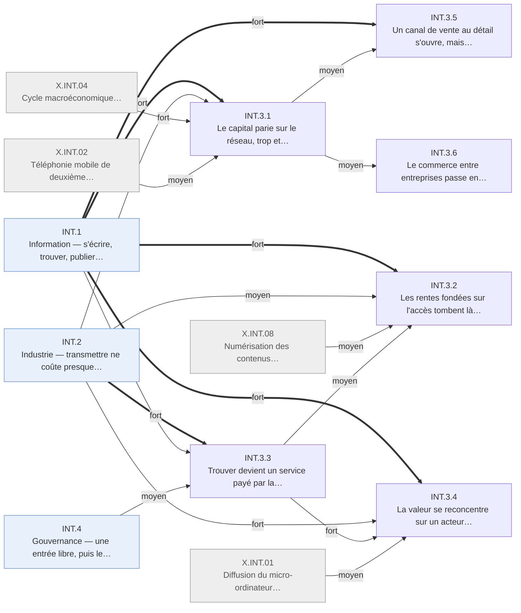

# Arbre des effets en quatre ordres — Internet · INT.3 Affaires

Branche de l'[arbre Internet en quatre ordres](README.md). Conventions :
[README.md § Comment lire](README.md#comment-lire).

## Table of Contents

1. [INT.3 · Affaires — le capital parie, la rente d'accès tombe, la publicité paie](#int3--affaires--le-capital-parie-la-rente-daccès-tombe-la-publicité-paie) _(Lines 15-172)_

---

## INT.3 · Affaires — le capital parie, la rente d'accès tombe, la publicité paie
<!-- Lines 15-172 -->

Le capital parie sur le réseau puis s'effondre ; les rentes fondées sur l'accès tombent là où les usagers migrent ; la valeur se reforme sur quelques plateformes payées par la publicité, tandis que le gros du commerce électronique passe par des réseaux antérieurs. Qui : investisseurs, intermédiaires, plateformes, consommateurs · certitude : V

Causes : INT.1 (principale, fort) ; INT.2 (fort) ; INT.4 (moyen) ; X.INT.04 (fort) ; X.INT.02 (moyen) ; X.INT.08 (moyen) ; X.INT.01 (moyen) ; X.INT.03 (faible) ; amont (réseaux privés d'échange de données informatisé entre entreprises, antérieurs à 1995, absents du registre)

Le capital-risque passe de 8 à 105 milliards de dollars par an, les introductions en bourse se
font à 81 % sur des sociétés déficitaires, le Nasdaq est multiplié par six puis perd 78 %, et la
dette des opérateurs finit en faillites (INT.3.1). Là où la valeur venait de la rareté de l'accès,
elle tombe à mesure que les usagers migrent : agences de voyages, courtage, petites annonces,
musique (INT.3.2). Trouver devient un service payé par la publicité sur mots-clés, qui rejoint
en 2005 les recettes de grands médias (INT.3.3). La valeur se reconcentre sur un acteur par
segment, points de contrôle successifs du navigateur à la recherche, et sur quelques métropoles
(INT.3.4). Le commerce de détail en ligne ne pèse que 2,3 % en 2005, mais la variété procure aux
usagers un surplus que les comptes nationaux ne voient pas (INT.3.5). Plus de 90 % du commerce
électronique mesuré est interentreprises et passe surtout par des réseaux antérieurs au Web
(INT.3.6). Mesure : la valeur en dollars ; en personnes touchées, l'ordre des branches serait
inverse.

<!-- GENERE:INT.3:debut -->

<!-- GENERE:INT.3:fin -->

- **INT.3.1 · Le capital parie sur le réseau, trop et trop tôt, puis s'effondre** — investisseurs, épargnants, opérateurs · V
  - Causes : INT.1.1 (principale, fort) ; INT.2.1 (fort) ; X.INT.04 (fort) ; X.INT.02 (moyen) ; X.INT.03 (faible)
  - Le pari porte sur la croissance d'audience plus que sur le résultat ; le cycle est un effet du choc (décision D11), encadré par la politique monétaire.
  - **INT.3.1.1 · Capital-risque et introductions en bourse décuplent sur des sociétés déficitaires, puis retombent** — jeunes sociétés, investisseurs · V
    - Causes : INT.1.1 (principale, fort) ; X.INT.04 (moyen)
    - Capital-risque : ~8 (1995), ~21,5 (1998), ~105 milliards de dollars par an (1999-2000), ~19 (2003) ; introductions technologiques : 205 (1995), 370 (1999), 18 (2003), 45 (2005) ; déficitaires : 76 % (1999), 81 % (2000) ; prix sur ventes de 4,6 à 31,7 fois ; un navigateur sans bénéfice (1995) et un libraire déficitaire (1997) ouvrent la voie.
    - Faits : F.INT.B1.001, F.INT.B1.002, F.INT.B1.003, F.INT.B1.004, F.INT.B1.005, F.INT.B1.006, F.INT.B1.007, F.INT.B1.008, F.INT.B2.007, F.INT.B2.008, J.INT.1995.03, J.INT.1997.01, J.INT.1999.03
  - **INT.3.1.2 · Les indices montent, s'effondrent et ne reviennent pas au pic** — marchés boursiers · V
    - Causes : INT.3.1.1 (principale, fort) ; X.INT.04 (fort)
    - **INT.3.1.2.1 · Le Nasdaq est multiplié par six, puis perd 78 %** — investisseurs US · V
      - Causes : INT.3.1.1 (principale, fort) ; X.INT.04 (moyen)
      - 743 (janvier 1995), 5 049 (mars 2000), 1 114 (octobre 2002), environ 2 200 (fin 2005) ; perte de capitalisation de plusieurs milliers de milliards, montant disputé.
      - Faits : F.INT.B2.001, F.INT.B2.002, F.INT.B2.003, F.INT.B2.004, F.INT.B2.005, F.INT.B2.006, F.INT.B2.010
    - **INT.3.1.2.2 · L'Europe crée ses marchés de croissance et les perd** — émetteurs et investisseurs européens · K
      - Causes : INT.3.1.1 (principale, fort)
      - Marché allemand : 10 introductions (1997), 120 (2000), −95 % et un tiers des sociétés sorties en 2002, fermeture annoncée la même année.
      - Faits : F.INT.B1.014, F.INT.B2.009, F.INT.B3.010, J.INT.2002.10
    - **INT.3.1.2.3 · La politique monétaire encadre le pic et le creux** — marchés US · V
      - Causes : X.INT.04 (principale, fort)
      - Trois baisses en 1998 sans récession ; taux de 4,75 % à 6,50 % (1999-2000), puis à 1,00 % (2001-2003).
      - Faits : F.INT.B5.002, F.INT.B5.003
  - **INT.3.1.3 · Le financement passe des actions à la dette des opérateurs, qui finit en faillites** — opérateurs télécoms, banques · K
    - Causes : INT.3.1.1 (principale, fort) ; X.INT.02 (moyen)
    - Crédit syndiqué télécoms : 256 milliards de dollars en 2000, plus du triple de 1999, dont au moins 20 % pour les licences mobiles, plus de 100 milliards levés par les États européens ; 23 opérateurs en faillite (2001-2002), dont un avec 107 milliards d'actifs et un opérateur intercontinental.
    - Faits : F.INT.B1.011, F.INT.B1.013, F.INT.B1.009, F.INT.B1.010, F.INT.B3.006, F.INT.A3.005, J.INT.2002.09
  - **INT.3.1.4 · Le capital étranger, européen surtout, finance le pari américain** — investisseurs étrangers · V
    - Causes : INT.3.1.1 (principale, fort) ; X.INT.04 (moyen) ; X.INT.03 (faible)
    - Investissement direct entrant : 69,7 (1997), 282,9 milliards de dollars (1999), à plus de 70 % européen, en très grandes opérations, télécoms en tête ; achats nets étrangers record de plus de 700 milliards (2000) ; la plus grande fusion transfrontalière, un opérateur mobile (2000) ; une part vient des capitaux sortis d'Asie après 1997.
    - Faits : F.INT.B4.001, F.INT.B4.002, F.INT.B4.003, F.INT.B4.004, F.INT.B4.005, F.INT.B4.006, F.INT.B4.007, F.INT.B4.008
  - **INT.3.1.5 · Les ménages entrent en bourse et encaissent les pertes du creux** — ménages actionnaires · V
    - Causes : INT.3.1.1 (principale, fort) ; X.INT.04 (moyen)
    - Ménages actionnaires : 40,4 % (1995), 51,9 % (2001) ; pertes concentrées sur les épargnants et salariés arrivés tard, sans l'information des initiés.
    - Faits : F.INT.B1.012, F.INT.B3.009, F.INT.C6.002, F.INT.C6.007
  - **INT.3.1.6 · Un nouvel entrant vaut un temps plus que l'ancien monde, puis le classement revient à 1995** — grandes capitalisations · K
    - Causes : INT.3.1.2 (principale, fort)
    - Technologie dans les dix premières capitalisations : 2 (1995), 4 à 6 (2000), 2 (2005) ; un fournisseur d'accès rachète un groupe de médias (2000), puis perte d'environ 99 milliards (2002).
    - Faits : F.INT.B3.001, F.INT.B3.002, F.INT.B3.003, F.INT.B3.004, F.INT.B3.005
- **INT.3.2 · Les rentes fondées sur l'accès tombent là où les usagers migrent** — intermédiaires, industries des supports · V
  - Causes : INT.1.1 (principale, fort) ; INT.1.5 (fort) ; INT.2.1 (moyen) ; X.INT.08 (moyen) ; INT.3.3 (moyen)
  - Destruction concentrée sur les intermédiaires dont la rente était l'accès ; les autres secteurs ajoutent un guichet (INT.2.3.4).
  - **INT.3.2.1 · Agences de voyages et courtiers perdent leur commission au profit du canal en ligne** — agences, courtiers, voyageurs · V
    - Causes : INT.1.1.1 (principale, fort) ; INT.2.1 (moyen)
    - Billets réservés en ligne : 7 % puis 30 % (1999-2002), agences traditionnelles de 67 % à 46 % ; comptes de courtage en ligne de 3,7 à 9,7 millions (1997-1999), 15,9 % des transactions ; la moitié des internautes a acheté un voyage en ligne (2002).
    - Faits : F.INT.A5.005, F.INT.A5.004, F.INT.E3.005
  - **INT.3.2.2 · Les petites annonces quittent la presse, qui traite le réseau comme un concurrent** — quotidiens · K
    - Causes : INT.1.1.1 (principale, fort) ; INT.3.3 (moyen)
    - Les petites annonces font 40,2 % des recettes publicitaires de la presse en 2000 et partent vers des sites à bas coût ; premiers plans numériques des quotidiens (1997).
    - Faits : F.INT.A5.002, F.INT.F1.002, J.INT.1997.06
  - **INT.3.2.3 · La musique enregistrée perd le contrôle de la distribution, puis vend au titre sous un distributeur numérique** — maisons de disques · K
    - Causes : INT.1.5.1 (principale, fort) ; X.INT.08 (fort)
    - Faits : F.INT.A5.003, F.INT.C4.010
- **INT.3.3 · Trouver devient un service payé par la publicité, qui rejoint les grands médias** — moteurs, annonceurs, médias · K
  - Causes : INT.2.1 (principale, fort) ; INT.1.3 (fort) ; INT.1.1 (fort) ; INT.4.1 (moyen)
  - La gratuité pour l'usager se fixe dès l'origine ; l'intention exprimée par une requête devient le produit publicitaire le plus cher.
  - **INT.3.3.1 · Le gratuit contre l'attention se fixe dès l'origine, l'abonnement reste marginal** — services grand public · K
    - Causes : INT.2.1 (principale, fort) ; INT.4.1 (moyen)
    - Première bannière (1994) ; courriel gratuit financé par la publicité (1996) ; l'abonnement se développe moins que la publicité et la place de marché.
    - Faits : F.INT.C4.001, J.INT.1996.05, F.INT.C4.009
  - **INT.3.3.2 · Un moteur fondé en 1998 fait de la recherche un service, puis des mots-clés son revenu dominant (2003)** — moteurs de recherche · K
    - Causes : INT.1.3.1 (principale, fort) ; INT.3.3.1 (moyen)
    - Nouvel entrant face aux annuaires et portails ; publicité sur mots-clés étendue aux sites tiers.
    - Faits : F.INT.C4.006, F.INT.C4.007, F.INT.A3.006
  - **INT.3.3.3 · En 2005, la publicité en ligne rivalise avec de grands médias et finance les médias en ligne** — annonceurs, médias · K
    - Causes : INT.3.3.2 (principale, fort) ; INT.1.1.1 (fort)
    - Part croissante pour la recherche ; une part du budget qui finançait la presse passe au réseau.
    - Faits : F.INT.C4.008, F.INT.F1.010
- **INT.3.4 · La valeur se reconcentre sur un acteur par segment et sur quelques métropoles** — firmes de tête, territoires · K
  - Causes : INT.1.6 (principale, fort) ; INT.2.2 (fort) ; INT.3.3 (fort) ; X.INT.01 (moyen)
  - Points de contrôle successifs : système d'exploitation, navigateur, recherche.
  - **INT.3.4.1 · Le navigateur intégré gagne, et le pionnier change de modèle** — éditeurs de logiciels · V
    - Causes : INT.2.2.1 (principale, fort) ; X.INT.01 (fort)
    - Vente du navigateur autonome : 45 % puis 13 % du chiffre du pionnier (1996-1997) ; le système d'exploitation reste concentré ; les éditeurs installés entrent par leur position sur le poste.
    - Faits : F.INT.C5.001, F.INT.C5.005, F.INT.A2.002, F.INT.A3.007
  - **INT.3.4.2 · Chaque segment tend vers un acteur dominant, et les survivants captent les gains de la décennie** — plateformes · K
    - Causes : INT.1.6.1 (principale, fort) ; INT.3.3.2 (fort)
    - Recherche, enchères, librairie, publicité ; le moteur de 1998 valorisé au niveau des plus grandes firmes en 2004 ; l'écart entre firmes de tête et reste s'élargit ; de jeunes sociétés entrent au classement des plus grandes.
    - Faits : F.INT.C5.006, F.INT.C5.004, F.INT.C5.007, F.INT.B3.008, F.INT.C6.004, F.INT.C6.005, F.INT.A3.009
  - **INT.3.4.3 · Les gains vont à quelques métropoles américaines** — territoires · K
    - Causes : INT.3.4.2 (principale, fort)
    - Faits : F.INT.C6.003
- **INT.3.5 · Un canal de vente au détail s'ouvre, mais reste mince ; l'usager y gagne surtout en variété** — détaillants, consommateurs · V
  - Causes : INT.1.1 (principale, fort) ; INT.3.1 (moyen) ; INT.1.3 (moyen) ; INT.4.2 (faible)
  - **INT.3.5.1 · Librairie en ligne et enchères naissent en 1995 ; le détail en ligne pèse 2,3 % en 2005** — détaillants, acheteurs · V
    - Causes : INT.1.1.1 (principale, fort) ; INT.3.1.1 (moyen) ; INT.4.2.2 (faible)
    - 0,64 % du détail (fin 1999), 1,0 % (2001, malgré le krach), 2,3 % (2005) ; la moitié des internautes a déjà acheté en ligne en 2000 ; la vente transfrontalière reste marginale.
    - Faits : F.INT.C4.002, F.INT.C4.003, F.INT.C4.004, F.INT.C4.005, F.INT.E3.002, F.INT.C3.004
  - **INT.3.5.2 · La variété procure aux usagers un surplus sept à dix fois supérieur à la baisse des prix, hors des comptes** — consommateurs · K
    - Causes : INT.3.5.1 (principale, fort) ; INT.1.3.2 (moyen)
    - Libraires en ligne, 2000 : 731 millions à 1,03 milliard de dollars de surplus de variété ; ce surplus, comme la valeur des services gratuits, n'entre pas dans le PIB.
    - Faits : F.INT.F5.006, F.INT.C1.007
- **INT.3.6 · Le commerce entre entreprises passe en électronique, surtout par des réseaux antérieurs au Web** — industrie, commerce de gros · V
  - Causes : amont (réseaux privés d'échange de données informatisé entre entreprises, antérieurs à 1995, absents du registre) ; INT.2.1 (faible) ; INT.3.1 (moyen)
  - Le plus gros changement mesuré en dollars n'est pas le plus visible, et sa cause principale est hors du réseau.
  - **INT.3.6.1 · Plus de 90 % du commerce électronique est interentreprises, et passe surtout par l'échange de données informatisé** — industrie, gros · V
    - Causes : amont (échange de données informatisé antérieur à 1995) ; INT.2.1 (faible)
    - Manufacturier : 12,0 % puis 26,7 % des expéditions ; gros : 5,3 % puis 18,3 % (1999-2005) ; échange de données : 59 % de la valeur manufacturière contre 5 % pour Internet (2000), 83,5 % du gros en 2005 ; en Europe aussi, vente en ligne interentreprises et domestique.
    - Faits : F.INT.A6.001, F.INT.A6.002, F.INT.A6.003, F.INT.A6.004, F.INT.A6.005, F.INT.A6.006, F.INT.A6.009
  - **INT.3.6.2 · Les places de marché ouvertes lancées en 2000 échouent** — industriels · K
    - Causes : INT.3.1.1 (principale, moyen) ; amont (échange de données informatisé déjà installé)
    - Plateforme commune de constructeurs automobiles lancée en 2000, restructurée ou vendue avant 2003 : le terrain n'était pas libre.
    - Faits : F.INT.A6.010
