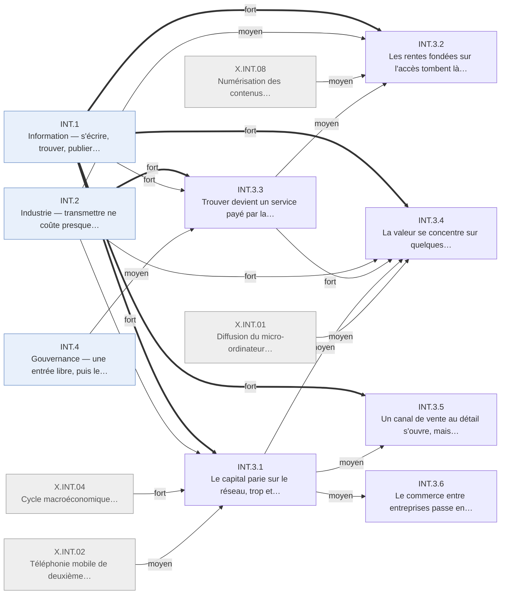

# Arbre des effets en quatre ordres — Internet · INT.3 Affaires

Branche de l'[arbre Internet en quatre ordres](README.md). Conventions :
[README.md § Comment lire](README.md#comment-lire).

## Table of Contents

1. [INT.3 · Affaires — le capital parie, la rente d'accès tombe, la publicité paie](#int3--affaires--le-capital-parie-la-rente-daccès-tombe-la-publicité-paie) _(Lines 15-174)_

---

## INT.3 · Affaires — le capital parie, la rente d'accès tombe, la publicité paie
<!-- Lines 15-174 -->

Le capital parie sur le réseau puis s'effondre ; les rentes fondées sur l'accès tombent là où les usagers migrent ; la valeur se concentre sur quelques plateformes payées par la publicité, tandis que le gros du commerce électronique passe par l'échange de données informatisé, antérieur au Web. Qui : investisseurs, intermédiaires, plateformes, consommateurs · certitude : A

Causes : INT.1 (principale, fort) ; INT.2 (fort) ; INT.4 (moyen) ; X.INT.04 (fort) ; X.INT.02 (moyen) ; X.INT.08 (moyen) ; X.INT.01 (moyen) ; X.INT.03 (faible) ; amont (échange de données informatisé entre entreprises, antérieur au Web : premières normes américaines en 1975, absent du registre)

Le capital-risque américain passe de 7,7 milliards de dollars par an (1995) à 104 milliards
(2000), les introductions en bourse se font à 76 % (1999) puis 81 % (2000) sur des sociétés
déficitaires, le Nasdaq est multiplié par six puis perd 78 %, et les faillites d'opérateurs de
télécommunications se multiplient en 2001 et 2002 (INT.3.1). Là où la valeur venait de la
rareté de l'accès, elle tombe à mesure que les usagers migrent : agences de voyages, courtage,
petites annonces de la presse américaine, musique enregistrée (INT.3.2). Trouver devient un service payé par la
publicité : en 2003 elle fournit environ 97 % des revenus d'un moteur fondé en 1998, et la
recherche fait 41 % de la publicité en ligne américaine en 2005 (INT.3.3). La concentration
s'observe sur le système d'exploitation, le navigateur, la recherche et la publicité en ligne,
et le capital-risque se concentre dans une aire, la Silicon Valley (INT.3.4). Le commerce de
détail en ligne ne pèse que 2,3 % en 2005, mais la variété procure aux usagers, chez les
libraires en ligne en 2000, un surplus sept à dix fois supérieur au gain de la concurrence et de
la baisse des prix (INT.3.5). Plus de 90 % du commerce électronique mesuré est interentreprises
et passe surtout par l'échange de données informatisé, antérieur au Web (INT.3.6). Mesure : la valeur en dollars ;
en personnes touchées, l'ordre des branches serait inverse.

<!-- GENERE:INT.3:debut -->

<!-- GENERE:INT.3:fin -->

- **INT.3.1 · Le capital parie sur le réseau, trop et trop tôt, puis s'effondre** — investisseurs, épargnants, opérateurs · A
  - Causes : INT.1.1 (principale, fort) ; INT.2.1 (fort) ; X.INT.04 (fort) ; X.INT.02 (moyen) ; X.INT.03 (faible)
  - Le pari porte sur des sociétés déficitaires plutôt que sur des résultats (76 % des introductions de 1999, 81 % de 2000) ; le cycle est un effet du choc (décision D11), encadré par la politique monétaire.
  - **INT.3.1.1 · Le capital-risque américain plus que décuple et les introductions en bourse se font sur des sociétés déficitaires, puis les deux retombent** — jeunes sociétés, investisseurs · A
    - Causes : INT.1.1 (principale, fort) ; X.INT.04 (moyen)
    - Capital-risque américain, en milliards de dollars par an : ~7,7 (1995), ~21,5 (1998), ~55 (1999), ~104 (2000), ~22 (2002), ~20 (2003) ; introductions technologiques américaines : 205 (1995), 370 (1999), 261 (2000), 24 (2001), 18 (2003), 61 (2004), 45 (2005) ; sociétés déficitaires parmi les sociétés introduites : 76 % (1999), 81 % (2000) ; prix d'offre rapporté aux ventes de 4,6 fois (1995) à 31,7 fois (2000) ; en août 1995 l'action de l'éditeur d'un navigateur, société alors non rentable, clôt le premier jour à plus du double de son prix d'offre (58,25 contre 28 dollars) ; en mars 1997 une entreprise de distribution déficitaire dépose son document d'introduction en bourse (cotation en mai).
    - Faits : F.INT.B1.001, F.INT.B1.002, F.INT.B1.003, F.INT.B1.004, F.INT.B1.005, F.INT.B1.006, F.INT.B1.007, F.INT.B1.008, F.INT.B2.007, F.INT.B2.008, J.INT.1995.03, J.INT.1997.01, J.INT.1999.03
  - **INT.3.1.2 · Les indices montent, s'effondrent et ne reviennent pas au pic** — marchés boursiers · A
    - Causes : INT.3.1.1 (principale, fort) ; X.INT.04 (fort)
    - **INT.3.1.2.1 · Le Nasdaq est multiplié par six, puis perd 78 % ; un nouvel entrant vaut un temps plus que l'ancien monde, puis sa fusion déclare une perte record** — investisseurs US, grandes capitalisations · A
      - Causes : INT.3.1.1 (principale, fort) ; X.INT.04 (moyen)
      - Nasdaq Composite : 743,58 (3 janvier 1995), 2 192,69 (fin 1998), 5 048,62 (10 mars 2000), 1 114 à 1 119 (début octobre 2002), 2 205 à 2 267 (fin 2005) ; la perte de capitalisation des valeurs technologiques américaines est de l'ordre de 5 à 9 mille milliards de dollars selon la méthode et le périmètre, montant disputé et retenu comme ordre de grandeur. Le 27 mars 2000, un équipementier réseau devient, selon l'entreprise elle-même, la société cotée de plus grande capitalisation au monde (environ 569 milliards de dollars) ; l'annonce de la fusion entre un fournisseur d'accès et un grand groupe de médias (janvier 2000) valorise l'opération entre 165 et 183 milliards de dollars selon les sources, le nouvel entrant valant alors plus que le groupe de médias qu'il acquiert ; la société issue de la fusion publie en janvier 2003 une perte annuelle d'environ 98,7 milliards de dollars pour 2002, après une charge comptable au quatrième trimestre, la plus importante jamais enregistrée par une société américaine ; dans le classement mondial publié en 2005, trois des dix plus grandes sociétés américaines relèvent de la technologie.
      - Faits : F.INT.B2.001, F.INT.B2.002, F.INT.B2.003, F.INT.B2.004, F.INT.B2.005, F.INT.B2.006, F.INT.B2.010, F.INT.B3.002, F.INT.B3.003, F.INT.B3.004, F.INT.B3.005
    - **INT.3.1.2.2 · L'Europe crée ses marchés de croissance et les perd : l'allemand s'effondre puis ferme, le français est fondu dans un marché unique en 2005** — émetteurs et investisseurs européens · A
      - Causes : INT.3.1.1 (principale, fort)
      - Deux marchés de croissance ouvrent en Europe : un français (14 février 1996) et un allemand (10 mars 1997), qui compte 11 introductions en bourse en 1997 et 143 en 2000 ; indice du marché allemand de plus de 9 000 points (mars 2000) à environ 400 (mars 2003), soit environ −95 %, capitalisation d'environ 210 à environ 10,5 milliards d'euros ; première société cotée en faillite en septembre 2000, 119 sociétés (plus d'un tiers) parties fin 2002 ; fermeture annoncée le 26 septembre 2002 après une perte de plus de 90 % de l'indice depuis mars 2000, effective en juin 2003 ; en 2005, le marché de croissance français est regroupé avec le Premier Marché et le Second Marché dans un marché réglementé unique d'Euronext Paris.
      - Faits : F.INT.B1.014, F.INT.B1.015, F.INT.B2.009, F.INT.B3.010, J.INT.2002.10
    - **INT.3.1.2.3 · La politique monétaire encadre le pic et le creux** — marchés US · V
      - Causes : X.INT.04 (principale, fort)
      - Trois baisses à l'automne 1998 (de 5,50 % à 4,75 %), sans lien direct avec une récession américaine ; taux de 4,75 % à 6,50 % (juin 1999-mai 2000), puis à 1,00 % (janvier 2001-juin 2003).
      - Faits : F.INT.B5.002, F.INT.B5.003
  - **INT.3.1.3 · Les opérateurs s'endettent lourdement en 2000, et la dette finit en faillites** — opérateurs télécoms, banques · A
    - Causes : INT.1.1 (principale, fort) ; INT.3.1.1 (moyen) ; X.INT.02 (moyen)
    - Les grands opérateurs, dont l'endettement rapporté au capital était stable jusqu'en 1999, empruntent très lourdement en 2000, surtout par le crédit syndiqué : les télécoms font 20 % des emprunts syndiqués de 2000 contre environ 6 % en moyenne sur 1995-1999 ; les licences mobiles de troisième génération attribuées dans l'Union européenne en 2000 coûtent environ 105 milliards d'euros (environ 50 en Allemagne, environ 38 au Royaume-Uni), recette directe des États que les opérateurs ont financée en partie par prêt syndiqué ; aux États-Unis, 26 sociétés de télécommunications déposent un Chapter 11 en 2001 et 33 en 2002 ; un grand opérateur longue distance fait faillite en 2002 avec environ 107 milliards de dollars d'actifs et une dette de 30 à 41 milliards selon la source ; un opérateur de fibre intercontinentale dépose son bilan le 28 janvier 2002 (environ 22,4 milliards d'actifs, 12,4 de dette) ; fin 2002, la plus grande partie des opérateurs locaux concurrents américains est en faillite ou proche de l'être.
    - Faits : F.INT.B1.011, F.INT.B1.013, F.INT.B1.009, F.INT.B1.010, F.INT.B3.006, F.INT.A3.005, J.INT.2002.09
  - **INT.3.1.4 · Le capital étranger, européen surtout, finance le pari américain** — investisseurs étrangers · V
    - Causes : INT.3.1.1 (principale, fort) ; X.INT.04 (moyen) ; X.INT.03 (faible)
    - Déficit courant américain : 123 milliards de dollars (1996, 1,6 % du PIB), 435 milliards (2000, 4,4 %) ; investissement direct étranger entrant aux États-Unis : 69,7 (1997), 215,3 (1998), 282,9 milliards de dollars (1999), portés par les télécommunications, les équipements de communication et l'assurance, à plus de 70 % européen en 1998 et 1999, et à environ 70 % en opérations de 2 milliards ou plus ; achats nets de titres et d'actifs américains par le secteur privé étranger : record de plus de 700 milliards (2000) ; flux mondiaux d'investissement direct : record de 1,3 billion de dollars en 2000 (+18 %), dont des fusions-acquisitions transfrontalières d'environ 1,1 billion ; le rachat d'un groupe allemand par un opérateur mobile britannique (mars-avril 2000) est la plus grande fusion-acquisition transfrontalière à cette date, valorisée autour de 190 milliards d'euros, de 165 à 203 milliards de dollars selon la source.
    - Faits : F.INT.B4.001, F.INT.B4.002, F.INT.B4.003, F.INT.B4.004, F.INT.B4.005, F.INT.B4.006, F.INT.B4.007
  - **INT.3.1.5 · Les ménages entrent en bourse et encaissent les pertes du creux** — ménages actionnaires · V
    - Causes : INT.3.1.1 (principale, fort) ; X.INT.04 (moyen)
    - Part des ménages américains détenant des actions : 36,7 % (1992), 40,4 % (1995), 48,9 % (1998), 51,9 % (2001) ; les actions Internet sont plus souvent détenues par des investisseurs individuels que les autres (détention médiane des institutions : 25,9 % contre 40,2 %, mars 2000) ; la valeur des actions détenues par les ménages et les institutions sans but lucratif passe de 8 673 milliards de dollars (mars 2000) à 4 725 (septembre 2002), environ −45 %, toutes actions confondues, et de 4 029 (fin 1995) à 8 193 milliards (fin 2005), environ +103 %, contre environ +67 % pour les salaires et traitements.
    - Faits : F.INT.B1.012, F.INT.B3.009, F.INT.C6.002, F.INT.C6.007
- **INT.3.2 · Les rentes fondées sur l'accès tombent là où les usagers migrent** — intermédiaires, industries des supports · A
  - Causes : INT.1.1 (principale, fort) ; INT.1.5 (fort) ; INT.2.1 (moyen) ; X.INT.08 (moyen) ; INT.3.3 (moyen)
  - Destruction concentrée sur les intermédiaires dont la rente était l'accès ; les autres secteurs ajoutent un guichet (INT.2.3.4).
  - **INT.3.2.1 · Agences de voyages et courtiers perdent leur commission au profit du canal en ligne** — agences, courtiers, voyageurs · V
    - Causes : INT.1.1.1 (principale, fort) ; INT.2.1 (moyen)
    - Part moyenne des billets d'avion réservés en ligne : 7 % (1999) puis 30 % (2002), contre 67 % puis 46 % pour les agences de voyages traditionnelles ; comptes de courtage en ligne : 3,7 millions (1997), près de 9,7 millions (deuxième trimestre 1999), soit 15,9 % des transactions sur actions au premier trimestre 1999 ; 36 % des internautes américains déclarent avoir acheté un voyage en ligne (mars 2000), 50 % (septembre 2002).
    - Faits : F.INT.A5.005, F.INT.A5.004, F.INT.E3.005
  - **INT.3.2.2 · Les petites annonces quittent la presse quotidienne américaine** — quotidiens · A
    - Causes : INT.1.1.1 (principale, fort) ; INT.3.3 (moyen)
    - Un site de petites annonces en ligne, gratuites dans la plupart des cas, s'implante dans les marchés locaux de la presse américaine (neuf villes de plus en 2000, quatorze en 2003) et, là où il entre, les quotidiens dont les petites annonces comptent le plus dans leurs revenus baissent leurs tarifs d'environ 20 % en moyenne ; les petites annonces des quotidiens américains culminent en 2000 à 19,6 milliards de dollars, environ 40 % des recettes publicitaires du secteur, puis reculent d'environ 70 % jusqu'en 2009 au profit de services en ligne gratuits ou spécialisés.
    - Faits : F.INT.A5.002, F.INT.F1.002
  - **INT.3.2.3 · La musique enregistrée perd des ventes en valeur dès 2000, puis vend au titre sous un distributeur numérique (2003)** — maisons de disques · V
    - Causes : INT.1.5.1 (principale, fort) ; X.INT.08 (fort)
    - Aux États-Unis, la valeur au détail des livraisons de musique enregistrée, nette des retours, recule dès 2000 : pour les supports physiques, de 14 584,7 millions de dollars en 1999 (maximum de la série 1995-2005) à 14 323,7 en 2000, 13 740,9 en 2001, 12 614,2 en 2002 et 11 854,4 en 2003 ; avec les ventes numériques, que la série compte à partir de 2004, le total est de 12 338,1 en 2004 et 12 269,5 en 2005. En février 2001, une cour d'appel fédérale retient qu'un service d'échange de fichiers musicaux peut être tenu responsable de contrefaçon et rapporte le constat du tribunal de première instance selon lequel il réduit les ventes de disques compacts chez les étudiants ; le 28 avril 2003, une boutique de musique en ligne propose plus de 200 000 titres de cinq maisons de disques à 99 cents le titre, sans abonnement.
    - Faits : F.INT.A5.003, F.INT.A5.011, F.INT.C4.010
- **INT.3.3 · Trouver devient un service payé par la publicité** — moteurs, annonceurs, médias · A
  - Causes : INT.2.1 (principale, fort) ; INT.1.3 (fort) ; INT.1.1 (fort) ; INT.4.1 (moyen)
  - Le gratuit contre l'attention apparaît dès 1994 ; en 2003 la publicité fournit environ 97 % des revenus d'un moteur fondé en 1998, et la recherche fait 41 % de la publicité en ligne américaine en 2005.
  - **INT.3.3.1 · Le gratuit financé par la publicité apparaît dès 1994 ; en 2005, la publicité en ligne rapporte environ six fois plus que le contenu payant** — services grand public · A
    - Causes : INT.2.1 (principale, fort) ; INT.4.1 (moyen)
    - Le 27 octobre 1994, un site publie dès son lancement des bannières de douze annonceurs, dont celle d'un opérateur de télécommunications ensuite tenue pour la première bannière du Web ; le 4 juillet 1996, un service de courriel gratuit consultable depuis le Web, soutenu par des bannières publicitaires, est lancé ; en 2005, les consommateurs américains dépensent un peu plus de 2 milliards de dollars en contenu en ligne payant, l'abonnement restant le mode de paiement dominant, contre plus de 12,5 milliards de recettes publicitaires en ligne (rapport d'environ six, calculé à partir des deux chiffres).
    - Faits : F.INT.C4.001, J.INT.1996.05, F.INT.C4.009
  - **INT.3.3.2 · Un moteur fondé en 1998 fait de la recherche un service, puis vend de la publicité sur mots-clés, qui fournit environ 97 % de son revenu (2003)** — moteurs de recherche · V
    - Causes : INT.1.3.1 (principale, fort) ; INT.3.3.1 (moyen)
    - Constitué en société en septembre 1998, le moteur classe les pages en partie selon l'importance des sites qui pointent vers elles ; son chiffre d'affaires passe de 86 millions de dollars (2001) à 962 millions (2003) ; en 2003, la publicité fournit environ 97 % de ses revenus, dont environ 43 % par les annonces diffusées sur les sites des membres de son réseau ; les annonceurs de son programme enchérissent sur les mots-clés qui déclenchent l'affichage de leurs annonces, ciblées sur les résultats de recherche ou le contenu des pages.
    - Faits : F.INT.C4.006, F.INT.C4.007, F.INT.A3.006
  - **INT.3.3.3 · En 2005, la publicité en ligne pèse environ 5 % des recettes publicitaires américaines, et la recherche en est la première catégorie** — annonceurs, médias · A
    - Causes : INT.3.3.2 (principale, fort) ; INT.1.1.1 (fort)
    - Les recettes publicitaires en ligne américaines dépassent 12,5 milliards de dollars en 2005 (+30 % sur 2004, 9,6 milliards), soit environ 5 % de l'ensemble des recettes publicitaires américaines ; la publicité liée aux mots-clés de recherche en représente 35 % en 2003, 40 % en 2004 puis 41 % en 2005, où elle reste la première catégorie.
    - Faits : F.INT.C4.008, F.INT.F1.010
- **INT.3.4 · La valeur se concentre sur quelques acteurs et sur une aire américaine** — firmes de tête, territoires · A
  - Causes : INT.1.6 (principale, fort) ; INT.2.2 (fort) ; INT.3.3 (fort) ; INT.3.1 (moyen) ; X.INT.01 (moyen)
  - Concentration observée sur le système d'exploitation (plus de 90 % du marché des micro-ordinateurs compatibles Intel jusqu'en 1999), le navigateur, la recherche et la publicité en ligne.
  - **INT.3.4.1 · Le navigateur intégré gagne des parts, et le pionnier change de modèle** — éditeurs de logiciels · V
    - Causes : INT.2.2.1 (principale, fort) ; X.INT.01 (fort)
    - La vente du navigateur autonome passe de 45 % du chiffre d'affaires du pionnier (quatrième trimestre 1996) à 13 % (quatrième trimestre 1997) ; l'éditeur dominant des systèmes d'exploitation (plus de 90 % du marché des micro-ordinateurs compatibles Intel chaque année de la décennie jusqu'en 1999) livre son navigateur avec le système dès juillet 1995, puis, à partir d'août 1996, n'offre plus qu'une version dont le code du navigateur est intégré ; selon les estimations retenues par le tribunal, la part d'usage passe de janvier 1996 à novembre 1997 de plus de 80 % à 55 % pour le navigateur du pionnier et d'environ 5 % à 36 % pour le navigateur intégré.
    - Faits : F.INT.C5.001, F.INT.C5.005, F.INT.A2.002, F.INT.A3.007
  - **INT.3.4.2 · Les segments tendent vers la concentration, et un moteur de recherche passe en tête** — plateformes · A
    - Causes : INT.1.6.1 (principale, fort) ; INT.3.3.2 (fort)
    - Selon une synthèse de 2002, effets de réseau, rendements d'échelle et verrouillage poussent les industries de haute technologie vers des ratios de concentration plus élevés, et le tribunal décrit en 1999 une boucle de rétroaction positive qui entretient la position dominante de l'éditeur de systèmes d'exploitation ; les dix premiers vendeurs de publicité en ligne américains réalisent 71 % des revenus aux quatrièmes trimestres 2003 et 2004, 74 % au deuxième trimestre 2004 et 72 % au deuxième trimestre 2005, la recherche en faisant 40 % ; en mai-juin 2004, 47 % des internautes américains citent le moteur fondé en 1998 comme premier choix, contre 26 % pour son premier concurrent, et il compte le plus de visiteurs uniques en octobre 2005 ; introduit en bourse en août 2004 à 85 dollars l'action, il est valorisé un peu moins de 25 milliards de dollars, contre environ 41 pour son premier concurrent ; les introductions de 1999 et de 2000 affichent un rendement moyen de −46,2 % et de −64,7 % (jusqu'au 30 septembre 2001 au plus tard) ; trois entreprises d'Internet entrent au classement Fortune 500 établi sur les revenus de 2005 (rangs 353, 412 et 458).
    - Faits : F.INT.C5.006, F.INT.C5.004, F.INT.C5.007, F.INT.B3.008, F.INT.C6.004, F.INT.A3.009
  - **INT.3.4.3 · Le capital-risque américain se concentre dans une aire, la Silicon Valley** — territoires · A
    - Causes : INT.3.1.1 (principale, fort) ; INT.3.4.2 (faible)
    - Entre 1995 et 2000, la Silicon Valley reçoit environ 65 milliards de dollars de capital-risque, près du tiers du total national, et ses industries de haute technologie versent en 2000 12,8 % des salaires de haute technologie du pays.
    - Faits : F.INT.C6.003
- **INT.3.5 · Un canal de vente au détail s'ouvre, mais reste mince ; l'usager y gagne surtout en variété** — détaillants, consommateurs · A
  - Causes : INT.1.1 (principale, fort) ; INT.3.1 (moyen) ; INT.1.3 (moyen) ; INT.4.2 (faible)
  - **INT.3.5.1 · Librairie en ligne et enchères naissent en 1995 ; le détail en ligne pèse 2,3 % en 2005** — détaillants, acheteurs · V
    - Causes : INT.1.1.1 (principale, fort) ; INT.3.1.1 (moyen) ; INT.4.2.2 (faible)
    - Une librairie en ligne commence à vendre des livres en juillet 1995 et une place d'enchères entre particuliers est fondée en septembre 1995 ; part des ventes au détail américaines : 0,64 % (quatrième trimestre 1999), 0,9 % (2000), 1,0 % (2001, 32,6 milliards de dollars), 2,3 % (2005, 86,3 milliards, contre 2,0 % en 2004) ; en 2000, 46 % des internautes américains (juin) puis 52 % (novembre-décembre) disent avoir déjà acheté en ligne, environ 22 % de tous les adultes ; dans l'Union européenne, 30 % des consommateurs ont acheté en ligne dans leur pays et 7 % dans un autre pays de l'Union en 2008 (hors de la fenêtre).
    - Faits : F.INT.C4.002, F.INT.C4.003, F.INT.C4.004, F.INT.C4.005, F.INT.E3.002, F.INT.C3.004
  - **INT.3.5.2 · La variété procure aux usagers un surplus sept à dix fois supérieur au gain de la concurrence et de la baisse des prix, et les services à prix nul en procurent un que la dépense ne mesure pas** — consommateurs · A
    - Causes : INT.3.5.1 (principale, fort) ; INT.1.3.2 (moyen)
    - Libraires en ligne, 2000 : la variété de titres accroît le bien-être des consommateurs de 731 millions à 1,03 milliard de dollars (étude de 2003), soit 7 à 10 fois le gain lié à la concurrence et à la baisse des prix (au moins cinq fois dans la version de travail) ; les services à prix nul échappent à la mesure par la dépense : le temps que les consommateurs y consacrent donne un gain de bien-être d'environ 38 milliards de dollars par an aux États-Unis sur 2002-2011, soit 0,29 % du PIB annuel.
    - Faits : F.INT.F5.006, F.INT.C1.007
- **INT.3.6 · Le commerce entre entreprises passe en électronique, surtout par l'échange de données informatisé, antérieur au Web** — industrie, commerce de gros · A
  - Causes : amont (échange de données informatisé entre entreprises, antérieur au Web : premières normes américaines en 1975, absent du registre) ; INT.2.1 (faible) ; INT.3.1 (moyen)
  - Le plus gros changement mesuré en dollars n'est pas le plus visible : l'échange de données informatisé, déjà en usage avant le Web, en porte l'essentiel de la valeur.
  - **INT.3.6.1 · Plus de 90 % du commerce électronique est interentreprises, et passe surtout par l'échange de données informatisé, déjà en usage avant le Web** — industrie, gros · A
    - Causes : amont (échange de données informatisé antérieur au Web : premières normes américaines en 1975) ; INT.2.1 (faible)
    - Plus de 90 % du volume de commerce électronique mesuré aux États-Unis est interentreprises (plus de 90 % en 1999, 94 % en 2000, 92,1 % en 2005), selon une estimation qui suppose que tout le commerce manufacturier et de gros est interentreprises ; manufacturier : 12,0 % puis 26,7 % des expéditions ; gros : 5,3 % puis 18,3 % (1999-2005) ; échange de données : 59 % de la valeur manufacturière contre 5 % pour Internet (2000), 83,5 % du commerce électronique des grossistes marchands en 2005 ; en 2001 en Europe, les ventes en ligne des entreprises sont majoritairement interentreprises dans la plupart des pays (hors Allemagne) et domestiques à 78 % en moyenne ; l'échange de données informatisé entre entreprises est antérieur au Web : dès 1968, assez de compagnies ferroviaires, aériennes, routières et maritimes utilisent des manifestes électroniques pour former le Transportation Data Coordinating Committee, qui publie en 1975 les premières normes américaines d'échange de données informatisé pour le transport aérien, maritime, routier et ferroviaire, et avant 1974-1975 de nombreuses normes propriétaires d'ordinateur à ordinateur ou d'entreprise à entreprise étaient déjà en usage.
    - Faits : F.INT.A6.001, F.INT.A6.002, F.INT.A6.003, F.INT.A6.004, F.INT.A6.005, F.INT.A6.006, F.INT.A6.009, F.INT.A6.011
  - **INT.3.6.2 · Les places de marché interentreprises refluent après 2000 ; celle des trois constructeurs automobiles américains, lancée en 2000, est cédée en 2003-2004** — industriels · A
    - Causes : INT.3.1.1 (principale, moyen) ; amont (relations établies entre entreprises clientes et fournisseurs, antérieures aux places de marché)
    - Place de marché interentreprises commune aux trois grands constructeurs automobiles américains, annoncée en février 2000 et lancée en septembre 2000, qui peine à attirer des clients une fois l'enthousiasme pour les places de marché en ligne retombé ; son activité d'enchères, mal accueillie des fournisseurs, est vendue à la fin de 2003 et l'ensemble est cédé à un éditeur de logiciels (annonce de février 2004), ce qui met fin à l'engagement financier des trois constructeurs. Une étude de la California Management Review sur le reflux des places de marché interentreprises en compte 1 520 en 2001 et en projette 180 en 2003 (un décompte et une projection, non des fermetures) ; elle l'attribue à la réticence des entreprises clientes à perturber des systèmes qui fonctionnent, au refus des fournisseurs de concourir sur les seuls prix et aux enchères, qui fragilisent les relations durables avec les fournisseurs, et conclut que les gagnantes sont les entreprises qui renforcent, et non remplacent, les relations traditionnelles de leur industrie (étude non ouverte, lue par un résumé).
    - Faits : F.INT.A6.010, F.INT.A6.012
