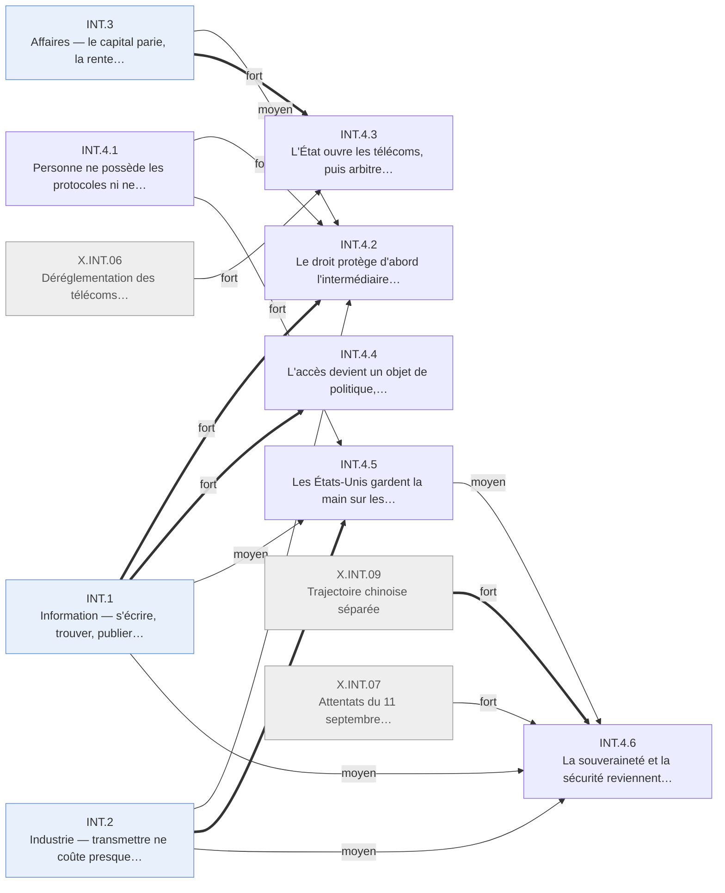

# Arbre des effets en quatre ordres — Internet · INT.4 Gouvernance

Branche de l'[arbre Internet en quatre ordres](README.md). Conventions :
[README.md § Comment lire](README.md#comment-lire).

## Table of Contents

1. [INT.4 · Gouvernance — une entrée libre, puis le droit rattrape les usages](#int4--gouvernance--une-entrée-libre-puis-le-droit-rattrape-les-usages) _(Lines 15-167)_

---

## INT.4 · Gouvernance — une entrée libre, puis le droit rattrape les usages
<!-- Lines 15-167 -->

Personne ne possède les protocoles ni ne filtre l'entrée ; le droit protège d'abord l'intermédiaire, puis rattrape les usages et le cycle ; les États-Unis gardent la main sur les ressources critiques, et les autres blocs répondent par la contestation, le filtrage du réseau ou la sécurité. Qui : législateurs, régulateurs, États · certitude : A

Causes : amont (Web placé dans le domaine public en 1993 ; gouvernance technique par consensus héritée du réseau de recherche) ; INT.1 (fort, boucle) ; INT.3 (moyen, boucle) ; INT.2 (faible, boucle) ; X.INT.06 (moyen) ; X.INT.07 (moyen) ; X.INT.09 (moyen) ; X.INT.01 (faible) ; X.INT.03 (faible) ; X.INT.08 (faible)

Les protocoles restent des standards ouverts, fixés par des instances multi-acteurs et non par un
État ou une entreprise unique, et personne ne possède le réseau ni n'en restreint l'accès : de
nouveaux services s'y ajoutent sans l'accord des fournisseurs de réseau ni approbation
réglementaire ; c'est le second levier du choc (INT.4.1). Le législateur américain
protège d'abord l'intermédiaire et choisit l'autorégulation et un moratoire sur les nouvelles
taxes ; le droit d'auteur s'adapte à la copie numérique avant même le partage de masse, puis
celui-ci est tranché pour les ayants droit ; données, mineurs et courrier non sollicité reçoivent
des règles, d'un bloc en Europe, au cas par cas aux États-Unis (INT.4.2). L'État ouvre les
télécoms, puis arbitre après coup la concurrence, la finance et le travail qualifié (INT.4.3).
L'accès devient un objet de politique, dans chaque pays et entre pays (INT.4.4). Les États-Unis
gardent la tutelle des noms et la centralité des serveurs racine et de la capacité interrégionale ;
des États la contestent aux sommets mondiaux sans l'obtenir (INT.4.5). La Chine filtre son réseau
et limite les capitaux étrangers, et la sécurité revient après 2001, avec une loi américaine et une
convention sur la cybercriminalité (INT.4.6). La plupart de ces règles répondent à des usages déjà installés : la flèche principale va des usages vers le droit, avec un
retard de deux à six ans.

<!-- GENERE:INT.4:debut -->

<!-- GENERE:INT.4:fin -->

- **INT.4.1 · Personne ne possède les protocoles ni ne filtre l'entrée : de nouveaux services s'y ajoutent sans l'accord des fournisseurs de réseau ni approbation réglementaire** — auteurs, entrepreneurs, tout nouvel entrant · A
  - Causes : amont (Web placé dans le domaine public en 1993 ; instances techniques par consensus héritées du réseau de recherche)
  - Second levier du choc. Les standards de l'Internet restent ouverts sur toute la fenêtre : publiés en documents ouverts (RFC) par des instances techniques ouvertes à toute personne intéressée, et non fixés par un État ou une entreprise unique ; un consortium industriel (fondé en octobre 1994) fixe les standards du Web par des recommandations ouvertes plutôt que par un traité ou une loi nationale. Personne n'en possède le réseau ni le protocole, n'en licencie l'usage ni n'en restreint l'accès : pour l'Internet Architecture Board en 1996, « nobody owns the Internet, there is no centralized control, and nobody can turn it off » (RFC 1958, § 2.4) ; pour le personnel de la Federal Communications Commission, dans deux documents de travail (mars 1997 et juillet 1999), de nouveaux types de services se superposent aux protocoles existants, souvent sans l'intervention ni même la connaissance des fournisseurs de réseau, les entreprises de l'industrie n'ont jamais dû obtenir d'approbation réglementaire pour leurs actions, et tout utilisateur peut développer de nouvelles applications.
  - Faits : F.INT.A2.005, F.INT.G2.004, F.INT.G2.007, F.INT.G2.008
- **INT.4.2 · Le droit protège d'abord l'intermédiaire et l'entrée libre, puis encadre les usages** — plateformes, hébergeurs, usagers, ayants droit · A
  - Causes : INT.1 (principale, fort) ; INT.4.1 (fort) ; INT.2.1 (moyen) ; INT.3.2 (moyen) ; X.INT.08 (faible) ; X.INT.01 (faible) ; X.INT.06 (faible)
  - Retard du droit sur l'usage : deux ans pour le partage de musique, six pour sa décision finale ; l'Europe légifère trois à quatre ans après les États-Unis, et la France transpose la directive de 2000 quatre ans plus tard.
  - **INT.4.2.1 · Les hébergeurs sont exonérés de responsabilité pour les contenus de tiers** — hébergeurs, plateformes · V
    - Causes : INT.4.1 (principale, moyen) ; X.INT.06 (faible)
    - États-Unis 1996 : la section 230, au titre V de la loi sur les télécommunications (approuvée le 8 février 1996), exonère les fournisseurs de services interactifs de la responsabilité éditoriale sur les contenus de tiers ; Europe : la directive du 8 juin 2000 exonère l'hébergeur (art. 14) tant qu'il n'a pas connaissance effective de l'activité illicite ; la loi française du 21 juin 2004, prise pour transposer cette directive, est promulguée quatre ans après son adoption.
    - Faits : F.INT.G1.001, F.INT.G1.007, J.INT.2003.06
  - **INT.4.2.2 · Les États-Unis choisissent l'autorégulation et un moratoire sur les nouvelles taxes du commerce en ligne ; l'Europe suit plus tard** — commerce en ligne · V
    - Causes : INT.4.1 (principale, moyen)
    - Cadre de politique non contraignant du 1er juillet 1997, fondé sur l'autorégulation du secteur privé, un moratoire sur les nouveaux droits de douane et taxes discriminatoires et la neutralité technologique du droit ; moratoire décennal (21 octobre 1998) sur les nouvelles taxes d'États et de collectivités locales sur l'accès à Internet et les taxes discriminatoires sur le commerce électronique ; signatures et dossiers électroniques de même valeur juridique que le papier (30 juin 2000) ; directive européenne du 8 juin 2000, près de trois ans après le cadre américain.
    - Faits : F.INT.G1.002, F.INT.G1.005, F.INT.G1.010, F.INT.C3.006
  - **INT.4.2.3 · Le droit d'auteur s'adapte à la copie numérique avant le partage de masse** — ayants droit, hébergeurs · A
    - Causes : INT.2.1 (principale, fort) ; X.INT.08 (moyen)
    - Traité de l'OMPI sur le droit d'auteur adopté à Genève le 20 décembre 1996 ; loi américaine du 28 octobre 1998 : protection juridique des mesures techniques et sphère de sécurité pour les hébergeurs qui retirent un contenu signalé ; directive européenne du 22 mai 2001, qui met en œuvre une partie des nouvelles obligations issues de la conférence de 1996.
    - Faits : J.INT.1996.04, F.INT.G1.003, F.INT.G1.008
  - **INT.4.2.4 · Le partage de masse est poursuivi jusqu'aux particuliers et tranché pour les ayants droit** — usagers du partage, maisons de disques · A
    - Causes : INT.1.5.1 (principale, fort) ; INT.3.2.3 (fort)
    - Décision d'appel du 12 février 2001 : un service de partage de musique peut être tenu responsable de contrefaçon par contribution et par représentation, et ferme en juillet 2001 ; au printemps 2003, 35 millions d'adultes américains téléchargent de la musique et 26 millions partagent des fichiers, près de 1 000 assignations visent des fournisseurs d'accès au 28 juillet 2003, puis l'association de l'industrie du disque engage 261 poursuites contre des particuliers le 8 septembre 2003 ; la Cour suprême américaine juge le 27 juin 2005, à l'unanimité, responsable des violations commises par des tiers celui qui distribue un dispositif dans le but de promouvoir son usage pour violer le droit d'auteur, annule l'arrêt d'appel et renvoie l'affaire.
    - Faits : F.INT.F1.004, J.INT.2001.02, J.INT.2003.02, J.INT.2005.02
  - **INT.4.2.5 · Données, mineurs et courrier non sollicité reçoivent des règles, d'un bloc en Europe, au cas par cas aux États-Unis** — usagers, exploitants de services · A
    - Causes : INT.1.1 (principale, fort) ; INT.1.2 (moyen) ; X.INT.01 (faible)
    - Directive européenne du 24 octobre 1995 sur les données personnelles, qui demande un niveau de protection équivalent dans tous les États membres ; accord de sphère de sécurité pour les transferts transatlantiques (principes du 21 juillet 2000), contournement de l'absence de loi fédérale américaine équivalente ; consentement parental vérifiable avant 13 ans (21 octobre 1998) ; première loi fédérale sur le courrier commercial non sollicité (16 décembre 2003) ; en août 2000, 84 % des internautes américains adultes se disent préoccupés par l'obtention de leurs informations personnelles et 86 % sont favorables au consentement préalable ; débat sur les mineurs de 1997 à 2003 devant les tribunaux et au Congrès.
    - Faits : F.INT.G1.006, F.INT.G1.009, F.INT.G1.004, F.INT.G1.012, F.INT.F3.005, F.INT.F3.009
  - **INT.4.2.6 · Des auteurs et des chercheurs fixent eux-mêmes leurs règles de partage** — créateurs, chercheurs · V
    - Causes : INT.4.2.3 (principale, fort) ; INT.1.4.2 (moyen)
    - Licences de partage volontaire (2002) ; déclarations pour l'accès libre à la recherche (2002, 2003) : prises de position datées, pas encore une pratique mesurée.
    - Faits : F.INT.F1.005, F.INT.F2.004, F.INT.F2.005
- **INT.4.3 · L'État ouvre les télécoms, puis arbitre après coup concurrence, finance et travail qualifié** — opérateurs, marchés, régulateurs · A
  - Causes : INT.3.1 (principale, fort) ; X.INT.06 (fort) ; INT.3.4 (moyen) ; INT.2.4 (faible)
  - **INT.4.3.1 · Les États ouvrent les télécoms à la concurrence et cèdent une part du capital de leurs opérateurs** — opérateurs historiques et nouveaux entrants · A
    - Causes : X.INT.06 (principale, fort)
    - Loi américaine de février 1996 (interconnexion et accès dégroupé imposés aux opérateurs locaux en place) ; directive européenne du 13 mars 1996 (pleine concurrence au 1er janvier 1998) ; en février 1997, 69 gouvernements souscrivent à l'organisation du commerce des engagements d'accès au marché des télécommunications de base ; introduction en bourse, le 18 novembre 1996, d'un grand opérateur allemand jusque-là public (environ 10 milliards d'euros, offre sursouscrite environ cinq fois selon l'émetteur) ; ouverture du capital de l'opérateur historique français en 1997 et 1998, part de l'État de 76,8 % à 62,34 %, puis 55,5 % fin 2000 ; directives européennes de 2002 (cadre commun des communications électroniques, vie privée).
    - Faits : J.INT.1996.01, F.INT.G4.008, F.INT.B5.008, F.INT.B5.009, J.INT.2002.06
  - **INT.4.3.2 · Le procès antitrust sur le navigateur échoue à obtenir la scission de l'éditeur** — éditeur dominant · V
    - Causes : INT.3.4.1 (principale, fort)
    - Plaintes déposées le 18 mai 1998 par le ministère de la justice et vingt États avec le District de Columbia, notamment sur la vente liée du navigateur au système d'exploitation de l'éditeur ; scission ordonnée par le jugement final du 7 juin 2000 (conclusions de droit du 3 avril 2000), jugement annulé en entier en appel le 28 juin 2001 ; en novembre 2002, remède de comportement, les plaignants restants n'ayant pas maintenu leur demande de scission.
    - Faits : F.INT.C5.002, F.INT.C5.003
  - **INT.4.3.3 · Les règles des marchés financiers répondent au cycle** — sociétés cotées, banques d'affaires · V
    - Causes : INT.3.1 (principale, fort)
    - Diffusion équitable de l'information (2000), réforme de la gouvernance comptable (2002), règlement de 1,4 milliard de dollars sur les conflits d'intérêts des analystes (2003).
    - Faits : F.INT.B5.005, F.INT.B5.006, F.INT.B5.007
  - **INT.4.3.4 · La séparation bancaire est abrogée en 1999, hors du choc** — banques · V
    - Causes : amont (mouvement de déréglementation financière, antérieur et absent du registre)
    - Loi de modernisation des services financiers, signée le 12 novembre 1999, qui abroge les articles 20 et 32 de la loi bancaire de 1933 et autorise le rapprochement des banques commerciales, des banques d'investissement et des assurances. Le dossier attribue le fait au choc et le jalon au contexte : l'arbre suit le jalon.
    - Faits : F.INT.B5.004, J.INT.1999.02
  - **INT.4.3.5 · Le plafond de visas qualifiés est relevé deux fois, puis revient à la base avec le retournement** — informaticiens étrangers, employeurs · V
    - Causes : INT.2.4.2 (principale, fort)
    - Plafond annuel de 65 000 porté à 115 000 pour les exercices 1999 et 2000 (loi d'octobre 1998), puis 107 500 prévus pour 2001 ; porté à 195 000 par an (loi d'octobre 2000, exercices 2001 à 2003 selon la loi promulguée, texte promulgué non relu directement) ; retour au plafond de base de 65 000 à partir de l'exercice 2004, dans un contexte de retournement de l'emploi informatique.
    - Faits : F.INT.D2.004, F.INT.D2.005
- **INT.4.4 · L'accès devient un objet de politique, dans chaque pays et entre pays** — États, organisations internationales · A
  - Causes : INT.1.1 (principale, fort)
  - **INT.4.4.1 · La fracture numérique devient une catégorie de politique publique américaine dès 1995-1996** — programmes d'accès universel · V
    - Causes : INT.1.1.2 (principale, fort)
    - Faits : F.INT.F3.002, F.INT.G3.004
  - **INT.4.4.2 · Le G8 s'engage pour un accès universel et abordable (2000)** — pays en développement · V
    - Causes : INT.1.1.3 (principale, fort)
    - Faits : F.INT.G6.002
  - **INT.4.4.3 · La Corée inscrit le haut débit dans un plan gouvernemental (1999)** — Corée du Sud · A
    - Causes : amont (choix de politique publique coréen, dont le dossier ne documente pas la cause)
    - Plan Cyber Korea 21 (1999-2002), plus large que le haut débit, qui s'ajoute à l'initiative d'infrastructure d'information engagée en 1995 pour construire un réseau dorsal national à haut débit ; un rapport de l'UIT compte le soutien public parmi les facteurs du haut débit coréen.
    - Faits : F.INT.G3.002, J.INT.1999.04
- **INT.4.5 · Les États-Unis gardent la main sur les ressources critiques ; les autres la contestent sans l'obtenir** — États · A
  - Causes : INT.2.1 (principale, fort) ; INT.4.1 (fort) ; INT.1.1 (moyen) ; X.INT.03 (faible) ; amont (réseau né aux États-Unis)
  - **INT.4.5.1 · Noms et adresses sont confiés à une entité privée sous tutelle américaine (1998)** — gestionnaires de noms, autres États · V
    - Causes : INT.2.1.1 (principale, fort) ; INT.4.1 (fort)
    - Politique du 5 juin 1998 déclarant l'intention de confier la gestion des noms et adresses à une entité privée à but non lucratif ; société californienne à but non lucratif constituée le 21 novembre 1998 ; protocole d'accord de novembre 1998 par lequel le département du Commerce assure une « supervision générale », accord qui prend fin le 30 septembre 2000 ; supervision contractuelle américaine qui, selon le dossier, installe pour la décennie un rapport de dépendance des autres blocs.
    - Faits : F.INT.G2.001, F.INT.G2.002, F.INT.G2.003, F.INT.G4.001
  - **INT.4.5.2 · Serveurs racine et capacité interrégionale restent centrés sur les États-Unis ; un grand câble transatlantique appartient à un consortium multinational** — infrastructure mondiale · A
    - Causes : amont (réseau né aux États-Unis) ; X.INT.03 (faible)
    - Dix des treize serveurs racine sont exploités par des organisations américaines (1997), les trois autres par des organisations suédoise, britannique et japonaise ; selon une analyse rétrospective (2023) d'un cabinet de télécommunications, 98 % de la capacité interrégionale et 42 % de la bande passante internationale sont connectées aux États-Unis en 2003, sans série officielle équivalente ; le câble transatlantique mis en service en 2001 relie six pays et appartient à un consortium d'opérateurs de plusieurs pays, dont le nombre est disputé (11 ou 48 selon les sources lues).
    - Faits : F.INT.G5.002, F.INT.G5.003, F.INT.G5.004
  - **INT.4.5.3 · Aux sommets mondiaux, des États contestent la tutelle et n'obtiennent qu'un forum non contraignant** — pays en développement, États non occidentaux · A
    - Causes : INT.4.5.1 (principale, fort) ; INT.1.1.3 (moyen)
    - Préparation de 2002-2003 : la Chine et des membres du G20 demandent de placer la gestion de l'Internet sous une organisation intergouvernementale des Nations unies, et des pays du tiers-monde reprochent à l'organisme de noms d'être dominé par les États-Unis ; Genève 2003 : la déclaration de principes demande une gestion « multilatérale, transparente et démocratique » (§48) et un groupe de travail (§50) ; Tunis 2005 : l'Agenda juge que les arrangements existants ont bien fonctionné (§55) et crée un forum multi-acteurs non contraignant, sans fonction de supervision, tandis que trois pays favorables à un rôle du secrétaire général des Nations unies se heurtent au refus des États-Unis de négocier leur supervision.
    - Faits : F.INT.G2.005, F.INT.G2.006, F.INT.G4.005, F.INT.G6.003
- **INT.4.6 · La souveraineté et la sécurité reviennent : la Chine filtre son réseau et limite les capitaux étrangers, les États légifèrent pour la sécurité après 2001** — États · A
  - Causes : X.INT.09 (principale, fort) ; X.INT.07 (fort) ; INT.4.5 (moyen) ; INT.1.1 (moyen) ; INT.2.1 (moyen)
  - **INT.4.6.1 · La Chine construit un réseau national filtré et ses propres champions** — Chine · A
    - Causes : X.INT.09 (principale, fort)
    - Projet de réseau d'information policier engagé en 1998 par le ministère de la Sécurité publique, présenté en novembre 2000 comme un réseau national de surveillance, et auquel une source associe des mécanismes de blocage et de filtrage ; en 2002, 18 931 sites (9,3 %) sur plus de 200 000 testés sont inaccessibles depuis la Chine ; plusieurs entreprises chinoises du Web entrent en bourse à l'étranger (trois en 2000, une en mars 2004, d'autres en 2004, une en août 2005), alors que la réglementation limite la participation étrangère dans les fournisseurs de contenu Internet et ne permet pas à une entreprise à capitaux étrangers de demander la licence de jeux en ligne.
    - Faits : F.INT.G4.002, J.INT.1998.06, F.INT.G4.007, F.INT.F4.005, F.INT.C3.007
  - **INT.4.6.2 · Après le 11 septembre, les États élargissent l'accès aux communications et coopèrent contre la cybercriminalité** — autorités, usagers · A
    - Causes : X.INT.07 (principale, fort) ; INT.1.1 (moyen)
    - Loi américaine approuvée le 26 octobre 2001, adoptée selon le Congressional Research Service en réponse aux attentats du 11 septembre 2001 : elle autorise l'interception des communications pour le terrorisme et la fraude informatique (art. 201, 202), élargit les réquisitions de registres de communications électroniques (art. 210) et la divulgation d'urgence (art. 212), et étend les ordonnances d'enregistrement aux communications électroniques hors contenu (art. 216) ; convention du Conseil de l'Europe sur la cybercriminalité, négociée depuis 1997, à laquelle les attentats ont donné, selon le même service, un élan supplémentaire (craintes de cyberattaques contre les infrastructures critiques, les institutions financières ou les systèmes gouvernementaux, usage d'Internet par les terroristes) : ouverte à signature le 23 novembre 2001, en vigueur le 1er juillet 2004 ; en janvier 2002, 55 % des Américains jugent nécessaire de renoncer à certaines libertés civiles pour limiter le terrorisme.
    - Faits : F.INT.G4.003, F.INT.G4.004, F.INT.F3.007, F.INT.G4.013, F.INT.G4.014
  - **INT.4.6.3 · Les États-Unis autorisent en 2000 l'exportation de la cryptographie, après un arrangement multilatéral qui remplace le régime de la guerre froide** — éditeurs, usagers · V
    - Causes : amont (fin du régime de contrôle des exportations de la guerre froide) ; INT.2.1 (moyen)
    - Arrangement multilatéral de contrôle des exportations de biens à double usage, conclu le 19 décembre 1995 et opérationnel le 1er novembre 1996 (33 pays fondateurs), en remplacement du régime de la guerre froide, dont la catégorie sur la sécurité de l'information inclut la cryptographie ; règle provisoire américaine du 14 janvier 2000 autorisant l'exportation de tout produit de chiffrement vers les utilisateurs non gouvernementaux de toutes destinations, sans modifier les restrictions visant sept États désignés comme soutiens du terrorisme, après l'annonce de l'exécutif américain du 16 septembre 1999.
    - Faits : F.INT.G4.009, F.INT.G4.012
  - **INT.4.6.4 · D'autres puissances font de leur dépendance informationnelle une question de sécurité** — Russie, Union européenne · V
    - Causes : INT.4.5.2 (principale, moyen) ; INT.1.1.3 (faible)
    - Doctrine de sécurité de l'information russe du 9 septembre 2000, qui désigne comme menace l'éviction des médias russes du marché intérieur et la dépendance croissante aux entités d'information étrangères ; le 5 septembre 2001, le Parlement européen adopte (367 voix contre 159) un rapport concluant à l'existence d'un système mondial d'interception des communications opéré par cinq pays anglophones, avec un risque d'espionnage économique.
    - Faits : F.INT.G4.010, F.INT.G4.011
