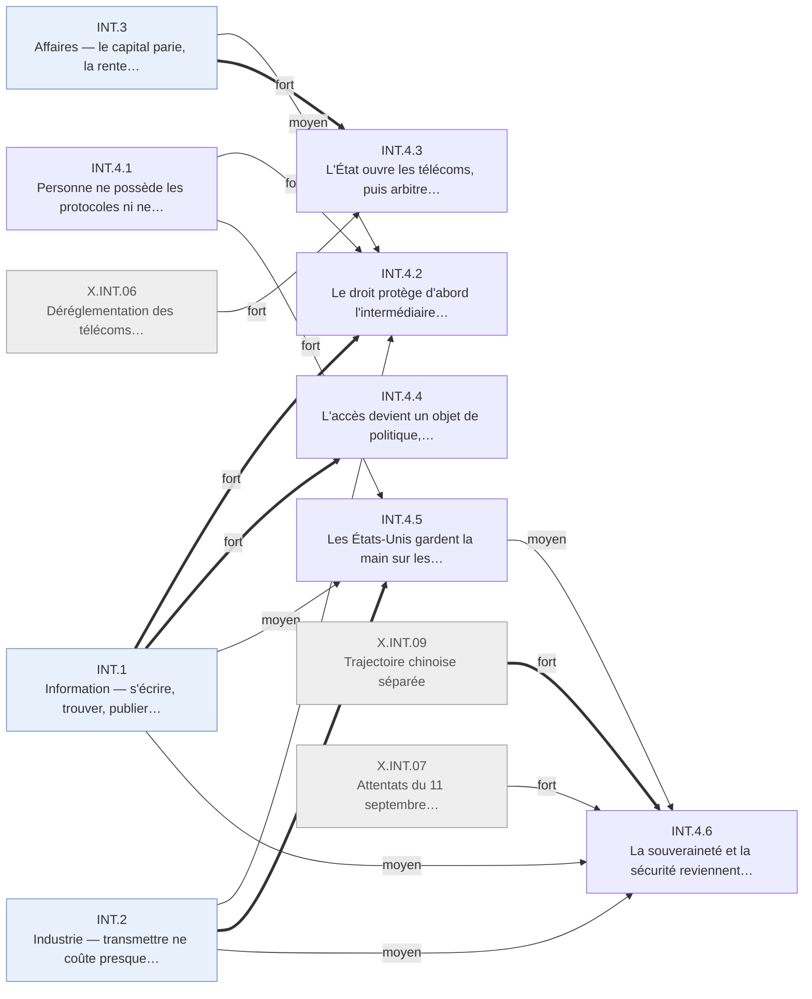

# Arbre des effets en quatre ordres — Internet · INT.4 Gouvernance

Branche de l'[arbre Internet en quatre ordres](README.md). Conventions :
[README.md § Comment lire](README.md#comment-lire).

## Table of Contents

1. [INT.4 · Gouvernance — une entrée libre, puis le droit rattrape les usages](#int4--gouvernance--une-entrée-libre-puis-le-droit-rattrape-les-usages) _(Lines 15-162)_

---

## INT.4 · Gouvernance — une entrée libre, puis le droit rattrape les usages
<!-- Lines 15-162 -->

Personne ne possède les protocoles ni ne filtre l'entrée ; le droit protège d'abord l'intermédiaire, puis rattrape les usages et le cycle ; les États-Unis gardent la main sur les ressources critiques, et les autres blocs répondent par la contestation, le cloisonnement ou la sécurité. Qui : législateurs, régulateurs, États · certitude : V

Causes : amont (Web placé dans le domaine public en 1993 ; gouvernance technique par consensus héritée du réseau de recherche) ; INT.1 (fort, boucle) ; INT.3 (moyen, boucle) ; INT.2 (faible, boucle) ; X.INT.06 (moyen) ; X.INT.07 (moyen) ; X.INT.09 (moyen) ; X.INT.01 (faible) ; X.INT.03 (faible) ; X.INT.08 (faible)

Les protocoles restent des standards ouverts fixés hors des États et sans péage : c'est le second
levier du choc (INT.4.1). Le législateur américain protège d'abord l'intermédiaire et choisit de
ne pas taxer ; le droit d'auteur se durcit avant même le partage de masse, puis le tranche pour
les ayants droit ; données, mineurs et courrier non sollicité reçoivent des règles, d'un bloc en
Europe, au cas par cas aux États-Unis (INT.4.2). L'État ouvre les télécoms, puis arbitre après
coup la concurrence, la finance et le travail qualifié (INT.4.3). L'accès devient un objet de
politique, dans chaque pays et entre pays (INT.4.4). Les États-Unis gardent la tutelle des noms et
la centralité des câbles ; les sommets mondiaux la contestent sans l'obtenir (INT.4.5). La Chine
cloisonne son réseau, et la sécurité revient après 2001 (INT.4.6). La plupart de ces règles
répondent à des usages déjà installés : la flèche principale va des usages vers le droit, avec un
retard de deux à six ans.

<!-- GENERE:INT.4:debut -->

<!-- GENERE:INT.4:fin -->

- **INT.4.1 · Personne ne possède les protocoles ni ne filtre l'entrée** — auteurs, entrepreneurs, tout nouvel entrant · K
  - Causes : amont (Web placé dans le domaine public en 1993 ; instances techniques par consensus héritées du réseau de recherche)
  - Second levier du choc. Transport, adressage et hypertexte restent des standards ouverts, sans ratification étatique ni brevet ; un consortium fixe les standards du Web par recommandations ouvertes.
  - Faits : F.INT.A2.005, F.INT.G2.004, F.INT.G2.007
- **INT.4.2 · Le droit protège d'abord l'intermédiaire et l'entrée libre, puis encadre les usages** — plateformes, hébergeurs, usagers, ayants droit · V
  - Causes : INT.1 (principale, fort) ; INT.4.1 (fort) ; INT.2.1 (moyen) ; INT.3.2 (moyen) ; X.INT.08 (faible) ; X.INT.01 (faible) ; X.INT.06 (faible)
  - Retard du droit sur l'usage : deux ans pour le partage de musique, six pour sa décision finale ; l'Europe transpose avec trois à cinq ans d'écart.
  - **INT.4.2.1 · Les hébergeurs sont exonérés de responsabilité pour les contenus de tiers** — hébergeurs, plateformes · V
    - Causes : INT.4.1 (principale, moyen) ; X.INT.06 (faible)
    - États-Unis 1996, par une clause de la loi sur les télécommunications ; Europe 2000 ; transposition française en préparation en 2003.
    - Faits : F.INT.G1.001, F.INT.G1.007, J.INT.2003.06
  - **INT.4.2.2 · Les États-Unis choisissent de ne pas réguler ni taxer le commerce en ligne ; l'Europe suit plus tard** — commerce en ligne · V
    - Causes : INT.4.1 (principale, moyen)
    - Doctrine d'autorégulation (1997), moratoire fiscal (1998), signature électronique valant papier (2000) ; directive européenne postérieure de plusieurs années.
    - Faits : F.INT.G1.002, F.INT.G1.005, F.INT.G1.010, F.INT.C3.006
  - **INT.4.2.3 · Le droit d'auteur s'adapte à la copie numérique avant le partage de masse** — ayants droit, hébergeurs · V
    - Causes : INT.2.1 (principale, fort) ; X.INT.08 (moyen)
    - Traités de 1996 ; loi américaine de 1998, protection des mesures techniques et régime de retrait pour les hébergeurs ; directive européenne de 2001.
    - Faits : J.INT.1996.04, F.INT.G1.003, F.INT.G1.008
  - **INT.4.2.4 · Le partage de masse est poursuivi jusqu'aux particuliers et tranché pour les ayants droit** — usagers du partage, maisons de disques · K
    - Causes : INT.1.5.1 (principale, fort) ; INT.3.2.3 (fort)
    - Service fermé après la décision d'appel (2001) : le partage se décentralise ; poursuites contre des particuliers (2003) ; décision de la Cour suprême sur les logiciels de partage (2005).
    - Faits : F.INT.F1.004, J.INT.2001.02, J.INT.2003.02, J.INT.2005.02
  - **INT.4.2.5 · Données, mineurs et courrier non sollicité reçoivent des règles, d'un bloc en Europe, au cas par cas aux États-Unis** — usagers, exploitants de services · V
    - Causes : INT.1.1 (principale, fort) ; INT.1.2 (moyen) ; X.INT.01 (faible)
    - Directive européenne sur les données (1995), accord de sphère de sécurité pour les transferts (2000) ; consentement parental avant 13 ans (1998) ; loi contre le courrier commercial non sollicité (2003) ; 84 % des internautes préoccupés par leurs données (2000) ; débat continu sur les mineurs.
    - Faits : F.INT.G1.006, F.INT.G1.009, F.INT.G1.004, F.INT.G1.012, F.INT.F3.005, F.INT.F3.009
  - **INT.4.2.6 · Des auteurs et des chercheurs fixent eux-mêmes leurs règles de partage** — créateurs, chercheurs · V
    - Causes : INT.4.2.3 (principale, fort) ; INT.1.4.2 (moyen)
    - Licences de partage volontaire (2002) ; déclarations pour l'accès libre à la recherche (2002, 2003) : prises de position datées, pas encore une pratique mesurée.
    - Faits : F.INT.F1.005, F.INT.F2.004, F.INT.F2.005
- **INT.4.3 · L'État ouvre les télécoms, puis arbitre après coup concurrence, finance et travail qualifié** — opérateurs, marchés, régulateurs · V
  - Causes : INT.3.1 (principale, fort) ; X.INT.06 (fort) ; INT.3.4 (moyen) ; INT.2.4 (faible)
  - **INT.4.3.1 · Les États ouvrent les télécoms à la concurrence et vendent leurs opérateurs** — opérateurs historiques et nouveaux entrants · K
    - Causes : X.INT.06 (principale, fort)
    - Loi américaine de 1996 ; privatisations allemande (1996, ~10 milliards d'euros) et française (1997-1998, part de l'État de 100 % à 62 %) ; paquet télécoms européen de 2002.
    - Faits : J.INT.1996.01, F.INT.G4.008, F.INT.B5.008, F.INT.B5.009, J.INT.2002.06
  - **INT.4.3.2 · Le procès antitrust sur le navigateur échoue à changer la structure du marché** — éditeur dominant · K
    - Causes : INT.3.4.1 (principale, fort)
    - Action engagée en 1998, démantèlement ordonné en 2000, réformé en appel.
    - Faits : F.INT.C5.002, F.INT.C5.003
  - **INT.4.3.3 · Les règles des marchés financiers répondent au cycle** — sociétés cotées, banques d'affaires · V
    - Causes : INT.3.1 (principale, fort)
    - Diffusion équitable de l'information (2000), réforme de la gouvernance comptable (2002), règlement de 1,4 milliard de dollars sur les conflits d'intérêts des analystes (2003).
    - Faits : F.INT.B5.005, F.INT.B5.006, F.INT.B5.007
  - **INT.4.3.4 · La séparation bancaire est abrogée en 1999, hors du choc** — banques · K
    - Causes : amont (mouvement de déréglementation financière, antérieur et absent du registre)
    - Le dossier attribue le fait au choc et le jalon au contexte : l'arbre suit le jalon.
    - Faits : F.INT.B5.004, J.INT.1999.02
  - **INT.4.3.5 · Le plafond de visas qualifiés est relevé deux fois, puis revient à la base avec le retournement** — informaticiens étrangers, employeurs · V
    - Causes : INT.2.4.2 (principale, fort)
    - 65 000 à 115 000 (1998), 195 000 (2000), retour à 65 000 en 2004.
    - Faits : F.INT.D2.004, F.INT.D2.005
- **INT.4.4 · L'accès devient un objet de politique, dans chaque pays et entre pays** — États, organisations internationales · V
  - Causes : INT.1.1 (principale, fort)
  - **INT.4.4.1 · La fracture numérique devient une catégorie de politique publique américaine dès 1996** — programmes d'accès universel · V
    - Causes : INT.1.1.2 (principale, fort)
    - Faits : F.INT.F3.002, F.INT.G3.004
  - **INT.4.4.2 · Le G8 s'engage pour un accès universel et abordable (2000)** — pays en développement · V
    - Causes : INT.1.1.3 (principale, fort)
    - Faits : F.INT.G6.002
  - **INT.4.4.3 · La Corée fait du haut débit un plan national (1999)** — Corée du Sud · K
    - Causes : amont (choix de politique publique coréen, dont le dossier ne documente pas la cause)
    - Faits : F.INT.G3.002, J.INT.1999.04
- **INT.4.5 · Les États-Unis gardent la main sur les ressources critiques ; les autres la contestent sans l'obtenir** — États · V
  - Causes : INT.2.1 (principale, fort) ; INT.4.1 (fort) ; INT.1.1 (moyen) ; X.INT.03 (faible) ; amont (réseau né aux États-Unis)
  - **INT.4.5.1 · Noms et adresses sont confiés à une entité privée sous tutelle américaine (1998)** — gestionnaires de noms, autres États · V
    - Causes : INT.2.1.1 (principale, fort) ; INT.4.1 (fort)
    - Politique de 1998, société californienne sans but lucratif, supervision contractuelle du département du Commerce : dépendance des autres blocs pour la décennie.
    - Faits : F.INT.G2.001, F.INT.G2.002, F.INT.G2.003, F.INT.G4.001
  - **INT.4.5.2 · Serveurs racine et capacité interrégionale restent centrés sur les États-Unis ; les câbles sont partagés** — infrastructure mondiale · V
    - Causes : amont (réseau né aux États-Unis) ; X.INT.03 (faible)
    - 10 serveurs racine sur 13 américains (1997) ; 98 % de la capacité interrégionale reliée aux États-Unis (2003, chiffre de cabinet) ; câble transatlantique de 2001 détenu par onze opérateurs.
    - Faits : F.INT.G5.002, F.INT.G5.003, F.INT.G5.004
  - **INT.4.5.3 · Les sommets mondiaux contestent la tutelle et n'obtiennent qu'un forum sans pouvoir** — pays en développement, États non occidentaux · K
    - Causes : INT.4.5.1 (principale, fort) ; INT.1.1.3 (moyen)
    - Genève 2003, gestion « multilatérale » demandée ; Tunis 2005, désaccord acté et forum de discussion.
    - Faits : F.INT.G2.005, F.INT.G2.006, F.INT.G4.005, F.INT.G6.003
- **INT.4.6 · La souveraineté et la sécurité reviennent : la Chine cloisonne, la sécurité prime après 2001** — États · K
  - Causes : X.INT.09 (principale, fort) ; X.INT.07 (fort) ; INT.4.5 (moyen) ; INT.1.1 (moyen) ; INT.2.1 (moyen)
  - **INT.4.6.1 · La Chine construit un réseau national filtré et ses propres champions** — Chine · K
    - Causes : X.INT.09 (principale, fort)
    - Dispositif de filtrage engagé en 1998 ; champions nationaux cotés à l'étranger en 2004, protégés à l'intérieur ; écosystème tourné vers le marché intérieur.
    - Faits : F.INT.G4.002, J.INT.1998.06, F.INT.G4.007, F.INT.F4.005, F.INT.C3.007
  - **INT.4.6.2 · Après le 11 septembre, les États élargissent l'accès aux communications et coopèrent contre la cybercriminalité** — autorités, usagers · K
    - Causes : X.INT.07 (principale, fort) ; INT.1.1 (moyen)
    - Loi américaine d'octobre 2001 ; convention de 2001 sur la cybercriminalité ; le discours public passe de la liberté à la sécurité.
    - Faits : F.INT.G4.003, F.INT.G4.004, F.INT.F3.007
  - **INT.4.6.3 · La cryptographie sort du contrôle de guerre froide et s'exporte** — éditeurs, usagers · V
    - Causes : amont (fin du régime de contrôle des exportations de la guerre froide) ; INT.2.1 (moyen)
    - Arrangement multilatéral de 1995-1996 couvrant la cryptographie ; export autorisé vers les utilisateurs non gouvernementaux en 2000.
    - Faits : F.INT.G4.009, F.INT.G4.012
  - **INT.4.6.4 · D'autres puissances font de leur dépendance informationnelle une question de sécurité** — Russie, Union européenne · V
    - Causes : INT.4.5.2 (principale, moyen) ; INT.1.1.3 (faible)
    - Doctrine russe de 2000 contre la dépendance aux médias étrangers ; le Parlement européen constate en 2001 un système d'interception anglophone.
    - Faits : F.INT.G4.010, F.INT.G4.011
