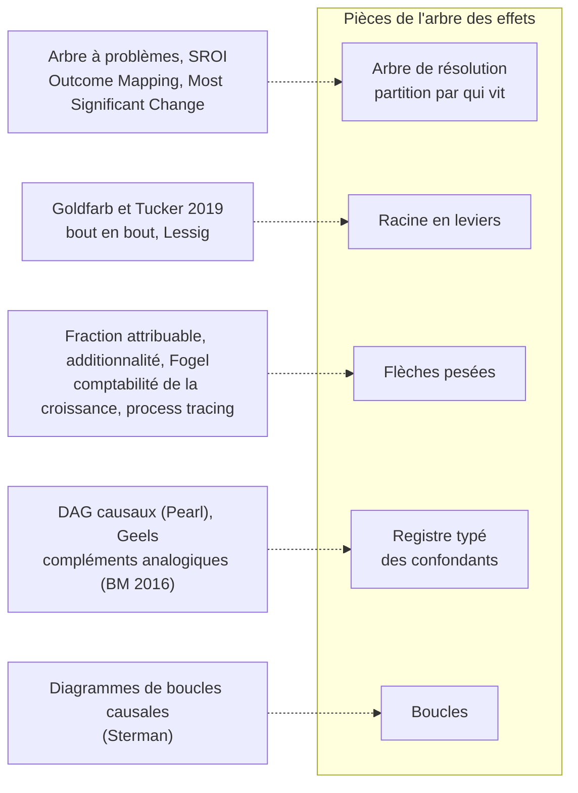

# État de l'art — démarches proches de l'arbre des effets

Statut : deuxième passe, corrigée après relecture par un modèle distinct. Recherche documentaire
menée par trois sous-agents (méthodes, Internet, cloud), synthétisée ici. Ne modifie rien dans
le dossier : ce sont des pistes à instruire, pas des faits intégrés.

## Table of Contents

1. [Verdict](#verdict)
1. [Carte de positionnement](#carte-de-positionnement)
1. [Ce qui touche directement le dossier](#ce-qui-touche-directement-le-dossier)
1. [Ce qu'il vaudrait la peine d'emprunter](#ce-qu-il-vaudrait-la-peine-d-emprunter)
1. [Lire d'abord](#lire-d-abord)
1. [Statuts et limites de cette recherche](#statuts-et-limites-de-cette-recherche)
1. [Fichiers](#fichiers)

---

## Verdict
<!-- Lines 21-43 -->

- **Aucun arbre des effets trouvé pour ces deux chocs**, en anglais ni en français. Le plus
  proche en forme est l'« arbre à problèmes » du cadre logique (causes en bas, effets en haut),
  outil de planification sans poids ni preuve. En français existent des synthèses d'époque
  (Conseil d'analyse économique, rapport Lorentz), pas d'arbre.
- **Aucun précédent ne combine les trois pièces de l'arbre** : résolution partitionnée par qui
  vit le changement, flèches causales pesées, rattachement de chaque chaîne à la racine ou à un
  confondant typé. Chaque pièce a des ancêtres, séparés.
- **Internet 1995-2005 : littérature riche mais éclatée.** Synthèses multi-domaines d'époque
  (Litan et Rivlin 2001, DiMaggio et al. 2001, OCDE 1999, Castells 1996-1998), comptabilité de la
  croissance, et études quasi expérimentales qui prennent le déploiement du réseau comme
  traitement ; aucune ne structure les effets en arbre ni ne pèse les causes entre domaines.
- **Cloud 2005-2015 : pas d'évaluation multi-domaines rigoureuse.** L'OCDE (rédigé en 2012,
  publié en 2014) constate le manque de données. Existent des études causales isolées
  (capital-risque, survie des jeunes usines, énergie, prix) et des projections d'analystes de
  quatre à vingt fois les estimations académiques.
- **Deux choix sont rares appliqués à un choc technologique, pas sans précédent** : la partition
  par qui vit le changement, et le poids défini par ce qui disparaît sans la cause. Leurs
  équivalents existent en évaluation de programmes (SROI, additionnalité, Outcome Mapping) et en
  histoire contrefactuelle (Fogel 1964).

---

## Carte de positionnement
<!-- Lines 46-76 -->

Chaque pièce de la démarche, ses ancêtres les plus proches, et ce qu'ils apportent. Détail et
références : [methodes.md](methodes.md).

| Pièce | Ancêtres | Ce qu'ils apportent, ou font autrement |
| --- | --- | --- |
| Arbre de résolution | Arbre à problèmes (GTZ ZOPP) ; SROI ; Outcome Mapping ; Most Significant Change (K) | L'arbre à problèmes partitionne par mécanisme. Le SROI liste les effets par partie prenante ; Most Significant Change part d'« un changement qui compte pour quelqu'un », proche de la définition du dossier. Aucun n'emboîte les niveaux. |
| Racine en leviers | Goldfarb et Tucker 2019 : baisse des coûts de recherche, réplication, transport, suivi, vérification | Coûts issus de la numérisation, pas du réseau ; un niveau sous la racine. Le levier « sans gardien » n'est pas un coût : ancêtres, le principe de bout en bout, Lessig 1999, Zittrain (K). |
| Flèches pesées | Fraction attribuable ; « deadweight » et « attribution » du SROI ; additionnalité du Green Book ; épargne sociale de Fogel ; comptabilité de la croissance ; process tracing | Le poids du dossier est une fraction attribuable : les poids d'un même effet peuvent dépasser 100 % au total, en cas d'interaction. Shapley en est la version additive. Les tests du process tracing bornent le jugement. |
| Registre des confondants | DAG causaux ; niche, régime, paysage (Geels) ; compléments analogiques (Banque mondiale 2016) | Le registre est déjà typé (Prérequis, Co-choc, Exogène, Réponse endogène, Produit dérivé) ; la littérature en donne le vocabulaire et deux distinctions utiles, voir plus bas. |
| Boucles | Diagrammes de boucles causales (Sterman 2000) | Polarité (renforçante ou équilibrante) et délai sur chaque lien. |
| Hors arbre : phases (règle R4) | Perez 2002 et 2009 ; David 1990 ; Comin et Hobijn 2010 | Phases datées de la vague des TIC ; retard d'adoption contre intensité d'usage. |

---

## Ce qui touche directement le dossier
<!-- Lines 79-134 -->

Aucun point n'est intégré ; chacun est à instruire selon les règles du dossier.

**À instruire en priorité**

1. **Productivité, résultat acquis n° 1 : contesté dans son interprétation, pas dans ses
   moyennes.** Fernald (2015) : « U.S. labor and total-factor productivity growth slowed prior to
   the Great Recession ». Test de rupture significatif : 2003:T4 pour la productivité du travail,
   2005:T1 pour la PGF corrigée de l'utilisation ; Fernald compare lui-même 2000-2004 et 2004-2007
   (texte relu deux fois). Les moyennes du dossier restent justes ; la phrase « pas au milieu des
   années 2000 » est contredite. Cette, Fernald et Mojon (2016) l'étendent aux économies
   avancées. La courbe en J n'est pas un contrepoids : la correction pour l'immatériel accentue
   légèrement le ralentissement d'après 2004 (écart de PGF de 11,3 % fin 2004, 15,9 % fin 2017).
2. **Perez situe la décennie du cloud dans le tournant, pas après.** En 2002, le krach de
   2000-2001 ouvre le tournant de la vague des TIC ; en 2009, Perez fait des deux bulles
   (Internet, puis liquidités 2003-2007) les deux temps d'un même tournant, achevé après 2008.
   Lecture à confronter aux phases de la fenêtre cloud.
3. **Délocalisation vers l'Inde (constat 3 de l'arbre) : contestée en partie.** Baldwin (2016)
   fait de la baisse des coûts de coordination par les TIC la cause du « second dégroupage »,
   services compris (K). Le registre le note déjà en partie (X.INT.03, « partiellement
   endogène ») ; l'arbre place pourtant la cause principale hors du choc. Candidat au statut `D`.
4. **Réseaux antérieurs au Web (question ouverte 1 du registre) : appuyés.** Campbell-Kelly et
   Garcia-Swartz (2013) : l'ARPANET n'est qu'un réseau parmi d'autres, et ils posent la question
   de ce qui se serait passé sans lui. Appui pour X.INT.11 comme pour X.INT.12 ; l'EDI n'est pas cité dans le
   résumé (texte intégral non lu).
5. **EDI (constat 4) : poids confirmé, canal non établi.** Census E-Stats 2005 (V) : EDI 83,5 %
   du commerce électronique des grossistes hors succursales de fabricants ; commerce
   interentreprises 92,1 % du total. Mais le Census compte ensemble l'EDI par réseaux à valeur
   ajoutée et par Internet : la part des réseaux antérieurs reste à établir. Détail en ligne :
   2,5 % en 2005 dans les E-Stats de 2007 contre 2,3 % dans le communiqué de 2006 cité par
   F.INT.C4.005 ; révision, sans effet sur le constat.

**Confirmations et appuis**

6. **Addition avant substitution (constat 5) : confirmé, une exception.** DiMaggio et al. (2001,
   V) : Internet « tends to complement rather than displace existing media and patterns of
   behavior ». Kolko (2012) : pas d'effet du haut débit sur le télétravail (K). Exception : la
   presse imprimée (Gentzkow 2007, K) ; les petites annonces, rente d'accès détruite (Seamans et
   Zhu 2014, K).
7. **Énergie (résultat acquis n° 2) : moitié confirmée.** Le découplage l'est : Koomey (2011) et
   Shehabi et al. (2016), déjà dans le dossier ; Masanet et al. (2020) le prolongent, instances de
   calcul multipliées par 6,5 et énergie +6 % sur 2010-2018 (K). Rien sur l'énergie bon marché
   comme condition du gain de productivité.
8. **Loi de puissance (constat 6) : les travaux cités portent sur les liens, pas sur le trafic.**
   Barabási et Albert (*Science* 286, 1999) ; Huberman et Adamic (*Nature* 401, 1999) ; mécanisme
   de l'attachement préférentiel contesté par Adamic et Huberman (commentaire technique,
   *Science* 287, 2000). Pour le trafic : Adamic et Huberman 2000, visites AOL de 1997 (K, à
   ouvrir).

**Vide**

9. **Emploi du traitement de données (résultat acquis n° 3) : ni confirmé ni contesté.** Aucune
   étude trouvée ; la série BLS n'a pas été relue.

---

## Ce qu'il vaudrait la peine d'emprunter
<!-- Lines 137-170 -->

Par ordre d'effet attendu sur l'arbre, sans rien décider.

1. **Rapprocher les types du registre du vocabulaire de la littérature.** Prérequis ≈
   complément analogique ou cause commune au sens de Pearl ; Co-choc ≈ cause concurrente ;
   Exogène à scinder en contexte lent et choc ponctuel. Pour X.INT.04 (cycle macroéconomique),
   séparer la part monétaire, exogène, de la part spéculative, endogène au sens de Perez : une
   flèche INT.1 → cycle, médiateur et non confondant. Sans quoi INT.2 compte deux fois le choc.
2. **Dire ce que somme un jeu de poids.** Le poids retire une cause et mesure ce qui disparaît :
   deux causes `fort` sur une même boîte (INT.1 et X.INT.04 sur INT.2) sont cohérentes, pas
   contradictoires. L'écrire dans la méthode évite qu'un lecteur y lise des parts additives.
3. **Borner les poids `fort` par un test.** Au minimum, un test hoop réussi (l'indice attendu est
   présent : chronologie, canal observable) ; pour le justifier, un test smoking gun ou une
   décomposition chiffrée (comptabilité de la croissance, additionnalité).
4. **Nommer les mécanismes de la racine avec Goldfarb et Tucker**, en gardant la racine à deux
   leviers. La baisse du coût de réplication relève surtout de la numérisation (X.INT.08), pas de
   la racine, ce que l'arbre dit déjà ; vérifier si la baisse du coût de vérification (réputation,
   notation) manque à l'arbre.
5. **Placer les études de déploiement comme feuilles à forte certitude**, en séparant celles de la
   fenêtre (Forman, Goldfarb et Greenstein 2012 ; Brown et Goolsbee 2002 ; Freund et Weinhold
   2004 ; Ewens, Nanda et Rhodes-Kropf 2018 ; Jin et McElheran) des exemples de méthode hors
   fenêtre (Akerman et al. 2015 ; Hjort et Poulsen 2019).
6. **Racine du cloud : deux leviers candidats.** « La capacité se loue à l'unité, sans
   engagement » (Armbrust et al. 2009) et « expérimenter ne coûte plus l'usine » (Varian 2010, K ;
   Ewens et al. 2018 : premiers tours de capital-risque environ 20 % plus petits dans les secteurs
   qui peuvent louer, nombre de premiers investissements presque doublé, dès 2006). Contre-thèse
   de l'essence « industrialisation » : Brynjolfsson, Hofmann et Jordan (2010).
7. **Le pont Internet-cloud a un nom : les fournisseurs d'applications hébergées (1998-2002)**,
   première tentative de l'informatique louée, emportée par le krach. Seuls des récits
   l'éclairent (Campbell-Kelly 2009).
8. **Notation des boucles** : polarité et délai, à la manière de Sterman.

---

## Lire d'abord
<!-- Lines 173-185 -->

| # | Référence | Pourquoi |
| --- | --- | --- |
| 1 | Fernald 2015, NBER Macro Annual (w20248) | Conteste l'interprétation du résultat acquis n° 1. |
| 2 | Goldfarb et Tucker 2019, « Digital Economics », JEL 57(1) | Peut-être la décomposition en cinq leviers abandonnée ; à relire comme niveau inférieur de la racine. |
| 3 | Perez 2002, et Perez 2009, « The double bubble at the turn of the century », CJE 33(4) | Phases datées de la vague des TIC ; statut du krach ; place de la décennie cloud. |
| 4 | Ewens, Nanda et Rhodes-Kropf 2018, JFE ; Jin et McElheran, Management Science | Les deux meilleures identifications causales du choc cloud. |
| 5 | Campbell-Kelly et Garcia-Swartz 2013, JIT 28(1) | Réseaux antérieurs au Web, confondants X.INT.11 et X.INT.12. |
| 6 | SROI Network 2012, *A Guide to Social Return on Investment* | Précédent le plus proche pour la partition par partie prenante et le poids par ce qui disparaît. |
| 7 | OCDE 2014, Digital Economy Papers n° 240 | Seule évaluation multi-domaines du cloud ; utile surtout par son constat de lacune. |

---

## Statuts et limites de cette recherche
<!-- Lines 188-204 -->

- **Statuts**, au sens du dossier : `V` = source ouverte et affirmation lue pendant cette
  recherche ; `K` = résumé secondaire ou connaissance.
- **Relus au texte intégral par le relecteur** : Fernald 2015, Ewens et al. 2018, Jin et
  McElheran (version 2018), Cette, Fernald et Mojon (version 2015), Byrne, Corrado et Sichel 2018,
  OCDE 2014, Census E-Stats 2005 ; résumés de Goldfarb et Tucker, DiMaggio et al., Brynjolfsson,
  Rock et Syverson. Les autres `V` reposent sur la lecture d'un sous-agent : les relire avant
  tout passage dans `par_dimension/`.
- **Restés `K`**, faute d'accès : Perez (livre), Baldwin, Masanet, DeStefano et al., les
  précédents d'évaluation (SROI, Outcome Mapping, Fogel) et les synthèses françaises.
- **Non vérifiés ou non trouvés** : base « Imagining the Internet » (Elon et Pew), Coyle et
  Nguyen, Haskel et Westlake, Crouzet et Eberly, Srnicek, étude sous-jacente à Bloom et Pierri.
- **Chiffres d'analystes et de fournisseurs** (IDC, Microsoft, fournisseurs d'applications
  hébergées) : artefacts au sens de R2, jamais `V`.

---

## Fichiers
<!-- Lines 207-212 -->

| fichier | contenu |
| --- | --- |
| [methodes.md](methodes.md) | Cadres de méthode : technologies génériques, vagues longues, transitions, décomposition par les coûts, évaluation de programmes, arbres de planification, attribution causale, diffusion. |
| [internet.md](internet.md) | Internet 1995-2005 : synthèses, séries officielles, productivité, études de déploiement, historiens, travaux en français. |
| [cloud.md](cloud.md) | Cloud 2005-2015 : cadrage, évaluations, études causales, mesure, structure de marché, énergie, pont avec Internet. |
