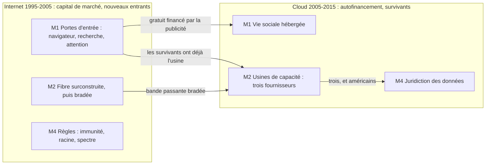

# Accaparement — les ruées sur un territoire neuf, Internet et cloud

Statut : première lecture transversale, 2026-09-23, décision D19. Lecture d'agent sur les faits
existants : aucun fait nouveau n'est créé ici, chaque ligne cite des identifiants de
`par_dimension/`. Les mécanismes et les lectures sont des **inférences** ; seuls les faits cités
portent un statut `V`, `K` ou `D`.

## Table of Contents

1. [Question et définition](#question-et-d-finition) _(Lines 27-46)_
1. [Vue d'ensemble](#vue-d-ensemble) _(Lines 49-83)_
1. [Les cinq mécanismes](#les-cinq-m-canismes) _(Lines 86-86)_
   1. [M1. La porte d'entrée](#m1-la-porte-d-entr-e) _(Lines 89-102)_
   1. [M2. L'infrastructure physique](#m2-l-infrastructure-physique) _(Lines 105-116)_
   1. [M3. La relation client déplacée](#m3-la-relation-client-d-plac-e) _(Lines 119-131)_
   1. [M4. Les règles et la juridiction](#m4-les-r-gles-et-la-juridiction) _(Lines 134-151)_
   1. [M5. Le capital qui court après le territoire](#m5-le-capital-qui-court-apr-s-le-territoire) _(Lines 154-165)_
1. [Échecs, reprises et contre-mouvements](#checs-reprises-et-contre-mouvements) _(Lines 168-191)_
1. [Lectures transversales](#lectures-transversales) _(Lines 194-218)_
1. [Certitude et lacunes](#certitude-et-lacunes) _(Lines 221-241)_
1. [Questions ouvertes](#questions-ouvertes) _(Lines 244-251)_

---

## Question et définition
<!-- Lines 27-46 -->

**Question :** quels grands mécanismes d'accaparement observe-t-on pendant chacun des deux
chocs, quel était le territoire, qui l'a pris, et selon quelle temporalité ?

**Accaparement** (*land grab*) : un acteur se précipite pour occuper une position nouvellement
ouverte avant que les règles, les prix ou les concurrents ne se fixent, puis la tient. Chaque
épisode se lit par quatre questions :

| question | contenu |
| --- | --- |
| terrain | ce qui s'ouvre et devient appropriable : attention, passage obligé, capacité, relation client, règle, juridiction |
| accapareur | qui le prend : firme, type de firme, État, bloc |
| mécanisme | comment : intégration par défaut, effet de réseau, surconstruction, échelle, loi, enchère, acquisition |
| temporalité | ouverture → ruée → clôture, et détenteur en fin de fenêtre |

La **clôture** est ce qui met fin à la ruée : effet de réseau installé, barrière d'échelle,
krach, loi, décision de justice. Un accaparement raté compte autant qu'un accaparement réussi.

---

## Vue d'ensemble
<!-- Lines 49-83 -->

Les cinq mécanismes se retrouvent dans les deux chocs. Ce qui change entre les deux, c'est qui
accapare, avec quel argent, et ce qui clôt la ruée :

- **Internet** : des nouveaux entrants accaparent avec l'argent des marchés de capitaux ; le krach
  de 2000-2002 élimine la plupart d'entre eux ; gagnent ceux qui tiennent la couche restée rare,
  l'attention.
- **Cloud** : les survivants d'Internet accaparent sur leurs propres revenus ; le premier entrant
  gagne ; pas de krach, l'échelle clôt le terrain vers 2014, puis le droit le rouvre en partie
  par la juridiction des données (2013-2015).

Les flèches reprennent des liens de l'[arbre des effets du cloud](../../arbre_des_effets/cloud.md)
(CH.INT.45 → CH.CLD.00 et CH.CLD.30 ; CH.INT.41 → CH.CLD.00 ; CH.INT.33 → CH.CLD.21 ;
CH.CLD.30 → CH.CLD.50), tous de certitude `i`.

---

## Les cinq mécanismes
<!-- Lines 86-86 -->

### M1. La porte d'entrée
<!-- Lines 89-102 -->

Terrain : le passage obligé entre l'usager et le réseau. Côté demande : quand trouver ne coûte
rien, tout le monde va au même endroit.

| choc | terrain | accapareurs | ouverture → ruée → clôture | détenteur en fin de fenêtre | faits |
| --- | --- | --- | --- | --- | --- |
| INT | navigateur | le navigateur pionnier, puis l'éditeur du système d'exploitation dominant, par intégration | 1994 → 1995-1997 → antitrust 1998-2000, démantèlement non exécuté | l'éditeur intégré | F.INT.A2.001 V, F.INT.A2.002 V, F.INT.A2.003 K, F.INT.C5.001 K, F.INT.C5.002 K, F.INT.C5.003 K |
| INT | recherche | un moteur fondé en 1998, classement par liens puis publicité sur mots-clés | 1998 → 1998-2003 → position dominante en 2003-2005 | ce moteur | F.INT.C4.006 K, F.INT.C4.007 K, F.INT.C5.004 K |
| INT | attention | quelques entités de tête | loi de puissance dès 1997 ; de onze à quatre entités pour la moitié du temps en ligne (1999-2001) | concentration installée, avec une traîne épaisse | F.INT.F5.001 V, F.INT.F5.005 K |
| CLD | vie sociale hébergée | réseaux sociaux et services de partage, petites équipes sur capacité louée | 2005 → 2005-2012 → entrée en bourse en 2012 | un très petit nombre de plateformes | F.CLD.A4.001 K, F.CLD.A4.002 K, F.CLD.F4.003 V, F.CLD.C5.006 K |

La clôture passe par l'effet de réseau, pas par le droit : l'action antitrust de 1998-2000 ne
modifie pas la structure du marché (F.INT.C5.003).

### M2. L'infrastructure physique
<!-- Lines 105-116 -->

Terrain : la capacité matérielle du réseau puis du calcul, et ses sites.

| choc | terrain | accapareurs | ouverture → ruée → clôture | détenteur en fin de fenêtre | faits |
| --- | --- | --- | --- | --- | --- |
| INT | fibre longue distance | opérateurs historiques et nouveaux entrants, par la dette autant que par les actions | 1996 → 1998-2000 → faillites de 2001-2002 | les survivants et les acheteurs de capacité bradée | F.INT.A1.001 V, F.INT.B1.013 K, F.INT.A1.009 K, F.INT.B1.010 K, F.INT.A3.004 K, F.INT.A3.005 K |
| CLD | capacité de calcul louée | un grand détaillant en ligne, puis deux autres fournisseurs américains | 2006 → 2006-2013, dépenses d'équipement du premier ×20 → oligopole à trois vers 2014 | trois fournisseurs qui coordonnent leurs baisses de prix | F.CLD.A1.003 V, F.CLD.A1.004 V, F.CLD.B1.001 V, F.CLD.C5.001 K, F.CLD.C5.002 K |
| CLD | sites et électricité | exploitants d'usines | 2006-2008 près des barrages ; premier contrat direct d'électricité éolienne en 2010 | les exploitants de grande taille | F.CLD.H2.001 K, F.CLD.H2.003 K |

Même terrain, issue inverse : la fibre ruine ceux qui l'ont posée et profite à ceux qui viennent
après ; l'usine de calcul reste à ceux qui l'ont construite.

### M3. La relation client déplacée
<!-- Lines 119-131 -->

Terrain : le client d'un intermédiaire établi, capté par un nouveau canal.

| choc | terrain | accapareurs | ouverture → ruée → clôture | détenteur en fin de fenêtre | faits |
| --- | --- | --- | --- | --- | --- |
| INT | commerce de détail par catégorie | une librairie en ligne et un site d'enchères, ouverts en 1995 | 1995 → 1995-2000 → consolidation après le krach | les deux premiers entrants | F.INT.C4.002 K |
| INT | commerce entre entreprises | places de marché ouvertes à fort soutien industriel | 2000 → 2000 → restructurées ou vendues en 2000-2003 | les réseaux d'échange antérieurs au Web | F.INT.A6.010 K |
| CLD | budget informatique des entreprises | les fournisseurs de capacité louée, contre les constructeurs historiques | 2008, la crise sert d'argument → 2008-2013 → scission d'un constructeur historique en 2015 | les fournisseurs de capacité | F.CLD.A4.004 K, F.CLD.B3.004 V, F.CLD.B3.006 V |
| CLD | les personnes sans compte bancaire (Afrique de l'Est) | un opérateur mobile, par une plateforme centralisée | 2007 → 2007-2010 → 9 millions d'usagers en janvier 2010 | l'opérateur | F.CLD.A5.004 V |

Là où un réseau d'intermédiation existait déjà (l'échange de données entre entreprises), le
terrain n'était pas libre et la ruée échoue (F.INT.A6.010).

### M4. Les règles et la juridiction
<!-- Lines 134-151 -->

Terrain : le droit applicable, les ressources critiques, le marché national. L'État y est
propriétaire foncier : il ouvre le terrain, le vend, le ferme ou le reprend.

| choc | terrain | accapareurs | ouverture → ruée → clôture | détenteur en fin de fenêtre | faits |
| --- | --- | --- | --- | --- | --- |
| INT | responsabilité et fiscalité du réseau | le législateur américain, au profit des plateformes | immunité des hébergeurs 1996, autorégulation 1997, moratoire fiscal 1998 | les plateformes américaines, terrain ouvert | F.INT.G1.001 V, F.INT.G1.002 V, F.INT.G1.005 V |
| INT | noms, adresses, serveurs racine | l'État américain | société californienne sous contrat du département du Commerce en 1998 → contestée aux sommets de 2003 et 2005 sans résultat | tutelle américaine maintenue | F.INT.G5.001 V, F.INT.G2.001 V, F.INT.G2.002 V, F.INT.G2.005 K, F.INT.G2.006 K |
| INT | spectre de troisième génération | les États européens vendeurs | enchères de 2000-2001, plus de 100 Md$ | les États encaissent ; les opérateurs gardent la dette | F.INT.B1.009 K, F.INT.B5.010 K, F.INT.B1.010 K |
| INT | marché national chinois | l'État chinois | filtrage à partir de 1998 → écosystème tourné vers l'intérieur | champions nationaux | F.INT.G4.002 K, F.INT.C3.007 K |
| CLD | achats publics fédéraux | l'administration américaine, puis un fournisseur | priorité au cloud 2011, homologation unique 2011, contrat de renseignement 2013 | les fournisseurs homologués | F.CLD.G3.002 V, F.CLD.G1.003 V, F.CLD.G3.009 K |
| CLD | marché national chinois | fournisseurs chinois, avec la séparation des marchés | 2007-2009 → filiale dédiée en 2009 | usines chinoises | F.CLD.A3.005 K, F.CLD.G4.002 K |
| CLD | juridiction des données personnelles | la Cour de justice de l'Union | révélations de 2013 → invalidation du cadre de transfert le 6 octobre 2015 | terrain rouvert ; les fournisseurs américains répondent par des régions européennes | F.CLD.G1.008 K, F.CLD.C3.005 V, F.CLD.G4.006 K |

Blocs : la Corée du Sud légifère en 2015 pour soutenir le secteur plutôt que pour se protéger
(F.CLD.G4.010 V). Le Japon, l'Inde et la Russie n'apparaissent pas comme accapareurs de règles
dans le dossier : absence notée, pas constatée.

### M5. Le capital qui court après le territoire
<!-- Lines 154-165 -->

Terrain : les titres des accapareurs eux-mêmes. Le capital accapare les accapareurs.

| choc | terrain | accapareurs | ouverture → ruée → clôture | détenteur en fin de fenêtre | faits |
| --- | --- | --- | --- | --- | --- |
| INT | jeunes sociétés du réseau | capital-risque et marchés d'introduction | ~8 Md$ (1995) → ~105 Md$/an (1999-2000) → ~22 Md$ (2002) | presque rien : 81 % des introductions de 2000 sont déficitaires | F.INT.B1.001 K, F.INT.B1.003 K, F.INT.B1.004 K, F.INT.B2.007 V |
| INT | un groupe de médias, payé en actions surévaluées | un fournisseur d'accès | annonce en 2000 → dépréciation d'environ 99 Md$ publiée en 2003 | opération défaite | F.INT.B3.004 D, F.INT.B3.005 K |
| INT | marchés de croissance européens | émetteurs et investisseurs européens | 1997 → 1997-2000 → plus de 95 % de valeur perdue, un tiers des sociétés sorties (2002) | presque rien | F.INT.B1.014 K, F.INT.B2.009 K, F.INT.B3.010 K |
| CLD | logiciel par abonnement coté | investisseurs | multiples de 3-5 fois à près de 20 fois le chiffre d'affaires (2013-2014) → retour vers 5 fois (août 2015) | correction, pas de terrain durable | F.CLD.B2.004 K, F.CLD.B2.006 K, F.CLD.B2.007 K |

---

## Échecs, reprises et contre-mouvements
<!-- Lines 168-191 -->

**Accaparements défaits.**
- La fibre surconstruite : F.INT.A1.009, F.INT.B1.010, F.INT.A3.004.
- La fusion du fournisseur d'accès et du groupe de médias : F.INT.B3.004, F.INT.B3.005.
- Les places de marché ouvertes entre entreprises : F.INT.A6.010.
- Les marchés de croissance européens : F.INT.B2.009, F.INT.B3.010.
- Le cloud souverain français, lancé sur fonds publics en 2009, scindé en deux coentreprises de
  75 M€ en 2012, dont l'une est reprise par son actionnaire télécoms en 2015 : F.CLD.G3.006,
  F.CLD.G3.007, F.CLD.G3.008.

**Terrain repris par l'ancien détenteur.** L'échange de musique entre particuliers retire aux
maisons de disques le contrôle de la distribution (1999), avant qu'un distributeur numérique
n'obtienne leur accord en 2003 : F.INT.A5.003, F.INT.F1.004.

**Entrée tardive d'un titulaire.** L'éditeur historique entre sur la capacité louée en 2008, deux
ans après le premier entrant : F.CLD.A3.002 V, F.CLD.C5.008 K.

**Contre-mouvement contre l'enfermement.** Un logiciel ouvert d'infrastructure (2010) puis un
format de conteneur portable entre fournisseurs (2013) visent à empêcher la capture de la pile
par les usines propriétaires : F.CLD.A2.004 V, F.CLD.A2.005 V. En fin de fenêtre, la capacité
reste aux trois fournisseurs (F.CLD.C5.001).

---

## Lectures transversales
<!-- Lines 194-218 -->

Inférences de l'agent, à trancher en phase 5.

1. **Le terrain passe de la demande à l'offre.** Internet concentre l'attention, le cloud
   concentre la capacité de production. Même lecture que l'arbre des effets, première lecture 2
   ([README de l'arbre](../../arbre_des_effets/README.md)).
2. **Qui paie décide de qui garde.** Pendant Internet, l'argent des marchés occupe le terrain
   trop tôt et le perd au krach (M2, M5). Pendant le cloud, l'autofinancement du premier entrant
   lui laisse l'avance (F.CLD.B1.001). Lien avec H3 : pas de forme en deux temps pour le cloud,
   donc pas de purge des premiers accapareurs.
3. **Le terrain gagné au choc N devient le capital du choc N+1.** Les survivants du Web ont déjà
   l'usine ; la fibre bradée rend l'usine lointaine proche (CH.INT.45 et CH.INT.41 vers
   CH.CLD.00 et CH.CLD.30). Deux fois par géographie : l'Europe sans survivant du Web, puis sans
   usine (CH.INT.36 → CH.CLD.32) ; la Chine derrière son mur dans les deux chocs (F.INT.G4.002,
   F.CLD.G4.002).
4. **Le gagnant n'est pas toujours le premier.** Pendant Internet, les détenteurs finaux arrivent
   tard sur leur terrain : le moteur de 1998 après les premiers moteurs et portails, l'éditeur
   intégré après le navigateur pionnier. Pendant le cloud, le premier entrant garde la tête ; le
   titulaire tardif devient l'un des trois, les entrants publics tardifs échouent.
5. **L'État agit en deux temps, à une quinzaine d'années d'écart.** Il ouvre ou vend d'abord le
   terrain (1996, 2000-2001), puis le reprend par la juridiction (2015). L'antitrust ne clôt aucun
   terrain dans les deux fenêtres.

---

## Certitude et lacunes
<!-- Lines 221-241 -->

**Certitude.** Les dates d'ouverture sont souvent `V` (F.CLD.A1.003, F.CLD.A3.002,
F.INT.G1.001, F.INT.G2.002). Les détenteurs finaux et la concentration sont surtout `K`
(F.INT.C5.004, F.INT.F5.005, F.CLD.C5.001, F.CLD.C5.002) : la vérification à la source de ces
faits est la première tâche si l'axe est retenu.

**Lacunes** : épisodes attendus sans fait dans le dossier, à collecter dans la sous-dimension
indiquée, pas ici.

| épisode absent | fenêtre | sous-dimension de rattachement probable |
| --- | --- | --- |
| guerre des portails et de la page d'accueil par défaut | INT | C5 |
| enchères américaines de spectre | INT | B5 |
| magasin d'applications comme porte d'entrée | CLD | C5 |
| câbles sous-marins détenus par les fournisseurs de capacité | CLD | G5 |
| brevets sur la virtualisation et le calcul loué | CLD | A2 |
| concurrence pour les ingénieurs | CLD | D2 |
| réglementation municipale des plateformes à la demande | CLD | G4 |

---

## Questions ouvertes
<!-- Lines 244-251 -->

1. **M3 et M5 sont-ils des accaparements, ou le contexte de M1 et M2 ?** M3 déplace un terrain
   déjà occupé plutôt qu'il n'en ouvre un neuf ; M5 est l'accaparement des accapareurs.
2. **Mesurer la clôture.** Une part de marché datée par terrain et par année donnerait la
   temporalité en trajectoire (règle R4), au lieu de trois dates.
3. **Intégration à l'arbre des effets.** Les cinq mécanismes recoupent des nœuds de l'arbre
   (CH.CLD.30, INT.4.4.2, INT.6.3) sans les nommer ; une étiquette « accaparement » sur ces
   nœuds suffirait peut-être, sans fichier propre.
