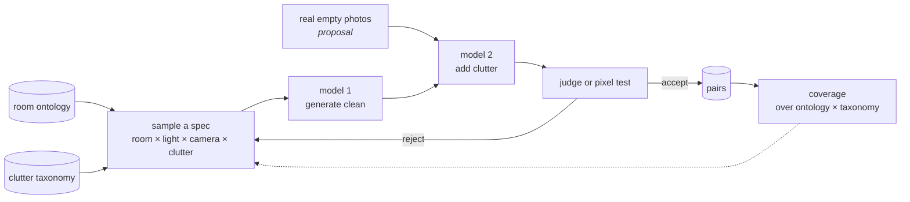

# Clutter pairs — architecture

Generate pairs of images of the same view, one **clean** (an empty or tidy room) and one **cluttered**
(the same room with furniture and belongings). The pairs are the training and test data of decluttering
tools such as [virtual_unstaging](../virtual_unstaging/README.md): the clean image is the ground truth of
what a decluttered photo should look like.

> **Status:** high-level design drafted in [design/README.md](design/README.md), awaiting the owner's agreement;
> code not started. The scope (only pairs are required), the two routes, the
> preference for the generation route, the room ontology, the clutter taxonomy and the three-model pipeline
> are the owner's; items marked *proposal* are the assistant's and not decided.

## Table of Contents

1. [Contract](#contract) _(Lines 31-46)_
1. [Two routes](#two-routes) _(Lines 49-57)_
1. [Generation route](#generation-route) _(Lines 60-60)_
   1. [Room ontology](#room-ontology) _(Lines 63-77)_
   1. [Clutter taxonomy](#clutter-taxonomy) _(Lines 80-94)_
   1. [Pipeline](#pipeline) _(Lines 97-121)_
   1. [Quality assessment](#quality-assessment) _(Lines 124-136)_
1. [Simulation route](#simulation-route) _(Lines 139-145)_
1. [Risks](#risks) _(Lines 148-158)_
1. [Prior work](#prior-work) _(Lines 161-181)_
1. [Open questions](#open-questions) _(Lines 184-190)_

---

## Contract
<!-- Lines 31-46 -->

The only thing truly required: **pairs of images, with and without clutter, of the same view.**

| Field | Required | Note |
|---|---|---|
| clean image | yes | the ground truth |
| cluttered image | yes | the input of a decluttering tool |
| clutter mask | *proposal*, derived | where the two differ; computed, not authored |
| room spec | *proposal*, free | the ontology entry the pair was sampled from (type, geometry, style, camera) |
| clutter spec | *proposal*, free | the taxonomy items placed, and where |
| building, room and scene ids | yes (owner) | a scene is one view of a room, a room belongs to a building; pairs that share a clean image share a scene. First version: one scene per room, one room per building; later, coherent views of one virtual room and coherent rooms of one virtual house |
| provenance and QA | yes (owner): full auditability | every model instruction a versioned file; every request stored as sent with its response, and recomposable from its recorded parts; quality verdicts |

Everything a consumer derives from a pair (segmentation, depth, judge training triplets, injected defects)
belongs to the consumer, not to this project.

## Two routes
<!-- Lines 49-57 -->

| Route | How | Realism | Pair consistency |
|---|---|---|---|
| **Simulation** | 3D models, 3D cameras, random clutter, render with and without | from good assets, or a generative beautification layer (adds risk) | exact by construction, until beautified |
| **Generation** (preferred) | a model makes the clean image, another adds clutter, a judge or a pixel test checks | the models' own | to be checked: the clutter model may change more than it adds |

Why generation first: image models will have a much easier time **adding** clutter than removing it. As
long as we have empty pictures, we can clutter them efficiently.

## Generation route
<!-- Lines 60-60 -->

### Room ontology
<!-- Lines 63-77 -->

A map of all possible rooms, textual and maybe with visual examples. Three axes from the owner; the
sub-items are *proposals*:

- **geometry:** plan shape and size, ceiling height and form (flat, sloped, beams), openings (doors,
  windows, passages) and where they sit, stairs, built-in elements;
- **room type:** living room, kitchen, bedroom, bathroom, corridor, garage, attic, workshop, cellar,
  outbuilding;
- **style:** period and region, materials (plaster, stone, timber, tiles, wood floor, concrete), finish and
  condition.

*Proposal* — two more axes the pairs need:
- **light:** time of day, artificial light, exposure;
- **camera:** height, lens, distance to the wall, angle; it covers close-ups on purpose.

### Clutter taxonomy
<!-- Lines 80-94 -->

A taxonomy of all clutter. *Proposal* for its axes:

- **category:** large furniture, small furniture, storage, textiles (rugs, curtains, bedding), objects and
  decoration, appliances, kitchen fittings, boxes, people and animals, vehicles, garden furniture;
- **placement:** standing against a wall, freestanding, on a surface, on a wall, **hanging on a door**,
  inside open storage;
- **density:** tidy, lived-in, cluttered, moving day;
- **attachment:** movable, or fixed to the building (what a given project keeps is that project's rule set;
  the taxonomy only records it).

Placement rules encode how people furnish: furniture stands against walls, not in front of doors; coats and
towels hang on doors. They make the pairs teach the right prior (behind furniture, a wall) and include its
exception (behind a coat, a door).

### Pipeline
<!-- Lines 97-121 -->

- **Inner loops with carry-forward** (owner): generator and judge iterate in two places, when generating the
  empty image and when cluttering it. The first images may need many iterations; what improves one image is passed
  to the next, so later images start with a better prompt and need fewer. Mechanics: [design](design/README.md).
- *Proposal:* **real empty photos** as a second source of clean images (moving-day photos, licensed listing
  photos), cluttered by the same model 2; closer to real cameras than generated clean images.
- Ruled out by the owner: grounding the clean images on clusters of real empty rooms from ZInD (licensed for
  academic use only, access by manual approval).
- *Proposal:* **coverage tracking**: count accepted pairs per cell of ontology × taxonomy, and sample the
  thin cells next.

### Quality assessment
<!-- Lines 124-136 -->

Model 3 is a judge, or a pixel-based test. *Proposal* for what each checks:

| Check | Test |
|---|---|
| clean image is empty and matches its spec | judge; an object detector finds no movable item |
| cluttered image changes **only** where clutter was added | pixel test: difference outside the clutter mask below a tolerance |
| clutter matches its spec and its placement rules | judge |
| the pair is plausible as a photo | judge |

The pixel test is the one that makes a pair usable as ground truth: if model 2 repaints a wall while adding a
sofa, the clean image is no longer the truth of the cluttered one.

## Simulation route
<!-- Lines 139-145 -->

- 3D models of rooms, 3D cameras, clutter placed at random under the placement rules; render the same
  camera with and without the clutter.
- Realism: start from good assets; or add a generative beautification layer, which adds risk (it may change
  the two renders differently and break the pair).
- *Proposal:* a procedural generator such as Infinigen Indoors (BSD licence) as the 3D source.

## Risks
<!-- Lines 148-158 -->

*Proposals.*
- **Shortcut cues:** anything that marks where clutter was pasted (seams, different noise or sharpness, a
  colour halo) lets a decluttering model find the mask without understanding the room. Check that a
  detector trained to find the mask from these cues does no better than chance.
- **Same-family bias:** a clutter model of the same family as the generator under test may share its
  priors; use different families on either side.
- **Domain gap:** generated clean rooms look generated; measure any ranking on real reviewed photos before
  trusting it.
- **Licences:** of the models used to generate (outputs may carry terms), and of any real photos.

## Prior work
<!-- Lines 161-181 -->

The full survey, with licences and certainty per work, is
[virtual_unstaging/state_of_the_art.md](../virtual_unstaging/state_of_the_art.md) (branch A).
<!-- Lines 154-165 -->

- **No existing benchmark fits the contract** (photographic pairs of the same view, many room types, open
  terms). Nearest: rendered panorama pairs (Structured3D, ShanghaiTech-Kujiale); a gated set of empty,
  furnished and staged bedroom images of unknown provenance and licence (ApplyDesign, on Hugging Face); small
  real before/after captures at object scale (Remove360, OBER). Real empty rooms at scale: ZInD, academic
  use only.
- Infinigen Indoors — https://arxiv.org/abs/2406.11824 (BSD licence).
- Structured3D: rooms rendered empty, simple and full — https://arxiv.org/abs/1908.00222 (Terms of Use, not
  read in full).
- Furnished and empty pairs rendered from 3D-FRONT — https://arxiv.org/abs/2512.17955 (3D-FRONT licence
  agreement, not read in full).
- Defurnishing: An Empty Room is All We Want (CVPR workshop 2024) — https://arxiv.org/abs/2405.03682;
  Defurnishing with X-Ray (CVPR workshop 2025) —
  https://openaccess.thecvf.com/content/CVPR2025W/CVEU/supplemental/Dolhasz_Defurnishing_with_X-Ray_CVPRW_2025_supplemental.pdf.

None was read in full.

## Open questions
<!-- Lines 184-190 -->

- Granularity of the ontology and the taxonomy: how many values per axis before the coverage cost explodes.
- Visual examples in the ontology: which, from where, under which licence.
- Inpainting inside a mask or free editing: answered by the owner, free editing then composite onto the clean
  image ([design](design/README.md), C2); the drift tolerance before compositing stays open.
- Which models for steps 1 to 3, and their licences for a public dataset.
- Name of the project.
