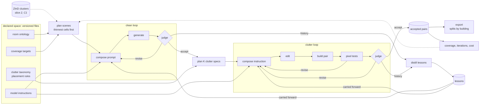
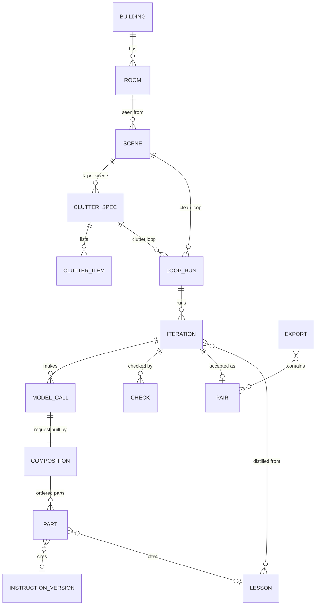
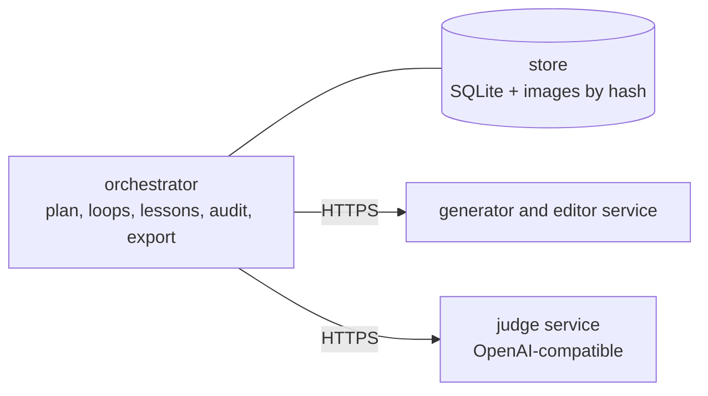

# clutter_pairs — high-level design

How the [architecture](../architecture.md) becomes a program, at the level the owner agrees on before any code:
usage, required properties, functions, data flow, loops, auditability, stored data, and the choices that shape them.
Derived in the order of the repository's
[construction guideline](../../dev_guidelines/software_development_guidelines/construction.md#derivation-order).

> **Status:** high-level design agreed by the owner: two inner loops with carry-forward, full auditability, building,
> room and scene ids, and choices C1 to C10. No clutter_pairs code yet; the changes it needs in virtual_unstaging
> come first (C7, C10). Mechanics marked *proposal* are the assistant's, to be fixed in the detailed design.

## Table of Contents

1. [N0](#n0) _(Lines 42-56)_
1. [Usage scenarios](#usage-scenarios) _(Lines 59-70)_
1. [Required properties](#required-properties) _(Lines 73-88)_
1. [Functional hierarchy](#functional-hierarchy) _(Lines 91-111)_
1. [Data flow](#data-flow) _(Lines 114-155)_
1. [Inner loops and carry-forward](#inner-loops-and-carry-forward) _(Lines 158-185)_
1. [Auditability](#auditability) _(Lines 188-206)_
1. [Stored data](#stored-data) _(Lines 209-247)_
1. [System shape](#system-shape) _(Lines 250-260)_
1. [Choices](#choices) _(Lines 263-263)_
   1. [C1 Clean sources](#c1-clean-sources) _(Lines 266-270)_
   1. [C2 How clutter is added](#c2-how-clutter-is-added) _(Lines 273-281)_
   1. [C3 Clutter variants per clean image](#c3-clutter-variants-per-clean-image) _(Lines 284-287)_
   1. [C4 Writing prompts and instructions](#c4-writing-prompts-and-instructions) _(Lines 290-293)_
   1. [C5 The checks, cheapest first](#c5-the-checks-cheapest-first) _(Lines 296-301)_
   1. [C6 Speed and cost](#c6-speed-and-cost) _(Lines 304-310)_
   1. [C7 Model serving](#c7-model-serving) _(Lines 313-319)_
   1. [C8 Editor families](#c8-editor-families) _(Lines 322-335)_
   1. [C9 Size of the first slice](#c9-size-of-the-first-slice) _(Lines 338-341)_
   1. [C10 Loop code](#c10-loop-code) _(Lines 344-352)_
1. [Build order](#build-order) _(Lines 355-364)_
1. [Open](#open) _(Lines 367-372)_

---

## N0
<!-- Lines 42-56 -->

- A **declared space** (room ontology, clutter taxonomy, placement rules, coverage targets) lives in versioned files;
  a planner samples specs where coverage is thinnest.
- **Two inner loops** (owner): generator and judge iterate on one image until the judge accepts. One loop makes the
  clean image, the other adds the clutter. A pair is built by **edit, then composite**: outside the change mask
  the two images are identical by construction.
- **Carry-forward** (owner): lessons distilled from each image's iterations feed the next image's first prompt, so
  the first images take many iterations and the later ones few; this is measured.
- **Full auditability** (owner): every model instruction is a versioned Markdown file; every request is stored as
  sent, with its response; every request can be recomposed from its recorded parts.
- **Ids** (owner): building, room, scene. In the first version each scene is its own room and building; later,
  coherent views of one virtual room and coherent rooms of one virtual house.
- Accepted pairs are exported as a dataset version split by building, with a coverage and cost report. One local
  store holds everything; models run on a rented GPU with a deadline.

## Usage scenarios
<!-- Lines 59-70 -->

What the owner does with the tool; every later section serves one of these.

| # | Scenario | Steps |
|---|---|---|
| S1 | **Build a dataset version**: choose the space version, the targets and the budget; start a GPU with a limit; run the loops; read the report; export | plan, run, report, export |
| S2 | **Grow it**: raise the targets or add a room type; the planner fills the thin cells; nothing already made is made again | edit targets, plan, run |
| S3 | **Compare models or instructions**: same specs and seeds, one factor changed; compare iterations, acceptance and cost per accepted pair | run per variant, report |
| S4 | **Review a sample**: mark the judge's and the checks' mistakes; the marks calibrate thresholds and instructions | review (later slice) |
| S5 | **Import clean images** from another source (real empty photos, renders): they enter the clean loop at the judge | import (later slice) |
| S6 | **Audit**: from any pair or image, trace every instruction version, lesson, finding and model call behind it | audit |

## Required properties
<!-- Lines 73-88 -->

Each is checkable; each check becomes a test.

| # | Property | Check |
|---|---|---|
| P1 | **Pair truth:** outside the change mask, the cluttered image equals the clean image | per pair, the difference outside the mask is zero |
| P2 | Every image is **replayable** | a finished run started again makes zero model calls |
| P3 | Every model is **swappable**: no model name, weight path or provider in code outside adapters and configuration | the test suite runs end to end on fake adapters |
| P4 | The **budget** is never exceeded; no GPU runs without a time limit | a call beyond the budget is refused; provisioning refuses to start without a limit |
| P5 | **Coverage** is measurable: every pair carries its room spec and clutter spec | the report counts accepted pairs per cell of the targets |
| P6 | **Split safety:** an export never puts one building in two splits (its rooms, scenes and pairs follow it) | export check |
| P7 | The public code carries **no dataset**: stores and exports live outside the package | the package ships no images |
| P8 | **Every request is stored as sent**, with its raw response | on fake adapters, the requests received equal the requests stored |
| P9 | **Every request is recomposable** from its recorded parts | `audit` recomposes every stored request and compares hashes |
| P10 | **No instruction text in code:** every instruction a model receives comes from a versioned file | every part of kind "instruction" cites a file version; a lint finds no prompt text in code |

## Functional hierarchy
<!-- Lines 91-111 -->

**L0** — produce a dataset of pairs (clean, cluttered) of the same view, the clean image being the truth of the
cluttered one, covering a declared space of rooms and clutter, every image traceable to what made it, at a known cost
per accepted pair.

**L1** — the flows:

| Flow | Does |
|---|---|
| F1 Declare | room ontology, clutter taxonomy with placement rules, coverage targets, model instructions: versioned files |
| F2 Plan | sample scenes into the thinnest cells; then K clutter specs per accepted clean image |
| F3 Clean loop | write, generate, judge, revise until accepted or out of budget |
| F4 Clutter loop | write, edit, build the pair, pixel tests, judge, revise until accepted or out of budget |
| F5 Carry forward | distill lessons from each loop; feed them to the next image's writer; measure and retire them |
| F6 Publish | export a dataset version: images, manifest, splits by building, coverage and cost report |
| F7 Serve models | generator, editor and judge on a rented GPU with a deadline ([C7](#c7-model-serving)) |
| F8 Audit | trace any image to its parts; recompose every request (P9); later, dataset audits (shortcut cues, near-copies) |

**L2** — one pair: `plan scene` → clean loop [`compose` → `generate` → `judge` → `revise`]* → `plan clutter` (×K) →
clutter loop [`compose` → `edit` → `build pair` → `pixel tests` → `judge` → `revise`]* → accept → `distill lessons`.

## Data flow
<!-- Lines 114-155 -->

- **The store is the queue:** each stage takes every item in its input state and moves it on; an interrupted run
  resumes from the states.
- **Rejects carry a typed reason** (not empty, off spec, implausible, misaligned, change outside the clutter, clutter
  off spec, placement rule broken); the report counts them per stage, model and instruction version (S3).

## Inner loops and carry-forward
<!-- Lines 158-185 -->

The owner's shape: in both places, generator and judge iterate on one image; the first images may need many
iterations, and what they teach makes the next images start better. Mechanics below are *proposals*.

| | Clean loop | Clutter loop |
|---|---|---|
| subject | a scene: room spec, light, camera | a clutter spec on an accepted clean image |
| make | the generator, from the prompt | the editor, from the clean image and the instruction; then build the pair and run the pixel tests |
| the judge asks | empty or tidy (only items fixed to the building), on spec, plausible | clutter on spec and on its placement rules, one room, plausible |
| revise | the reviser rewrites the prompt from the findings and the judge's guidance | the same, for the instruction |

- **An iteration:** compose the request → make → (pixel tests) → judge → stop or revise. Stop reasons: accepted,
  budget spent, no progress. A loop that ends without acceptance rejects the subject with its last reason.
- **Lessons:** after each loop, the distiller turns its iteration history into lessons. A lesson is a short
  instruction fragment, with its scope (stage, and cell: room type, style, density, clutter category) and its
  evidence (the iterations it came from). The writer's first request for the next image includes the active lessons
  in scope.
- **Measured, not assumed:** iterations per accepted image along the run, per stage (the curve should fall); per
  lesson, iterations with and without it in scope. A lesson that does not help is retired. The owner promotes a
  lasting one into an instruction file, which makes a new version of that file.
- **Waves:** a few images run in parallel so the GPU alternates generation and judgment; lessons update between
  waves.
- **Models on the GPU:** one generator (or editor) and one judge; the writer, the reviser and the distiller run on
  the judge's model, so no third model is loaded. A model that does both text-to-image and editing serves both
  loops without a switch.
- Same pattern as virtual_unstaging's per-image loop and its retuning step; whether the code is shared is
  [C10](#c10-loop-code).

## Auditability
<!-- Lines 188-206 -->

The owner's requirement: full auditability. How it is met (*proposal*):

- **Instructions are files.** One Markdown file per model role in `instructions/`: clean writer, clean judge,
  clutter writer, pair judge, reviser, lesson distiller; the composers' templates are files too. Versioned by git;
  every use records the file's content hash, and the content is copied into the store at first use, so an audit
  needs no checkout. No instruction text lives in code (P10).
- **Every request is stored as sent** (P8): the messages in full, the images by hash in their order, the settings,
  the seed, the model and its revision; and the raw response.
- **Every request is recomposable** (P9). A request is built by a named, versioned composer, a pure function of
  ordered parts. Each part records its slot, its source and the hash of its text. Source kinds: an instruction
  version; a spec field, rendered; a lesson; a judge finding or guidance; the previous request (for a revision);
  the output of a writer or reviser call. Recomposing from the parts must give the stored request byte for byte.
- **The trace never stops at a text of unknown origin.** A prompt written by a model is the output of a call whose
  own request is composed and recorded the same way; a lesson points to the iterations it was distilled from.
- **Lineage is a query.** `audit <pair>` walks from a pair to its iteration, its model calls, their parts, and each
  part's origin, recursively, and prints the tree. The export carries per pair the ids and hashes that reach it.
- **Human acts are records:** review marks, threshold changes, lesson promotions and retirements, with who and when.

## Stored data
<!-- Lines 209-247 -->

One store per dataset: a SQLite file and an image store addressed by SHA-256, the pattern of virtual_unstaging.
Entities at claim level; the full schema comes with the detailed design.

| Entity | Holds |
|---|---|
| building, room, scene | the hierarchy (owner). The room carries the room spec (type, geometry, style); the scene the light, the camera and its accepted clean image. First version: one scene per room, one room per building |
| clutter spec, clutter item | density; per item: taxonomy category, placement, attachment |
| loop run, iteration | stage (clean or clutter), stop reason; per iteration the images made (raw edit, composite, change mask) |
| check | kind (pixel, judge, detector, human), verdict, typed reason, scores, findings |
| model call | role, model and revision, the request exactly as sent, the raw response, seconds, error, request hash; an identical request returns the stored result (P2) |
| composition, part | the composer (name, version) and the ordered parts of one request: slot, source kind, source id, text hash |
| instruction version | file path, content hash, content |
| lesson | text, scope, evidence, the call that wrote it, status (active, retired, promoted), measured effect |
| pair, export | the accepted iteration with its clean image; a named version, its pairs, its splits by building |

The export is plain files: `clean/`, `cluttered/` and `mask/` PNGs, and a JSONL manifest (one line per pair:
building, room and scene ids, split, specs, provenance ids and hashes, checks), loadable by common dataset libraries.

## System shape
<!-- Lines 250-260 -->

Same shape as virtual_unstaging: a local orchestrator owns the store; models run as services on a rented GPU that
deletes itself at its deadline and holds nothing that cannot be lost.

## Choices
<!-- Lines 263-263 -->

### C1 Clean sources
<!-- Lines 266-270 -->

**Decided:** clean images are generated from the written prompt; imported clean images (real or rendered) enter
the clean loop at the judge in a later slice (S5). Ruled out by the owner: grounding the generation on clusters of
ZInD's real empty rooms (licensed for academic use only, access by manual approval).

### C2 How clutter is added
<!-- Lines 273-281 -->

**Decided:** free edit, then composite. The change mask is computed from the difference between the clean image and
the edit (so it includes shadows and reflections), cleaned, dilated and feathered; the edited pixels are pasted onto
the clean image inside it, so P1 holds by construction. Possible shortcut cues (the seam, the model's image signature
inside the mask): both images pass through the same encode-decode round trip (or the clean generator and the editor
share one VAE), and the dataset audit checks that a detector cannot find the mask from them. Rejected: the edit as
returned (editors repaint slightly everywhere, so the clean image is only approximately the truth); masked
inpainting (needs floor and wall segmentation first, bounds the clutter to the mask's shape).

### C3 Clutter variants per clean image
<!-- Lines 284-287 -->

**Decided:** K = 3 independent variants at different densities (lived-in, cluttered, moving day), sharing the scene.
Nested variants (clutter added onto the previous edit) stay a later option.

### C4 Writing prompts and instructions
<!-- Lines 290-293 -->

**Decided:** a language model writes them from the spec, the lessons and its instruction file; its call is recorded
like any other, so the trace goes one level deeper (see [Auditability](#auditability)).

### C5 The checks, cheapest first
<!-- Lines 296-301 -->

**Decided:** in the clutter loop, pixel tests before the judge (alignment of the edit with the clean image, change
area within the range the density implies, drift outside the mask before compositing); the judge on a fixed schema
in both loops; an object detector only if the judge misses leftover clutter; thresholds calibrated on a reviewed
sample (S4).

### C6 Speed and cost
<!-- Lines 304-310 -->

**Decided:** the 10-second figure of virtual_unstaging is a guideline. Measured instead: seconds and iterations per
accepted image per stage, and cost per accepted pair. Arithmetic, *inferred* from the measured A100 80 GB figures
at $1.79 an hour: one iteration costs about 14 s for a clean image and 15 s for a clutter edit (generation or
edit, plus judgment), plus a few seconds of writing or revising. At two to three iterations per accepted image,
about 1,000 pairs take 15 to 25 hours, $25 to $45, start-up excluded.

### C7 Model serving
<!-- Lines 313-319 -->

**Decided:** virtual_unstaging's serving (rental with a self-deleting deadline, generator service with recipes and
switching, judge service), used through its HTTP contract and command line. Features clutter_pairs needs are added
there. In place: generation from text alone (tool server API 1.2): a recipe declares `text_only`, a request with no
image gets an output of the requested `output_aspect`; FLUX.2 klein 4B and 9B and Qwen-Image-2.1 declare it, not yet
run on a GPU. To settle in the detailed design: GPU rental is keyed to a virtual_unstaging project folder today.

### C8 Editor families
<!-- Lines 322-335 -->

A model family is the models of one lab and architecture: FLUX models (Black Forest Labs), Qwen-Image
models (Alibaba's Qwen team). virtual_unstaging will test removal generators on these pairs, some from the same
families as the editors. If a test pair's clutter was painted by the remover's own family, the remover may undo it
more easily than real clutter (it shares that family's way of drawing objects and its image signature), and the
test overrates it.

**Decided: two editor families, each pair tagged with its editor's family.** A remover is tested on the other
family's pairs, and the gap between its scores on the two halves measures the bias. Slice 1 runs one family; the
second comes in slice 2. Rejected: one family (the bias would stay, unmeasured).

Default models remain the owner's choice. Candidates: FLUX.2 klein 4B (edits in 5 to 6 s, measured; text-to-image
not clocked), Qwen-Image-Edit-2511 (not clocked), Qwen3-VL-8B as judge (7 to 10 s, measured).

### C9 Size of the first slice
<!-- Lines 338-341 -->

**Decided:** 3 room types (living room, kitchen, bedroom) × 2 styles × 3 densities, other axes at random; about 50
accepted pairs; one rental of at most 2 hours.

### C10 Loop code
<!-- Lines 344-352 -->

**Decided: import virtual_unstaging and change it where clutter_pairs needs it**, with clean, well-structured changes
made there. The dependency is one-way: clutter_pairs uses virtual_unstaging, never the reverse. virtual_unstaging
already has the per-image loop (an engine contract: the engine proposes the next attempt, is told its evaluation,
and resumes by replay), the judge call with typed findings, the score from findings, attempts stored as sent. The
first engine here is the reviser (rewrite from findings); virtual_unstaging's dimension engines plug into the same
contract. Rejected by the owner: a separate shared library (overengineering at this stage); a separate loop in
clutter_pairs (duplicated code).

## Build order
<!-- Lines 355-364 -->

The whole flow end to end at small scale first, then depth where it fails.

1. **Slice 1:** both loops with lessons, edit-then-composite, pixel tests, full audit records and the recomposition
   check, export of about 50 pairs, a report with iterations per image along the run. On fake adapters first, then
   one rental.
2. **Slice 2:** coverage planner, second editor family, review of a sample, lesson promotion.
3. **Slice 3:** dataset audits (shortcut-cue detector, near-copies), imports, scale-up; then coherence: several scenes
   per room, several rooms per building.

## Open
<!-- Lines 367-372 -->

- Default models for slice 1 (one editor family): the owner decides.
- A gated dataset of empty, furnished and staged bedroom images (state of the art, branch A, "Existing pair
  benchmarks"): access requested; once readable, it says whether its pipeline is generated and may serve as a check.
- Name of the project and of its command (architecture, "Open questions").
- Granularity of the ontology and the taxonomy beyond slice 1: set from slice 1's report.
