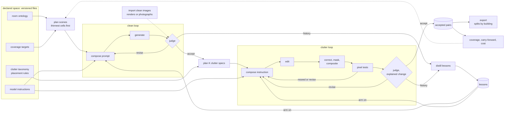
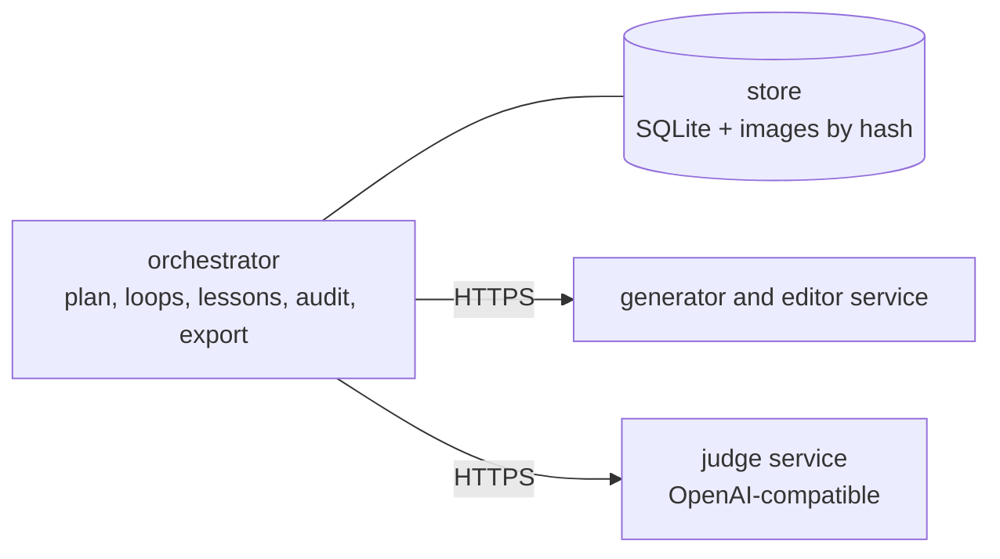

# clutter_pairs — design

How the [architecture](../architecture.md) becomes a program: usage, required properties, functions, data flow, the
two loops, auditability, stored data, and the choices that shape them. Derived in the order of the repository's
[construction guideline](../../dev_guidelines/software_development_guidelines/construction.md#derivation-order).

> **Status:** the high-level design (this page) is agreed by the owner, with the owner's later answers folded in.
> Slice 1's detailed design, revised after an independent review, is implemented and tested offline: [data_model.md](data_model.md) (the
> schema, its views and audit checks), [loops.md](loops.md) (composition and recording, both loops, pixel tests and
> composite, verdict and stop rule, lessons and how their effect is measured), [components.md](components.md) (use of
> virtual_unstaging, layering, configuration, command line). The rental of slice 1 is next. Imported clean images
> (S5, C1): [imports.md](imports.md), implemented 2026-10-24, awaiting the owner's review.

## Table of Contents

1. [N0](#n0) _(Lines 44-59)_
1. [Usage scenarios](#usage-scenarios) _(Lines 62-71)_
1. [Required properties](#required-properties) _(Lines 74-89)_
1. [Functional hierarchy](#functional-hierarchy) _(Lines 92-113)_
1. [Data flow](#data-flow) _(Lines 116-157)_
1. [Inner loops and carry-forward](#inner-loops-and-carry-forward) _(Lines 160-175)_
1. [Auditability](#auditability) _(Lines 178-191)_
1. [Stored data](#stored-data) _(Lines 194-199)_
1. [System shape](#system-shape) _(Lines 202-212)_
1. [Choices](#choices) _(Lines 215-217)_
   1. [C1 Clean sources](#c1-clean-sources) _(Lines 220-229)_
   1. [C2 How clutter is added](#c2-how-clutter-is-added) _(Lines 232-239)_
   1. [C3 Clutter variants per clean image](#c3-clutter-variants-per-clean-image) _(Lines 242-244)_
   1. [C4 Writing prompts and instructions](#c4-writing-prompts-and-instructions) _(Lines 247-250)_
   1. [C5 The checks, cheapest first](#c5-the-checks-cheapest-first) _(Lines 253-257)_
   1. [C6 Speed and cost](#c6-speed-and-cost) _(Lines 260-266)_
   1. [C7 Model serving](#c7-model-serving) _(Lines 269-274)_
   1. [C8 Editor families](#c8-editor-families) _(Lines 277-284)_
   1. [C9 Size of the first slice](#c9-size-of-the-first-slice) _(Lines 287-290)_
   1. [C10 Loop code](#c10-loop-code) _(Lines 293-298)_
1. [Build order](#build-order) _(Lines 301-314)_
1. [Open](#open) _(Lines 317-334)_

---

## N0
<!-- Lines 44-59 -->

- A **declared space** (room ontology, clutter taxonomy, placement rules, coverage targets) lives in versioned files;
  a planner samples scenes where coverage is thinnest.
- **Two inner loops** (owner): generator and judge iterate on one image until the judge accepts, once to make the
  clean image, once to add the clutter. A pair is built by **edit, then composite**: outside the change mask the two
  images are identical by construction; inside it, every change must be one of the specified items, assigned by
  the judge to the mask's numbered regions.
- **Carry-forward** (owner): lessons distilled from each image's iterations feed the next images' first prompt; whether
  they help is measured against a comparison group that runs without them (owner).
- **Full auditability** (owner): every model instruction is a versioned Markdown file; every exchange with a model is
  stored as sent; every request can be recomposed from its recorded parts.
- **Ids** (owner): building, room, scene. In slice 1 each scene is its own room and building; later, coherent views
  of one virtual room and coherent rooms of one virtual house.
- Accepted pairs are exported as a dataset version split by building, with coverage, carry-forward and cost reports.
  One local store holds everything; models run on a rented GPU with a deadline.

## Usage scenarios
<!-- Lines 62-71 -->

| # | Scenario | Steps |
|---|---|---|
| S1 | **Build a dataset version**: choose the space and targets; start a GPU with a deadline; run (a smoke wave, then waves); read the reports; export | plan, gpu up, run, report, export |
| S2 | **Grow it**: raise the targets or add a room type; the planner fills the thin cells; nothing already made is made again, and earlier pairs still count | edit targets, plan, run |
| S3 | **Compare models or instructions**: same specs and seeds, one factor changed; compare iterations, acceptance and cost per accepted pair | run per variant, report |
| S4 | **Review a sample**: look at pairs, mark the checks' mistakes, set thresholds; in slice 1, 20 to 30 pairs early in the rental | review, decide |
| S5 | **Import clean images**: renders of a procedural generator, or real empty photos (the owner's preferred clean source, once one is usable): they enter the clean loop at the judge ([imports.md](imports.md); implemented, awaiting the owner's review) | import |
| S6 | **Audit**: from any pair or image, trace every instruction version, lesson, assessment, exchange and decision behind it | audit |

## Required properties
<!-- Lines 74-89 -->

Each is checkable; each check becomes a test or an `audit` check.

| # | Property | Check |
|---|---|---|
| P1 | **Pair truth:** clean and cluttered images are equal wherever the mask's alpha is 0, and every change inside the mask is a specified item | audit compares the pixels; a numbered mask region the judge assigns no item, or another change, fails the pair, as do specks above their limit (`unexplained_change`) |
| P2 | Every image is **replayable** | a finished run started again makes zero model calls |
| P3 | Every model is **swappable**: no model name, weight path or provider in code outside adapters and configuration | the test suite runs end to end on fake adapters |
| P4 | **No GPU without a deadline;** a run stops at its pair target or at the rental's deadline | provisioning refuses to start without a limit; no call starts that the deadline would cut |
| P5 | **Coverage** is measurable, across versions of the targets and the space | the report counts accepted pairs per target cell, matching on (axis, value) |
| P6 | **Split safety:** an export never puts one building in two splits | the split is stored per building only |
| P7 | The public code carries **no dataset** | the package ships no images |
| P8 | **Every exchange is stored as sent**, with its answer | audit rebuilds each body from the store and matches the hash of the bytes sent |
| P9 | **Every request recomposes** from its composer, its model and its recorded parts | audit recomposes every request and compares it byte for byte |
| P10 | **No instruction text in code** | every instruction or template part cites a file; a test fails on any prompt-like literal (multi-line, or over 200 characters) in the package's Python sources |

## Functional hierarchy
<!-- Lines 92-113 -->

**L0** — produce a dataset of pairs (clean, cluttered) of the same view, the clean image being the truth of the
cluttered one, covering a declared space of rooms and clutter, every image traceable to what made it, at a known cost
per accepted pair.

**L1** — the flows:

| Flow | Does |
|---|---|
| F1 Declare | room ontology, clutter taxonomy with placement rules, coverage targets, model instructions, decision rules: versioned files |
| F2 Plan | sample scenes into the thinnest cells; then K clutter specs per accepted clean image; draw each subject's arm |
| F3 Clean loop | write, generate, judge, revise until accepted, no progress, or a limit |
| F4 Clutter loop | write, edit, correct, mask, composite, pixel tests, judge, explained change, revise until accepted or a limit |
| F5 Carry forward | distill lessons after each loop; give them to the next waves' `on` arm; compare the arms |
| F6 Publish | export a dataset version: images, manifest with public ids and licences, splits by building, reports |
| F7 Serve models | generator, editor and judge on a rented GPU with a deadline ([components.md](components.md)) |
| F8 Audit | trace any image to its parts; rebuild every exchange and recompose every request; later, dataset audits |

**L2** — one pair: `plan scene` → clean loop [`compose` → `generate` → `judge` → `revise`]* → `plan clutter` (×K) →
clutter loop [`compose` → `edit` → `correct` → `mask` → `composite` → `pixel tests` → `judge` → `explain` →
`revise`]* → accept → `distill lessons`.

## Data flow
<!-- Lines 116-157 -->

- **The store is the queue:** each stage takes every item in its input state and moves it on; an interrupted run
  resumes from the states.
- **Rejects carry a typed reason** with a severity fixed per reason; the reports count them per stage, model and
  instruction version (S3).

## Inner loops and carry-forward
<!-- Lines 160-175 -->

The owner's shape: in both places, generator and judge iterate on one image; the first images may need many
iterations, and what they teach makes the next images start better.

| | Clean loop | Clutter loop |
|---|---|---|
| subject | a scene: room spec, light, camera | a clutter spec on one accepted clean image of the scene, recorded on the loop |
| make | the generator, from the prompt | the editor, from the clean image and the instruction; then correct, mask, composite, pixel tests |
| the judge asks | empty or tidy (only items fixed to the building), on spec, plausible | clutter on spec and on its placement rules, nothing else changed, plausible; it locates each item |
| revise | the reviser rewrites the prompt from the findings and the guidance | the same, for the instruction; a pixel failure is answered by a reseed first |

- **Lessons:** after each loop, the distiller turns its history into lessons (a short instruction fragment, its scope
  in axis values, its evidence); a lesson is active from the next wave until it is replaced, retired or promoted.
- **Arms** (owner): about one subject in three runs without lessons, by a recorded seeded draw. The `carry_forward`
  report compares the arms under a decision rule written before the rental. Mechanics: [loops.md](loops.md).

## Auditability
<!-- Lines 178-191 -->

The owner's requirement: full auditability.

- **Instructions are files:** one Markdown file per model role; composers, answer schemas, reasons and decision rules
  are files too. Every use records the file's hash; its content is copied into the store at first use.
- **Every exchange is stored as sent (P8):** virtual_unstaging's endpoint observer hands each HTTP exchange to the
  recorder; bodies are kept with embedded images replaced by their hash and the image bytes kept, plus the hash of
  the bytes on the wire.
- **Every request recomposes (P9):** a request is a pure function of its composer file, its model and its ordered
  parts (instruction files, spec, lessons, earlier assessments, earlier outputs, images, settings, seeds), each part
  recorded with its source. A prompt written by a model is the output of a call recorded the same way.
- **Lineage is a query:** `audit <pair>` walks from a pair to its iterations, calls, exchanges and parts, and each
  part's origin, recursively. Human acts (thresholds, reviews, lesson retirements and promotions) are `decision` rows.

## Stored data
<!-- Lines 194-199 -->

One store per dataset: a SQLite file and an image store addressed by SHA-256, the pattern of virtual_unstaging. The
schema, its views and the audit checks are in [data_model.md](data_model.md) and [schema.sql](../src/clutter_pairs/store/schema.sql) (48 tables;
the DDL loads in SQLite and in Postgres 18). The export is plain files: `clean/`, `cluttered/` and `mask/` PNGs and a JSONL manifest, one line per
pair: public ids (content hashes that survive a rebuild of the store), split, specs, families, licences, checks.

## System shape
<!-- Lines 202-212 -->

Same shape as virtual_unstaging: a local orchestrator owns the store; models run as services on a rented GPU that
deletes itself at its deadline and holds nothing that cannot be lost.

## Choices
<!-- Lines 215-217 -->

All decided by the owner, except where marked *proposal*.

### C1 Clean sources
<!-- Lines 220-229 -->

Generated from the written prompt in slice 1. **Real empty photos are the owner's preferred source** ("if we can find
empty pictures, real, it would be actually perfect"): imported through S5, `cpairs import`, which also takes renders
of a procedural generator (2026-10-23, the owner's request: [imports.md](imports.md); *status:* implemented
2026-10-24, awaiting the owner's review). Candidate found:
Wikimedia Commons, category "Empty rooms" and its sub-categories, about 700 to 800 real photos under per-file open
licences (CC BY, CC BY-SA, CC0, public domain), of mixed buildings (classrooms, offices, homes) and uneven sizes, to be
sorted before use; licences are recorded per image and carried into the manifest. Ruled out: ZInD (academic use only,
access by approval). Detail: [state of the art](../../virtual_unstaging/state_of_the_art.md), branch A.

### C2 How clutter is added
<!-- Lines 232-239 -->

Free edit, then colour correction and composite: the change mask is measured from the difference between the clean
image and the corrected edit (so it includes shadows and reflections); outside it the clean image is kept, so P1
holds there by construction; inside it, every numbered region must hold an item the judge assigns to it. Slice 1
uses one model for clean image and edit (one VAE); slice 2's second family makes its own clean images. Rejected: the
edit as returned (editors repaint slightly everywhere); masked inpainting (needs segmentation first, bounds the
clutter to the mask's shape).

### C3 Clutter variants per clean image
<!-- Lines 242-244 -->

K = 3 independent variants at different densities (lived-in, cluttered, moving day), sharing the scene.

### C4 Writing prompts and instructions
<!-- Lines 247-250 -->

A language model writes them from the spec, the lessons and its instruction file, with a sampling seed per subject;
its call is recorded like any other.

### C5 The checks, cheapest first
<!-- Lines 253-257 -->

Pixel tests before the judge (size, shift, global repaint, mask share); the judge on a fixed schema, answering a checklist
of openings and the items of each numbered mask region in the clutter loop; the explained-change test; an object detector only if the judge misses leftover clutter.
Thresholds are set by the owner on 20 to 30 pairs early in the rental (S4).

### C6 Speed and cost
<!-- Lines 260-266 -->

The 10-second figure of virtual_unstaging is a guideline. Measured: iterations and wall seconds per accepted image per
stage; cost per accepted pair from the rental's price and wall clock. Arithmetic, *inferred* from the measured A100
80 GB figures at $1.79 an hour: one iteration costs about 14 s for a clean image and 15 s for a clutter edit, plus a
few seconds of writing or revising; at two to three iterations per accepted image, about 1,000 pairs take 15 to 25
hours, $25 to $45, start-up excluded.

### C7 Model serving
<!-- Lines 269-274 -->

virtual_unstaging's serving: rental with a self-deleting deadline, generator service with recipes, judge service.
The owner's rule: virtual_unstaging changes only by **adding modularity or override mechanisms** that keep its own
behaviour by default and never name clutter_pairs; text-to-image (a new request form, opt-in per recipe) is the one
exception the owner accepted. What is used, and how: [components.md](components.md).

### C8 Editor families
<!-- Lines 277-284 -->

A model family is the models of one lab and architecture (FLUX, Black Forest Labs; Qwen-Image, Alibaba's Qwen team).
A remover tested on clutter painted by its own family may undo it more easily than real clutter, and the test then
overrates it. **Two editor families**; each pair records the families of its clean generator and of its editor; a
remover is tested on the other family's pairs, and the gap between the two halves measures the bias. Slice 1 runs one
family: FLUX.2 klein 4B makes and edits the clean images, Qwen3-VL-8B judges and writes (the owner said go). Slice 2
adds Qwen-Image-Edit-2511 with its own family's text-to-image model for its clean images. All are configuration.

### C9 Size of the first slice
<!-- Lines 287-290 -->

3 room types (living room, kitchen, bedroom) × 2 styles × 3 densities, other axes at random; about 50 accepted pairs;
one rental of at most 2 hours.

### C10 Loop code
<!-- Lines 293-298 -->

clutter_pairs imports virtual_unstaging. Shared: the ask / tell contract (`engines.SearchEngine`, generic over the
candidate) and the replay check (`engines.replay`, extracted at the owner's request and used by virtual_unstaging's own
runner). clutter_pairs' engine is the reviser's policy; its driver is the short loop around `replay`. Rejected by the
owner: a separate shared library (overengineering at this stage); duplicated loop code.

## Build order
<!-- Lines 301-314 -->

The whole flow end to end at small scale first, then depth where it fails.

1. **Slice 1.** Domain, space (with the image-size check), store; composer and the data files, with the decision rule
   for carry-forward; the recorder and the model callers, and fakes; both loops, the pairs module, the engine with
   replay; lessons, arms, views; audit, export, reports, command line. Tests on fakes, one per property: P1, P2, P6,
   P8, P9, P10, the size check, and carry-forward itself (a scripted fake judge that rejects until a lesson is
   present: the `on` arm's next scene is accepted at its first iteration, the `off` arm's is not). Then one rental of at
   most 2 hours: a smoke wave, the owner's threshold setting on 20 to 30 pairs, waves to about 50 pairs.
2. **Slice 2.** Coverage planner, the second family with its own text-to-image model, per-lesson effects, sorting of
   real empty photos for the import (S5; the import itself is built, [imports.md](imports.md)), a review page.
3. **Slice 3.** Dataset audits (shortcut-cue detector, near-copies), scale-up; then coherence: several scenes per
   room, several rooms per building.

## Open
<!-- Lines 317-334 -->

- Whether FLUX.2 klein 4B makes an image from text alone, and its condition-image size limit: read before the
  rental, then checked by the smoke wave.
- Imported clean images ([imports.md](imports.md)): whether a render's style and light can be mapped onto the space's
  axes; a crop or pad step for images whose aspect does not survive the sizing rule; the owner's review of the choices
  the implementation settled.
- Real empty photos: sort the Commons candidates (residential, tidy, large enough); two more leads to look at: a
  furniture-synthesis benchmark with real test images (RoomBench++, training data by request) and the gated empty,
  furnished and staged bedroom dataset (access requested).
- Name of the project and of its command (architecture, "Open questions").
- Granularity of the ontology and the taxonomy beyond slice 1: set from slice 1's report.
- **Helping the judges** (owner's idea, 2026-10-22): explored in [judge_aids.md](judge_aids.md): knowledge as text
  and numbered mask regions with a blocking code for changed openings (both implemented), crops, detection and
  segmentation through virtual_unstaging's tools, and a judge bench that measures each aid on stored iterations
  against the owner's marks. Which to build next: open.
- **Concrete clutter specs** (*proposal*, 2026-10-23), for the owner's ruling that an unlisted object blocks a
  pair: [concrete_specs.md](concrete_specs.md): one named object per item, a support that exists, storage with its
  contents, a text check of every prompt before the edit. Extends C5; needs the owner's OK.
