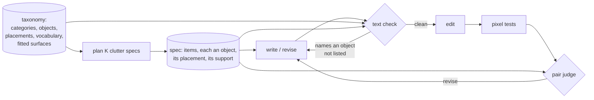

# clutter_pairs — concrete clutter specs

How a clutter spec names exactly what may appear, so that a pair holds the specified clutter and nothing else: one
named object per item, a support that exists for every item that rests on something, storage listed with its
contents, and a text check of every prompt before an image is spent on it. Refines the clutter taxonomy
([architecture](../architecture.md#clutter-taxonomy)), the planner and the clutter loop ([loops.md](loops.md)).

> **Status:** *proposal* (2026-10-23), answering the owner's ruling that an object nobody listed blocks a pair
> ([loops.md](loops.md#the-verdict-and-the-stop-rule)). Not built. It extends choice C5 (a check before the edit) and
> changes the taxonomy's shape: both need the owner's OK. Grounds: the second rental's stored iterations (FLUX.2
> klein 4B as editor, Qwen3.8-27B as writer and judge).

## Table of Contents

1. [N0](#n0)
1. [What fails today](#what-fails-today)
1. [Data flow](#data-flow)
1. [D1 One named object per item](#d1-one-named-object-per-item)
1. [D2 A support that exists](#d2-a-support-that-exists)
1. [D3 Storage with its contents](#d3-storage-with-its-contents)
1. [D4 The text check](#d4-the-text-check)
1. [What changes where](#what-changes-where)
1. [Measuring it](#measuring-it)
1. [Open](#open)

---

## N0
<!-- Lines 30-41 -->

- **The item becomes an object.** A new item axis, `object`, declares every object the planner may draw (a floor
  lamp, a stack of books), with its category, rooms, placements and the words that name it. The writer and the judge
  receive that exact list.
- **Every "on a surface" or "inside storage" item rests on something the spec guarantees:** another listed item that
  can hold it, or a fitted surface the room type always has (a kitchen worktop). The planner records which.
- **Storage carries its contents** ("a bookcase with books"); the judge is told they are part of the item.
- **A text check, no model, before every edit and every generation:** a prompt that names an object the spec does not
  list is rejected and revised before the editor or the generator is called.
- **Left as is:** objects the editor adds on its own (two televisions where the prompt named one). The judge still
  catches them; the next rental measures how often they remain once the prompts are clean.

## What fails today
<!-- Lines 44-58 -->

In the second rental, `clutter_off_spec` (an unlisted object, among others) was on 294 of 394 judged clutter
iterations, the largest blocker. Read in the store:

| Cause | Mechanism in the code | Addressed by |
|---|---|---|
| An item is a category, not an object | `sample_items` draws a category and a placement; the spec renders the category's text, "small objects and decoration (lamp, books, plants, frames, toys, dishes)"; the writer turns one item into several objects | D1, D4 |
| The writer invents supports | an `on_surface` item is planned whether or not anything can hold it; the writer adds "a wooden coffee table holding …" | D2, D4 |
| `inside_open_storage` without storage | its rule says "the storage itself is also listed", but the planner does not ensure it | D2 |
| The judge contradicts a vague spec | "open storage (bookcase …)" listed, a bookcase called unlisted | D1, D3 |
| The editor adds on its own | a prompt naming one television, two drawn | not addressed; measured |

The writer named the object the judge called unlisted for most of them (books 72 of 74 times, plants 40 of 46, boxes
60 of 86, tables 52 of 85): a word match of the judge's comments against the edit prompts, not a reading.

## Data flow
<!-- Lines 61-77 -->

The clean loop takes the same check with an empty list: its prompt may name the room's fixed elements, no object.

## D1 One named object per item
<!-- Lines 80-100 -->

- **Shape.** `object` is an axis applying to `clutter_item`, like `category` and `placement`. Each value declares:
  `text` (the object as the writer and judge read it), `category`, `rooms`, `placements`, `words` (the nouns that
  name it in a prompt), and optionally `holds = true` (D2) or `contents` (D3).
- **Placements move to the objects.** A floor lamp stands, a picture hangs, books lie on a surface: the placement
  belongs to the object. A category's rooms and placements become the union of its objects' and are no longer
  declared (one fact, one place). Categories stay as an axis: coverage and lessons can still name them.
- **Planning.** For each item: a category fitting the room, then an object of that category fitting the room, then one
  of the object's placements, each by the spec's seeded draw (D2 adds the support).
- **Stored** as one more `clutter_item_value` row (`object`, `floor_lamp`): no schema change for D1. The taxonomy
  file's hash changes, so the space version changes; coverage targets name no item axis and stay valid.
- **Rendered** to the writer and the judge as the object's text with its placement and support, by a new spec
  renderer version (`spec_text@2`); `spec_text@1` stays, so `audit` still recomposes earlier requests.
- **Slice 1's objects**, a first list to be checked by the owner, about five per category, for the three room types:
  large furniture (sofa, double bed, wardrobe, dining table, chest of drawers); small furniture (armchair, dining
  chair, stool, coffee table, side table, bedside table, desk); storage (bookcase, open kitchen shelving, chest of
  open baskets); textiles (rug, throw on a sofa or bed, pile of clothes, coat on a wall hook); objects (table lamp,
  floor lamp, stack of books, potted plant, framed picture, wall clock, mirror, fruit bowl, stack of dishes); appliances
  (freestanding fridge, microwave, television, electric fan, vacuum cleaner, kettle); boxes (stack of moving boxes,
  plastic crate, laundry bag, suitcase). Curtains are left out: they need a window the clean image may not have.

## D2 A support that exists
<!-- Lines 103-116 -->

- **What can hold.** An object with `holds = true` holds `on_surface` items (a table, a chest of drawers, a bed, a
  sofa for a throw); a storage object holds `inside_open_storage` items. A room type may declare **fitted surfaces**
  it always has (`[fixed.surfaces]`: a kitchen's worktop), since its fixed elements say so; a windowsill or a hearth
  is not one, because the planner works before the clean image exists and cannot know the photograph shows one.
- **Planning.** An item whose placement needs a support takes one among the spec's earlier items that can hold it, or
  the room's fitted surfaces, by the seeded draw. When there is none: if the density's item count leaves room, a
  support is drawn first (an object that can hold it, fitting the room) and counts as one of the items; otherwise the
  item's placement is drawn again among those needing no support, and if it has none, the item is drawn again.
- **Stored** in a new table, one row per supported item: `clutter_item_support (clutter_item_id, on_item_id |
  on_fitted)`, exactly one of the two, the item on the same spec. Audit check: every item whose placement needs a
  support has one row, and the holder can hold it.
- **Rendered** as "on item 2 (the coffee table)" or "on the fitted worktop".

## D3 Storage with its contents
<!-- Lines 119-126 -->

- A storage object declares `contents` (text and words): "a bookcase filled with books and a few boxes".
- The writer names the storage with its contents; the judge reads that the contents belong to the item, so a region
  holding the bookcase and its books is that one item.
- An `inside_open_storage` item rests on a listed storage (D2) and is a separate item (a plant on the bookcase's
  shelf): the contents are what fills the storage by default, the item what the spec adds to it. *Alternative,
  simpler:* drop the `inside_open_storage` placement and let contents carry everything inside storage.

## D4 The text check
<!-- Lines 129-147 -->

- **What it matches.** A **vocabulary** declared in the taxonomy: every object's words, every content word, and a
  `watch` list of objects a prompt may slip in that the space does not draw (cushion, candle, vase, magazine, bottle,
  cup, curtain, …). Each entry may give an irregular plural (shelves); regular plurals are derived. Matching is on
  whole words, case-insensitive, longest phrase first, so "table lamp" is one match and does not count as "table".
- **What is allowed** in a prompt: the words of the subject's listed objects, their contents and supports, and the
  room type's fixed elements (`[fixed.words]`: door, window, radiator, worktop, sink …). Any other vocabulary word
  rejects the prompt, **negated or not**: an image model draws what a prompt names, "no table" included (the writer's
  instruction already says so for openings).
- **What a rejection does.** The iteration ends before the edit with an assessment of a new kind, `text`, carrying
  a blocking finding `prompt_off_spec` that lists the words found; the next action is a revision, the reviser
  receiving that finding like any other. It counts toward `max_iterations` (it costs one reviser call, about 8 s,
  against about 28 s for an edit and a judgment, measured means of the second rental) and is left out of the stall rule's scores, which compare images.
- **The clean loop** takes the same check with an empty list (the clean writer named logs in the first rental).
- **Where it lives.** The vocabulary is data (the taxonomy); the check is pure code beside the space, with one test
  per rule above; `audit` runs it again on every stored prompt and compares.
- **Known limits.** A noun outside the vocabulary passes ("a ukulele"), and the judge remains the guard. A fixed
  element that is also an object (a built-in wardrobe in a bedroom) is allowed by its room's fixed words.

## What changes where
<!-- Lines 150-162 -->

| File | Change |
|---|---|
| `data/space/taxonomy.toml` | the `object` axis; placements moved from categories to objects; `[fixed.surfaces]`, `[fixed.words]`, `[vocabulary]` |
| `space.py` | parse and check the new attributes (every object in a declared category, room and placements; every word declared once); draw objects and supports; the text check |
| `store/schema.sql`, `store/repo.py` | `clutter_item_support`; `assessment.kind` admits `text` |
| `domain.py`, `compose.py` | the item's object, support and contents in `ItemSpec`; `spec_text@2` |
| `engine.py`, `run.py` | the text check between the prompt and the edit or generation; a text failure left out of the stall scores |
| `data/reasons.toml` | `prompt_off_spec` (both stages, blocking, by text) |
| `data/instructions/` | writer and reviser: name exactly the listed objects with their supports and contents, no other object even negated; pair judge: contents belong to their storage |
| `audit.py` | the support check; the text check run again on every prompt |
| [loops.md](loops.md), [data_model.md](data_model.md), [architecture](../architecture.md#clutter-taxonomy) | folded in once agreed |

## Measuring it
<!-- Lines 165-172 -->

- **Before a rental, on stored data, no GPU:** run the text check on the second rental's stored prompts. It tells how
  many judged `clutter_off_spec` iterations had a prompt the check would have rejected (an upper bound on what D4 alone
  removes), and its false rejections, read on a sample.
- **On the next rental:** the share of judged clutter iterations carrying `clutter_off_spec`, against 294 of 394;
  the share of prompts rejected and revised; pairs per hour, against 32 in about 1 h 40 min. What remains of
  `clutter_off_spec` with a clean prompt is the editor's own additions.

## Open
<!-- Lines 175-182 -->

- **Does the owner approve D1 to D4?** Changes what is built. Recommendation: all four; D4 alone cannot hold without
  D1 (a category names no object to check against).
- **`inside_open_storage`: keep it as a supported item, or drop it and let contents carry everything inside storage**
  (D3). Recommendation: keep, it teaches what a decluttering tool must remove from shelves. If unanswered: keep.
- **The object list** (D1): the owner's to check; it is data, replaceable per dataset. If unanswered: the list above.
- **A text failure counts toward `max_iterations`** (D4). Alternative: a separate small cap of rewrites per
  iteration, which needs a second prompt per iteration in the store. Recommendation: count it. If unanswered: count it.
