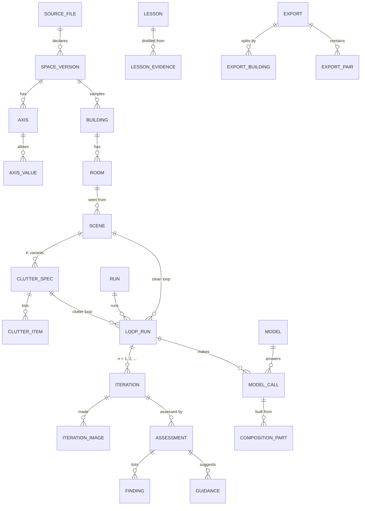

# clutter_pairs — data model

The store of one dataset: what is declared, what is planned, what each loop made and why it was accepted or
rejected, and the parts every model request was built from. Refines [Stored data](README.md#stored-data) of the
high-level design.

> **Status:** *proposal* for slice 1, not accepted. Portable SQL: SQLite now, Postgres when several writers or a
> shared knowledge base appear (the signal of virtual_unstaging's design D2). Normalized to 3NF; the few
> denormalizations are named where they occur.

## Table of Contents

1. [Principles](#principles) _(Lines 32-46)_
1. [Entities](#entities) _(Lines 49-78)_
1. [Schema](#schema) _(Lines 81-81)_
   1. [Declared files, texts, images](#declared-files-texts-images) _(Lines 84-111)_
   1. [The declared space](#the-declared-space) _(Lines 114-147)_
   1. [Buildings, rooms, scenes, clutter specs](#buildings-rooms-scenes-clutter-specs) _(Lines 150-196)_
   1. [Runs, loops, iterations](#runs-loops-iterations) _(Lines 199-239)_
   1. [Models, calls, and what each request was built from](#models-calls-and-what-each-request-was-built-from) _(Lines 242-298)_
   1. [Assessments](#assessments) _(Lines 301-346)_
   1. [Lessons and decisions](#lessons-and-decisions) _(Lines 349-376)_
   1. [Exports](#exports) _(Lines 379-403)_
1. [Views](#views) _(Lines 406-415)_
1. [Checks run by `audit`](#checks-run-by-audit) _(Lines 418-427)_


---

## Principles
<!-- Lines 32-46 -->

- **Facts once.** Every text a request is built from is stored once (`text_blob`, by hash); every declared file once
  (`source_file`, by hash); every image once (`image`, by hash; the bytes in the image store).
- **Derived, not stored:** the pair, the clean image of a scene, coverage, the iteration curve, a lesson's effect
  are views. The one stored state that a view could derive, `loop_run.stop_reason = 'accepted'`, is kept because
  the other stop reasons cannot be derived; a check query guards the agreement.
- **Spec values are rows, checked against the declared axes.** The ontology and the taxonomy declare axes and their
  values; a room, a scene, a clutter spec, a clutter item, a lesson's scope and a coverage target each hold at most
  one row per axis, whose value must belong to that axis (composite foreign key). Adding an axis is a file change, not a
  schema change.
- **Polymorphic references are avoided:** a row that can point to one of several kinds of source has one nullable
  foreign key per kind and a check that exactly the one matching its kind is set.
- **The dataset folder:** `store.sqlite`, `images/<first two hex>/<sha256>.<ext>`, `exports/<name>/`. Nothing in
  the package.

## Entities
<!-- Lines 49-78 -->



The spec-value tables (`room_value`, `scene_value`, `clutter_spec_value`, `clutter_item_value`, `lesson_scope`,
`target_value`) are left out of the diagram: each links its owner to one `axis_value` per axis.

## Schema
<!-- Lines 81-81 -->

### Declared files, texts, images
<!-- Lines 84-111 -->

```sql
-- Every declared file as read at first use: the space, model instructions, composers, answer schemas,
-- reason codes, the run configuration. The file in git is the source; the row is its immutable copy.
CREATE TABLE source_file (
  sha256      TEXT PRIMARY KEY CHECK (length(sha256) = 64),
  kind        TEXT NOT NULL CHECK (kind IN ('ontology', 'taxonomy', 'targets', 'instruction', 'composer',
                                            'schema', 'reasons', 'config')),
  path        TEXT NOT NULL,                       -- as read: package-relative or dataset-relative
  content     TEXT NOT NULL,
  first_used  TEXT NOT NULL                        -- ISO 8601 UTC
);

-- Every text a request is built from or answered with, once.
CREATE TABLE text_blob (
  sha256   TEXT PRIMARY KEY CHECK (length(sha256) = 64),
  content  TEXT NOT NULL
);

-- Image metadata; the bytes live in the image store under their hash.
CREATE TABLE image (
  sha256      TEXT PRIMARY KEY CHECK (length(sha256) = 64),
  media_type  TEXT NOT NULL CHECK (media_type IN ('image/png', 'image/jpeg')),
  width       INTEGER NOT NULL CHECK (width > 0),
  height      INTEGER NOT NULL CHECK (height > 0)
);
```

### The declared space
<!-- Lines 114-147 -->

```sql
CREATE TABLE space_version (
  id            INTEGER PRIMARY KEY,
  ontology_sha  TEXT NOT NULL REFERENCES source_file,
  taxonomy_sha  TEXT NOT NULL REFERENCES source_file,
  targets_sha   TEXT NOT NULL REFERENCES source_file,
  UNIQUE (ontology_sha, taxonomy_sha, targets_sha)
);

CREATE TABLE axis (
  id                INTEGER PRIMARY KEY,
  space_version_id  INTEGER NOT NULL REFERENCES space_version,
  name              TEXT NOT NULL,                 -- room_type, style, light, camera, density, category...
  applies_to        TEXT NOT NULL CHECK (applies_to IN ('room', 'scene', 'clutter_spec', 'clutter_item')),
  UNIQUE (space_version_id, name)
);

CREATE TABLE axis_value (
  id       INTEGER PRIMARY KEY,
  axis_id  INTEGER NOT NULL REFERENCES axis,
  value    TEXT NOT NULL,
  UNIQUE (axis_id, value),
  UNIQUE (axis_id, id)                             -- target of the composite keys below
);

-- Coverage targets: a cell is a set of axis values; `pairs` accepted pairs are wanted in it.
CREATE TABLE target (
  id                INTEGER PRIMARY KEY,
  space_version_id  INTEGER NOT NULL REFERENCES space_version,
  pairs             INTEGER NOT NULL CHECK (pairs > 0)
);
```

### Buildings, rooms, scenes, clutter specs
<!-- Lines 150-196 -->

```sql
CREATE TABLE building (
  id                INTEGER PRIMARY KEY,
  space_version_id  INTEGER NOT NULL REFERENCES space_version
);

CREATE TABLE room (
  id           INTEGER PRIMARY KEY,
  building_id  INTEGER NOT NULL REFERENCES building
);

CREATE TABLE scene (
  id       INTEGER PRIMARY KEY,
  room_id  INTEGER NOT NULL REFERENCES room,
  seed     INTEGER NOT NULL CHECK (seed >= 0)      -- shared by every clean generation of this scene
);

CREATE TABLE clutter_spec (
  id        INTEGER PRIMARY KEY,
  scene_id  INTEGER NOT NULL REFERENCES scene,
  variant   INTEGER NOT NULL CHECK (variant >= 1), -- 1..K
  seed      INTEGER NOT NULL CHECK (seed >= 0),    -- shared by every edit of this spec
  UNIQUE (scene_id, variant)
);

CREATE TABLE clutter_item (
  id               INTEGER PRIMARY KEY,
  clutter_spec_id  INTEGER NOT NULL REFERENCES clutter_spec,
  ordinal          INTEGER NOT NULL CHECK (ordinal >= 1),
  UNIQUE (clutter_spec_id, ordinal)
);

-- One value per axis, of that axis. The same shape for scene_value, clutter_spec_value, clutter_item_value,
-- lesson_scope (lesson_id) and target_value (target_id).
CREATE TABLE room_value (
  room_id        INTEGER NOT NULL REFERENCES room,
  axis_id        INTEGER NOT NULL,
  axis_value_id  INTEGER NOT NULL,
  PRIMARY KEY (room_id, axis_id),
  FOREIGN KEY (axis_id, axis_value_id) REFERENCES axis_value (axis_id, id)
);
```

Not enforced by the schema, checked by `audit`: an axis used by an owner applies to that owner's kind and belongs
to its building's space version.

### Runs, loops, iterations
<!-- Lines 199-239 -->

```sql
CREATE TABLE run (
  id                  INTEGER PRIMARY KEY,
  config_sha          TEXT NOT NULL REFERENCES source_file,  -- models, engine, budget, as read
  budget_gpu_seconds  REAL NOT NULL CHECK (budget_gpu_seconds > 0),
  started_at          TEXT NOT NULL,
  ended_at            TEXT
);

CREATE TABLE loop_run (
  id               INTEGER PRIMARY KEY,
  run_id           INTEGER NOT NULL REFERENCES run,
  stage            TEXT NOT NULL CHECK (stage IN ('clean', 'clutter')),
  scene_id         INTEGER REFERENCES scene,
  clutter_spec_id  INTEGER REFERENCES clutter_spec,
  engine           TEXT NOT NULL,                  -- name and version of the loop's policy
  max_iterations   INTEGER NOT NULL CHECK (max_iterations >= 1),
  stop_reason      TEXT CHECK (stop_reason IN ('accepted', 'budget', 'no_progress', 'error')),  -- NULL while running
  CHECK ((stage = 'clean' AND scene_id IS NOT NULL AND clutter_spec_id IS NULL)
      OR (stage = 'clutter' AND clutter_spec_id IS NOT NULL AND scene_id IS NULL))
);

CREATE TABLE iteration (
  id           INTEGER PRIMARY KEY,
  loop_run_id  INTEGER NOT NULL REFERENCES loop_run,
  n            INTEGER NOT NULL CHECK (n >= 1),
  verdict      TEXT CHECK (verdict IN ('accept', 'revise')),  -- NULL until assessed
  UNIQUE (loop_run_id, n)
);
CREATE UNIQUE INDEX iteration_one_accept ON iteration (loop_run_id) WHERE verdict = 'accept';

-- clean loop: generated; clutter loop: raw_edit, clean_round_trip, change_mask, composite (the cluttered image).
CREATE TABLE iteration_image (
  iteration_id  INTEGER NOT NULL REFERENCES iteration,
  role          TEXT NOT NULL CHECK (role IN ('generated', 'raw_edit', 'clean_round_trip', 'change_mask', 'composite')),
  image_sha     TEXT NOT NULL REFERENCES image,
  PRIMARY KEY (iteration_id, role)
);
```

### Models, calls, and what each request was built from
<!-- Lines 242-298 -->

```sql
CREATE TABLE model (
  id        INTEGER PRIMARY KEY,
  name      TEXT NOT NULL,
  revision  TEXT NOT NULL,                         -- the weights as run, as the server reports them
  family    TEXT NOT NULL,                         -- the editor-family rule (choice C8)
  licence   TEXT NOT NULL,                         -- recorded, never a filter
  UNIQUE (name, revision)
);

CREATE TABLE model_call (
  id              INTEGER PRIMARY KEY,
  loop_run_id     INTEGER NOT NULL REFERENCES loop_run,
  iteration_id    INTEGER REFERENCES iteration,    -- NULL for a call after the loop (distill)
  role            TEXT NOT NULL CHECK (role IN ('write', 'generate', 'edit', 'round_trip', 'judge', 'revise',
                                                'distill')),
  model_id        INTEGER NOT NULL REFERENCES model,
  composer_sha    TEXT NOT NULL REFERENCES source_file,
  request_sha     TEXT NOT NULL REFERENCES text_blob,  -- the request as sent, each image replaced by its hash
  wire_sha        TEXT CHECK (wire_sha IS NULL OR length(wire_sha) = 64),  -- hash of the body bytes sent (observer)
  response_sha    TEXT REFERENCES text_blob,           -- the raw answer; NULL on error or when reused
  output_image    TEXT REFERENCES image,
  reused_call_id  INTEGER REFERENCES model_call,       -- an identical earlier request, answered from the store
  started_at      TEXT NOT NULL,
  seconds         REAL,
  gpu_seconds     REAL,
  error_code      TEXT,
  error_message   TEXT
);
CREATE INDEX model_call_request ON model_call (request_sha);

-- The ordered parts the composer assembled into the request. Exactly the column matching source_kind is set;
-- a spec part needs none: it renders the spec of the call's loop subject (room and scene; in the clutter loop,
-- also the clutter spec and its items).
CREATE TABLE composition_part (
  model_call_id  INTEGER NOT NULL REFERENCES model_call,
  ordinal        INTEGER NOT NULL CHECK (ordinal >= 1),
  slot           TEXT NOT NULL,                    -- the composer's slot: instructions, spec, lessons, findings...
  source_kind    TEXT NOT NULL CHECK (source_kind IN ('template', 'instruction', 'schema', 'spec', 'lesson',
                                                      'assessment', 'call_output', 'image')),
  file_sha       TEXT REFERENCES source_file,      -- template, instruction, schema
  lesson_id      INTEGER REFERENCES lesson,
  assessment_id  INTEGER REFERENCES assessment,    -- findings and guidance of an earlier judgment
  call_id        INTEGER REFERENCES model_call,    -- the output of a writer or reviser call
  image_sha      TEXT REFERENCES image,
  text_sha       TEXT REFERENCES text_blob,        -- the rendered text; NULL for an image
  PRIMARY KEY (model_call_id, ordinal),
  CHECK ((source_kind IN ('template', 'instruction', 'schema')) = (file_sha IS NOT NULL)),
  CHECK ((source_kind = 'lesson') = (lesson_id IS NOT NULL)),
  CHECK ((source_kind = 'assessment') = (assessment_id IS NOT NULL)),
  CHECK ((source_kind = 'call_output') = (call_id IS NOT NULL)),
  CHECK ((source_kind = 'image') = (image_sha IS NOT NULL)),
  CHECK ((source_kind = 'image') = (text_sha IS NULL))
);
```

### Assessments
<!-- Lines 301-346 -->

`check` is a reserved word in SQL; the table is `assessment`.

```sql
-- Reason codes, from the versioned reasons file: not_empty, off_spec, implausible, misaligned,
-- change_outside_clutter, clutter_off_spec, placement_broken...
CREATE TABLE reason (
  code      TEXT PRIMARY KEY,
  stage     TEXT NOT NULL CHECK (stage IN ('clean', 'clutter', 'both')),
  file_sha  TEXT NOT NULL REFERENCES source_file
);

CREATE TABLE assessment (
  id             INTEGER PRIMARY KEY,
  iteration_id   INTEGER NOT NULL REFERENCES iteration,
  kind           TEXT NOT NULL CHECK (kind IN ('pixel', 'judge', 'detector', 'human')),
  verdict        TEXT NOT NULL CHECK (verdict IN ('pass', 'fail')),
  model_call_id  INTEGER REFERENCES model_call,   -- the judge's call
  CHECK ((kind = 'judge') = (model_call_id IS NOT NULL))
);

CREATE TABLE finding (
  id             INTEGER PRIMARY KEY,
  assessment_id  INTEGER NOT NULL REFERENCES assessment,
  code           TEXT NOT NULL REFERENCES reason,
  severity       TEXT NOT NULL CHECK (severity IN ('blocking', 'minor')),
  x0 REAL, y0 REAL, x1 REAL, y1 REAL,              -- optional region, in [0, 1]
  comment        TEXT
);

CREATE TABLE guidance (
  assessment_id  INTEGER NOT NULL REFERENCES assessment,
  rank           INTEGER NOT NULL CHECK (rank >= 1),
  text_sha       TEXT NOT NULL REFERENCES text_blob,
  PRIMARY KEY (assessment_id, rank)
);

-- Pixel tests' numbers: alignment shift, change area, drift outside the mask...
CREATE TABLE measure (
  assessment_id  INTEGER NOT NULL REFERENCES assessment,
  name           TEXT NOT NULL,
  value          REAL NOT NULL,
  PRIMARY KEY (assessment_id, name)
);
```

### Lessons and decisions
<!-- Lines 349-376 -->

```sql
CREATE TABLE lesson (
  id               INTEGER PRIMARY KEY,
  stage            TEXT NOT NULL CHECK (stage IN ('clean', 'clutter')),
  text_sha         TEXT NOT NULL REFERENCES text_blob,
  distill_call_id  INTEGER NOT NULL REFERENCES model_call,
  status           TEXT NOT NULL CHECK (status IN ('active', 'retired', 'promoted'))
);

CREATE TABLE lesson_evidence (
  lesson_id     INTEGER NOT NULL REFERENCES lesson,
  iteration_id  INTEGER NOT NULL REFERENCES iteration,
  PRIMARY KEY (lesson_id, iteration_id)
);

-- Every change of state that a model or a rule did not make by itself, and every automatic rule's act.
CREATE TABLE decision (
  id             INTEGER PRIMARY KEY,
  at             TEXT NOT NULL,
  actor          TEXT NOT NULL,                    -- 'owner', or 'rule:<name>'
  action         TEXT NOT NULL CHECK (action IN ('lesson_retire', 'lesson_promote', 'threshold_set', 'review_mark')),
  lesson_id      INTEGER REFERENCES lesson,
  assessment_id  INTEGER REFERENCES assessment,
  detail         TEXT NOT NULL                     -- JSON: the values set, the reason given
);
```

### Exports
<!-- Lines 379-403 -->

```sql
CREATE TABLE export (
  id            INTEGER PRIMARY KEY,
  name          TEXT NOT NULL UNIQUE,
  created_at    TEXT NOT NULL,
  manifest_sha  TEXT NOT NULL CHECK (length(manifest_sha) = 64)
);

-- The split is a property of the building: its rooms, scenes and pairs follow it (P6 by construction).
CREATE TABLE export_building (
  export_id    INTEGER NOT NULL REFERENCES export,
  building_id  INTEGER NOT NULL REFERENCES building,
  split        TEXT NOT NULL CHECK (split IN ('train', 'validation', 'test')),
  PRIMARY KEY (export_id, building_id)
);

-- A snapshot: pairs accepted later do not join an existing export. A pair is its accepted clutter iteration.
CREATE TABLE export_pair (
  export_id     INTEGER NOT NULL REFERENCES export,
  iteration_id  INTEGER NOT NULL REFERENCES iteration,
  PRIMARY KEY (export_id, iteration_id)
);
```

## Views
<!-- Lines 406-415 -->

| View | Gives | How |
|---|---|---|
| `scene_clean` | the accepted clean image of each scene | the `generated` image of the clean loop's iteration with verdict `accept` |
| `pair` | one row per accepted pair: its id (the accepted clutter iteration), building, room, scene, clutter spec, clean, cluttered and mask images, editor family | the clutter loop's accepted iteration, its `clean_round_trip`, `composite` and `change_mask` images, the edit call's model |
| `coverage` | per target: pairs wanted, pairs accepted | relational division: pairs whose room, scene and clutter values include every value of the target |
| `iteration_curve` | per stage, loops in run order with their iteration count and stop reason | the carry-forward test: the count should fall |
| `lesson_effect` | per lesson: mean iterations of loops in its scope whose first request used it, and of those that did not | `composition_part` rows of kind `lesson` on each loop's first write call |
| `cost` | per run, stage and model: calls, GPU-seconds, reused calls | `model_call` |

## Checks run by `audit`
<!-- Lines 418-427 -->

- Every request recomposes: the composer named by `composer_sha`, applied to the parts' texts and images in order,
  gives the text stored under `request_sha`, byte for byte (property P9).
- Every request re-renders to what was sent: the adapter's wire encoding of the stored request, with the images
  from the image store, hashes to `wire_sha` (property P8).
- Every part's text is its source's rendering: an instruction part is its file's content, a lesson part its
  lesson's text, a spec part the rendering of its loop subject's spec.
- Every axis used by an owner applies to that owner's kind and belongs to its building's space version.
- `stop_reason = 'accepted'` exactly when the loop has an iteration with verdict `accept`.
- Every image hash in the store has its bytes in the image store, and the bytes hash to it.
