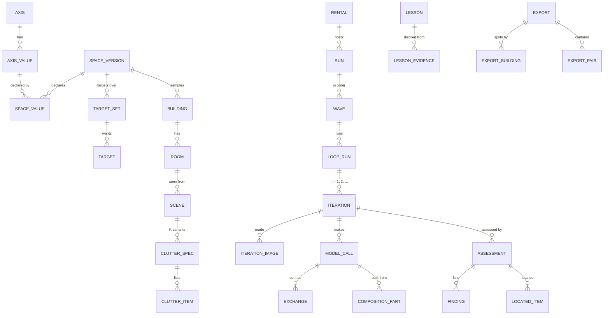

# clutter_pairs — data model

The store of one dataset: what is declared, what is planned, what each loop made and why it was accepted or
rejected, what was sent to every model and what each request was built from. Refines
[Stored data](README.md#stored-data) of the high-level design.

> **Status:** slice 1, implemented. The DDL is [schema.sql](../src/clutter_pairs/store/schema.sql): SQLite
> now; it avoids forward references and uses `BIGINT` and `DOUBLE PRECISION`, so moving to Postgres changes the ids
> only (`INTEGER PRIMARY KEY` here, an identity column there). Normalized to 3NF; the two denormalizations kept are
> named in the schema, each with the audit check that guards it.

## Table of Contents

1. [Principles](#principles) _(Lines 26-42)_
1. [Entities](#entities) _(Lines 45-76)_
1. [Schema](#schema) _(Lines 79-117)_
1. [Views](#views) _(Lines 120-131)_
1. [Checks run by `audit`](#checks-run-by-audit) _(Lines 134-155)_

---

## Principles
<!-- Lines 26-42 -->

- **Facts once.** Every text a request is built from or answered with is stored once (`text_blob`, by hash); every
  declared file once (`source_file`); every image once (`image`; the bytes in the image store, by hash).
- **What was sent is stored, not rebuilt from code.** Each HTTP exchange of a model call is recorded from the
  endpoint's observer: the body with every embedded image replaced by its hash, the exact image bytes in the image
  store, and the hash of the bytes on the wire. Rebuilding a body is a substitution plus base64, independent of any
  library version (P8).
- **Axis values have a stable identity:** the natural key (axis name, value). A space version declares which values
  it allows; rooms, scenes, clutter specs, clutter items, lesson scopes and coverage targets point to the value, so
  coverage and lessons keep matching when the targets or the ontology change. A value an ontology drops stays in the
  registry, still pointed to by what used it; nothing new can use it.
- **Derived, not stored:** the pair, coverage, the iteration curve, the carry-forward comparison, costs are views.
- **Polymorphic references are avoided:** a row that can point to one of several kinds of source has one nullable
  foreign key per kind and a check that exactly the one matching its kind is set.
- **The dataset folder:** `store.sqlite`, `images/<first two hex>/<sha256>` (virtual_unstaging's `BlobStore`; the
  media type is in `image`), `exports/<name>/`. Nothing in the package.

## Entities
<!-- Lines 45-76 -->

Left out of the diagram: the value tables, each linking its owner to one axis value per axis; `guidance`,
`measure`, `reason`, `model`, `decision`, and the files, texts and images every table points to.

## Schema
<!-- Lines 79-117 -->

The DDL is [schema.sql](../src/clutter_pairs/store/schema.sql): 44 tables in dependency order and the views below,
loaded in SQLite and in Postgres 18. One line per
table here; each table's comments in the file carry its rules.

| Group | Table | Holds |
|---|---|---|
| declared files, texts, images | `source_file` | every declared file as read at first use: space, instructions, composers with their renderer, schemas, reasons, targets, configuration, decision rules |
| | `text_blob` | every text a request is built from or answered with, once |
| | `image` | image metadata; the bytes are in the image store |
| space and targets | `space_version` | one (ontology, taxonomy) pair; owns no axis, only declares values |
| | `axis`, `axis_value` | the registry of axes and values across versions: the natural key is the identity |
| | `space_value` | the values one space version allows |
| | `target_set`, `target`, `target_value` | a targets file over a space version; each target a cell (axis values) and a wanted count |
| hierarchy | `building`, `room`, `scene` | the owner's ids; a scene carries its seed |
| | `clutter_spec`, `clutter_item` | K variants per scene, each with its seed and its items |
| | `room_value`, `scene_value`, `clutter_spec_value`, `clutter_item_value` | one axis value per axis and owner |
| runs | `rental` | the GPU session: provider, GPU, hourly price, start, deadline |
| | `run` | its configuration, target set, pair target, rental |
| | `wave` | ordered across runs; the smoke wave flagged |
| | `loop_run` | stage, subject, the clean image a clutter loop received, the lessons arm, the engine and its stop rule, the stop reason |
| | `iteration`, `iteration_image` | the engine's action and the seed per iteration; the images it made by role; its verdict (a named denormalization) |
| | `mask_region` | the numbered regions of a clutter iteration's change mask: box and mask pixels ([judge aids](judge_aids.md#a2-and-openings-in-detail)) |
| calls | `model` | name, revision, family, licence |
| | `model_call` | role, model, composer, canonical request (the cache key), answer, output image, reuse, timings, error |
| | `exchange` | every HTTP exchange of a call as sent and answered: bodies with images by hash, the wire hash |
| | `composition_part` | the ordered parts of a request, each with its source: file, lesson, assessment, earlier call, image, setting, seed |
| assessments | `reason` | reason codes with their stage and fixed severity |
| | `assessment` | pixel, judge, detector or human; its verdict (a named denormalization) |
| | `finding`, `finding_region`, `guidance`, `region_item` | the judge's findings (with its own severity recorded) and the regions each cites, its suggestions, the items it assigns to each region |
| | `measure` | pixel tests' values and the thresholds in force |
| lessons and decisions | `lesson`, `lesson_evidence`, `lesson_scope` | the text, the call that wrote it, what it replaces, the waves it is valid for, its evidence and scope |
| | `decision` | the owner's acts and every automatic rule's act (the lesson activation at each wave: the lessons added from a distill answer, the ones dropped and why) |
| exports | `export`, `export_building`, `export_pair` | a named snapshot; the split per building; its pairs |

**Public ids.** The export never publishes store-local integers. A pair's id is the hash of its clean and cluttered
images' hashes; a scene's, a room's and a building's are the hash of their axis values and seeds (and, for a room
or a building, of their children's ids). They survive a rebuild of the store.

## Views
<!-- Lines 120-131 -->

| View | Gives | How |
|---|---|---|
| `clean_image` | accepted clean images, per scene (several when models are compared, S3) | the `generated` image of a clean loop's iteration with verdict `accept` |
| `pair` | one row per accepted pair: id (the accepted clutter iteration), building, room, scene, clutter spec; clean image (the loop's `input_image`), cluttered (`composite`), mask (`change_mask`); the clean generator's family and the editor's | the clutter loop's accepted iteration; the families from the call that made `input_image` and from the edit call |
| `coverage` | per target of a target set: pairs wanted, pairs accepted | relational division on (axis, value): pairs whose room, scene and clutter values include every value of the target, whatever the space version |
| `iteration_curve` | per stage, loops in wave order with their iterations and stop reason | descriptive only |
| `carry_forward_loop`, `carry_forward` | the compared loops; per stage and arm (`on`, `off`): loops, accepted share, mean iterations to acceptance | finished loops (not stopped by a deadline or an error) in waves from the stage's first active lesson on, the lessons' evidence loops excluded; the decision rule is applied by the report ([loops.md](loops.md#measuring-carry-forward)) |
| `lesson_use` | per lesson: the loops whose first request cited it | `composition_part` rows of kind `lesson`; descriptive (per-lesson effects: slice 2) |
| `call_cost` | per run, stage, role and model: calls, reused calls, wall seconds, generator GPU-seconds | `model_call`; the rental's price times the run's wall clock and the cost per accepted pair are computed by the report (date arithmetic differs between SQLite and Postgres) |
| `pair_value` | every axis value of a pair: its room's, its scene's, its clutter spec's | used by `coverage` |

## Checks run by `audit`
<!-- Lines 134-155 -->

Requests and records:
- **P9:** every request recomposes: the composer file, the call's model and the parts in order give the request
  stored under `request_sha`, byte for byte; every part's text is its source's rendering (an instruction part is its
  file, a lesson part its lesson, a spec part its loop subject's spec rendered by the composer's renderer).
- **P8:** every exchange's body rebuilds: its stored text with each image reference replaced by the base64 of the
  stored bytes, or its stored image, hashes to `wire_sha`.
- Every image hash has its bytes in the image store, and the bytes hash to it.

Denormalizations and rules:
- `iteration.verdict` and `assessment.verdict` equal the verdict rule applied to the findings and the reasons'
  severities; `stop_reason = 'accepted'` exactly when the loop has an iteration with verdict `accept`.
- A clutter loop's `input_image` is the `generated` image of an accepted iteration of a clean loop of the same scene.
- An image role fits its loop's stage (`generated` on clean loops only; the other roles on clutter loops only).
- A clutter iteration's regions recompute from its stored change mask with the thresholds recorded beside them, and
  its `regions` image redraws byte for byte from its composite and those regions.

Space and exports:
- Every owner holds exactly one value for every axis that applies to its kind, and each value is declared by its
  building's space version (`space_value`).
- Every exported pair is an accepted clutter iteration, and its building has a split row in that export.
- **P1:** for every pair, clean and cluttered images are equal wherever the mask's alpha is 0.
