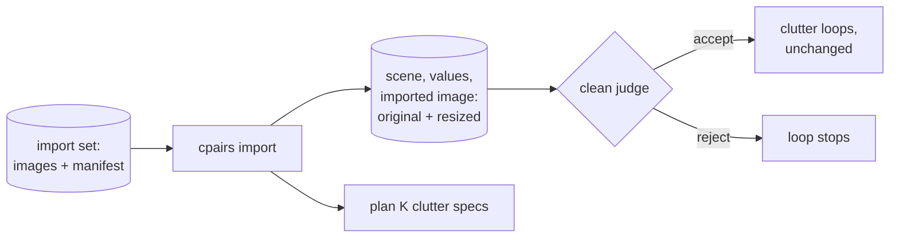

# clutter_pairs — imported clean images

How clean images made outside the clean loop enter the dataset: renders of a procedural 3D generator, or real
photographs of empty rooms. Realizes usage scenario S5 of [design/README.md](README.md#usage-scenarios) and the
owner's preferred clean sources (choice C1); refines [loops.md](loops.md) and [data_model.md](data_model.md).

> **Status:** *proposal* (2026-10-23), written for the owner's request to feed rendered empty rooms into the clutter
> loop. **Implemented (2026-10-24), awaiting the owner's review**; tested offline on stand-in models
> and generated images; revised after an independent review the same day. A render or a photo replaces the clean
> loop's generator; the clean judge, the clutter loop and the export are unchanged, the audit gains the import checks.
> Points the design left unclear and how the code settles them: [Settled in the
> implementation](#settled-in-the-implementation); review findings left to the owner: [Awaiting the
> owner](#awaiting-the-owner). Decision I1 is a proposal that replaces "one building per image".

## N0
<!-- Lines 17-29 -->

- An **import set** is a folder of images and a `manifest.jsonl`, one line per image: the file, its room type, its
  source (name, revision, family, licence), optional other axis values, an optional origin (URL or render seed), an
  optional `group` (views of one room).
- `cpairs import <folder>` makes one scene per image, with the values the manifest gives (room type at least); an
  image has its own building and room unless it names a `group`, whose views share one building and one room (I1,
  proposal). It makes the image opaque RGB, resizes it to the size the editor returns at the run's `output_side`,
  stores both, and plans the scene's K clutter specs as for a generated scene.
- At the next `run`, an imported scene's clean loop has **one iteration and no generation**: its image is judged by
  the clean judge; accepted, it feeds the clutter loops; rejected, the loop stops (no prompt to revise).
- The source is recorded as a `model` row (its family counts in the editor-family rule, choice C8), so an export
  says which pairs have an imported clean image and from what.

## Data flow
<!-- Lines 32-40 -->



## Decisions
<!-- Lines 43-51 -->

| # | Decision | Why |
|---|---|---|
| I1 | **(proposal, awaiting the owner)** Images that name the same `group` (and the same source) share one building and one room, each image its own scene; an image with no group has its own building, room and scene | split safety (P6): the views of one rendered or photographed room must land in one split, and the split is a property of the building; for an image with no group the ids rule of slice 1 (one scene per room and building) holds. Replaces "one building, room and scene per imported image", which put two cameras of one room in two splits |
| I2 | Values only where the manifest gives them; room type required | an import was not drawn from the space: inventing a style or a light would be false; coverage counts it only in the cells its values name |
| I3 | Make the image opaque RGB and resize it to `output_size(image, output_side, size_multiple)`; reject an image whose resized size exceeds the editor's condition-image limit or that the editor would return at another size | the clean image and the edit must have the same size and mode (pair truth, P1); the original is kept with its hash; the parameters are recorded with the import set |
| I4 | Judged once by the clean judge, no revision | the same quality gate as a generated image; nothing to revise without a prompt |
| I5 | The source is a `model` row; no `model_call` for the import | the family rule (C8) and the export read families from models; an import is not an exchange, so P8 and P9 do not apply to it, and the audit checks the import record instead |

## Data model
<!-- Lines 54-67 -->

- `import_set` (id, manifest_sha → `source_file`, imported_at, output_side, size_multiple, condition_max_pixels,
  resampler): one `cpairs import` and the sizing it applied.
- `imported_image` (scene_id PK → `scene`, import_set_id, line, original_sha → `image`, pixel_sha, image_sha →
  `image`, source_model_id → `model`, group_name, origin text): the image a scene's clean loop judges. The original's
  bytes, its decoded pixels and the resized image are each unique; scenes of one room share their group name.
- `iteration.action` admits `import`; `iteration_image.role` admits `imported`. The clean loop of an imported scene
  has one iteration, action `import`, image role `imported`, then the judge's call as usual.
- Views: `clean_image` takes the `imported` image of an accepted iteration as well as a `generated` one; `pair` takes
  the clean family from `imported_image.source_model_id` when the clean image was imported.
- Audit: every `imported_image` has its line in the stored manifest, its two images in the image store, and its clean
  image equals its original resized again, pixel for pixel, with the parameters of its import set; the image an
  imported iteration judged is the recorded one; the scenes of a room share one group and one source.

## Manifest line
<!-- Lines 70-80 -->

```json
{"file": "kitchen_101_cam0.png", "room_type": "kitchen",
 "source": {"name": "infinigen", "revision": "2.0.0a3", "family": "infinigen-procedural", "licence": "BSD-3-Clause"},
 "values": {}, "origin": "render seed 101, camera 0", "group": "kitchen 101"}
```

`group` is optional: the views of one room (cameras of one render) give the same text, which is scoped to the source,
so a later import can add a view to an existing group. Views of a group must give the same room type and room values;
light and camera may differ per view.

## Settled in the implementation
<!-- Lines 83-128 -->

Choices the design did not state; each is a proposal for the owner to confirm or change.

- **A rejected import stops with `max_iterations`** (the loop's budget is its one iteration), no new stop reason. Its
  engine is `import@1+one_iteration@1`, its arm `off` (no prompt for a lesson to change), `max_iterations` 1, no
  distill. A rejected scene is dead: no clutter loop, never retried; re-importing the image is skipped (below).
- **I3 also refuses a size the editor would not return.** The sizing rule is not always a fixed point (about one
  random aspect in five at side 1024): such an image is resized to a size the editor then changes, and every edit would
  be `misaligned`. Import checks, as `check_sizes` does for a camera, that the editor returns the resized size, and
  refuses the image with the sizes named (crop it to an aspect that survives). **All problems of a set are reported
  together and nothing is imported.**
- **A `group` replaces "one building per image"** (I1; proposal, awaiting the owner). Review of the first implementation
  showed two cameras of one rendered room in train and test (P6). Views of one group share a building and a room, so
  the export's split (a property of the building) is one for all of them. The manifest's author must name the groups;
  the code cannot know which images show one room.
- **One picture enters once.** The original's bytes, its decoded RGB pixels (EXIF applied) and the resized image are
  each unique (`imported_image.original_sha`, `pixel_sha`, `image_sha`): the same picture saved with another
  compression is not a second building. A second `import` skips the pictures already in the dataset and reports them.
- **A clean image is opaque RGB:** an alpha channel with a transparent pixel is refused, a grey or fully opaque image
  is converted, so the clean and the cluttered image have one mode.
- **The sizing parameters stay with the import set**, and the audit resizes each original again with them and
  compares pixels (one grey level of slack, so a Pillow upgrade does not fail every import). A `run` refuses imported
  scenes with work left when the configuration's `output_side`, multiple or limit no longer keeps their size (it
  stops with a message; `plan`, `audit` and `export` still open the dataset).
- **The scene's seed** is derived from the dataset's seed and the original's hash, so ids (hashes of values and seeds)
  survive a rebuild. The K clutter specs are drawn as the planner draws them, from the space's densities in order
  (no cell to start from), by the same function (`space.sample_clutter_specs`).
- **The clean loop of an imported scene is left out of the carry-forward comparison** (`carry_forward_loop`): its
  iterations to acceptance do not depend on lessons and would dilute the `on` / `off` difference. Its clutter loops
  stay in.
- **Audit relaxes the value rule for imported owners only:** a room or scene of an imported image must hold its room
  type, other axes only if the manifest gave them. It also checks that the action `import` and the image role
  `imported` appear only in the clean loop of an imported scene, that the manifest line, read again, gives the
  scene's values, source, group and origin, that the judged image is the recorded one, and that every accepted
  clutter iteration is a pair.
- **Imported scenes run before generated ones only when they were imported first:** a wave takes scenes by rank, then
  by scene id, so scenes planned before the import come first. Targets do not see an imported pair unless its values
  include every value of a cell (a default cell names a style: none matches).
- **A source name carries one licence** (until the owner rules on 7 below). The source is a `model` row, unique on
  (name, revision): a clash, with the manifest or with an earlier import, is found at validation and reported with the
  other problems of the set.
- **`audit <pair>` lineage** carries an `import` entry (set, manifest line, original hash, origin, source).
- **Store version 3, no migration**, as for version 2: a store of an earlier version is refused by its version
  number; the `CHECK` lists of `iteration.action`, `iteration_image.role` and `source_file.kind` cannot be widened
  in place by SQLite without rebuilding tables.

## Awaiting the owner
<!-- Lines 131-158 -->

Review findings (2026-10-24) the code does not settle, each with the reviewer's recommendation. Numbers are the
review's.

- **5. The clean judge's instruction speaks of "one generated photograph" and of "room type, style, light, camera"**,
  while an import's spec gives the room type at least. How the real judge reacts is not measured (no GPU).
  Recommendation: its own composer and instruction, `clean_judge_imported`, saying the axes not given are free; a
  new file keeps P9 exact.
- **7. Licence and attribution belong to an image, not to a `model` row.** The rule "one source name per licence"
  stores an image's attribute in a name, and the export carries no author or source for CC BY and CC BY-SA photographs.
  Recommendation: licence and attribution on `imported_image` (or a child table), carried by the export, the `model`
  row keeping the family; needed before photographs, not for renders (choice C1).
- **8. Schema version 3 has no migration from version 2** (two new tables, three tables rebuilt for their `CHECK`
  lists, views recreated), against the repository's guideline of a versioned migration. A version-2 store, the 32-pair
  GPU dataset if it was kept as a store, is refused. Recommendation: a migration script, or a statement that the
  version-2 store is disposable.
- **9. The smoke wave runs imported scenes first** whenever they have lower ids, so it may never test text-to-image,
  which it exists to check. Recommendation (review: the owner decides): a smoke wave of one imported and one
  generated scene when both exist.
- **11. A rejected import stops with `max_iterations`**, the same reason as a revision budget running out.
  Recommendation: a separate `rejected` stop reason, free now that the schema changes anyway.
- **15. Small originals are upscaled without bound** (400x300 becomes about 1024x1024 pixels) and the rounding stretches
  the aspect by up to 1.56% (16:9 becomes 1344x768). Recommendation (review): a minimum original size, or a crop;
  the threshold is the owner's choice.
- **16 (last point). `pair_target` counts imported pairs while the default coverage cells do not** (their values name
  no style). Recommendation (review): the owner decides whether imported pairs count toward the target, or the targets
  gain cells that name room type and density only.

## Open
<!-- Lines 161-164 -->

- Whether a procedural render's style and light could be mapped onto the space's axes (a renderer knows its
  materials and its sky); for now they are left out (I2).
- Real photographs: same path; their licence and attribution per image: see "Awaiting the owner", 7.
