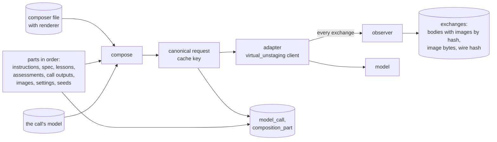
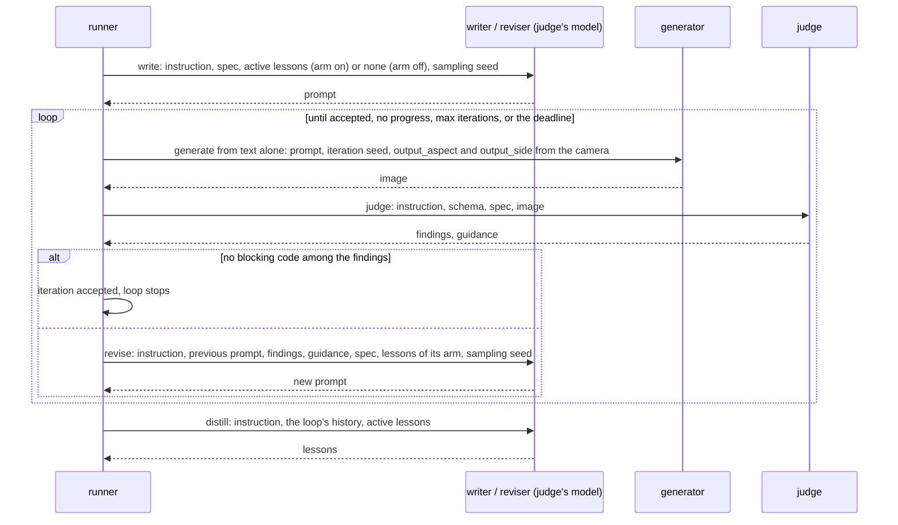

# clutter_pairs — loops, composition and lessons

How one clean image and one cluttered image are made: the files a request is composed from, how calls are recorded,
the two loops, the pixel tests and the composite, the verdict and the stop rule, the lessons carried to the next
image and how their effect is measured. Refines [Inner loops and carry-forward](README.md#inner-loops-and-carry-forward)
and [Auditability](README.md#auditability); tables are in [data_model.md](data_model.md).

> **Status:** slice 1, implemented as written here; tested offline on stand-in models. Owner's decisions applied: a
> comparison group without lessons (about one subject in three), the decision rule written before the rental.

## Table of Contents

1. [Vocabulary](#vocabulary) _(Lines 28-39)_
1. [Files in the package](#files-in-the-package) _(Lines 42-54)_
1. [Composition and recording](#composition-and-recording) _(Lines 57-89)_
1. [The clean loop](#the-clean-loop) _(Lines 92-124)_
1. [The clutter loop](#the-clutter-loop) _(Lines 127-158)_
1. [The verdict and the stop rule](#the-verdict-and-the-stop-rule) _(Lines 161-174)_
1. [Lessons](#lessons) _(Lines 177-193)_
1. [Measuring carry-forward](#measuring-carry-forward) _(Lines 196-209)_
1. [The run](#the-run) _(Lines 212-225)_

---

## Vocabulary
<!-- Lines 28-39 -->

| Term | Meaning |
|---|---|
| subject | what a loop works on: a scene (clean loop) or a clutter spec on an accepted clean image (clutter loop) |
| role | what a model call does: write, generate, edit, judge, revise, distill |
| composer | a versioned file that says, for one role, which parts go into the request, in which order, and which spec renderer (with its version) turns a subject's values into text |
| part | one input of a request: a template text, an instruction file, an answer schema, the subject's spec, a lesson, an earlier assessment, an earlier call's output, an image, a setting, a seed |
| canonical request | the request in a stable form, images by hash: what the cache is keyed on |
| exchange | one HTTP request and its answer, as the endpoint's observer saw them |
| arm | whether a loop's first request gets the active lessons (`on`) or none (`off`); drawn per subject, recorded |
| wave | the subjects run in parallel; lessons distilled in one wave become active in the next |

## Files in the package
<!-- Lines 42-54 -->

Versioned by git, copied into the store by content hash at first use (`source_file`). A dataset's configuration may
name another file for any of them (the override); it is recorded the same way.

| Folder | Files | Read by |
|---|---|---|
| `instructions/` | `clean_writer.md`, `clean_judge.md`, `clean_reviser.md`, `clutter_writer.md`, `pair_judge.md`, `clutter_reviser.md`, `distiller.md` | the model of each role, as its instructions |
| `composers/` | one TOML per role: message blocks, each a list of slots; the spec renderer and its version | the composer |
| `schemas/` | `clean_judgment.json`, `pair_judgment.json`, `lessons.json`, `text.json` (one field: free text) | the judge, the distiller, the writer and the reviser, as the required answer format |
| `space/` | `ontology.toml`, `taxonomy.toml`, `targets.toml` (a generic default space) | the planner |
| `reasons.toml` | each reason code with its stage and fixed severity | the store (`reason`), the judges' schemas, the verdict rule |
| `decision_rules/` | `carry_forward.md`: how the arms are compared, written before a rental | the report |

## Composition and recording
<!-- Lines 57-89 -->

- **Pure composition (P9).** A composer is a function of its file, the call's model and the ordered parts; nothing
  else enters a request. Settings and seeds are parts with their origin (run configuration, subject's spec, engine
  move), so `audit` recomposes every request and compares it with the stored canonical request, byte for byte. A
  setting part in the slot `setting` is a request setting (temperature, answer length, output size); in any other
  slot it is text the model reads (the distiller's `outcome`: how the loop stopped).
- **What was sent (P8).** Requests go through virtual_unstaging's clients; its endpoint observer hands every exchange
  to clutter_pairs' recorder: blob uploads, the request, job polls, downloads. A text body is stored with each data
  URL `data:<type>;base64,<…>` replaced by `data:<type>;sha256,<hex>` and the decoded bytes kept in the image store;
  an image body is stored as an image; the hash of the bytes on the wire is kept. Rebuilding a body is base64 and a
  substitution, independent of any library version; `audit` checks every rebuilt body against its wire hash.
- **Seeds for every model.** The generator and the editor take the iteration's seed: the subject's seed at the
  first iteration, kept by a revision (only the prompt changes), drawn anew by a reseed. Writers, revisers, judges and
  the distiller take a sampling seed derived from the subject's seed, the role and the iteration, sent as the chat
  server's `seed`: two scenes with equal values get different prompts, while replay stays exact.
- **Cache.** A call whose canonical request and model revision equal an earlier one's returns the stored answer
  (`reused_call_id`): a finished run started again makes no call (P2). A step redone in the same iteration (a resume
  after a pause) finds its own call and adds no row. A model that answers off its contract (no JSON, a foreign code)
  keeps its answer, the call is marked `bad_answer`, and the loop stops with `error`; a replay meets the same
  answer.

## The clean loop
<!-- Lines 92-124 -->

- **Judge, clean:** empty or tidy (only items the taxonomy marks as fixed to the building), on spec (room type, style,
  light, camera), plausible as a photograph.
- **Image size.** The ontology's camera aspects are restricted to fixed points of the tool server's sizing rule at
  the run's `output_side` and the model's size multiple: an image of that size, edited, comes back at the same size.
  The space is checked when it is loaded (a test covers it). `output_side` keeps clean images under the editor's
  condition-image limit, so the editor sees the clean image unscaled (the limit is read from the model before the
  rental).

## The clutter loop
<!-- Lines 127-158 -->

Same shape. The subject is a clutter spec; its input image C is one accepted clean image of the scene, recorded on
the loop (`input_image`).

1. **Write** the instruction: the clutter writer's instruction, the spec (room, scene, density, items with category,
   placement, attachment), the placement rules that apply, the lessons of the arm.
2. **Edit:** the editor receives C as `original`, the instruction, the iteration's seed. Output: the raw edit E,
   at C's size (otherwise reason `misaligned`).
3. **Correct and test globally:** estimate the shift between C and E and E's global colour and level change on the
   far field (pixels clearly unchanged); correct E's colour and levels (`corrected_edit`). Above a tolerance:
   `misaligned` (shift) or `global_repaint` (colour), with no judge call.
4. **Change mask:** a per-pixel colour difference between C and the corrected E (CIE ΔE after a small blur),
   thresholded, cleaned (opening, closing), dilated, feathered into an alpha in [0, 1]; it includes shadows and
   reflections because it is measured, not drawn. Its share of the image must lie in the range the density implies,
   otherwise `clutter_off_spec`.
5. **Composite:** K = C where the alpha is 0, the corrected E where it is 1, blended between. K is the cluttered image;
   C stays the clean one (P1: equal wherever the alpha is 0).
6. **Judge, pair:** C, K and the mask; the clutter matches its spec and its placement rules, nothing else in the
   room changed, K is plausible as a photograph; the judge **locates each specified item** (a box per item).
7. **Explained change:** every connected component of the mask must fall in a located item's box; a component that
   does not is an `unexplained_change` (a repainted patch, a removed fixture, a changed frame pasted along with the
   clutter). Identity outside the mask is necessary, not sufficient: this test guards the inside.
8. **Revise** or accept, as in the clean loop; then distill.

Every threshold in force is recorded with what it was compared to (`measure`, kind `threshold`). The owner looks at
20 to 30 pairs early in the rental and sets the thresholds (a `decision` row each).

**Same VAE in slice 1:** one model makes C and E, so C already carries that model's image signature; the remaining
asymmetry (the inside of the mask went through one more encode-decode) is a known shortcut-cue risk, measured by the
dataset audit of slice 3. Slice 2's second family generates its own clean images with its own text-to-image model,
which keeps one VAE per pair.

## The verdict and the stop rule
<!-- Lines 161-174 -->

- **Verdict:** the judge answers on its schema: findings (a reason code, its own severity, an optional region in
  thousandths of the width and height, stored in [0, 1], a comment), guidance (ranked suggestions), and, for the pair
  judge, the located items. A degenerate box is dropped (a finding without a region; an item counted as not
  located). An iteration is
  accepted when no finding's code is blocking: the severity is the code's, from `reasons.toml`, so the verdict does not
  rest on the judge's severity call (which is recorded).
- **Score and no progress:** each assessed iteration scores (blocking findings, minor findings). The loop stops with
  `no_progress` when its best score has not strictly improved for 2 iterations; a pixel failure (`misaligned`,
  `global_repaint`) is answered first by a reseed, since a prompt rarely fixes it. The rule's name and version are
  part of `loop_run.engine`.
- **Limits:** `max_iterations` per loop and stage (6 by default); the run stops at its pair target or at the
  rental's deadline (P4), whichever comes first; a call the deadline would cut is not started.

## Lessons
<!-- Lines 177-193 -->

- **Distill** after every loop of two or more iterations: the distiller gets its instruction, the loop's history
  (prompts, findings, guidance, final verdict), the spec, and the active lessons in scope; it answers on the lessons
  schema: new lessons, each with its text, its scope (a subset of the subject's axis values; empty for all), its
  evidence (iteration numbers), and the lessons it replaces.
- **Validity:** a lesson is active from the wave after the one that distilled it until it is replaced, retired or
  promoted (`active_from_wave_id`, `ended_wave_id`); the active set at any wave is derivable, so replay is exact.
  When a wave is created, each distill answer not yet processed is parsed once: its lessons are added (a text
  already active for the stage, or just added, is dropped), and the rule's act is a `decision` row
  (`rule:activate_lessons@1`: the lessons added, the ones dropped and why). The owner's retirements and promotions
  take effect at that wave too.
- **Use:** the first request of a loop in the `on` arm gets the active lessons of its stage whose scope is included in
  the subject's values, most specific first, at most a configured number; the `off` arm gets none. Revisions follow
  the loop's arm.
- **Retire and promote:** by the owner through the command line (`decision` rows); promotion ends the lesson and
  prints its text for the owner to add to the instruction file in force, a new file version in git.

## Measuring carry-forward
<!-- Lines 196-209 -->

The owner's hypothesis: lessons make later images need fewer iterations. A falling curve alone cannot show it (later
loops differ in order, cells and other lessons), so slice 1 compares arms.

- **Arms:** each subject is drawn `off` with probability 1/3 (`off_share` in the decision rule's file), `on`
  otherwise, by a draw seeded from the subject's seed, recorded on the loop.
- **Compared loops:** those in waves after the stage's first lesson became active, the lessons' evidence loops
  excluded (they were selected for being hard).
- **Decision rule** (`decision_rules/carry_forward.md`, written before the rental, as proposed; its parameters in a
  TOML block the report reads): per stage, carry-forward helps if the `on` arm's mean iterations to acceptance is
  lower than the `off` arm's by at least 0.5, with a one-sided permutation test at p < 0.1, and its acceptance share
  is not lower; with fewer than 3 accepted loops in an arm, undecided. Slice 1 has about 17 clean and
  50 clutter loops: the test can show a large effect or none; per-lesson effects wait for slice 2.

## The run
<!-- Lines 212-225 -->

- **Smoke wave first:** each rental starts with one wave of two scenes through both loops (`wave.smoke`), checked
  before the other waves: text-to-image on the chosen model, sizes, recording, the composite. A rental's first `run`
  runs the smoke wave only and stops; the next `run` goes on.
- **Stop:** between waves, at the pair target or when the next call would pass the deadline; inside a wave, no
  clutter loop starts once the target is reached. A loop the deadline stops resumes on the next rental; a loop an
  endpoint failure interrupts stays unfinished and resumes on the next `run`.
- **Waves:** a few scenes run in parallel (`wave_width`), each its clean loop then its clutter loops, so the GPU
  alternates generation and judgment; one generator (or editor) and one judge are loaded; the writer, the reviser
  and the distiller run on the judge's model. Before each wave the planner tops up the scenes whose loops failed.
- **Resume:** the loop's policy is an engine behind virtual_unstaging's generic ask / tell contract
  (`engines.SearchEngine`); its candidate is the next action (write, revise from an assessment, reseed). A resumed
  loop replays its stored history through virtual_unstaging's `engines.replay`, which checks that the engine asks
  again what is stored; the cache returns every stored answer, so nothing is called twice.
