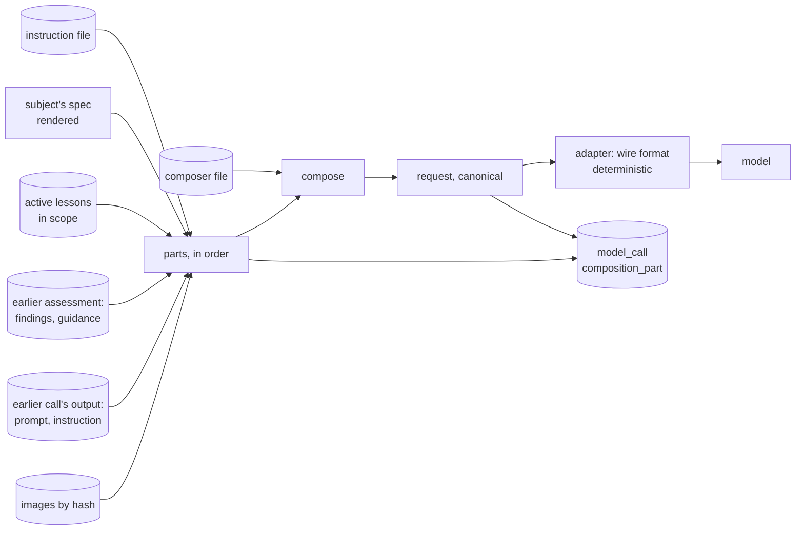
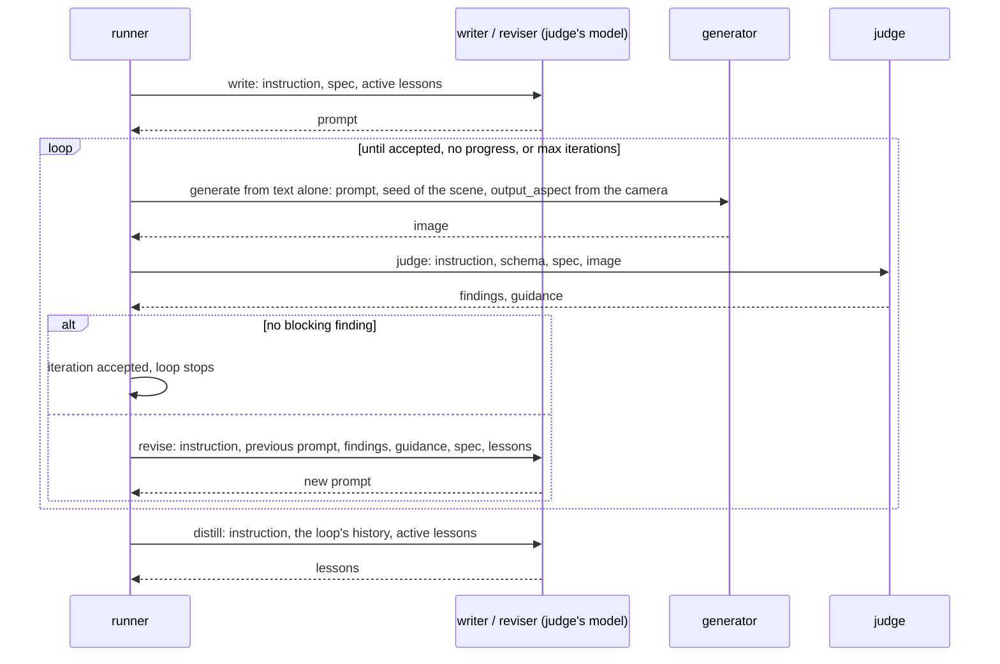

# clutter_pairs — loops, composition and lessons

How one clean image and one cluttered image are made: the files a request is composed from, the two loops, the pixel
tests and the composite, the judge's answer, the stop rules, and the lessons carried to the next image. Refines
[Inner loops and carry-forward](README.md#inner-loops-and-carry-forward) and [Auditability](README.md#auditability);
tables are in [data_model.md](data_model.md).

> **Status:** *proposal* for slice 1, not accepted.

## Table of Contents

1. [Vocabulary](#vocabulary) _(Lines 26-36)_
1. [Files in the package](#files-in-the-package) _(Lines 39-50)_
1. [Composition](#composition) _(Lines 53-83)_
1. [The clean loop](#the-clean-loop) _(Lines 86-115)_
1. [The clutter loop](#the-clutter-loop) _(Lines 118-141)_
1. [Judge answers and the verdict](#judge-answers-and-the-verdict) _(Lines 144-153)_
1. [Lessons](#lessons) _(Lines 156-168)_
1. [Resume and reuse](#resume-and-reuse) _(Lines 171-178)_

---

## Vocabulary
<!-- Lines 26-36 -->

| Term | Meaning |
|---|---|
| subject | what a loop works on: a scene (clean loop) or a clutter spec on an accepted clean image (clutter loop) |
| role | what a model call does: write, generate, edit, judge, revise, distill |
| composer | a versioned file that says, for one role, which parts go into the request and in which order |
| part | one piece of a request: a template text, an instruction file, an answer schema, the subject's spec, a lesson, an earlier judgment, the output of an earlier call, an image |
| request | what is sent to a model, stored in canonical form: JSON with sorted keys, each image replaced by its hash |
| lesson | a short instruction fragment distilled from a loop's history, with a scope (stage and cell) and its evidence |
| wave | the subjects run in parallel; lessons distilled in one wave serve the next |

## Files in the package
<!-- Lines 39-50 -->

Versioned by git, copied into the store by content hash at first use (`source_file`). A dataset's configuration may
name another file for any of them (the override); it is recorded the same way.

| Folder | Files | Read by |
|---|---|---|
| `instructions/` | `clean_writer.md`, `clean_judge.md`, `clean_reviser.md`, `clutter_writer.md`, `pair_judge.md`, `clutter_reviser.md`, `distiller.md` | the model of each role, as its instructions |
| `composers/` | one TOML per role: message blocks, each a list of slots | the composer |
| `schemas/` | `clean_judgment.json`, `pair_judgment.json`, `lessons.json` | the judge and the distiller, as the required answer format |
| `space/` | `ontology.toml`, `taxonomy.toml`, `targets.toml` (a generic default space) | the planner |
| `reasons.toml` | the typed reasons a check or a judge may give, per stage | the store (`reason`), the judges' schemas |

## Composition
<!-- Lines 53-83 -->

A composer is a pure function: (composer file, ordered parts) → request. Nothing else enters a request.

- **Slots** of a composer: `template` (literal text in the composer file itself), `instruction`, `schema`, `spec`,
  `lessons`, `assessment`, `call_output`, `image:<role>`. A slot that receives several items (lessons) records one
  part per item, in order.
- **Canonical request and wire format.** The stored request is JSON with sorted keys and images as
  `{"image": "<sha256>"}`. The adapter turns it into the bytes sent (data URLs, multipart) by a deterministic
  encoding whose parameters (format, maximum side) are part of the request. The endpoint's observer (an extension
  point of virtual_unstaging's HTTP client) hands over the bytes actually sent and received; their hash is stored
  (`wire_sha`) and the raw answer kept. "Stored as sent" therefore means: the bytes sent are rebuilt exactly from the
  stored request and the image store, and `audit` checks it against `wire_sha` (P8).
- **Recomposition (P9):** `audit` reads each call's composer file and parts, recomposes, and compares the hash with
  `request_sha`. A difference is an error: a request was built from something not recorded.
- **Spec rendering** is part of the composer (a named renderer and its version), so a spec part's text can be
  rendered again from the store.

## The clean loop
<!-- Lines 86-115 -->

- **Seed:** one per scene, shared by every generation of the loop, so two iterations differ by the prompt only
  (virtual_unstaging's common random numbers, design D5). The engine may reseed as an explicit move, recorded.
- **Judge, clean:** empty or tidy (only items the taxonomy marks as fixed to the building), on spec (room type, style,
  light, camera), plausible as a photograph.

## The clutter loop
<!-- Lines 118-141 -->

Same shape. The subject is a clutter spec; the input image is the scene's accepted clean image C.

1. **Write** the instruction: clutter writer's instruction, the spec (room, scene, density, items with category,
   placement, attachment), the placement rules that apply, active lessons.
2. **Edit:** the editor receives C as `original`, the instruction, the clutter spec's seed. Output: the raw edit E.
3. **Build the pair** (no model):
   - alignment: the shift between C and E, estimated on the whole image; above a tolerance, reason `misaligned`;
   - change mask M: a per-pixel colour difference between C and E (CIE ΔE after a small blur), thresholded,
     cleaned (opening, closing), dilated and feathered; it includes shadows and reflections because it is measured,
     not drawn;
   - drift: the mean difference outside M, before compositing; above a tolerance, reason `change_outside_clutter`;
   - area: the share of the image inside M, against the range the density implies; outside it, `clutter_off_spec`;
   - composite K = C outside M, E inside M, blended across the feather. K is the cluttered image; C stays the clean.
4. **Pixel assessment:** the three tests above, recorded with their measures; a failure goes straight to revise,
   with its reasons, without a judge call.
5. **Judge, pair:** C, K and M; the clutter matches its spec and its placement rules, C and K read as one room, K is
   plausible as a photograph.
6. **Revise** or accept, as in the clean loop; then distill.

**Same VAE in slice 1:** one model makes C and E, so C already carries that model's image signature; the remaining
asymmetry (the inside of M went through one more encode-decode) is a known shortcut-cue risk, measured by the
dataset audit of slice 3.

## Judge answers and the verdict
<!-- Lines 144-153 -->

- The judge answers on its schema: `findings` (code from the reasons file, severity blocking or minor, optional region
  in [0, 1], comment) and `guidance` (ranked suggestions for the next prompt). Its own overall verdict, if it gives
  one, is recorded and never used.
- **Verdict, computed:** accept when no finding is blocking (the rule of virtual_unstaging's design D4: one rule,
  defined once, recomputed from findings).
- **No progress:** the set of blocking codes is the same for two revisions in a row.
- **Budget:** `max_iterations` per loop and stage (configuration; 6 by default); a run's GPU-seconds budget; a call
  that would exceed it is refused and the loop stops with `budget`.

## Lessons
<!-- Lines 156-168 -->

- **Distill** after every loop of two or more iterations: the distiller gets its instruction, the loop's history
  (prompts, findings, guidance, final verdict), the spec, and the active lessons in scope; it answers on the lessons
  schema: new lessons, each with its text, its scope (a subset of the subject's axis values; empty for all), its
  evidence (iteration numbers), and the lessons it replaces.
- **Use:** the writer's first call of a loop gets the active lessons of its stage whose scope is included in the
  subject's values, most specific first, at most a configured number.
- **Measure:** the view `lesson_effect` compares loops in a lesson's scope that used it with those that did not; the
  report shows it with the iteration curve per stage.
- **Retire and promote:** in slice 1, by the owner through the command line (`decision` rows); an automatic retirement
  rule waits for enough loops to measure. Promotion copies a lesson into an instruction file: a new file version,
  in git.

## Resume and reuse
<!-- Lines 171-178 -->

- Every call is keyed by the hash of its canonical request and its model revision; an identical request returns the
  stored answer (`reused_call_id`), so a finished run started again makes no model call (P2), and an interrupted
  one resumes from the store's states.
- The loop policy (when to stop, revise, reseed) is an engine behind virtual_unstaging's generic ask / tell contract
  (`SearchEngine`), whose candidate here is the next action (write, revise from an assessment, reseed). It is a
  deterministic function of the stored history, so resume is a replay, as virtual_unstaging's engines are (design
  D10 there); the driver that replays it is clutter_pairs' own, about twenty lines over its own store.
