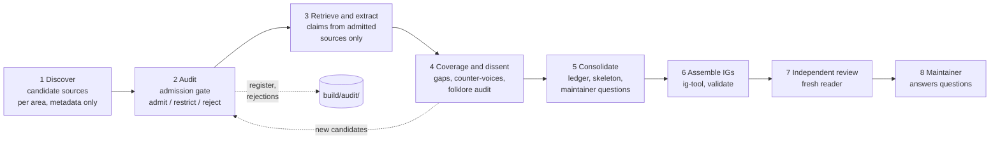

# JavaScript guidelines: build plan

Status: built. Stages 1 to 7 done, plus gap rounds 13 SRVSEC and 14 SECGAP2, each reviewed and fixed. 443 documents audited, 412 admitted (261 restricted), 31 rejected; 700 claims; two IntentGraphs in `../intent_graphs/` (52 + 287 nodes after the language-general principles went to the software development guideline, `handoff/to_software_guideline/`; validate clean). Reviews: `review/result.md` (18 of 21 fixed), `review/patch14/result.md` (16 of 17 fixed, 1 partly). Open items: `../intent_graphs/README.md` section Not covered.

## Table of Contents

1. [Goal](#goal) _(Lines 22-32)_
1. [Boundary with sibling guidelines](#boundary-with-sibling-guidelines) _(Lines 35-46)_
1. [Pipeline](#pipeline) _(Lines 49-75)_
1. [Source admission policy](#source-admission-policy) _(Lines 78-133)_
1. [Research areas](#research-areas) _(Lines 136-155)_
1. [Claim format](#claim-format) _(Lines 158-169)_
1. [Target IntentGraphs](#target-intentgraphs) _(Lines 172-184)_
1. [Agents and model tiers](#agents-and-model-tiers) _(Lines 187-200)_
1. [Maintainer decisions](#maintainer-decisions) _(Lines 203-229)_

---

## Goal
<!-- Lines 22-32 -->

**Level 0.** JavaScript whose behaviour is predictable, whose changes stay cheap, and which
resists attack, in that order of dependency: security rests on predictability, and
maintainability rests on both.

The guideline is code-level: how to write, type, structure, check and ship JavaScript. It is
held as IntentGraphs, distilled from a source base that has passed an explicit admission audit.
JavaScript is the most written language with the lowest average standard of published advice,
so **the admission audit is the core of this build**, not a formality: most of what a search
returns must be rejected, and every rejection carries the reason.

## Boundary with sibling guidelines
<!-- Lines 35-46 -->

| Topic | Owner |
|---|---|
| What the browser tier owns, rendering strategy (SPA vs server HTML), JS server tier, API contract, session and token architecture, CSP *as a deployment policy* | `../web_architecture_guidelines/` |
| Code that runs in the browser or in Node: language use, types, modules, async, errors, DOM-safe code, injection classes, dependencies, tooling, tests | **this guideline** |
| Python code | `../python_guidelines/` |
| CLI interface contract (any language) | `../cli_guidelines/` |
| Concerns of any software project whatever its language: sourcing (what to build versus take, finding and judging libraries and other code sources), application architecture, validating that the product works for its users (UX), deploy, operations and monitoring, the development process | a separate software development guideline (planned, maintainer decision); this guideline holds only their JavaScript-specific rules |

A claim on a boundary is recorded once, tagged `boundary: <owner>`, and becomes an inter
intentlink, never a copy.

## Pipeline
<!-- Lines 49-75 -->

Order changed from the web-architecture build: **sources are audited before any claim is
extracted**, so no claim is ever written from a source that later fails the gate.

| Stage | Output (all under `build/`) | Gate to pass before the next stage |
|---|---|---|
| 1 Discover | `discover/NN_area/result.md`: candidate sources with title, author, body, URL, date, kind, proposed tier, why it might be authoritative. No claims. | Every area has candidates in T1 |
| 2 Audit | `audit/source_register.md` (admitted, deduplicated, final tier), `audit/rejections.md` (every rejected source with the gate it failed) | Auditor is not the agent that discovered the source |
| 3 Extract | `research/NN_area/result.md`, claims in the format below | No claim cites an unadmitted source (script check) |
| 4 Coverage | `research/10_coverage/result.md`, `research/11_dissent/result.md` | Every contested topic has each position stated with its holders |
| 5 Consolidate | `distill/claims_ledger.md`, `distill/skeleton.md`, `distill/decisions_for_review.md` | Every claim placed exactly once (script check) |
| 6 Assemble | `../intent_graphs/*.ig.yaml` | `ig-tool validate` passes |
| 7 Review | `review/result.md` | No blocking finding open |

## Source admission policy
<!-- Lines 78-133 -->

### Tiers, with what counts at each

- **T1, normative or primary.** ECMA-262 and ECMA-402 and TC39 proposals at stage 4; WHATWG
  (HTML, DOM, URL, Fetch); W3C (CSP Level 3, Trusted Types, SRI); MDN reference pages; official
  Node.js docs (API, ESM, security best practices, permission model, threat model); TypeScript
  handbook and tsconfig reference; npm CLI docs; OWASP cheat sheets and ASVS; OpenSSF
  (Scorecard, npm best-practices guide, SLSA); ESLint and typescript-eslint rule docs; CVE and
  GitHub Security Advisory records (as facts, not advice).
- **T2, recognized authority.** Peer-reviewed research (USENIX Security, IEEE S&P, CCS, NDSS,
  ICSE, FSE: npm ecosystem risk, prototype pollution, ReDoS, DOM XSS); writing by TC39 delegates,
  spec editors, V8 and Node.js core maintainers, browser security teams; books with named
  technical review by such people; style guides of large engineering organizations that state
  their reasons (Google JS and TS style guides). An IETF or W3C draft counts here until
  published.
- **T3, reputable practice.** Engineering blogs of established companies; security research of
  established firms (PortSwigger research, Google Project Zero) when it publishes mechanism and
  reproducible evidence; maintainers' documentation of tools concerned.
- **T4, community.** Everything else. **Never admitted, not even as evidence that a piece of
  advice exists** (maintainer rule: only authoritative sources). The folklore audit names a
  popular belief only through an admitted source that addresses it (a spec note, an MDN
  warning, a maintainer's correction, a study).

### Gates: a source must pass all six, or it is rejected

| Gate | Test | Typical failure |
|---|---|---|
| G1 Identifiable authority | A named author or body whose standing on *this topic* can be checked (spec role, maintainer role, publication record, CVE credits) | Anonymous, ghost-written, SEO or content-farm page |
| G2 Currency | Consistent with the current language and runtime; date recorded. Pre-ES2015 advice is rejected unless a current T1 reconfirms it | `var` and IIFE module patterns, callback-era error handling, CommonJS-only module advice, old `npm audit` folklore |
| G3 Grounds | States a mechanism (spec, runtime behaviour) or evidence (measurement, CVE, study). Pure opinion passes only from T2, and is recorded as the holder's opinion | "Best practices" lists with no reasons |
| G4 Primary over derivative | The source is the origin of the claim, not a restatement. A restatement is dropped in favour of its origin; if the origin cannot be found, the claim is recorded as such | Tutorials and blog posts paraphrasing MDN or OWASP |
| G5 Conflict of interest | Vendor and framework content is admitted for facts with evidence, never for normative claims that favour the vendor's product | Security vendor posts concluding "use our scanner" |
| G6 Consistency with T1 | A mechanism claim that contradicts the spec or the runtime docs is rejected, unless the source documents a spec or runtime bug with evidence | Claims about coercion, `this`, event-loop order that the spec refutes |

### Standing rules

- **Popularity is not authority.** Stars, downloads, views, upvotes and "industry standard" count
  for nothing. A popular style guide (Airbnb, StandardJS) is admitted *restricted*: its rules are
  recorded as that guide's position, never as evidence.
- **Rejected by default, no audit needed:** content farms and SEO tutorials (W3Schools,
  GeeksforGeeks, tutorial aggregators), Medium and dev.to posts by unidentified authors,
  Stack Overflow answers, listicles ("N best practices"), AI-generated pages, course marketing,
  and any page that cites no source and states no mechanism.
- **Claim threshold.** A claim enters the ledger only with one T1 ground, or two *independent* T2
  grounds. One T2 alone is `single-source`. T3 alone is `practice, single-source` and cannot
  make a node `known`. Two sources copying each other count as one.
- **A tool's or framework's own documentation** is T1 for facts about that tool's own behaviour
  and policies (what it escapes, its support policy, its governance), admitted restricted by
  G5: it never grounds a claim that the tool should be preferred over another. Usage figures
  never come from the vendor.
- **Read the source, not a summary of it.** Record the URL actually read; a failed fetch on a T1
  source is pinned, and another copy is sought before falling back.
- **Audit outcomes:** `admit` (final tier), `admit-restricted` (facts only, or positions only,
  with the restriction stated), `reject` (the gate that failed, one line). Rejections are kept:
  they are part of the guideline's evidence that the filter ran.

## Research areas
<!-- Lines 136-155 -->

Partition of the Level 0 goal; each area is one discovery slot and one extraction slot.

| Slot | Area | Covers |
|---|---|---|
| 01 LANG | Language semantics and safe subset | Strict mode and modules, equality and coercion, numbers and BigInt, immutability, `this` and classes, features to avoid, modern features to prefer |
| 02 TYPES | Static types and boundary validation | Type layer choice (TypeScript, JSDoc-checked JS, none), strictness, `any` and `unknown`, runtime parsing of untrusted data at boundaries |
| 03 ASYNC | Async, concurrency, errors | Promises and async/await, unhandled rejections, cancellation, timeouts, error types and causes, event-loop blocking, workers |
| 04 STRUCT | Code organization and APIs | ES modules, dependency direction, side-effect-free imports, paradigm choice, naming, function and object API design, state |
| 05 DOMSEC | Browser code security | DOM XSS sinks and sources, Trusted Types, sanitization, URL and `postMessage` handling, storage of sensitive data, third-party scripts, SRI |
| 06 RUNSEC | Injection and runtime security | Prototype pollution, `eval` and `Function`, ReDoS, unsafe deserialization, command and path injection in Node, permission model, secrets in code |
| 07 SUPPLY | Dependencies and supply chain | Dependency minimalism, lockfiles, install scripts, provenance and signatures, typosquatting, update policy, audit tooling limits |
| 08 QUALITY | Static checks, tests, CI gates | Linting rule sets, formatting, testing strategy and runners, property-based tests, coverage, gates in CI |
| 09 RUNTIME | Node runtime behaviour and performance | Streams and backpressure, memory leaks, process lifecycle and signals, profiling, performance claims that hold |
| 10 FRAMEWORKS | Framework candidates | A short list (three to five) of front-end framework candidates, including the no-framework and hypermedia options, compared on criteria grounded in authoritative sources: built-in security model, governance and maintenance, release and support policy, measured usage, type support. Boundary: the rendering-strategy decision belongs to `../web_architecture_guidelines/` |
| 11 COVERAGE | Stage 4 | Gaps and overlaps across 01 to 10 |
| 12 DISSENT | Stage 4 | Disagreements between admitted authorities, and the **folklore audit**: widespread advice, each item confirmed, restricted or refuted with T1 grounds |
| 13 SRVSEC | Gap round after stage 4 | The five high-criticality security gaps found by 11 COVERAGE: randomness and crypto API misuse (constant-time comparison included), query injection (SQL, NoSQL, raw ORM queries), SSRF and outbound requests from Node, JavaScript-specific unsafe deserialization, path containment in Node; plus the sections of admitted Node security pages never extracted (DNS rebinding, request smuggling, timing attacks, information exposure). Same gates: discover, audit, extract |
| 14 SECGAP2 | Second gap round, after the stage-7 review | Security classes the review found uncovered: token and JWT verification, XML external entities, HTTP header and CRLF injection, server-side template injection, file upload handling, typosquatting screening, CSRF and clickjacking as code-level duties (architecture stays with the web guideline); plus the four security nodes left undecided for want of a source: URL validation by parsing and allowlisting, Node path containment recipe, v8.deserialize on untrusted data, Node fetch redirect semantics. Same gates: discover, audit, extract, then patch the graphs |

## Claim format
<!-- Lines 158-169 -->

Same fields as `../web_architecture_guidelines/build/research/brief_shared.md` § Claim format
(`id`, `claim`, `level`, `stack`, `sources`, `agreement`, `positions`, `certainty`), with these
changes:

- `level`: `principle` (holds for any language) | `js-principle` (follows from what JavaScript
  is) | `decision` (a choice with alternatives) | `practice` (a rule under a decision).
- `stack`: `language` | `browser` | `node` | `typescript` | `tooling`.
- `since`: the ECMAScript edition, Node.js version or TypeScript version the claim depends on.
- `mechanism`: one line naming the spec section or runtime behaviour that makes it true, when
  there is one.

## Target IntentGraphs
<!-- Lines 172-184 -->

Mirroring the Python pair (`../python_guidelines/intent_graphs/README.md`), in
`../intent_graphs/` once built:

- `js_philosophy.ig.yaml`, graph id `js-philosophy`, **product** graph: principles for solid
  JavaScript. Expected small. Principles shared with any language are inter intentlinks to
  `python-kb-philosophy`, not copies; the JavaScript-distinct ones (a permissive language
  narrowed to a safe subset, a runtime shared with untrusted code, a dependency graph that is
  part of the attack surface) are nodes here.
- `js_defaults.ig.yaml`, graph id `pig-js-defaults`, **projection** graph, UIDs `PIG-JS.*`: the
  concrete rules, each traced to ledger rows. Contested choices are `undecided` nodes with every
  position, turned into maintainer questions, never settled by the build.

## Agents and model tiers
<!-- Lines 187-200 -->

| Stage | Calls | Tier | Why |
|---|---|---|---|
| 1 Discover | 10, parallel | sonnet | Search and judgment on candidates |
| 2 Audit | 5, parallel, two areas each (01+02, 03+04, 05+06, 07+10, 08+09), none auditing what it discovered; then a script merge | opus (gap-round audit: sonnet) | The filter is the point of the build |
| 3 Extract | 10, parallel | sonnet | Reading and claim extraction |
| 4 Coverage, dissent | 2 | sonnet | Cross-reading |
| 5 Consolidate | 1 | sonnet, thorough | Deep cross-corpus synthesis |
| 6 Assemble | 1 or 2 | sonnet | `ig-tool` batch work |
| 7 Review | 1 | sonnet, thorough, a fresh agent | Fresh reader, not the author |

About 31 calls. Each writes its result at three levels of detail in its slot; the orchestrator
reads L1 and L2 and passes files on by path.

## Maintainer decisions
<!-- Lines 203-229 -->

- **Q1 TypeScript: in scope as a decision**, researched with its alternatives (TypeScript,
  JSDoc-checked JavaScript, none); language-semantics rules apply in every case. Decided by the
  build under the max rule (below), not left open.
- **Q2 Runtimes: browser and Node** at code level, server-side Node included. Deno and Bun are
  named only.
- **Q3 Frameworks: a short list of main candidates** (area 10), compared on authoritative
  criteria; framework-specific coding rules stay out.
- **Q4 Model tiers: accepted**, opus for audit, consolidation and review. Revised after the
  stage-2 audit: "utilize sonnet agents, high; not opus". Every later agent runs on sonnet,
  briefed for thorough work.
- **Only authoritative sources.** T4 is never admitted (see the tier list).
- **Scope stays at the language level.** After the build, the maintainer weighed widening this
  guideline to the whole project life cycle (sourcing, architecture, UX validation, deploy,
  operations, development process) and decided instead: "I decided to do another project for
  these problems that are transverse. It will be a separate software dev guideline".
- **Closing decisions.** Code design belongs to the software development guideline when it
  holds for all languages; what is specific to JavaScript or especially important in
  JavaScript stays here ("if there are things specific to js or especially important in js,
  they can stay here"). No readable guideline document for now. No quote check against raw
  page text: quotes stay marked tool-extracted. The 10 undecided rules stay undecided.
- **Stance.** JavaScript is the most misused language, yet with strong principles and
  guidelines it can be made very useful and safe. The guideline is written from that stance:
  narrow the language to a safe, checked subset, rather than avoid it.
- **Max, not average.** "I dont want you to bring me the internet average, aka avg(all
  sources). I want you to do max(all sources). It's ok to make choices and pick the best."
  Selection rule and judge record: `distill/target_hierarchy.md`.
