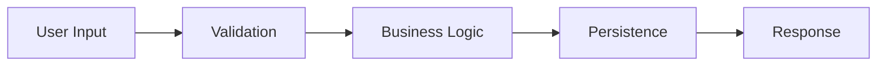

# 0.3 Rough-to-Fine Process

> Derive solutions top-down: from abstract goals to concrete implementation.

## Table of Contents

1. [The Axiom](#the-axiom) _(Lines 41-45)_
   1. [The Derivation Metaphor](#the-derivation-metaphor) _(Lines 48-62)_
   1. [Why Top-Down Works](#why-top-down-works) _(Lines 65-69)_
   1. [The Alternative (Anti-Pattern)](#the-alternative-anti-pattern) _(Lines 72-89)_
1. [The Derivation Pipeline](#the-derivation-pipeline) _(Lines 92-94)_
   1. [Stage 1: Functional Scenario](#stage-1-functional-scenario) _(Lines 97-121)_
   1. [Stage 2: Data Flow Strategy](#stage-2-data-flow-strategy) _(Lines 124-141)_
   1. [Stage 3: Data Architecture](#stage-3-data-architecture) _(Lines 144-170)_
   1. [Stage 4: System Design](#stage-4-system-design) _(Lines 173-194)_
   1. [Stage 5: Implementation Strategy](#stage-5-implementation-strategy) _(Lines 197-217)_
   1. [Stage 6: Tactical Coding](#stage-6-tactical-coding) _(Lines 220-245)_
1. [Level of Detail Navigation](#level-of-detail-navigation) _(Lines 248-250)_
   1. [The LOD Hierarchy](#the-lod-hierarchy) _(Lines 253-262)_
   1. [Navigation Principles](#navigation-principles) _(Lines 265-281)_
   1. [Anti-Pattern: Starting at LOD_5](#anti-pattern-starting-at-lod_5) _(Lines 284-295)_
1. [The Iteration Model](#the-iteration-model) _(Lines 298-300)_
   1. [Iterating at Each Level](#iterating-at-each-level) _(Lines 303-313)_
   1. [Prototyping vs. Production](#prototyping-vs-production) _(Lines 316-328)_
   1. [Refactoring as Re-Derivation](#refactoring-as-re-derivation) _(Lines 331-340)_
   1. [Incremental Derivation](#incremental-derivation) _(Lines 343-352)_
1. [Premature Optimization](#premature-optimization) _(Lines 355-357)_
   1. [Forms of Premature Optimization](#forms-of-premature-optimization) _(Lines 360-384)_
   1. [Why It Happens](#why-it-happens) _(Lines 387-392)_
   1. [The Corrective](#the-corrective) _(Lines 395-408)_
   1. [Premature Optimization vs. Design](#premature-optimization-vs-design) _(Lines 411-436)_
1. [Summary](#summary) _(Lines 439-450)_


---

## The Axiom
<!-- Lines 41-45 -->

Rough-to-Fine asserts that **good solutions are derived, not discovered**. You don't find the right code by trial and error; you derive it by systematically transforming abstract requirements into concrete implementation.

The name comes from physics and signal processing: **renormalization** is the process of connecting phenomena at different scales. In software, we connect the abstract ("the system should handle user authentication") to the concrete (`def verify_password(hash: str, password: str) -> bool`).

### The Derivation Metaphor
<!-- Lines 48-62 -->

Think of software development as a mathematical derivation:

```
Axioms (Requirements)
    ↓ derive
Theorems (Architecture)
    ↓ derive
Lemmas (Interfaces)
    ↓ derive
Proofs (Implementation)
```

Each step follows logically from the previous. If you cannot derive the next step, either the previous step is incomplete or you've found a contradiction that requires revision.

### Why Top-Down Works
<!-- Lines 65-69 -->

**Bottom-up fails because local optima mislead.** If you start with code and try to organize upward, you optimize for the code you've written, not the problem you're solving. You end up with a system shaped by implementation accidents rather than domain requirements.

**Top-down succeeds because context constrains.** When you start with requirements and derive downward, each decision is made with full context. You know what the function is *for* before you write it, what the module *should contain* before you create it.

### The Alternative (Anti-Pattern)
<!-- Lines 72-89 -->

The opposite of rough-to-fine is **fine-to-rough**: starting with code and hoping structure emerges.

```
# Fine-to-rough (anti-pattern)
1. Write some functions
2. Organize them into files somehow
3. Notice patterns, maybe refactor
4. End up with structure shaped by accidents
```

This approach produces systems where:
- Structure reflects the order code was written, not domain concepts
- Abstractions emerge from code duplication, not design
- The "architecture" is post-hoc rationalization

---

## The Derivation Pipeline
<!-- Lines 92-94 -->

The rough-to-fine process follows a structured pipeline. Each stage produces artifacts that feed the next.

### Stage 1: Functional Scenario
<!-- Lines 97-121 -->

**Input:** Raw requirements, user needs, business goals
**Output:** Capability hierarchy

Define what the system *does* before how it does it.

```
Level 0: System Goal
    "Enable users to manage their tasks"

Level 1: Core Capabilities
    - Create tasks
    - Organize tasks into projects
    - Track task completion
    - Collaborate with others

Level 2: Atomic Operations
    - create_task(title, description, due_date)
    - assign_task_to_project(task_id, project_id)
    - mark_task_complete(task_id)
    ...
```

**Key question:** What are the verbs? What actions does the system perform?

### Stage 2: Data Flow Strategy
<!-- Lines 124-141 -->

**Input:** Capability hierarchy
**Output:** Data flow diagrams, pipeline models

Visualize how data moves through the system.



Model the system as a **Hyper-DAG**: inputs flow to multiple transforms, transforms flow to multiple outputs. Rarely are flows simple linear chains.

**Key question:** What data enters? What transformations occur? What data exits?

### Stage 3: Data Architecture
<!-- Lines 144-170 -->

**Input:** Data flow strategy
**Output:** Entity definitions, relationships, schemas

Define the nouns that the verbs operate on.

```python
@dataclass
class Task:
    id: UUID
    title: str
    description: str
    status: TaskStatus
    project_id: UUID | None
    created_at: datetime
    due_date: datetime | None

class TaskStatus(Enum):
    PENDING = "pending"
    IN_PROGRESS = "in_progress"
    COMPLETED = "completed"
```

**Key question:** What entities exist? What are their attributes and relationships?

**Cross-ref:** → [0.4 Data-Centricity](0.4_data_centricity.md)

### Stage 4: System Design
<!-- Lines 173-194 -->

**Input:** Data architecture
**Output:** Module boundaries, component interactions, API specs

Define how components are organized and how they communicate.

```
src/
├── domain/           # Pure business logic
│   ├── task.py
│   └── project.py
├── application/      # Use cases
│   └── task_service.py
├── infrastructure/   # External systems
│   ├── database.py
│   └── notifications.py
└── api/              # External interface
    └── routes.py
```

**Key question:** What are the boundaries? How do components talk to each other?

### Stage 5: Implementation Strategy
<!-- Lines 197-217 -->

**Input:** System design
**Output:** Algorithm choices, pseudocode, naming conventions

Define the *approach* before writing syntax.

```python
# Strategy (not code yet)
"""
To mark a task complete:
1. Load task by ID (fail if not found)
2. Validate status transition is allowed
3. Update status to COMPLETED
4. Record completion timestamp
5. Persist changes
6. Emit task_completed event
"""
```

**Key question:** What is the algorithm? What are the steps in plain language?

### Stage 6: Tactical Coding
<!-- Lines 220-245 -->

**Input:** Implementation strategy
**Output:** Working code

Finally, write the actual Python.

```python
def mark_task_complete(self, task_id: UUID) -> Task:
    task = self.repository.get(task_id)
    if task is None:
        raise TaskNotFoundError(task_id)

    if not task.status.can_transition_to(TaskStatus.COMPLETED):
        raise InvalidStatusTransitionError(task.status, TaskStatus.COMPLETED)

    task.status = TaskStatus.COMPLETED
    task.completed_at = datetime.utcnow()

    self.repository.save(task)
    self.events.emit(TaskCompleted(task_id=task.id))

    return task
```

---

## Level of Detail Navigation
<!-- Lines 248-250 -->

This documentation itself follows rough-to-fine principles. The LOD system embodies the derivation pipeline.

### The LOD Hierarchy
<!-- Lines 253-262 -->

| LOD | Purpose | Derivation Stage |
|-----|---------|------------------|
| LOD_0 | Philosophy | Axioms |
| LOD_1 | Stages | Functional Scenario |
| LOD_2 | Phases | Data Flow Strategy |
| LOD_3 | Domains | Architecture & Design |
| LOD_4 | Practices | Implementation Strategy |
| LOD_5 | Details | Tactical Patterns |

### Navigation Principles
<!-- Lines 265-281 -->

**Start rough, drill down as needed:**
- Begin at LOD_1 to locate your stage
- Move to LOD_2 for phase-specific guidance
- Drill to LOD_3 when you need topic depth
- Reach LOD_4-5 only for specific patterns

**Return to philosophy when stuck:**
- If LOD_3 guidance seems arbitrary, check LOD_0
- Philosophy provides the *why* behind the *how*
- Understanding principles helps you adapt patterns

**Cross-level consistency:**
- Lower LOD decisions should derive from higher ones
- If LOD_4 guidance contradicts LOD_0 philosophy, question it
- The derivation should be traceable

### Anti-Pattern: Starting at LOD_5
<!-- Lines 284-295 -->

Developers often want to jump to the most specific guidance: "Just tell me the exact code to write."

This fails because:
- Specific patterns require context to apply correctly
- Without understanding the *why*, you can't adapt to variations
- You learn recipes without learning to cook

**Instead:** Start at least one level above where you think you need to be.

---

## The Iteration Model
<!-- Lines 298-300 -->

Rough-to-fine is not waterfall. It is compatible with iteration.

### Iterating at Each Level
<!-- Lines 303-313 -->

Each derivation stage can iterate independently:

```
Requirements change → Re-derive from Stage 1
Architecture issue found → Re-derive from Stage 4
Bug found → May only need Stage 6 fix
```

The key is to **iterate at the right level**. A requirements change should not start with code changes; it should restart the derivation from Stage 1.

### Prototyping vs. Production
<!-- Lines 316-328 -->

Prototypes can skip stages:

```
Prototype: Stage 1 → Stage 6 (skip to code to test ideas)
Production: Stage 1 → 2 → 3 → 4 → 5 → 6 (full derivation)
```

This is valid as long as you:
- Recognize prototypes as throw-away
- Re-derive properly for production
- Don't let prototype code become production code

### Refactoring as Re-Derivation
<!-- Lines 331-340 -->

Refactoring is re-running the derivation pipeline with new knowledge:

1. **Extract understanding:** What is the current implicit design?
2. **Identify problems:** Where did the derivation go wrong?
3. **Re-derive:** Start from the broken stage with corrected assumptions
4. **Implement:** Apply the new derivation to code

Large refactorings often mean the original derivation had errors in Stages 2-4 (architecture), not Stage 6 (code).

### Incremental Derivation
<!-- Lines 343-352 -->

For large systems, derive incrementally:

1. Derive the core flow end-to-end (walking skeleton)
2. Add capability by capability
3. Each addition runs the full pipeline for that capability
4. Integration points are designed upfront (in Stage 4)

---

## Premature Optimization
<!-- Lines 355-357 -->

Premature optimization is the enemy of rough-to-fine. It is **jumping to low-level concerns while high-level decisions are unresolved**.

### Forms of Premature Optimization
<!-- Lines 360-384 -->

**Performance optimization before profiling:**
```python
# Premature: Optimizing before knowing if it matters
def get_user(user_id):
    # Using hand-rolled caching because "it might be slow"
    if user_id in _cache:
        return _cache[user_id]
    ...
```

**Abstraction before understanding:**
```python
# Premature: Factory pattern for one implementation
class UserRepositoryFactory:
    def create(self) -> UserRepository:
        return PostgresUserRepository()  # Only implementation
```

**Framework selection before requirements:**
```python
# Premature: Choosing Django before knowing you need an ORM
# Maybe you need FastAPI. Maybe you need a script.
```

### Why It Happens
<!-- Lines 387-392 -->

Premature optimization comes from:
- **Fear:** "What if it's slow/inflexible later?"
- **Resume-driven development:** "I want to use this cool pattern"
- **Bottom-up thinking:** Starting with solutions, not problems

### The Corrective
<!-- Lines 395-408 -->

Apply this test: **Am I solving a problem I actually have, or one I imagine I might have?**

```
Real problem: "Users are waiting 10 seconds for page load."
Imagined problem: "Users might wait 10 seconds someday."
```

For imagined problems:
1. Build the simple solution
2. Measure actual performance
3. Optimize if measurements indicate a problem
4. Document the measurement that justified the optimization

### Premature Optimization vs. Design
<!-- Lines 411-436 -->

There is a distinction between:
- **Premature optimization:** Adding complexity to solve an unverified problem
- **Good design:** Structuring code so optimization is *possible* later

Good design keeps options open:
```python
# Good design: Abstraction allows future optimization
def get_users(ids: list[UUID]) -> list[User]:
    return [self.repository.get(id) for id in ids]

# Can later optimize to batch query without changing interface
def get_users(ids: list[UUID]) -> list[User]:
    return self.repository.get_batch(ids)  # Same interface, better implementation
```

Premature optimization closes options:
```python
# Premature: Baked-in assumption about caching
def get_users(ids: list[UUID], use_cache: bool = True) -> list[User]:
    # Now every caller must know about caching
    ...
```

---

## Summary
<!-- Lines 439-450 -->

Rough-to-fine is the process of deriving code from requirements through structured stages. It ensures that implementation serves design, and design serves requirements.

**The pipeline:** Functional Scenario → Data Flow → Data Architecture → System Design → Implementation Strategy → Code

**The discipline:** Work at the appropriate level of abstraction. Don't jump to code before design. Don't optimize before measuring.

**Cross-refs:**
- ↑ Parent: [0.1 Intentionality](0.1_intentionality.md) - Derivation as intentional process
- → Sibling: [0.2 Structure Primacy](0.2_structure_primacy.md) - Structure is derived early
- ↓ Child: [1 Understand](../LOD_1_stages/1_understand.md) - Requirements derivation
- ↓ Child: [6 Evolve](../LOD_1_stages/6_evolve.md) - Iteration and re-derivation
