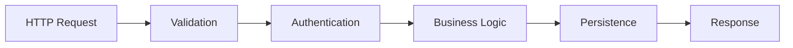

# 1 Understand

> Define the problem before solving it. Design before coding.

## Table of Contents

1. [Stage Overview](#stage-overview) _(Lines 43-45)_
   1. [Why Understanding First](#why-understanding-first) _(Lines 48-60)_
   1. [What Happens Here](#what-happens-here) _(Lines 63-70)_
   1. [Entry Criteria](#entry-criteria) _(Lines 73-79)_
   1. [Exit Criteria](#exit-criteria) _(Lines 82-96)_
1. [Requirements Phase](#requirements-phase) _(Lines 99-101)_
   1. [The Requirements Mindset](#the-requirements-mindset) _(Lines 104-111)_
   1. [Requirements Gathering](#requirements-gathering) _(Lines 114-128)_
   1. [Functional Decomposition](#functional-decomposition) _(Lines 131-153)_
   1. [Scope Definition](#scope-definition) _(Lines 156-181)_
   1. [Success Criteria](#success-criteria) _(Lines 184-201)_
1. [Design Phase](#design-phase) _(Lines 204-206)_
   1. [The Design Mindset](#the-design-mindset) _(Lines 209-211)_
   1. [Data Modeling](#data-modeling) _(Lines 214-248)_
   1. [Architecture Patterns](#architecture-patterns) _(Lines 251-274)_
   1. [Interface Design](#interface-design) _(Lines 277-295)_
   1. [Flow Design](#flow-design) _(Lines 298-311)_
   1. [Error Strategy](#error-strategy) _(Lines 314-338)_
1. [Stage Checklist](#stage-checklist) _(Lines 341-343)_
   1. [Requirements Checklist](#requirements-checklist) _(Lines 346-354)_
   1. [Design Checklist](#design-checklist) _(Lines 357-365)_
   1. [Red Flags](#red-flags) _(Lines 368-376)_
   1. [Artifacts](#artifacts) _(Lines 379-393)_
1. [Navigation](#navigation) _(Lines 396-401)_


---

## Stage Overview
<!-- Lines 43-45 -->

The Understand stage is where **thinking happens before typing**. This is the most important stage in the development lifecycle—and the most frequently skipped. Every hour spent here saves days of rework later.

### Why Understanding First
<!-- Lines 48-60 -->

The cost of fixing problems increases exponentially with each stage:

| Stage | Cost to Fix |
|-------|-------------|
| Requirements | 1x |
| Design | 3x |
| Implementation | 10x |
| Testing | 30x |
| Production | 100x |

A misunderstood requirement caught now is a conversation. The same misunderstanding caught in production is an incident.

### What Happens Here
<!-- Lines 63-70 -->

This stage has two phases:

1. **Requirements (1.1):** Understanding *what* to build
2. **Design (1.2):** Planning *how* to build it

These phases are iterative. As you design, you may discover requirements ambiguities. As you clarify requirements, design options become clearer.

### Entry Criteria
<!-- Lines 73-79 -->

You enter this stage when:
- Starting a new project
- Adding a significant feature
- Making architectural changes
- Responding to a major bug that reveals design problems

### Exit Criteria
<!-- Lines 82-96 -->

You exit this stage when:
- Requirements are documented and agreed upon
- Data model is defined
- Architecture is sketched
- Interfaces are specified
- You can explain the design to someone else

**Philosophy connections:**
- [0.1 Intentionality](../LOD_0_philosophy/0.1_intentionality.md) — Every decision has a reason
- [0.2 Structure Primacy](../LOD_0_philosophy/0.2_structure_primacy.md) — Structure before code
- [0.3 Rough-to-Fine](../LOD_0_philosophy/0.3_rough_to_fine.md) — Top-down derivation starts here

---

## Requirements Phase
<!-- Lines 99-101 -->

Requirements answer: **What are we building and why?**

### The Requirements Mindset
<!-- Lines 104-111 -->

Requirements are not a wishlist. They are a **contract** between stakeholders and developers. Good requirements are:

- **Specific:** Not "fast" but "responds in < 200ms"
- **Testable:** You can verify they're met
- **Prioritized:** Must-have vs. nice-to-have
- **Bounded:** Clear scope of what's included and excluded

### Requirements Gathering
<!-- Lines 114-128 -->

Start with the problem, not the solution:

```
Wrong: "We need a microservices architecture"
Right: "We need to scale the order processing system to handle 10x current load"
```

**Questions to ask:**
- What problem are we solving?
- Who has this problem?
- How do they currently solve it?
- What would success look like?
- What constraints exist (time, budget, technology)?

### Functional Decomposition
<!-- Lines 131-153 -->

Break the problem into a capability hierarchy:

```
Level 0: System Goal
    "Users can manage their task lists"

Level 1: Core Capabilities
    ├── Create and edit tasks
    ├── Organize tasks into projects
    ├── Track completion status
    └── Share tasks with others

Level 2: Atomic Operations
    ├── create_task(title, description)
    ├── update_task(task_id, changes)
    ├── delete_task(task_id)
    ├── assign_to_project(task_id, project_id)
    └── ...
```

This hierarchy guides all downstream decisions.

### Scope Definition
<!-- Lines 156-181 -->

Define boundaries explicitly:

```markdown
## In Scope
<!-- Lines 165-169 -->
- Single-user task management
- Basic project organization
- Due date tracking
- Web interface

## Out of Scope (for this version)
<!-- Lines 172-176 -->
- Multi-user collaboration
- Mobile apps
- Calendar integration
- Recurring tasks

## Deferred
<!-- Lines 179-184 -->
- File attachments (v2)
- Tags and filters (v2)
```

The "Out of Scope" section is as important as "In Scope." It prevents scope creep and manages expectations.

### Success Criteria
<!-- Lines 184-201 -->

Define measurable outcomes:

```markdown
## Success Criteria
<!-- Lines 193-204 -->
1. Users can create a task in < 3 clicks
2. Page load time < 1 second
3. System handles 1000 concurrent users
4. Zero data loss on system failure
```

These become acceptance tests.

**Cross-ref:** → [1.1 Requirements](../LOD_2_phases/1.1_requirements.md) for detailed guidance

---

## Design Phase
<!-- Lines 204-206 -->

Design answers: **How will we build this?**

### The Design Mindset
<!-- Lines 209-211 -->

Design is about making structural decisions explicit before writing code. A design document doesn't need to be long—it needs to be clear.

### Data Modeling
<!-- Lines 214-248 -->

Start with the data. What entities exist? What are their relationships?

```python
# Core entities
@dataclass
class User:
    id: UUID
    email: str
    created_at: datetime

@dataclass
class Project:
    id: UUID
    owner_id: UUID  # FK to User
    name: str

@dataclass
class Task:
    id: UUID
    project_id: UUID | None  # FK to Project, nullable
    title: str
    description: str
    status: TaskStatus
    due_date: date | None
```

**Key questions:**
- What are the entities?
- What are their attributes?
- How do they relate?
- What constraints exist?

**Cross-ref:** → [0.4 Data-Centricity](../LOD_0_philosophy/0.4_data_centricity.md)

### Architecture Patterns
<!-- Lines 251-274 -->

Choose an architecture that fits the problem:

| Pattern | When to Use |
|---------|-------------|
| Layered | Simple CRUD applications |
| Hexagonal | Complex domain logic, many integrations |
| Pipeline | Data transformation workflows |
| Event-driven | Reactive systems, async processing |

For most Python applications, a simple layered architecture suffices:

```
┌─────────────────────────────────────┐
│           Presentation              │ ← API routes, CLI
├─────────────────────────────────────┤
│           Application               │ ← Use cases, orchestration
├─────────────────────────────────────┤
│             Domain                  │ ← Business logic, entities
├─────────────────────────────────────┤
│          Infrastructure             │ ← Database, external APIs
└─────────────────────────────────────┘
```

### Interface Design
<!-- Lines 277-295 -->

Define how components communicate:

```python
# Public interface for task management
class TaskService(Protocol):
    def create_task(self, title: str, project_id: UUID | None = None) -> Task: ...
    def get_task(self, task_id: UUID) -> Task | None: ...
    def update_task(self, task_id: UUID, changes: TaskUpdate) -> Task: ...
    def delete_task(self, task_id: UUID) -> None: ...
    def list_tasks(self, filters: TaskFilters) -> list[Task]: ...
```

Good interfaces:
- Are minimal (only what's needed)
- Are stable (don't change often)
- Hide implementation details
- Use domain vocabulary

### Flow Design
<!-- Lines 298-311 -->

Map how data flows through the system:



This clarifies where each concern is handled.

### Error Strategy
<!-- Lines 314-338 -->

Decide how errors are handled:

```python
# Domain exceptions
class TaskError(Exception):
    """Base exception for task operations."""

class TaskNotFoundError(TaskError):
    """Raised when task doesn't exist."""

class InvalidTaskStateError(TaskError):
    """Raised when operation invalid for current state."""
```

**Key questions:**
- What errors can occur?
- Which are recoverable?
- How are errors communicated to users?
- What gets logged?

**Cross-ref:** → [1.2 Design](../LOD_2_phases/1.2_design.md) for detailed guidance

---

## Stage Checklist
<!-- Lines 341-343 -->

Before leaving the Understand stage, verify:

### Requirements Checklist
<!-- Lines 346-354 -->

- [ ] Problem statement is clear and agreed upon
- [ ] Stakeholders are identified
- [ ] Functional requirements are documented
- [ ] Non-functional requirements are documented (performance, security, etc.)
- [ ] Scope is defined (in/out/deferred)
- [ ] Success criteria are measurable
- [ ] Constraints and assumptions are documented

### Design Checklist
<!-- Lines 357-365 -->

- [ ] Data model is defined (entities, relationships)
- [ ] Architecture pattern is chosen and justified
- [ ] Key interfaces are specified
- [ ] Data flow is mapped
- [ ] Error strategy is defined
- [ ] Configuration strategy is defined
- [ ] You can explain the design verbally

### Red Flags
<!-- Lines 368-376 -->

Stop and reconsider if:

- **"We'll figure it out as we go"** — You're skipping design
- **"It's obvious what we need"** — Requirements aren't documented
- **"Let's just start coding"** — Structure isn't defined
- **"We can refactor later"** — Design problems compound
- **"Everyone knows what X means"** — Terminology isn't defined

### Artifacts
<!-- Lines 379-393 -->

This stage should produce:

| Artifact | Purpose |
|----------|---------|
| Requirements doc | What we're building |
| Data model | Core entities and relationships |
| Architecture sketch | How components fit together |
| Interface definitions | How components communicate |
| Decision log (ADRs) | Why we chose this approach |

These artifacts are living documents—update them as understanding evolves.

---

## Navigation
<!-- Lines 396-401 -->

**Cross-refs:**
- ↑ Parent: [LOD_1 Stages Index](0_index.md)
- ↑ Philosophy: [0.1 Intentionality](../LOD_0_philosophy/0.1_intentionality.md), [0.2 Structure Primacy](../LOD_0_philosophy/0.2_structure_primacy.md), [0.3 Rough-to-Fine](../LOD_0_philosophy/0.3_rough_to_fine.md)
- → Next Stage: [2 Setup](2_setup.md)
- ↓ Child Phases: [1.1 Requirements](../LOD_2_phases/1.1_requirements.md), [1.2 Design](../LOD_2_phases/1.2_design.md)
