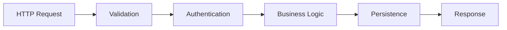

# 1.2 Design

> Architecture, data structures, and interfaces before code.

## Table of Contents

1. [Phase Overview](#phase-overview) _(Lines 47-49)_
   1. [Why Design First](#why-design-first) _(Lines 52-54)_
   1. [What This Phase Produces](#what-this-phase-produces) _(Lines 57-65)_
   1. [The Design Mindset](#the-design-mindset) _(Lines 68-81)_
1. [1.2.1 Data Modeling](#121-data-modeling) _(Lines 84-86)_
   1. [Entity Identification](#entity-identification) _(Lines 89-101)_
   1. [Defining Entities](#defining-entities) _(Lines 104-137)_
   1. [Relationships](#relationships) _(Lines 140-148)_
   1. [Design for Stability](#design-for-stability) _(Lines 151-160)_
1. [1.2.2 Architecture Patterns](#122-architecture-patterns) _(Lines 163-165)_
   1. [Common Patterns](#common-patterns) _(Lines 168-201)_
   1. [Selection Criteria](#selection-criteria) _(Lines 204-210)_
   1. [Python-Specific Considerations](#python-specific-considerations) _(Lines 213-221)_
1. [1.2.3 Interface Design](#123-interface-design) _(Lines 224-226)_
   1. [Function Signatures](#function-signatures) _(Lines 229-261)_
   1. [Interface Principles](#interface-principles) _(Lines 264-272)_
   1. [Protocol vs ABC](#protocol-vs-abc) _(Lines 275-288)_
1. [1.2.4 Flow Design](#124-flow-design) _(Lines 291-293)_
   1. [Data Flow Diagrams](#data-flow-diagrams) _(Lines 296-307)_
   1. [Flow Types](#flow-types) _(Lines 310-329)_
   1. [Designing Flows](#designing-flows) _(Lines 332-345)_
   1. [Flow Questions](#flow-questions) _(Lines 348-357)_
1. [1.2.5 Error Strategy](#125-error-strategy) _(Lines 360-362)_
   1. [Exception Hierarchy](#exception-hierarchy) _(Lines 365-381)_
   1. [Error Propagation Policy](#error-propagation-policy) _(Lines 384-392)_
   1. [Fail-Fast vs. Resilient](#fail-fast-vs-resilient) _(Lines 395-405)_
   1. [Error Messages](#error-messages) _(Lines 408-417)_
1. [1.2.6 Configuration Strategy](#126-configuration-strategy) _(Lines 420-422)_
   1. [Configuration Sources](#configuration-sources) _(Lines 425-431)_
   1. [12-Factor App Principles](#12-factor-app-principles) _(Lines 434-444)_
   1. [Configuration Design](#configuration-design) _(Lines 447-466)_
   1. [Environment-Specific Configuration](#environment-specific-configuration) _(Lines 469-486)_
1. [Navigation](#navigation) _(Lines 489-495)_


---

## Phase Overview
<!-- Lines 47-49 -->

Design translates requirements into **structural decisions**. This phase produces the blueprints from which code will be written. Design before code; structure before syntax.

### Why Design First
<!-- Lines 52-54 -->

Code is expensive to change. Structure is even more expensive. The decisions you make here—data model, architecture, interfaces—will constrain all future work. Get them right.

### What This Phase Produces
<!-- Lines 57-65 -->

By the end of this phase, you should have:
- Data model (entities, relationships, types)
- Architecture pattern (how components fit together)
- Interface definitions (public APIs)
- Flow diagrams (how data moves)
- Error strategy (how failures are handled)
- Configuration strategy (how settings are managed)

### The Design Mindset
<!-- Lines 68-81 -->

Design is not code. Resist the urge to think in implementation details. Think in:
- **Entities:** What things exist?
- **Relationships:** How do they connect?
- **Operations:** What can be done to them?
- **Flows:** How does data move?

**Cross-refs:**
- ↑ Parent: [1 Understand](../LOD_1_stages/1_understand.md)
- ↑ Philosophy: [0.2 Structure Primacy](../LOD_0_philosophy/0.2_structure_primacy.md), [0.4 Data-Centricity](../LOD_0_philosophy/0.4_data_centricity.md)
- ← Previous Phase: [1.1 Requirements](1.1_requirements.md)

---

## 1.2.1 Data Modeling
<!-- Lines 84-86 -->

Data modeling defines the **core entities and their relationships**. Data outlives code; design data for stability.

### Entity Identification
<!-- Lines 89-101 -->

Start by listing the nouns in your requirements:

```
Requirements: "Users create tasks in projects with due dates"

Entities:
- User
- Task
- Project
- DueDate (or just a date attribute?)
```

### Defining Entities
<!-- Lines 104-137 -->

For each entity, define attributes and types:

```python
from dataclasses import dataclass
from datetime import date, datetime
from uuid import UUID

@dataclass
class User:
    id: UUID
    email: str
    name: str
    created_at: datetime

@dataclass
class Project:
    id: UUID
    owner_id: UUID  # FK to User
    name: str
    description: str

@dataclass
class Task:
    id: UUID
    project_id: UUID | None  # FK to Project, nullable
    creator_id: UUID  # FK to User
    title: str
    description: str
    status: TaskStatus
    due_date: date | None
    created_at: datetime
```

### Relationships
<!-- Lines 140-148 -->

Define how entities connect:

| Relationship | Type | Meaning |
|-------------|------|---------|
| User → Project | One-to-many | User owns many projects |
| Project → Task | One-to-many | Project contains many tasks |
| User → Task | One-to-many | User creates many tasks |

### Design for Stability
<!-- Lines 151-160 -->

Ask future-oriented questions:
- What attributes might we add later? (Leave room)
- What relationships might change? (Use junction tables)
- What data might need history? (Consider audit tables)

**Cross-ref:** → [1.2.1 Data Modeling](../LOD_3_domains/1.2.1_data_modeling.md) for detailed patterns

---

## 1.2.2 Architecture Patterns
<!-- Lines 163-165 -->

Architecture patterns define how **components fit together**. Choose the simplest pattern that meets your needs.

### Common Patterns
<!-- Lines 168-201 -->

**Layered Architecture** (most common for Python):
```
┌─────────────────────────────────────┐
│           Presentation              │ ← API routes, CLI, web views
├─────────────────────────────────────┤
│           Application               │ ← Use cases, orchestration
├─────────────────────────────────────┤
│             Domain                  │ ← Business logic, entities
├─────────────────────────────────────┤
│          Infrastructure             │ ← Database, external APIs
└─────────────────────────────────────┘
```

**Pipeline Architecture** (data processing):
```
Input → Stage 1 → Stage 2 → Stage 3 → Output
          │          │          │
          └──────────┴──────────┴── Each stage is independent
```

**Hexagonal Architecture** (complex domains):
```
        ┌─────────────┐
        │   Adapters  │ ← HTTP, CLI, Queue
        │      │      │
        │   ┌──┴──┐   │
        │   │Core │   │ ← Domain logic
        │   └──┬──┘   │
        │      │      │
        │   Adapters  │ ← Database, APIs
        └─────────────┘
```

### Selection Criteria
<!-- Lines 204-210 -->

| Pattern | Best For | Avoid When |
|---------|----------|------------|
| Layered | Simple CRUD, most web apps | Complex domain logic |
| Pipeline | ETL, data transformation | Interactive applications |
| Hexagonal | Many integrations, testability | Simple applications |

### Python-Specific Considerations
<!-- Lines 213-221 -->

- **Module boundaries:** Each architectural layer can be a Python package
- **Dependency direction:** Higher layers depend on lower; never reverse
- **Import discipline:** Don't import from presentation in domain

**Cross-ref:** → [1.2.2 Architecture Patterns](../LOD_3_domains/1.2.2_architecture_patterns.md) for implementation details

---

## 1.2.3 Interface Design
<!-- Lines 224-226 -->

Interface design defines the **contracts between components**. Good interfaces are minimal, stable, and hide implementation.

### Function Signatures
<!-- Lines 229-261 -->

Design function signatures before implementation:

```python
from typing import Protocol
from uuid import UUID

class TaskService(Protocol):
    """Contract for task management operations."""

    def create_task(
        self,
        title: str,
        creator_id: UUID,
        *,
        project_id: UUID | None = None,
        due_date: date | None = None,
    ) -> Task: ...

    def get_task(self, task_id: UUID) -> Task | None: ...

    def update_task(self, task_id: UUID, changes: TaskUpdate) -> Task: ...

    def delete_task(self, task_id: UUID) -> None: ...

    def list_tasks(
        self,
        *,
        project_id: UUID | None = None,
        status: TaskStatus | None = None,
    ) -> list[Task]: ...
```

### Interface Principles
<!-- Lines 264-272 -->

**Minimal:** Only expose what's needed. Internal helpers stay private.

**Stable:** Interfaces should change rarely. Implementation can change freely.

**Consistent:** Similar operations should have similar signatures.

**Obvious:** Good interfaces are hard to use incorrectly.

### Protocol vs ABC
<!-- Lines 275-288 -->

Use `Protocol` for structural subtyping (duck typing with types):
- Consumer doesn't care about inheritance
- Multiple implementations expected
- Testing with mocks

Use `ABC` for nominal subtyping:
- Shared implementation in base class
- Explicit inheritance required

**Cross-ref:** → [1.2.3 Interface Design](../LOD_3_domains/1.2.3_interface_design.md) for patterns

---

## 1.2.4 Flow Design
<!-- Lines 291-293 -->

Flow design maps how **data moves through the system**.

### Data Flow Diagrams
<!-- Lines 296-307 -->

Visualize the flow from input to output:



### Flow Types
<!-- Lines 310-329 -->

**Request/Response Flow:**
```
User Request → Validate → Process → Persist → Respond
```

**Event Flow:**
```
Event Source → Event Bus → Handler A
                       → Handler B
                       → Handler C
```

**Pipeline Flow:**
```
Extract → Transform → Load
   │          │         │
   └──────────┴─────────┴── Each stage produces input for next
```

### Designing Flows
<!-- Lines 332-345 -->

For each major operation, map the flow:

**Create Task Flow:**
```
1. Receive request (title, project_id, due_date)
2. Validate input (title not empty, project exists)
3. Authenticate user (JWT token)
4. Authorize action (user owns project)
5. Create task entity
6. Persist to database
7. Return created task
```

### Flow Questions
<!-- Lines 348-357 -->

- Where is input validated?
- Where are errors caught?
- Where does logging happen?
- What happens on failure at each step?

**Cross-ref:** → [1.2.4 Flow Design](../LOD_3_domains/1.2.4_flow_design.md) for diagramming techniques

---

## 1.2.5 Error Strategy
<!-- Lines 360-362 -->

Error strategy defines how **failures are handled** throughout the system.

### Exception Hierarchy
<!-- Lines 365-381 -->

Design a hierarchy of domain exceptions:

```python
class TaskError(Exception):
    """Base exception for task operations."""

class TaskNotFoundError(TaskError):
    """Raised when task doesn't exist."""

class TaskValidationError(TaskError):
    """Raised when task data is invalid."""

class TaskPermissionError(TaskError):
    """Raised when user lacks permission."""
```

### Error Propagation Policy
<!-- Lines 384-392 -->

Define what happens at each layer:

| Layer | Strategy |
|-------|----------|
| Domain | Raise domain exceptions |
| Application | Catch, log, re-raise or transform |
| Presentation | Catch all, convert to user-friendly response |

### Fail-Fast vs. Resilient
<!-- Lines 395-405 -->

**Fail-fast:** Stop immediately on error. Best for:
- Development/testing
- Data corruption risks
- Unrecoverable errors

**Resilient:** Continue despite errors. Best for:
- Batch processing (log and continue)
- External service failures (retry, circuit break)
- Graceful degradation

### Error Messages
<!-- Lines 408-417 -->

Design error messages for their audience:
- **Developers:** Include stack trace, context, debugging hints
- **Users:** Friendly message, what to do next, no technical details
- **Logs:** Structured, searchable, includes correlation IDs

**Cross-ref:** → [1.2.5 Error Strategy](../LOD_3_domains/1.2.5_error_strategy.md) for patterns

---

## 1.2.6 Configuration Strategy
<!-- Lines 420-422 -->

Configuration strategy defines how **settings flow into the system**.

### Configuration Sources
<!-- Lines 425-431 -->

From highest to lowest priority (typically):
1. Command-line arguments
2. Environment variables
3. Configuration files
4. Defaults in code

### 12-Factor App Principles
<!-- Lines 434-444 -->

Store configuration in the environment:

```python
import os

DATABASE_URL = os.environ["DATABASE_URL"]
SECRET_KEY = os.environ["SECRET_KEY"]
DEBUG = os.environ.get("DEBUG", "false").lower() == "true"
```

### Configuration Design
<!-- Lines 447-466 -->

```python
from pydantic_settings import BaseSettings

class Settings(BaseSettings):
    """Application configuration."""

    # Required (no default)
    database_url: str
    secret_key: str

    # Optional with defaults
    debug: bool = False
    log_level: str = "INFO"
    cache_ttl: int = 3600

    class Config:
        env_file = ".env"
```

### Environment-Specific Configuration
<!-- Lines 469-486 -->

```python
from enum import Enum

class Environment(Enum):
    DEVELOPMENT = "development"
    STAGING = "staging"
    PRODUCTION = "production"

# Derived settings
DEBUG = ENV == Environment.DEVELOPMENT
LOG_LEVEL = "DEBUG" if DEBUG else "INFO"
```

**Cross-ref:** → [1.2.6 Configuration](../LOD_3_domains/1.2.6_configuration.md) for patterns

---

## Navigation
<!-- Lines 489-495 -->

**Cross-refs:**
- ↑ Parent: [1 Understand](../LOD_1_stages/1_understand.md)
- ↑ Philosophy: [0.2 Structure Primacy](../LOD_0_philosophy/0.2_structure_primacy.md), [0.4 Data-Centricity](../LOD_0_philosophy/0.4_data_centricity.md)
- ← Previous Phase: [1.1 Requirements](1.1_requirements.md)
- → Next Stage: [2 Setup](../LOD_1_stages/2_setup.md)
- ↓ Children: [1.2.1](../LOD_3_domains/1.2.1_data_modeling.md), [1.2.2](../LOD_3_domains/1.2.2_architecture_patterns.md), [1.2.3](../LOD_3_domains/1.2.3_interface_design.md), [1.2.4](../LOD_3_domains/1.2.4_flow_design.md), [1.2.5](../LOD_3_domains/1.2.5_error_strategy.md), [1.2.6](../LOD_3_domains/1.2.6_configuration.md)
