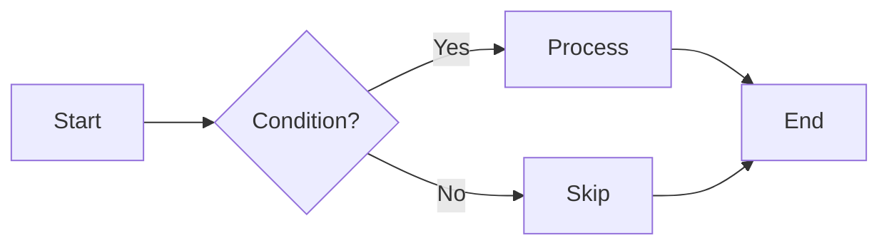
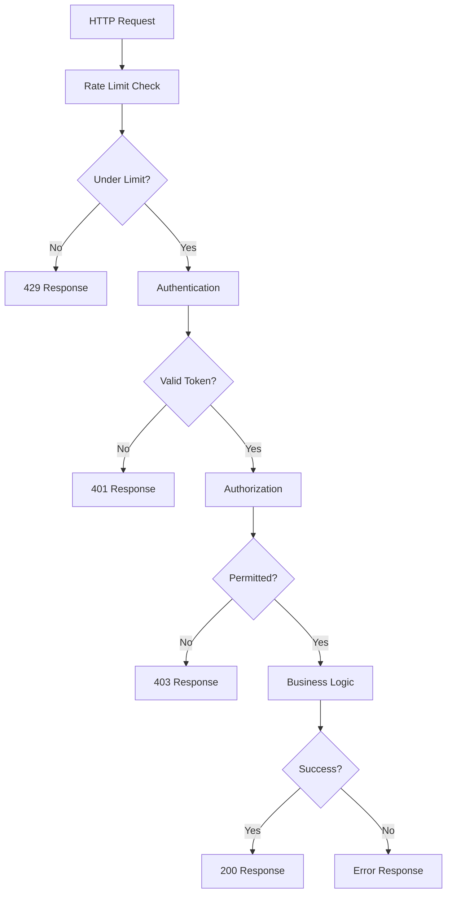
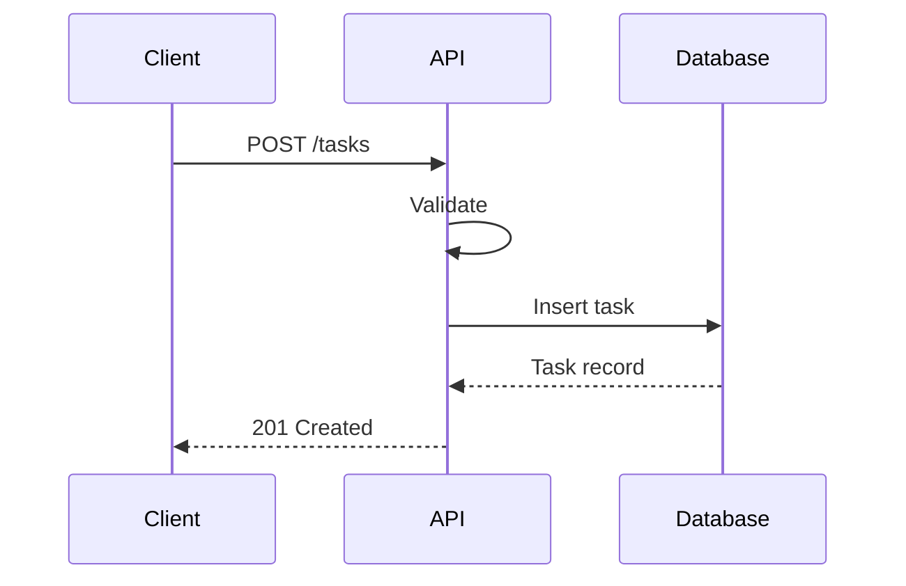

# 1.2.4 Flow Design

> Map how data moves through the system from input to output.

## Table of Contents

1. [Core Concept](#core-concept) _(Lines 33-62)_
1. [When to Use](#when-to-use) _(Lines 65-87)_
1. [Flow Diagrams](#flow-diagrams) _(Lines 90-90)_
   1. [Mermaid Syntax](#mermaid-syntax) _(Lines 93-102)_
   1. [Node Types](#node-types) _(Lines 105-113)_
   1. [Example: API Request Flow](#example-api-request-flow) _(Lines 116-133)_
   1. [Sequence Diagrams](#sequence-diagrams) _(Lines 136-155)_
1. [Flow Types](#flow-types) _(Lines 158-158)_
   1. [Request/Response Flow](#requestresponse-flow) _(Lines 161-170)_
   1. [Pipeline Flow](#pipeline-flow) _(Lines 173-182)_
   1. [Event Flow](#event-flow) _(Lines 185-195)_
   1. [State Machine Flow](#state-machine-flow) _(Lines 198-215)_
   1. [Branching Flow](#branching-flow) _(Lines 218-228)_
1. [Designing Flows](#designing-flows) _(Lines 231-231)_
   1. [Flow Design Process](#flow-design-process) _(Lines 234-253)_
   1. [Flow Questions](#flow-questions) _(Lines 256-263)_
   1. [Example: Create Task Flow](#example-create-task-flow) _(Lines 266-297)_
   1. [Flow Documentation Template](#flow-documentation-template) _(Lines 300-323)_
1. [Navigation](#navigation) _(Lines 326-331)_


---

## Core Concept
<!-- Lines 33-62 -->

**Definition:** Flow design visualizes and documents how data moves through a system—from external input through processing stages to output.

**Key Points:**
- Flows reveal system behavior at a glance
- Each flow has clear entry and exit points
- Flows help identify where concerns are handled
- Diagrams communicate more than code

**Flow Elements:**
```
[Input] → (Process) → [Output]
             │
         Decision?
          /    \
        Yes     No
```

**Why Flow Design:**
- Clarifies system behavior before coding
- Reveals missing error handling
- Identifies bottlenecks
- Communicates to non-technical stakeholders

**Cross-refs:**
- ↑ Parent: [1.2 Design](../LOD_2_phases/1.2_design.md)
- ↑ Philosophy: [0.4 Data-Centricity](../LOD_0_philosophy/0.4_data_centricity.md)

---

## When to Use
<!-- Lines 65-87 -->

**Design Flows When:**
- Planning new features
- Debugging complex processes
- Onboarding team members
- Documenting integrations
- Identifying optimization points

**Create Flow Diagrams For:**
- Primary user journeys
- Data processing pipelines
- Authentication/authorization
- Error handling paths
- Integration points

**Signs You Need Flow Documentation:**
- "How does this work again?"
- Developers interpret behavior differently
- Edge cases are discovered in production
- New team members struggle to understand system

---

## Flow Diagrams
<!-- Lines 90-90 -->

### Mermaid Syntax
<!-- Lines 93-102 -->



### Node Types
<!-- Lines 105-113 -->

| Shape | Syntax | Meaning |
|-------|--------|---------|
| Rectangle | `[Text]` | Process/Action |
| Diamond | `{Text}` | Decision |
| Rounded | `(Text)` | Start/End |
| Parallelogram | `[/Text/]` | Input/Output |
| Database | `[(Text)]` | Data store |

### Example: API Request Flow
<!-- Lines 116-133 -->



### Sequence Diagrams
<!-- Lines 136-155 -->

For time-ordered interactions:



**Cross-ref:** → [1.2.4.1 Mermaid Flows](../LOD_4_practices/1.2.4.1_mermaid_flows.md)

---

## Flow Types
<!-- Lines 158-158 -->

### Request/Response Flow
<!-- Lines 161-170 -->

Standard API request handling:

```
Request → Validate → Authenticate → Authorize → Process → Respond
    │         │           │             │           │
    └─────────┴───────────┴─────────────┴───────────┘
                    Error at any stage → Error Response
```

### Pipeline Flow
<!-- Lines 173-182 -->

Data transformation stages:

```
Extract → Transform → Validate → Enrich → Load
   │          │           │         │        │
   └──────────┴───────────┴─────────┴────────┘
              Each stage: Input → Process → Output
```

### Event Flow
<!-- Lines 185-195 -->

Asynchronous event processing:

```
Event Source → Event Bus → Handler 1
                       │→ Handler 2
                       └→ Handler 3
                             │
                       Each handler independent
```

### State Machine Flow
<!-- Lines 198-215 -->

Entity lifecycle:

```
         ┌───────────────┐
         │    PENDING    │
         └───────┬───────┘
                 │ start()
         ┌───────▼───────┐
         │    ACTIVE     │◄────────┐
         └───────┬───────┘         │
                 │                 │ reopen()
      complete() │                 │
         ┌───────▼───────┐         │
         │   COMPLETE    │─────────┘
         └───────────────┘
```

### Branching Flow
<!-- Lines 218-228 -->

Conditional processing:

```
                    ┌─→ Path A → Result A ─┐
Input → Evaluate ──┼─→ Path B → Result B ─┼→ Merge → Output
                    └─→ Path C → Result C ─┘
```

---

## Designing Flows
<!-- Lines 231-231 -->

### Flow Design Process
<!-- Lines 234-253 -->

**Step 1: Identify the trigger**
What initiates this flow?
- User action
- Scheduled job
- External event
- System event

**Step 2: Map the happy path**
What happens when everything works?

**Step 3: Identify decisions**
Where does the flow branch?

**Step 4: Add error paths**
What can go wrong at each step?

**Step 5: Mark data stores**
Where is data read/written?

### Flow Questions
<!-- Lines 256-263 -->

For each step, ask:
- What input does it need?
- What output does it produce?
- What errors can occur?
- What side effects happen?
- How long does it take?

### Example: Create Task Flow
<!-- Lines 266-297 -->

```
1. Receive request
   - Input: title, project_id, due_date
   - Source: HTTP POST

2. Validate input
   - title not empty
   - project_id exists (if provided)
   - due_date in future (if provided)
   - Error: 400 Bad Request

3. Authenticate user
   - Check JWT token
   - Error: 401 Unauthorized

4. Authorize action
   - User owns project (if provided)
   - Error: 403 Forbidden

5. Create task entity
   - Generate ID
   - Set created_at

6. Persist to database
   - Insert task record
   - Error: 500 Database error

7. Return response
   - Output: Created task with 201
```

### Flow Documentation Template
<!-- Lines 300-323 -->

```markdown
## Flow: Create Task
<!-- Lines 304-323 -->

**Trigger:** POST /api/tasks

**Input:** { title, project_id?, due_date? }

**Output:** Created Task | Error

**Steps:**
1. [Validate] Check input validity → 400 if invalid
2. [Auth] Verify user token → 401 if invalid
3. [Authz] Check project ownership → 403 if forbidden
4. [Create] Instantiate Task entity
5. [Persist] Save to database → 500 if fails
6. [Respond] Return created task

**Diagram:** [link to mermaid diagram]
```

---

## Navigation
<!-- Lines 326-331 -->

**Cross-refs:**
- ↑ Parent: [1.2 Design](../LOD_2_phases/1.2_design.md)
- ← Sibling: [1.2.3 Interface Design](1.2.3_interface_design.md)
- → Sibling: [1.2.5 Error Strategy](1.2.5_error_strategy.md)
- ↓ Child: [1.2.4.1 Mermaid Flows](../LOD_4_practices/1.2.4.1_mermaid_flows.md)
