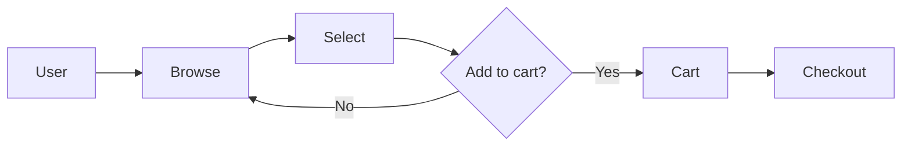

# 1.1.2.2 Flow Mapping

## Table of Contents

1. [User Journey Flow](#user-journey-flow) _(Lines 17-24)_
1. [Mapping Template](#mapping-template) _(Lines 27-33)_
1. [Flow Diagram](#flow-diagram) _(Lines 36-46)_
1. [Identifies](#identifies) _(Lines 49-53)_
1. [Cross-refs](#cross-refs) _(Lines 56-57)_

---

> Visualize how capabilities connect in user workflows.

## User Journey Flow
<!-- Lines 17-24 -->

```
Start → Browse → Select → Purchase → Receive
  │        │        │         │          │
  └────────┴────────┴─────────┴──────────┘
         Each step maps to capabilities
```

## Mapping Template
<!-- Lines 27-33 -->

| User Action | Capability | Operations |
|-------------|------------|------------|
| View products | 1.1 Browse | list_products(), filter() |
| Add to cart | 1.2 Cart | add_item(), update_qty() |
| Checkout | 1.3 Purchase | create_order(), pay() |

## Flow Diagram
<!-- Lines 36-46 -->



## Identifies
<!-- Lines 49-53 -->

- **Gaps:** Steps not covered by capabilities
- **Redundancy:** Multiple capabilities for same step
- **Dependencies:** Order of operations

## Cross-refs
<!-- Lines 56-57 -->

- ↑ Parent: [1.1.2 Functional Decomposition](../LOD_3_domains/1.1.2_functional_decomposition.md)
