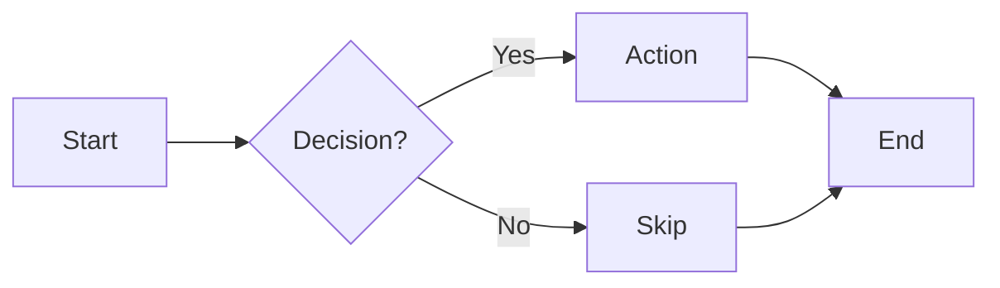
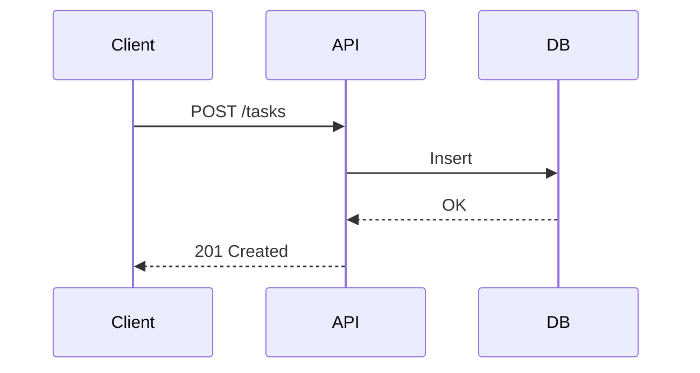

# 1.2.4.1 Mermaid Flow Diagrams

## Table of Contents

1. [Basic Flowchart](#basic-flowchart) _(Lines 18-27)_
1. [Node Shapes](#node-shapes) _(Lines 30-37)_
1. [Direction Options](#direction-options) _(Lines 40-45)_
1. [Sequence Diagram](#sequence-diagram) _(Lines 48-56)_
1. [Tips](#tips) _(Lines 59-63)_
1. [Cross-refs](#cross-refs) _(Lines 66-67)_

---

> Create flow diagrams using Mermaid syntax.

## Basic Flowchart
<!-- Lines 18-27 -->

## Node Shapes
<!-- Lines 30-37 -->

| Shape | Syntax | Use |
|-------|--------|-----|
| Rectangle | `[Text]` | Process |
| Diamond | `{Text}` | Decision |
| Rounded | `(Text)` | Start/End |
| Database | `[(Text)]` | Storage |

## Direction Options
<!-- Lines 40-45 -->

- `LR` = Left to Right
- `TD` = Top Down
- `RL` = Right to Left
- `BT` = Bottom to Top

## Sequence Diagram
<!-- Lines 48-56 -->

## Tips
<!-- Lines 59-63 -->

- Keep diagrams focused (one flow per diagram)
- Use subgraphs for complex systems
- Link to diagram in documentation

## Cross-refs
<!-- Lines 66-67 -->

- ↑ Parent: [1.2.4 Flow Design](../LOD_3_domains/1.2.4_flow_design.md)
