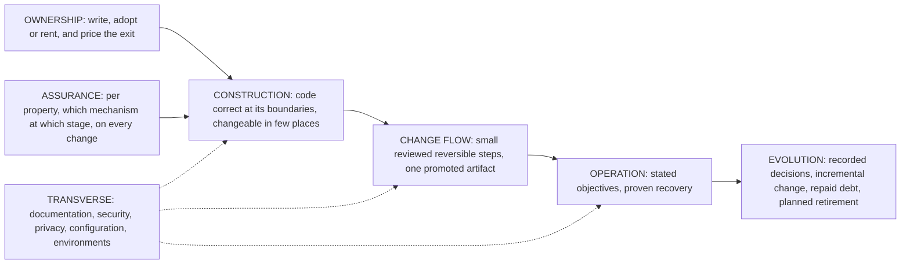

# Software Development Guidelines

Principles of software development that hold for every stack: what a team owns, how it knows each
property of its system holds, and how it constructs, changes, operates and evolves the system. The
markdown files are a projection of one IntentGraph, which holds the full grounds of every decision.

## Table of Contents

1. [What This Is](#what-this-is) _(Lines 21-31)_
1. [Thesis](#thesis) _(Lines 34-50)_
1. [How to Read](#how-to-read) _(Lines 53-70)_
1. [Maintainer Decisions](#maintainer-decisions) _(Lines 73-96)_
1. [The Graph](#the-graph) _(Lines 99-108)_
1. [Provenance](#provenance) _(Lines 111-118)_
1. [Related Guidelines](#related-guidelines) _(Lines 121-131)_

---

## What This Is
<!-- Lines 21-31 -->

- **Is**: a set of decisions between competing practices, each chosen as the best practice for its
  purpose (never the average of what sources say, and "best" is not "most demanding"), each
  rejected alternative kept with the condition under which it would be the best. Stack-neutral and
  language-neutral.
- **Is not**: stack mechanisms (see [Related Guidelines](#related-guidelines)), a survey of what
  sources say, or a tutorial.
- **No default team.** The guideline states principles and the outcomes they guarantee, whoever
  does the work, human or AI agent. A decision names a context condition only where the best
  practice really differs with it.

## Thesis
<!-- Lines 34-50 -->

A team delivers, and keeps delivering, a system that does what is intended, at a cost it can
sustain. Two decisions come first; five branches carry them out.

The outcome, whoever does the work: **the design was good, the testing was good, the review was
trustworthy, and what runs is what was reviewed.**

## How to Read
<!-- Lines 53-70 -->

Read a branch's index file first; drill into one body file for the question at hand. Every
section ends with a node id in backquotes: query the graph with it for grounds, positions
considered and sources.

| Question | File |
|---|---|
| Should we write it, use a library or tool, or rent a service? How do we choose, update, contain and exit it? Licences? | [ownership.md](ownership.md) |
| How do we know it works, at every level, and keeps working? Which check blocks, which advises? | [assurance.md](assurance.md) |
| How is code structured to be correct and changeable, in any language? | [construction.md](construction.md) |
| How does a change get to production and back out: review, CI, release, deploy, rollback, data and schema change? | [change_flow.md](change_flow.md) |
| How is the running system watched and recovered: objectives, alerting, telemetry, incidents, capacity, backup and restore? | [operation.md](operation.md) |
| How does the system change over years: decision records, incremental change, technical debt, decommissioning, number of technologies? | [evolution.md](evolution.md) |
| Documentation practice, security practice, privacy, configuration and secrets, development environments | [transverse.md](transverse.md) |

Where a topic has both a guarantee and a practice (documentation, security, data, recovery), the
fact is stated once, and the other file points to it.

## Maintainer Decisions
<!-- Lines 73-96 -->

These override any source on their point.

1. **The best, not the average.** For every point, the best practice for its purpose, the one the
   strongest arguments across sources establish; agreement among sources is evidence, never the
   verdict.
2. **Principles and outcomes, not a default team.** Who writes the code is not a principle; the
   outcomes are: good design, good testing, trustworthy review.
3. **One location per fact.** A topic spanning a guarantee and a practice is stated once; the
   other place is an index.
4. **Evolution is a branch of its own.**
5. **Scope.** In: the six topics the guideline was built for (sourcing tools, libraries and APIs;
   adopting versus writing code; making sure things work and keep working; CI/CD; deploy;
   monitoring), language-neutral code design, evolution, AI coding agents as contributors (as
   author-neutral outcomes), backup and disaster recovery, security beyond process. Deferred:
   regulated contexts; software that is not a hosted service (mobile, data and ML pipelines,
   infrastructure-as-code).
6. **Who can be the independent check on a change (MD-08).** A person other than the author is
   the independent check by default. An automated reviewer working from its own context counts as
   the independent check only for a tier of low-risk changes the team declares in advance. A named
   person stays accountable and approves every change. Accepted cost: the team keeps a declared
   list of low-risk change classes, and a team of one cannot meet the rule for its own higher-risk
   changes. See [assurance_rules.md](assurance_rules.md).

## The Graph
<!-- Lines 99-108 -->

- File: [intent_graphs/software_development_philosophy.ig.yaml](intent_graphs/software_development_philosophy.ig.yaml),
  graph id `software-development-philosophy`, manifest
  [intent_graphs/intent_resources.yaml](intent_graphs/intent_resources.yaml).
- 292 nodes under seven branches, 394 typed links (requires, realizes, refines, constrains,
  dataflow, conflicts).
- Query, never load whole: `ig-tool tree -g <graph> --root OWNERSHIP`;
  `ig-tool query -g <graph> --node ASSURANCE.RULES.4`; `ig-tool query -g <graph> --links <UID>`.
  Command guide: [../../../intent_graph/agents/PRIMER_TOOLS.md](../../../intent_graph/agents/PRIMER_TOOLS.md).

## Provenance
<!-- Lines 111-118 -->

Built by the procedure in
[../web_architecture_guidelines/build/RECIPE.md](../web_architecture_guidelines/build/RECIPE.md);
every intermediate artifact is in [build/](build/): research results by slot
(`build/research/`), the consolidated claims ledger, the skeleton, the judge records with their
reviews and final passes, the graph batches, and the critique (`build/distill/`). What this run
changed in the procedure: [build/build_notes.md](build/build_notes.md).

## Related Guidelines
<!-- Lines 121-131 -->

Stack guidelines keep only their stack's realization and link here for the principles:

- [../python_guidelines/](../python_guidelines/README.md): Python, from empty folder to production.
- [../javascript_guidelines/](../javascript_guidelines/README.md): JavaScript at the language
  level; its language-general principles were moved here (code design into
  [construction.md](construction.md), verification into [assurance.md](assurance.md), dependency
  policy into [ownership.md](ownership.md)).
- [../web_architecture_guidelines/](../web_architecture_guidelines/README.md): who does what
  across database, backend and browser.
- [../cli_guidelines/](../cli_guidelines/README.md): interface contract of command-line tools.
