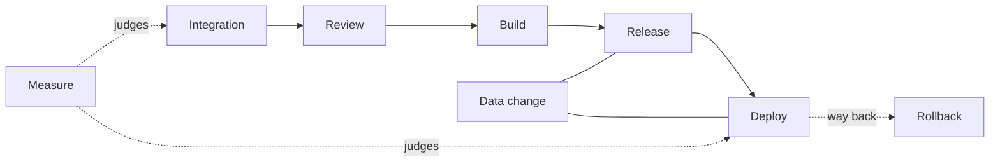

# Change Flow

Everything needed to build, deploy and restore lives in version control, and small, independently reviewed changes are integrated into one mainline. One hermetic build produces one artifact that is promoted unchanged, released and deployed progressively by the same automated process everywhere. Schema and data changes travel the same path as code, as reviewed scripts rehearsed on production-shaped data. Delivery is judged by outcomes, never by the volume of code produced. The way back is decided before a change ships, so what ships was reviewed, built once and is reversible. `CHANGE_FLOW`

Four rules hold the whole branch:

- A change MUST NOT reach production except from reviewed mainline through the one pipeline.
- The deployed artifact MUST be the one that was built.
- Every change MUST have a named way back before it ships.
- A schema or data change MUST NOT be applied as hand-typed statements.

This branch carries out the guarantees decided in [Rules Common to Every Property](assurance_rules.md#rules-common-to-every-property), [Artifact Integrity](assurance_rules.md#artifact-integrity), [Data Integrity Under Change](assurance_interfaces_data.md#data-integrity-under-change) and [Availability and Recovery](assurance_performance_availability.md#availability-and-recovery); it re-decides none of them.

Certainty: build-once, small batches and the review principles are grounded in consensus practice. Numeric defaults and much of the data-change section are inferred from a single practitioner source that public practice is read as agreeing with. Gaps that change what a reader does are shown inline as "Open".

The branch is split by section group; this file holds the thesis and the index.

- [Change Flow: Integration and Review](change_flow_integration_review.md): sections Version Control and Integration, Review
- [Change Flow: Build, Release, Deploy and Rollback](change_flow_delivery.md): sections Build and Pipeline, Release, Deployment, Rollback
- [Change Flow: Data Change and Measurement](change_flow_data_and_measure.md): sections Data and Schema Change, Measuring Delivery

## Table of Contents

1. [Map](#map) _(Lines 29-49)_

---
## Map
<!-- Lines 29-49 -->

| Section | One line |
|---|---|
| [Version Control and Integration](change_flow_integration_review.md#version-control-and-integration) | One complete repository, one mainline, small frequent attributable changes |
| [Review](change_flow_integration_review.md#review) | Independent, content-bound review, depth by risk, automation first |
| [Build and Pipeline](change_flow_delivery.md#build-and-pipeline) | Scripted hermetic build on every push, one artifact promoted unchanged |
| [Release](change_flow_delivery.md#release) | Small frequent releases, honest identifiers, flags only where needed, gates by change class |
| [Deployment](change_flow_delivery.md#deployment) | One automated process, progressive exposure, parity, replaced instances |
| [Rollback](change_flow_delivery.md#rollback) | The way back decided before shipping, compatible and reversible changes |
| [Data and Schema Change](change_flow_data_and_measure.md#data-and-schema-change) | Reviewed once-only scripts, ordered with code, rehearsed, watched |
| [Measuring Delivery](change_flow_data_and_measure.md#measuring-delivery) | Outcomes, not volume; independent baselines |
