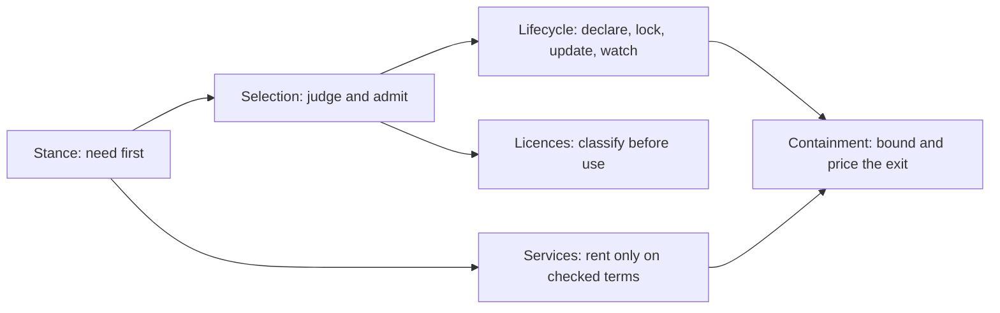

# Ownership

## Table of Contents

1. [Map](#map) _(Lines 27-47)_

---

Nothing is added by default. Each capability is written, adopted or rented through a recorded,
per-need decision, then declared, locked, watched and kept as a managed liability. Its licence
obligations are known before use, and its exit is priced in proportion to what failure would
cost. The team always knows what it depends on, why, and what leaving would cost. `OWNERSHIP`

Rules of the branch, binding on every section below:

- A dependency, layer or service MUST NOT be adopted without a recorded reason.
- An adopted artifact MUST NOT be installed from anything but the lock.
- A rented service MUST NOT be adopted without a tested way out proportional to its criticality.

Certainty: the lifecycle, licence-reading and rented-service mechanics are grounded; the scaling
of effort by criticality is inferred. Four points are open and are marked where they occur
(containment of runtime effect, API stability in practice, vendor assurance reports, the
copyleft linking boundary).

## Map
<!-- Lines 27-47 -->

| Section | What it settles |
|---|---|
| [Necessity and Default Stance](ownership_stance_selection.md#necessity-and-default-stance) | whether to add at all, and whether to write, adopt or rent |
| [Finding, Profiling and Selecting](ownership_stance_selection.md#finding-profiling-and-selecting) | how a candidate is judged and admitted |
| [Dependency Lifecycle](ownership_lifecycle_containment.md#dependency-lifecycle) | declaring, locking, updating, sourcing and watching |
| [Containment and Exit](ownership_lifecycle_containment.md#containment-and-exit) | how much reversibility to buy and how to isolate a dependency |
| [External Services](ownership_services_licence.md#external-services) | what to check before renting a service |
| [Licences](ownership_services_licence.md#licences) | reading, classifying and declaring licences |

Files: [ownership_stance_selection.md](ownership_stance_selection.md), [ownership_lifecycle_containment.md](ownership_lifecycle_containment.md), [ownership_services_licence.md](ownership_services_licence.md).
