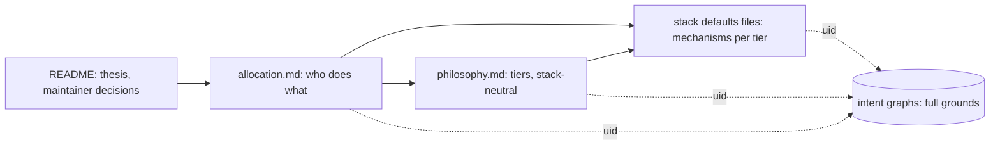

# Web Architecture Guidelines

Architecture decisions for a web application built on JavaScript, Python and Postgres: who does what across database, backends and browsers, then how each tier carries its share. The markdown files are a projection of two IntentGraphs, which hold the full grounds of every decision.

## Table of Contents

1. [What This Is](#what-this-is) _(Lines 19-23)_
1. [Thesis](#thesis) _(Lines 26-47)_
1. [How to Read](#how-to-read) _(Lines 50-73)_
1. [Maintainer Decisions](#maintainer-decisions) _(Lines 76-99)_
1. [The Two Graphs](#the-two-graphs) _(Lines 102-124)_
1. [Provenance](#provenance) _(Lines 127-131)_
1. [Related Guidelines](#related-guidelines) _(Lines 134-138)_

---

## What This Is
<!-- Lines 19-23 -->

- **Is**: a set of decisions between competing practices, each chosen as the best practice for its purpose (never the average of what sources say, and "best" is not "most demanding"), and each rejected alternative kept with the condition under which it would win. A stack-neutral philosophy, plus stack defaults for Postgres, Python and browser JavaScript.
- **Is not**: code-level conventions (see [Related Guidelines](#related-guidelines)), a survey of what sources say, or a tutorial.
- **Default context**: a classic website (documents, forms, CRUD), one team, single tenant, humans and agents as users, and a database shared by several backends and by reporting, admin consoles and scripts. A project that differs moves [placements](glossary.md#placement) in the directions listed in [Context](allocation.md#context).

## Thesis
<!-- Lines 26-47 -->

Who does what across database, backend and browser is decided first, per responsibility, from stated forces, context and rules; each tier then carries out the share it is given. The allocation, in three lines:

1. The **database** is the [authority](glossary.md#authority) for the truth of stored data and for everything that must hold whoever touches it: invariants, multi-table operations and state transitions behind a [function API](glossary.md#function-api), [per-user write rules](glossary.md#per-user-rule), per-role privileges, audit.
2. Each **backend** is the authority for product policy not stored in the data, its users' identity and its workflows.
3. **Browsers and agent clients** are the authority for nothing durable: they hold views, ephemeral state and copies for feedback and latency.

Interface descriptions stay in sync with the implementation by process, and per-user read visibility follows the sensitivity of the read: simple reads are written by each backend, sensitive or shared reads go through database functions. The [Maintainer Decisions](#maintainer-decisions) override any other source on their point.



The thesis renders the root of both graphs. `ROOT`

## How to Read
<!-- Lines 50-73 -->

| Question | File |
|---|---|
| Where does a responsibility go: which tier decides, which copies are allowed, what would move it? | [allocation.md](allocation.md#allocation-matrix), the allocation matrix first |
| Which forces, context variables and rules decide a placement? | [allocation.md](allocation.md#forces): Forces, Context, Rules |
| What does each tier do, independent of the stack? | [philosophy.md](philosophy.md#durable-data) |
| Which Postgres mechanism realizes the data tier? | [stack_defaults_data.md](stack_defaults_data.md#data-tier-overview) |
| How does the Python backend secure entry: access control, sessions, [CSRF](glossary.md#csrf), login, limits? | [stack_defaults_logic_security.md](stack_defaults_logic_security.md#backend-security-overview) |
| How is the Python backend built: use cases, transactions, jobs, files, HTTP interface? | [stack_defaults_logic.md](stack_defaults_logic.md#python-tier-overview) |
| How do browsers work with the data: rendering, editing, real time, comments? | [stack_defaults_interaction.md](stack_defaults_interaction.md#browser-surface-overview) |
| How do AI agents use the application: protocol, delegation, approval, limits? | [stack_defaults_agents.md](stack_defaults_agents.md#agent-surface-overview) |
| Security, performance, contracts, operations, topology, evolution on this stack? | [stack_defaults_transverse.md](stack_defaults_transverse.md#transverse-overview) |
| What does a term or acronym mean? | [glossary.md](glossary.md) |
| Why was a choice made, and what else was considered? | the graph node named by the section's uid ([The Two Graphs](#the-two-graphs)) |

Conventions in every file:

- Each section ends with its graph uid in code font, for example `ALLOCATION.GUARD.3`; a section that refines another links it.
- **Acceptable when** names the condition under which a rejected alternative wins; **Changes when** names what would move the decision.
- **Open** marks a value or choice left to each project or to measurement.
- **(inferred)** after a clause marks a rule the guideline derives rather than reads from a source: a synthesis, an inference, or a single weak source. **Gap** marks a missing source or rule, **Tension recorded** a [maintainer decision](glossary.md#maintainer-decision) that overrides research evidence, **Departs from the maintainer's practice** a rule that overrides the maintainer's own codified practice, and **Deferred** a topic recorded but not decided.
- The markers cover the clauses a reader acts on; the uid's node holds the full epistemic state of every clause.
- The first use of a defined term in each file links to the [glossary](glossary.md).

## Maintainer Decisions
<!-- Lines 76-99 -->

Ten maintainer decisions are in force and override any other source on their point; they are recorded, in this order, in the [maintainer decisions](build/distill/maintainer_decisions.md). No maintainer question remains open.

1. **[Row-level security](glossary.md#row-level-security) is not a default.** Postgres row-level security is acceptable only when the data model is simple, the scoping key (client, tenant or owner id) is present in every table the policy covers, in practice composite primary keys led by that key, and no all-powerful administrator role must cross scopes. Authorization stays a backend decision, with per-role database privileges as the second gate and [writer functions](glossary.md#writer-function) for per-user write rules. See [Row Security Placement](allocation.md#row-security-placement). `PIG-WEB-ALLOCATION.ROW_SECURITY`
2. **Interface descriptions are always in sync; the origin is chosen per project.** Every description [consumers](glossary.md#consumer) read (HTTP, function API catalogue, agent tool surface) stays in sync with the implementation by process: one origin per fact, the other side generated or conformance-checked, a CI gate that fails on drift. Whether the description or the code originates is recorded per project, with criteria for each direction. See [Type and Contract Definitions](allocation.md#type-and-contract-definitions). `ALLOCATION.RECORD.3`
3. **The database is shared by default.** Several backends, reporting, admin consoles and scripts use it, so multi-table operations, state transitions and everything that must hold whoever touches the data belong to the database, behind a function API with one role per consumer. See [Context](allocation.md#context). `ALLOCATION.CONTEXT`
4. **Deletion is a per-table choice; the default is basic soft delete.** Each table's strategy is weighed on the data's importance, whether it can be rebuilt, how often it changes and its business value. The default is a `deleted_at` column with no change to the primary key, which every consumer excludes. Hard delete with a same-transaction archive becomes the case for some caches and for data consumers must be unable to reach; its cost is keeping two schemas in sync. Foreign keys are required in every case, and full-history soft delete is maintained by database functions or triggers. See [Deletion, Retention and Partitioning](stack_defaults_data.md#deletion-retention-and-partitioning). `PIG-WEB-DATA.MAINTAIN.2`
5. **Simple reads direct; sensitive or complex reads through database functions.** Each backend writes reads that carry no logic (a basic select, a few joins) itself. A read that is sensitive, complex, high-impact, built by a function or shared by several backends goes through a database function. Per-user visibility rules ("a draft is visible only to its author") are [sensitive reads](glossary.md#sensitive-read), so they go through read functions that receive the verified [actor](glossary.md#actor). The reporting role reads comment content and narrower-audience comments only through those functions; the operator role sees every row. See [Authorization](allocation.md#authorization). `ALLOCATION.GUARD.3`
6. **Hosting is chosen per project.** A prototype takes the fastest path that is secure; an orchestration platform is added when reliability and scaling are needed. The self-managed defaults (a process manager per host, the proxy serving static files, a file fallback for secrets until a managed store is added) are one acceptable route, and each affected section names what changes on an orchestrator. See [Process Placement](stack_defaults_transverse.md#process-placement). `PIG-WEB-TRANSVERSE.TOPOLOGY.3`
7. **The session cookie is `SameSite=Lax` plus a navigation check.** `Lax` keeps users logged in when they arrive from another site's link. A check of the browser's [Fetch Metadata](glossary.md#fetch-metadata) headers refuses or redirects cross-site navigations to authenticated pages not declared as entry points, which closes what `Lax` lets an attacker's page open. `Strict` applies to operator consoles and other applications never entered from other sites' links. See [Sessions](stack_defaults_logic_security.md#sessions). `PIG-WEB-LOGIC.SECURE.2`

8. **"Best" means the best practice for the purpose, not the most demanding one.** Each decision takes the position the strongest arguments establish for the node's purpose: never the average or most common practice, never a blend, and not the strictest option because it is strict. This is the selection rule stated in [What This Is](#what-this-is); the judges worked under the earlier "most demanding" wording, so their verdicts were re-audited (decision 9).
9. **Seven verdicts corrected under that rule.** Where strictness rather than fitness for purpose had decided:
   - [MFA](glossary.md#mfa) is offered on every human account and required on privileged accounts and at step-up; requiring it everywhere follows the project's risk level ([Secured Entry](philosophy.md#secured-entry), [Passwords and Login Throttling](stack_defaults_logic_security.md#passwords-and-login-throttling)).
   - For client-named fetches the safe fetch helper is required; a network guard is preferred, and required only when the server's network holds internal services or a token-less metadata endpoint ([Server-Side Fetch](stack_defaults_logic_security.md#server-side-fetch)).
   - Agent tokens are sender-constrained wherever the client can hold a key; a bearer-only client reaches consequential operations only through the owner's exact-action approval ([Identity and Delegation](stack_defaults_agents.md#identity-and-delegation)).
   - A dependency a Boyce-Codd decomposition would lose is kept in third normal form and enforced by a composite foreign key, with a trigger only where no declarative form exists ([Organized Facts](philosophy.md#organized-facts)).
   - Work is deferred when it is expected to exceed a few seconds or the request timeout; 1 s stays the interactive target, not the deferral cut-off ([Deferred and Scheduled Work](allocation.md#deferred-and-scheduled-work)).
   - Keyset paging is used for structured-data and agent interfaces and for large or growing sets; offset with page numbers is acceptable for a human HTML list over a bounded result ([Filtering, Sorting, Paging and Search](allocation.md#filtering-sorting-paging-and-search)).
   - Threat models are kept per critical flow and trust boundary and revisited when a placement on the flow changes ([Security Across Tiers](philosophy.md#security-across-tiers)).
10. **The web guideline follows the [software development guidelines](../software_development_guidelines/README.md) where both decide a principle.** Ten positions were aligned, keeping the stack realization: secrets come from a managed store, an environment variable being a recorded exception; hardened builds ([SLSA](glossary.md#slsa) Build L3) are chosen by risk, not by default; a server-side fetch uses an allowlist where the hosts are known; recovery follows per-workload objectives, with a copy out of reach of production credentials and automated restore tests; circuit breakers guard only slow or shared dependencies; the JSON interface is versioned by consumer reach; a deployable is split only for a named force; a new technology replaces an older one on a plan; an accepted decision record may be corrected without changing its decision; an [ASVS](glossary.md#asvs) level is paired with outcome measures. Decisions 4 and 5 stand unchanged, and the software guideline is asked to scope its own rules on them. Incident response, personal data erasure and high availability stay deferred here and point to the software guideline; a missing rollback rule is recorded as a gap only. See [Maintainer decisions](build/distill/maintainer_decisions.md#md-10-alignment-with-the-software-development-guideline).

The six departures from the maintainer's codified practice (CHECK constraints and triggers required, not optional; 8-byte keys by default; no `updated_at` on append-only tables; a trigger-written `updated_at`; a declared parent link for hierarchies; "[deployed together](glossary.md#deployed-together)" narrowed to the same-deployment condition) stand as judged, and each is marked "Departs from the maintainer's practice" where it appears.

## The Two Graphs
<!-- Lines 102-124 -->

The graphs in `intent_graphs/` are the source of truth; these files are their projection. Change a graph first, then re-render the file.

| File | Content | Uids |
|---|---|---|
| `intent_graphs/web_app_philosophy.ig.yaml` | stack-neutral philosophy, 80 nodes: allocation, data, logic, interaction, transverse | `ROOT`, `ALLOCATION.*`, `DATA.*`, `LOGIC.*`, `INTERACTION.*`, `TRANSVERSE.*` |
| `intent_graphs/web_defaults.ig.yaml` | stack projection for JavaScript, Python and Postgres, 132 nodes | `ROOT`, `PIG-WEB-*` |
| `intent_graphs/intent_resources.yaml` | manifest linking both graphs and the philosophy graphs of the Python and software development guidelines | |

Each node carries its intent, the constraints a reader acts on, an epistemic state (known, inferred or unvalidated, undecided, conflict, gap), design notes (positions considered, forces, decision, alternatives with the condition under which each wins) and pointers into `build/`. Query one node at a time; never load a graph file whole, since each runs to thousands of lines:

```bash
ig-tool tree  -g intent_graphs/web_app_philosophy.ig.yaml                       # structure
ig-tool query -g intent_graphs/web_app_philosophy.ig.yaml --node ALLOCATION.GUARD.3
ig-tool query -g intent_graphs/web_defaults.ig.yaml --children PIG-WEB-DATA
ig-tool query -g intent_graphs/web_defaults.ig.yaml --projection-links PIG-WEB-ALLOCATION.DB_API
ig-tool validate -g intent_graphs/web_defaults.ig.yaml -m intent_graphs/intent_resources.yaml
```

Both graphs have a `ROOT`; every `PIG-WEB-*` uid lives in `web_defaults.ig.yaml`, every other uid in `web_app_philosophy.ig.yaml`. Tool guide: [PRIMER_TOOLS.md](../../../intent_graph/agents/PRIMER_TOOLS.md) ([GitHub](https://github.com/intent-graph/intent_graph/blob/main/agents/PRIMER_TOOLS.md)).

To browse both graphs in Obsidian, run `./intent_graphs/export_to_obsidian.sh` and open `intent_graphs/obsidian_export/` as a vault: one note per node, one folder per graph, canvases per branch ([obsidian_export/README.md](intent_graphs/obsidian_export/README.md)).

## Provenance
<!-- Lines 127-131 -->

- [build/RECIPE.md](build/RECIPE.md): how this guideline was built (research, consolidation, maintainer-fixed hierarchy, judging allocation first, adversarial review, graph build, critique), and how to build a sibling guideline the same way.
- `build/research/`: the evidence, gathered by area from tiered sources.
- `build/distill/`: the claims ledger, the skeleton, the judge records and their reviews, the [maintainer decisions](build/distill/maintainer_decisions.md), the graph batches, the critique and its fixes.

## Related Guidelines
<!-- Lines 134-138 -->

- [Software development guidelines](../software_development_guidelines/README.md): the stack-neutral principles (ownership, assurance, construction, change flow, operation, evolution, transverse) that this guideline applies to a web stack; a node that applies one carries an inter link to its graph and a "Principle:" pointer in its section.
- [Python guidelines](../python_guidelines/): Python code conventions; shared principles link to its philosophy graph.
- [JavaScript guidelines](../javascript_guidelines/README.md): JavaScript code conventions and language-level practice.
- [Documentation standard](../../documentation_tools/DOCUMENTATION_STANDARD.md): the format of these files.
